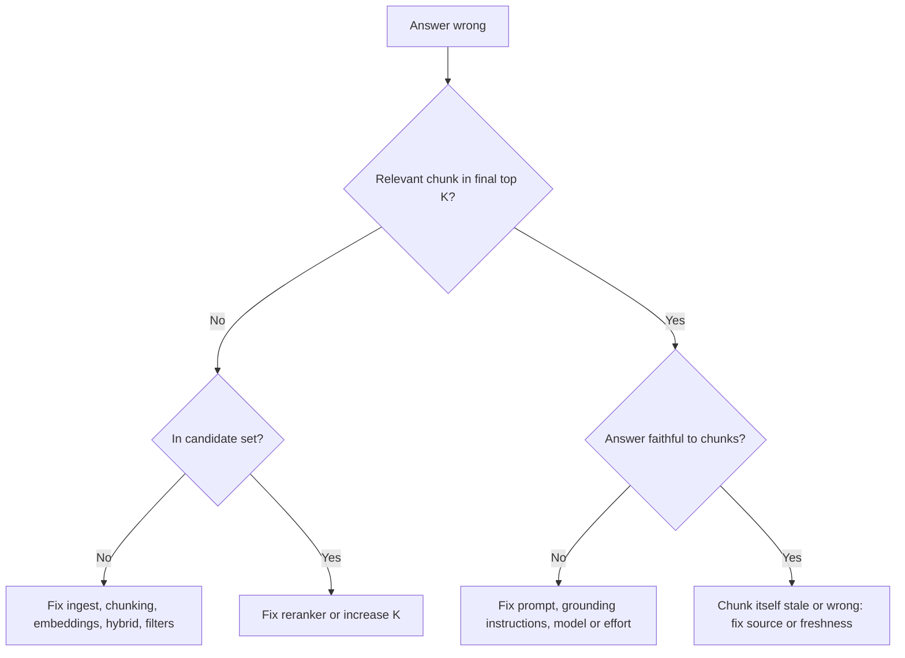

# RAG Evaluation

> **Level:** Advanced · **Time:** ~35 min · **Exam relevance:** CCAR-P D4 (4.1, 4.2, 4.4), CCAR-P D3 (3.5, 3.6)

## In plain English

A RAG system can fail in two places: it can fetch the wrong pages, or it can read the right pages and still answer
badly. Evaluating RAG means measuring those two halves separately, so that when the overall answer is wrong you know
whether to fix the librarian (retrieval) or the writer (generation).

## Why it matters

- Without separate metrics, teams tune prompts for weeks when the real problem is that the answer was never retrieved.
- Every design choice on the previous pages (chunk size, embedding model, hybrid weights, K, reranker) is a hypothesis.
  Evaluation turns it into evidence.
- Index refreshes, model upgrades and prompt changes all risk regressions. A repeatable evaluation set is your safety net.

Defining metrics is objective CCAR-P-4.1, building datasets is CCAR-P-4.2, and diagnosing hallucination and failure is
CCAR-P-4.4 (see the [registry](../16-certification-tracks/registry.yaml)). Module 14 covers evaluation in general;
this page focuses on what is specific to RAG.

## How it works

### The evaluation dataset

Each test case needs:

| Field | Purpose |
|---|---|
| `question` | Realistic user phrasing, including typos, acronyms and vague wording |
| `relevant_chunk_ids` (or doc IDs) | Ground truth for retrieval metrics |
| `reference_answer` or key facts | Ground truth for correctness |
| `answerable` | `false` for questions the corpus cannot answer, to test abstention |
| `tags` | Query type (lookup, explanation, comparison, aggregation), product, language, difficulty |
| `user_context` | Role or tenant, to test access filters |

Sources for questions: real (anonymised) query logs, subject-matter experts, support tickets, and model-generated
questions that a human reviews. Start small (tens of carefully labelled cases catch large problems), then grow towards
hundreds, weighted to match production traffic. Include adversarial cases: questions about withdrawn policies, near-
duplicate documents, questions where the answer spans two sections, and unanswerable questions.

Labelling relevant chunks ties the dataset to a chunking configuration. Labelling at document or section level and
mapping to chunks makes the set survive re-chunking.

### Retrieval metrics

Computed per query and averaged, without any model call:

| Metric | Definition | Use it to answer |
|---|---|---|
| **Recall@K** | Fraction of relevant chunks that appear in the top K | "Is the answer even reaching the model?" The most important RAG metric |
| **Hit rate@K** | Fraction of queries with at least one relevant chunk in the top K | A simpler version of recall for single-answer questions |
| **Precision@K** | Fraction of the top K that are relevant | "How much noise are we sending?" |
| **MRR** (mean reciprocal rank) | Average of 1 / rank of the first relevant result | "How high does the first good result appear?" |
| **nDCG@K** | Rank-weighted relevance, normalised to the ideal ordering | Comparing rerankers when there are graded relevance labels |

Measure recall at the candidate stage (before reranking, for example K = 100) and at the final stage (after reranking,
for example K = 8). The gap tells you whether to fix first-stage retrieval or the reranker.

### Generation metrics

Need a judge: a human, code checks, or a model acting as a grader.

| Metric | Question the judge answers |
|---|---|
| **Faithfulness / groundedness** | Is every claim supported by the retrieved passages? |
| **Answer correctness** | Does the answer match the reference answer or key facts? |
| **Answer relevance** | Does it address the question asked, without padding? |
| **Citation accuracy** | Do the citations support the sentences they are attached to? |
| **Abstention accuracy** | For unanswerable questions, did it say so rather than invent an answer? |
| **Completeness** | For multi-part questions, are all parts addressed? |

Faithfulness and correctness are different. An answer can be faithful to a stale retrieved passage and still be wrong;
an answer can be correct from general knowledge but unsupported by the sources, which is still a grounding failure.

### System metrics

Latency per stage (retrieval, rerank, generation) and end to end, cost per answered query, index freshness lag, and
the rate of "not found" responses. Track them alongside quality, because an improvement that triples latency may break
an SLA.

### Diagnosing with the two halves



### LLM-as-judge, carefully

A model grader scales generation evaluation, but it needs the same rigour as any measurement:

- Give the judge a rubric with explicit criteria and a constrained output (structured outputs), not a free-form opinion.
- Judge one criterion per call when criteria interact, and ask for the supporting evidence before the verdict.
- Calibrate the judge against a human-labelled sample and report agreement. Re-check after changing the judge model.
- Use a different prompt (ideally a different configuration) from the system under test, to reduce shared blind spots.

### Running it

- Run the full suite on every change to chunking, embeddings, retrieval, prompts, model or effort level.
- Compare against a baseline and look at per-tag breakdowns, not just the average: a gain on lookups can hide a loss
  on aggregation questions.
- In production, sample live traffic for faithfulness grading and collect user feedback; feed failures back into the set.

## Example

Retrieval metrics in pure Python, plus a faithfulness judge using structured outputs.

```python
"""RAG evaluation: retrieval metrics (offline) + faithfulness judge (live)."""
from __future__ import annotations

def recall_at_k(retrieved: list[str], relevant: set[str], k: int) -> float:
    return len(set(retrieved[:k]) & relevant) / len(relevant) if relevant else 0.0

def precision_at_k(retrieved: list[str], relevant: set[str], k: int) -> float:
    top = retrieved[:k]
    return len(set(top) & relevant) / len(top) if top else 0.0

def reciprocal_rank(retrieved: list[str], relevant: set[str]) -> float:
    for rank, cid in enumerate(retrieved, start=1):
        if cid in relevant:
            return 1 / rank
    return 0.0

CASES = [  # synthetic results from a retriever run
    {"q": "hotel cap tier-1", "relevant": {"travel-3a"}, "retrieved": ["travel-3a", "travel-5b", "it-4"]},
    {"q": "lost laptop deadline", "relevant": {"it-4"}, "retrieved": ["travel-5b", "it-4", "travel-3a"]},
    {"q": "business class rule", "relevant": {"travel-2a"}, "retrieved": ["travel-5b", "it-4", "hr-9"]},
]

K = 2
n = len(CASES)
print(f"recall@{K}:    {sum(recall_at_k(c['retrieved'], c['relevant'], K) for c in CASES) / n:.2f}")
print(f"precision@{K}: {sum(precision_at_k(c['retrieved'], c['relevant'], K) for c in CASES) / n:.2f}")
print(f"MRR:          {sum(reciprocal_rank(c['retrieved'], c['relevant']) for c in CASES) / n:.2f}")
misses = [c["q"] for c in CASES if not set(c["retrieved"][:K]) & c["relevant"]]
print("retrieval misses (fix retrieval, not the prompt):", misses)
```

A faithfulness judge. Structured outputs guarantee a parseable verdict.

> **Cost:** requires API credits (live mode).

```python
import json
import anthropic

client = anthropic.Anthropic()  # reads ANTHROPIC_API_KEY

VERDICT_SCHEMA = {
    "type": "object",
    "properties": {
        "unsupported_claims": {"type": "array", "items": {"type": "string"}},
        "verdict": {"type": "string", "enum": ["faithful", "partially_faithful", "unfaithful"]},
    },
    "required": ["unsupported_claims", "verdict"],
    "additionalProperties": False,
}

def judge_faithfulness(passages: list[str], answer: str) -> dict:
    response = client.messages.create(
        model="claude-opus-5-5",
        max_tokens=2048,
        system=("You are a strict evaluator. List every factual claim in the answer that is not directly "
                "supported by the passages, then give a verdict. Ignore style."),
        messages=[{"role": "user", "content": (
            "<passages>\n" + "\n---\n".join(passages) + "\n</passages>\n"
            f"<answer>\n{answer}\n</answer>"
        )}],
        output_config={"format": {"type": "json_schema", "schema": VERDICT_SCHEMA}},
    )
    if response.stop_reason != "end_turn":
        raise RuntimeError(f"Judge did not finish: {response.stop_reason}")
    return json.loads(next(b.text for b in response.content if b.type == "text"))

# Example:
# judge_faithfulness(["Hotel cap is 180 EUR in tier-1 cities."],
#                    "The cap is 180 EUR in tier-1 cities, and breakfast is always included.")
# -> {"unsupported_claims": ["breakfast is always included"], "verdict": "partially_faithful"}
```

## Enterprise use case

*Northwind Lending* planned to switch embedding models to cut cost. Their evaluation set had 420 cases tagged by
product and query type, including 60 unanswerable questions.

| Metric | Current | Candidate |
|---|---|---|
| Candidate recall@100 | 0.97 | 0.96 |
| Final recall@8 (after rerank) | 0.91 | 0.84 |
| Faithfulness (judge, human-calibrated) | 0.95 | 0.94 |
| Correct abstention on unanswerable | 0.88 | 0.87 |
| Embedding cost per month | baseline | -40% |

The per-tag breakdown showed the recall drop came almost entirely from questions containing loan product codes. The
team kept the cheaper model but added BM25 hybrid retrieval, which restored final recall to 0.92 at lower total cost.
The numbers here are synthetic, but the method (separate stages, per-tag breakdowns, a decision recorded with evidence)
is the point.

## Common mistakes

- **Only measuring end-to-end answer quality,** so you cannot tell which half failed.
- **No unanswerable questions in the set,** so hallucination under missing knowledge is never measured.
- **Evaluating on questions written by the people who wrote the documents,** which share their vocabulary and
  overstate recall.
- **Trusting an uncalibrated LLM judge.**
- **Reporting only averages,** hiding regressions on important slices.
- **Letting the evaluation set go stale** while the corpus changes.

## Security considerations

- **Evaluation sets contain sensitive questions and answers.** Anonymise production queries before adding them, and
  store the set under the same controls as the corpus.
- **Test access control as a metric.** Include cases where the user must not see a relevant document; any retrieval of
  it is a severity-one failure regardless of answer quality.
- **Include injection cases.** Plant documents with embedded instructions in a test index and measure whether the system
  follows them. See [safety and red-team evals](../14-evaluation-and-testing/07-safety-and-red-team-evals.md).

## Troubleshooting

| Symptom | Likely cause | Fix |
|---|---|---|
| High recall, low faithfulness | Generation ignoring sources | Strengthen grounding instructions, enable citations, check effort level |
| Low candidate recall | Ingest, chunking or embedding problems | Inspect missed cases one by one |
| Candidate recall fine, final recall low | Reranker or K too small | Tune reranker, raise K |
| Judge scores fluctuate between runs | Vague rubric | Tighter rubric, evidence before verdict, structured outputs |
| Offline scores good, users unhappy | Dataset does not match real traffic | Sample real queries, reweight tags |

## Check your understanding

1. Why measure recall at both the candidate stage and the final stage?
2. What is the difference between faithfulness and correctness?
3. Why must an evaluation set include unanswerable questions?
4. Name two practices that make an LLM-as-judge trustworthy.

<details>
<summary>Answers</summary>

1. The gap shows whether failures come from first-stage retrieval (the chunk was never found) or from reranking and K
   (found but dropped).
2. Faithfulness is whether claims are supported by the retrieved passages; correctness is whether the answer is actually
   right. A faithful answer can be wrong if the passage is stale; a correct answer can be unfaithful if it relies on
   unsupported knowledge.
3. To measure abstention: whether the system says it does not know instead of inventing an answer.
4. Any two: an explicit rubric with structured output, evidence before verdict, calibration against human labels,
   separate prompts or configuration from the system under test, one criterion per call where needed.

</details>

## Further reading

- Claude docs, [Define success criteria and build evaluations](https://platform.claude.com/docs/en/test-and-evaluate/develop-tests).
- Anthropic, [Contextual Retrieval](https://www.anthropic.com/news/contextual-retrieval) (shows retrieval-failure-rate
  measurement in practice).
- In this repository: [Module 14 metrics](../14-evaluation-and-testing/02-metrics.md),
  [building eval datasets](../14-evaluation-and-testing/03-building-eval-datasets.md),
  [lab-16 evaluation framework](../19-hands-on-labs/lab-16-evaluation-framework/README.md).

<!-- page-nav:start -->
---

[← Previous: Grounding and Citations](05-grounding-and-citations.md) · [Module overview](README.md) · [Next: RAG vs Long Context vs Agentic Search →](07-rag-vs-long-context.md)
<!-- page-nav:end -->
