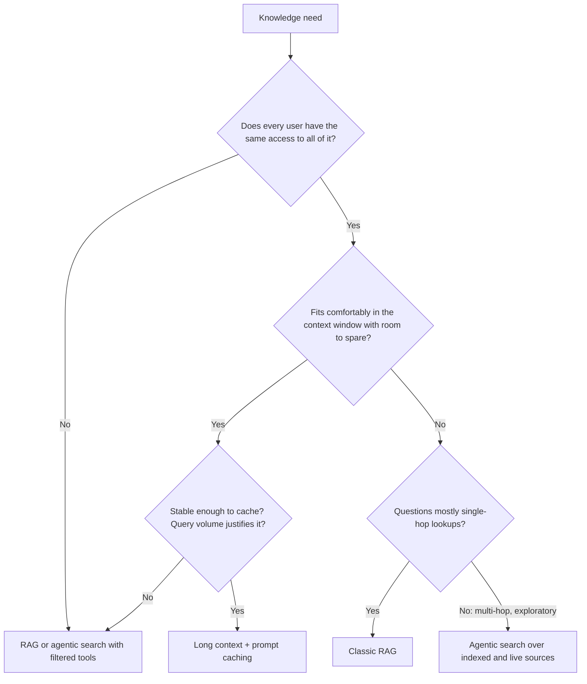

# RAG vs Long Context vs Agentic Search

> **Level:** Advanced · **Time:** ~30 min · **Exam relevance:** CCAR-P D3 (3.6, 3.8, 3.3), CCAR-P D1 (1.3)

## In plain English

There are three ways to give Claude the knowledge it needs:

1. **Long context:** hand over the whole binder. Claude reads everything every time.
2. **RAG:** a librarian picks the few most relevant pages before Claude reads anything.
3. **Agentic search:** give Claude a search tool and let it look things up itself, as many times as it needs, deciding
   what to read next based on what it found.

None is always best. The right choice depends on how big the knowledge is, how often it changes, how questions are
asked, and what latency, cost and audit constraints you have.

## Why it matters

Current Claude models have large context windows (as of 2026-10-24, Claude Opus 5.5, Sonnet 5.5 and Haiku 5.5 list a
1M-token context window; check the [models overview](https://platform.claude.com/docs/en/models/overview)
for current figures). That changes the economics: many corpora that once needed RAG now fit in a single prompt, and
prompt caching makes re-sending them affordable. At the same time, agentic search lets Claude handle open-ended
investigations that a single retrieval pass cannot.

Choosing well is objective CCAR-P-3.6 (retrieval matched to data and queries) and CCAR-P-3.8 (progressive discovery
versus monolithic context), with accuracy–latency trade-offs under CCAR-P-3.3 (see the
[registry](../16-certification-tracks/registry.yaml)).

## How it works

### Long context with prompt caching

Put the entire knowledge base in the prompt, stable content first, with a cache breakpoint after it. The first request
writes the cache; later requests within the cache lifetime read it at a fraction of the normal input price and with
lower latency. See [prompt caching](../04-context-engineering/03-prompt-caching.md).

Anthropic's [Contextual Retrieval](https://www.anthropic.com/news/contextual-retrieval) article (September 2024)
suggests that if a knowledge base is smaller than about 200,000 tokens, you can include all of it in the prompt and
skip RAG. Context windows have grown since then; the principle, "if it fits comfortably and caches well, try it first",
still holds, but measure quality and cost at your size.

Strengths: no retrieval pipeline to build or maintain; no recall failures from chunking or embeddings; Claude sees
cross-document relationships. Weaknesses: per-request token volume grows with the corpus, cache misses are expensive,
time to first token rises with very long prompts, every user must be allowed to see everything in the prompt, and
answer quality can degrade when the relevant detail is a small needle in a very large haystack.

> **Unverified:** Exactly how retrieval accuracy within a very long context varies with length and position for current
> models. Anthropic does not publish a single figure for this; test it on your own documents.

### Classic RAG

Covered in pages [1](01-rag-fundamentals.md)–[6](06-rag-evaluation.md). One retrieval pass, a focused set of passages,
one generation call. Strengths: scales to any corpus size, low and predictable per-request tokens, per-user access
filtering at retrieval time, clear audit of what was shown. Weaknesses: an indexing pipeline to build and run, and
answers are capped by retrieval recall in a single pass.

### Agentic search

Give Claude one or more search tools (keyword search, vector search, file grep, SQL query tools, web search) in an
agent loop. Claude issues a query, reads results, refines, follows references and stops when it has enough. Return
results as `search_result` blocks to get citations (see [grounding and citations](05-grounding-and-citations.md)).
Coding agents are a familiar example: the Claude Agent SDK, for instance, ships built-in `Glob`, `Grep` and `Read`
tools that let an agent explore a codebase step by step.

Strengths: handles multi-hop questions ("which contracts renewed after the supplier changed its parent company?"),
adapts the query when the first attempt misses, and can combine sources. Weaknesses: more model calls, higher and less
predictable latency and cost, harder to evaluate, and more surface for tool misuse. It also needs loop limits and the
reliability controls in [agent reliability](../10-agentic-ai/07-agent-reliability.md).

This is progressive discovery applied to knowledge: rather than loading everything up front (monolithic context),
Claude pulls in what it needs as it goes. See [progressive disclosure and skills](../04-context-engineering/06-progressive-disclosure-and-skills.md).

### Comparison

| Factor | Long context + caching | Classic RAG | Agentic search |
|---|---|---|---|
| Corpus size | Fits comfortably in the window | Any | Any |
| Build effort | Lowest | Medium to high (pipeline) | Medium (tools + loop) |
| Per-request tokens | High (mostly cached) | Low | Variable, often highest |
| Latency | Medium, rises with size | Low | Highest and variable |
| Multi-hop questions | Good | Weak in a single pass | Strong |
| Per-user access control | Hard: everything in the prompt is visible | Strong: filter at retrieval | Strong if tools enforce it |
| Freshness | Rebuild the prompt (cache resets) | Incremental index updates | Tools query live sources |
| Auditability | Whole corpus "shown" | Exact passages logged | Full tool trace logged |
| Typical failure | Detail missed in a huge prompt; cost on cache misses | Relevant chunk not retrieved | Loops, over-searching, drift |

### A decision path



### Hybrids are normal

- **RAG then long context:** retrieve whole relevant documents (not small chunks) and let Claude read them fully.
- **Agentic RAG:** the agent's search tool *is* your hybrid retrieval pipeline, so you keep reranking and filters but gain
  multi-hop refinement.
- **Cached core plus retrieval:** a cached "always relevant" core (product catalogue, glossary) plus retrieval for the
  long tail.
- **Routing:** a cheap classifier sends simple lookups to classic RAG and complex research questions to an agent.

## Example

A routing sketch that applies the decision path in code. It estimates corpus size with the token counting endpoint and
uses structured outputs for the query-complexity classification.

> **Cost:** requires API credits (live mode). Token counting is free to call but rate limited.

```python
"""Choose a knowledge strategy per corpus and per query."""
import json
import anthropic

client = anthropic.Anthropic()  # reads ANTHROPIC_API_KEY
MODEL = "claude-opus-5-5"
CONTEXT_BUDGET = 400_000  # leave generous headroom below the model's window for instructions and output

def corpus_tokens(corpus_text: str) -> int:
    count = client.messages.count_tokens(
        model=MODEL, messages=[{"role": "user", "content": corpus_text}]
    )
    return count.input_tokens

def corpus_strategy(corpus_text: str, uniform_access: bool, stable: bool) -> str:
    if not uniform_access:
        return "rag"
    if corpus_tokens(corpus_text) <= CONTEXT_BUDGET and stable:
        return "long_context_cached"
    return "rag"

def query_route(question: str) -> str:
    response = client.messages.create(
        model="claude-haiku-5-5",  # a fast model is enough for routing
        max_tokens=256,
        system=("Classify the question. 'lookup' = answerable from one passage. "
                "'multi_hop' = needs combining several facts or following references."),
        messages=[{"role": "user", "content": question}],
        output_config={"format": {"type": "json_schema", "schema": {
            "type": "object",
            "properties": {"kind": {"type": "string", "enum": ["lookup", "multi_hop"]}},
            "required": ["kind"], "additionalProperties": False,
        }}},
    )
    if response.stop_reason != "end_turn":
        return "classic_rag"  # safe default
    kind = json.loads(next(b.text for b in response.content if b.type == "text"))["kind"]
    return "agentic_search" if kind == "multi_hop" else "classic_rag"
```

## Enterprise use case

*Litware Legal* (fictional) has three knowledge needs:

1. **Firm style guide and clause library:** 120,000 tokens, changes monthly, everyone may read it, used in every
   drafting session. Decision: **long context with prompt caching.** No pipeline to maintain, and drafts can draw on
   cross-references between clauses.
2. **Matter documents:** millions of pages, strict per-matter access rights. Decision: **classic RAG** with hybrid
   retrieval and a mandatory matter-ID filter from the user's entitlements, citations on every answer.
3. **Due-diligence research questions** such as "which of the target's suppliers have change-of-control clauses that
   trigger on this deal?" Decision: **agentic search** over the matter index plus a contracts-metadata SQL tool, with a
   step budget, human review of findings, and full tool-call logging.

The architecture decision records for each explain the rejected alternatives, for example that long context was
rejected for matter documents because access rights differ per matter, not because of size alone.

## Common mistakes

- **Building RAG for a small, stable corpus** that would fit and cache well in the context window.
- **Putting everything in context when users have different permissions.** Prompt contents are visible to the model and
  can surface in answers.
- **Placing volatile content before the cached corpus,** which breaks the cache prefix on every request.
- **Defaulting to agents for simple lookups,** paying several calls of latency and cost for a one-hop answer.
- **No loop limits on agentic search,** leading to runaway tool calls.
- **Comparing approaches by intuition** instead of on the same evaluation set with the same metrics.

## Security considerations

- **Long context and data minimisation pull in opposite directions.** Sending everything on every request maximises
  exposure; ensure that is acceptable for the data classification.
- **Agentic search widens the tool surface.** Each search tool must enforce the caller's permissions itself and return
  only what that user may see. Search results can carry indirect prompt injection that tries to steer later tool calls.
  See [tool misuse and excessive agency](../12-ai-security/05-tool-misuse-and-excessive-agency.md).
- **Caching and tenancy.** Never share a cached prefix that contains one tenant's data across tenants in your application
  design.

## Troubleshooting

| Symptom | Likely cause | Fix |
|---|---|---|
| Long-context answers miss small details | Relevant detail buried in a huge prompt | Add structure and document tags, ask for quotes first, or move to RAG |
| Long-context cost higher than expected | Cache misses from changing prefix | Check `cache_read_input_tokens`; move volatile content after the breakpoint |
| RAG fails on multi-part questions | Single retrieval pass | Query decomposition or agentic search |
| Agentic search slow and expensive | Over-searching | Step and token budgets, better tool descriptions, effort tuning |
| Users see content outside their rights | Shared long context or unfiltered tools | RAG with retrieval-time filters; permission-aware tools |

## Check your understanding

1. Give two conditions under which long context with prompt caching is a strong alternative to RAG.
2. Why can differing user permissions rule out the long-context approach even for a small corpus?
3. What kinds of questions favour agentic search over classic RAG?
4. Describe one hybrid of these approaches and when you would use it.

<details>
<summary>Answers</summary>

1. The corpus fits comfortably within the context window with headroom; it is stable enough to cache; every user may see
   all of it; query volume makes caching worthwhile.
2. Everything in the prompt is available to the model and can appear in answers, so you cannot enforce per-user access
   inside a shared prompt; RAG filters at retrieval time.
3. Multi-hop, exploratory or investigative questions that need refined queries, following references or combining
   several sources.
4. Examples: a cached core corpus plus retrieval for the long tail; an agent whose search tool is the hybrid RAG pipeline;
   a router that sends lookups to RAG and research questions to an agent.

</details>

## Further reading

- Anthropic, [Contextual Retrieval](https://www.anthropic.com/news/contextual-retrieval) (the small-knowledge-base note).
- Claude docs, [Prompt caching](https://platform.claude.com/docs/en/build-with-claude/prompt-caching) and
  [Search results](https://platform.claude.com/docs/en/build-with-claude/search-results).
- In this repository: [managing long context](../04-context-engineering/02-managing-long-context.md),
  [the agent loop](../10-agentic-ai/03-the-agent-loop.md),
  [knowledge-base Q&A project](../20-real-world-projects/02-knowledge-base-qa-assistant/README.md).
