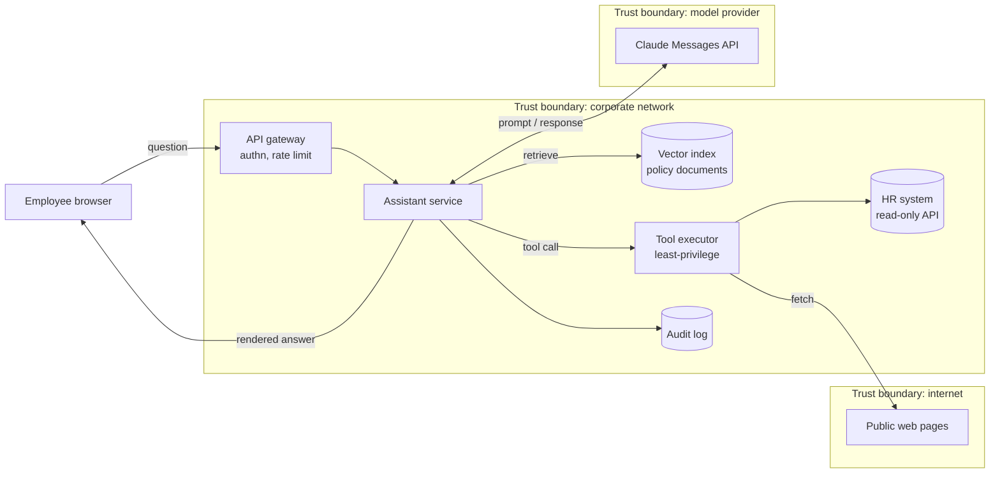

# LLM Threat Modelling

> **Level:** Advanced · **Time:** ~45 min · **Exam relevance:** CCAR-P D5 (5.2), CCAR-P D1 (1.2), CCAR-P D3 (3.2)

## In plain English

Threat modelling is structured worrying. Before you build or ship a system, you draw how data moves through it, mark
the places where one party's trust ends and another's begins, and ask "what could go wrong here?" at each point.

For an application built on a large language model (LLM) the method is the same as for any other system. What
changes is one element in the diagram: the model. A database does what its query language says. A model reads
everything in its context window, including text written by people you do not trust, and decides what to do next.
That makes the model both a processing component and a place where untrusted data can become behaviour.

A useful analogy: treat the model like a capable new contractor who reads every document put in front of them,
including anonymous notes slipped into the pile. You would not give that contractor the master keys on day one, and
you would check their work before it reaches a customer.

## Why it matters

- Most serious LLM incidents are architecture failures, not model failures. A model that follows an injected
  instruction is only dangerous when the architecture gives it a tool, a credential or an output channel that turns
  the instruction into harm.
- Threat modelling is where you decide which controls are needed, so you avoid both under-protecting and burying the
  system in guardrails that add latency and cost without reducing risk.
- Auditors, regulators and the CCAR-P exam expect you to identify risks and failure modes systematically
  (objective CCAR-P-5.2), not from a memorised list.

## How it works

### Step 1: describe the system

Write one paragraph per use case: who the users are, what they ask for, which data the system reads, which actions
it can take and who sees the output. Note the deployment surface (Claude API, Claude apps, Claude Code, Managed
Agents or a cloud platform) because each one changes which controls you own.

### Step 2: draw a data-flow diagram (DFD)

A DFD has five element types: external entities (users, third-party services), processes (your code, the model, an
agent loop), data stores (vector index, logs, databases), data flows (arrows) and trust boundaries (dashed boxes).
For an LLM app, draw the model call as a process of its own and draw every source of context as a separate flow
into it. This is the key move: each flow into the context window is a potential instruction channel.



### Step 3: mark trust boundaries and trust levels of content

Physical trust boundaries (network, process, tenant) still matter. LLM apps add a second dimension: the trust level
of each piece of content in the context window.

| Content in context | Typical author | Trust level | Can it legitimately instruct the model? |
|---|---|---|---|
| System prompt | Your engineering team | High | Yes |
| Mid-conversation system messages | Your application | High | Yes |
| Authenticated user turn | Your user | Medium (user is an adversary in some threat models) | Yes, within policy |
| Retrieved documents | Many internal authors | Low to medium | No, data only |
| Tool results, web pages, emails, file contents | Third parties | Untrusted | No, data only |
| Model output | The model, influenced by all of the above | Untrusted until validated | Not to downstream systems |

Anthropic's guidance on [mitigating jailbreaks and prompt injection](https://platform.claude.com/docs/en/test-and-evaluate/strengthen-guardrails/mitigate-jailbreaks)
draws exactly this line: direct injection, where the user is the adversary, and indirect injection, where the user
is trusted but third-party content is not.

### Step 4: apply STRIDE per element

STRIDE (Spoofing, Tampering, Repudiation, Information disclosure, Denial of service, Elevation of privilege) still
works. The table shows how each category shows up in an LLM application.

| STRIDE | Classic meaning | LLM-specific manifestation | Example controls |
|---|---|---|---|
| Spoofing | Pretending to be someone else | Injected text claims to be the system, an admin or the user; an agent acts with a shared identity so you cannot tell who acted | Content provenance tags, per-agent identities, never trust identity claims inside content |
| Tampering | Modifying data or code | Poisoned documents in the RAG index; modified prompt templates; malicious MCP tool descriptions | Signed prompt and tool manifests, ingestion review, index write controls |
| Repudiation | Denying an action | No record of which prompt, model version and tool calls produced an action | Request IDs, structured audit logs, model and prompt version in every log line |
| Information disclosure | Data leaks | System prompt leakage, cross-tenant retrieval, exfiltration via image URLs or tool calls | Per-user retrieval filters, output URL allow-lists, egress control |
| Denial of service | Exhausting resources | Unbounded agent loops, huge inputs, cost amplification ("denial of wallet") | Iteration caps, token budgets, rate limits, spend limits |
| Elevation of privilege | Gaining rights you should not have | Model uses a tool with more privilege than the user has; confused deputy in MCP | User-scoped credentials, policy enforcement outside the model, confirmation gates |

### Step 5: rate, decide and record

Rate each threat by likelihood and impact (a simple 3x3 matrix is enough for most teams). For each threat record a
decision: mitigate, transfer, accept or avoid. Store the model as a living document next to the code and revisit it
when you add a tool, a data source, a new model or a new user population.

### Two principles that simplify everything

1. **Assume the model can be convinced.** Design as if any untrusted content in the context can make the model
   attempt anything its tools allow. Then ask whether the architecture limits the damage. This is the LLM version
   of "assume breach".
2. **Put enforcement outside the model.** Prompts shape behaviour; they do not enforce it. Authorization, egress
   rules, rate limits and approval gates belong in deterministic code that the model cannot talk its way past.

## Example

The following script turns a small YAML-free Python description of a DFD into a STRIDE worksheet. It runs with the
standard library only, so you can keep it in a repository and regenerate the worksheet whenever the architecture
changes.

```python
"""stride_worksheet.py - generate a STRIDE checklist from a simple DFD description."""
from dataclasses import dataclass

@dataclass
class Element:
    name: str
    kind: str            # "entity" | "process" | "store" | "flow" | "model"
    crosses_boundary: bool = False
    carries_untrusted_text: bool = False

# STRIDE categories that apply to each element type (classic Microsoft mapping, extended for "model").
APPLIES = {
    "entity":  "SR",
    "process": "STRIDE",
    "store":   "TRID",
    "flow":    "TID",
    "model":   "STRIDE",
}

PROMPTS = {
    "S": "Can content or a caller impersonate a trusted party here?",
    "T": "Can an attacker modify data, prompts, tool definitions or index content here?",
    "R": "Could an action here happen without an attributable log record?",
    "I": "Could sensitive data leave through this element (output, URL, tool call, log)?",
    "D": "Can this element be driven into unbounded work or cost?",
    "E": "Can this element act with more privilege than the requesting user holds?",
}

def worksheet(elements: list[Element]) -> list[str]:
    rows = []
    for el in elements:
        for letter in APPLIES[el.kind]:
            note = PROMPTS[letter]
            if el.carries_untrusted_text and letter in "TEI":
                note += "  [HIGH PRIORITY: untrusted text reaches the model through this element]"
            if el.crosses_boundary:
                note += "  [crosses trust boundary]"
            rows.append(f"{el.name:<28} {letter}  {note}")
    return rows

if __name__ == "__main__":
    dfd = [
        Element("Employee browser", "entity", crosses_boundary=True),
        Element("Assistant service", "process"),
        Element("Claude Messages API", "model", crosses_boundary=True),
        Element("Vector index", "store", carries_untrusted_text=True),
        Element("Web fetch tool result", "flow", crosses_boundary=True, carries_untrusted_text=True),
        Element("HR read-only API", "store"),
        Element("Audit log", "store"),
    ]
    print("\n".join(worksheet(dfd)))
```

Run it with `python stride_worksheet.py`, then answer each line in your threat-model document. The "HIGH PRIORITY"
flag points you at the flows where indirect prompt injection can enter.

## Enterprise use case

*Northwind Lending* wants an internal assistant that answers loan-servicing staff questions using policy documents
and can look up a borrower's payment history. The security team runs a two-hour threat-modelling session:

- The DFD shows three content sources into the model: the staff member's question, retrieved policy chunks, and
  borrower records returned by a tool. Borrower records include free-text notes typed by borrowers through a web
  portal, so they are untrusted text even though they live in an internal system.
- STRIDE on the borrower-lookup tool finds an elevation-of-privilege risk: the tool used a service account that could
  read every borrower. The fix is to pass the staff member's own scoped token so the tool can only read records the
  staff member could already see.
- Information disclosure on the response path finds that the chat UI renders markdown images. The fix is to strip or
  proxy external image URLs (see [page 4](04-data-exfiltration-and-disclosure.md)).
- Denial of service finds no iteration cap on the agent loop. The fix is a cap of eight tool calls per request and a
  per-user daily token budget.

The resulting threat model goes into the design review alongside the
[architecture decision records](../13-enterprise-ai-architecture/07-architecture-decision-records.md).

## Common mistakes

- Drawing the model as part of "the backend" instead of as its own process with its own inbound flows. You then miss
  every indirect-injection path.
- Treating internal data as trusted because it is internal. Internal stores often contain text written by customers,
  vendors or anonymous web forms.
- Listing threats without owners or decisions. A threat model with no "mitigate / accept" column is a brainstorm.
- Relying on the system prompt as the control for an elevation-of-privilege threat.
- Threat modelling once at design time and never again, even after adding tools or MCP servers.

## Security considerations

- Keep the threat model itself access-controlled; it is a map of your weaknesses.
- Include the model provider's boundary. Data sent to the API leaves your network; decide what may cross it and
  check retention arrangements (see [page 14](14-enterprise-deployment-controls.md)).
- Model multi-agent systems as multiple processes with flows between them. A sub-agent's output is untrusted input
  to the orchestrator.
- For Claude Code and other coding agents, the repository itself (README files, issues, dependency code) is an
  untrusted content source.

## Troubleshooting

| Symptom | Likely cause | Fix |
|---|---|---|
| The STRIDE table is enormous and nobody reads it | Every element analysed at the same depth | Prioritise flows that carry untrusted text into the model and elements that hold credentials |
| Engineers disagree about where boundaries are | No shared definition of "trusted content" | Adopt the content trust-level table above as a team standard |
| Threats keep reappearing in pen tests | Controls were prompt-only | Move each control to a deterministic enforcement point and re-test |

## Check your understanding

1. Why should the model be drawn as a separate process in the data-flow diagram?
2. A retrieved document is stored in your company's own SharePoint. Is it trusted content? Explain.
3. Which STRIDE category does "an agent reads every customer's records through a shared service account" fall
   under, and what is the architectural fix?
4. Give one LLM-specific example of repudiation and one control for it.

<details>
<summary>Answers</summary>

1. Because every flow into its context window is a potential instruction channel. Drawing it separately forces you
   to enumerate those flows and their trust levels.
2. Not automatically. Trust depends on who could author the text, not where it is stored. If many people or external
   parties can write to it, treat it as data that cannot instruct the model.
3. Elevation of privilege. Use the requesting user's own scoped credential (or a token exchanged on their behalf) so
   the tool cannot exceed the user's rights, and enforce authorization in the tool, not the prompt.
4. Example: a refund was issued and nobody can show which prompt version, model and tool calls led to it. Control:
   structured audit logs with request IDs, model ID, prompt version and every tool call and approval.

</details>

## Further reading

- Anthropic: [Mitigate jailbreaks and prompt injections](https://platform.claude.com/docs/en/test-and-evaluate/strengthen-guardrails/mitigate-jailbreaks)
- Anthropic: [Claude Code security](https://code.claude.com/docs/en/security)
- OWASP: [Top 10 for LLM Applications 2025](https://genai.owasp.org/llm-top-10/) and the [mapping in this module](owasp-llm-mapping.md)
- OWASP: [Threat Modeling Cheat Sheet](https://cheatsheetseries.owasp.org/cheatsheets/Threat_Modeling_Cheat_Sheet.html)
- In this repository: [tool security](../07-tool-use-and-function-calling/06-tool-security.md),
  [Lab 20: secure enterprise architecture](../19-hands-on-labs/lab-20-secure-enterprise-architecture/README.md)

<!-- page-nav:start -->
---

[Module overview](README.md) · [Next: Prompt Injection →](02-prompt-injection.md)
<!-- page-nav:end -->
