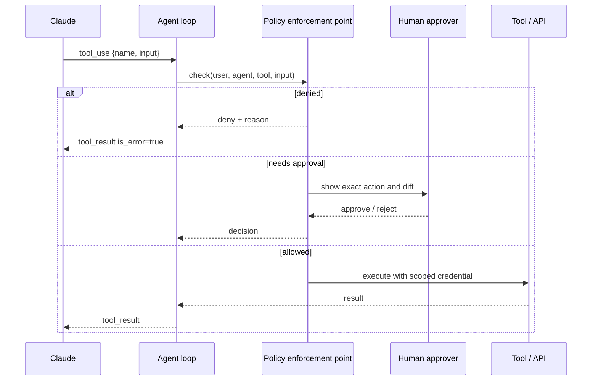

# Tool Misuse and Excessive Agency

> **Level:** Advanced · **Time:** ~45 min · **Exam relevance:** CCAR-P D3 (3.1, 3.2), CCAR-P D5 (5.1, 5.3)

## In plain English

Agency is what lets an LLM application *do* things: call APIs, run code, send messages, change records. Excessive
agency is giving it more ability than the task needs, so that a mistake, a hallucination or an injected instruction
can cause real damage. Tool misuse is the model using a legitimate tool in a harmful way, for example deleting
instead of archiving, or querying every customer instead of one.

The fix is the oldest principle in security, least privilege, applied to three things: which tools the agent has
(functionality), what each tool can reach (permissions) and how much it can do without a human (autonomy).

## Why it matters

- OWASP lists Excessive Agency as LLM06:2025, and the 2026 agentic list starts with ASI01 Agent Goal Hijack and
  ASI02 Tool Misuse, then ASI03 Identity and Privilege Abuse.
- CCAR-P-3.1 asks you to evaluate tool and agent configuration for capability bloat. That is this page.
- Excessive agency multiplies every other risk on this module's list. Prompt injection without tools is an
  embarrassment; with a payments tool it is a loss.

## How it works

### The three dimensions of excess

| Dimension | Excess looks like | Least-agency alternative |
|---|---|---|
| Excessive functionality | A generic `run_sql`, `http_request` or `shell` tool when the task needs two specific queries | Narrow, task-shaped tools (`get_invoice(invoice_id)`), separate read and write tools |
| Excessive permissions | Tools run as a service account with admin rights over all tenants | Tools run with the end user's scoped credential, or a dedicated identity per agent with only needed scopes |
| Excessive autonomy | Irreversible actions with no confirmation | Risk-tiered approval, dry-run previews, reversible actions by default |

### Capability bloat

Agents accumulate tools over time: each team adds "just one more" MCP server. Large tool sets cause three problems:
more attack surface, more chances for the model to pick the wrong tool, and more context spent on tool definitions.
Review tool inventories the way you review IAM policies. For large catalogues that are genuinely needed, Claude's
tool search features let tools load on demand (`defer_loading`), which reduces context cost but does not reduce
privilege. Privilege review still applies to every tool that *can* be loaded.

### Put a policy enforcement point outside the model

Every tool call should pass through a deterministic policy enforcement point (PEP) in your code before it executes:



The PEP checks: Is this tool allowed for this agent? Is this input within bounds (schema, ranges, allow-listed
identifiers)? Does the *user* on whose behalf the agent acts have the right to do this? What is the risk tier, and
does it need approval? Has a rate or budget limit been reached?

### Risk-tier your tools

| Tier | Examples | Default policy |
|---|---|---|
| 0 Read, own scope | Read the user's own tickets | Allow, log |
| 1 Read, broad or sensitive | Search all customer records | Allow with filters, log, alert on volume |
| 2 Reversible write | Draft an email, create a ticket, add a label | Allow with limits, log, reversible |
| 3 Irreversible or external | Send email, issue refund, merge code, delete data | Human approval showing exact parameters |
| 4 Prohibited | Change permissions, disable logging, transfer funds | Not exposed as a tool at all |

### Strict schemas reduce misuse

Use JSON Schema with `strict: true` on tool definitions so the arguments Claude sends always validate against your
schema. Use enums and patterns to constrain identifiers, and set `additionalProperties: false`. Validation is still
your job at the PEP: a schema-valid `customer_id` may belong to a different tenant.

### Agent-level guardrails

- **Iteration and budget caps:** maximum tool calls per task, token budgets, wall-clock timeouts (also limits
  OWASP LLM10 Unbounded Consumption).
- **Sandboxing:** run code-execution and shell tools in isolated containers or VMs with no ambient credentials and
  restricted network. Claude Code offers a sandboxed bash tool with filesystem and network isolation; see
  [Claude Code permissions and settings](../09-claude-code/04-permissions-and-settings.md).
- **Kill switch:** the ability to disable a tool or an agent across the fleet immediately.

## Example

A minimal PEP for a support agent. It is pure Python and is called from your agent loop before any tool runs.

```python
"""pep.py - deterministic policy enforcement for tool calls."""
from dataclasses import dataclass, field

@dataclass
class Context:
    user_id: str
    tenant_id: str
    user_scopes: set[str]
    calls_so_far: int = 0
    refunds_today_cents: int = 0
    approvals: set[str] = field(default_factory=set)   # tool_use ids a human approved

POLICY = {
    "get_order":     {"tier": 0, "scope": "orders:read"},
    "search_orders": {"tier": 1, "scope": "orders:read", "max_results": 20},
    "create_ticket": {"tier": 2, "scope": "tickets:write"},
    "issue_refund":  {"tier": 3, "scope": "refunds:write", "max_cents": 20_000, "daily_cents": 50_000},
}
MAX_CALLS = 12

class Denied(Exception):
    pass

class NeedsApproval(Exception):
    pass

def check(ctx: Context, tool_use_id: str, name: str, args: dict, owner_of) -> None:
    rule = POLICY.get(name)
    if rule is None:
        raise Denied(f"tool {name!r} is not enabled for this agent")
    if ctx.calls_so_far >= MAX_CALLS:
        raise Denied("tool-call budget exhausted for this task")
    if rule["scope"] not in ctx.user_scopes:
        raise Denied(f"user lacks scope {rule['scope']}")
    if "order_id" in args and owner_of(args["order_id"]) != ctx.tenant_id:
        raise Denied("order belongs to another tenant")
    if name == "search_orders" and args.get("limit", 0) > rule["max_results"]:
        raise Denied("search limit too large")
    if name == "issue_refund":
        amount = int(args["amount_cents"])
        if amount > rule["max_cents"] or ctx.refunds_today_cents + amount > rule["daily_cents"]:
            raise Denied("refund exceeds per-call or daily limit")
    if rule["tier"] >= 3 and tool_use_id not in ctx.approvals:
        raise NeedsApproval(f"{name} requires human approval: {args}")
    ctx.calls_so_far += 1
```

In the agent loop, map `Denied` to a `tool_result` with `is_error: true` and a short reason (so Claude can adjust),
and map `NeedsApproval` to your approval workflow. Never let the model see or set `ctx.approvals`.

## Enterprise use case

*Northwind Lending* reviews an internal operations agent before production. The inventory shows 41 tools from five
MCP servers, including `execute_sql`, `send_email` and `update_customer`. The agent's job is to answer questions
about delinquent accounts and draft outreach.

Review outcome:

- 33 tools removed as unused in two weeks of pilot logs.
- `execute_sql` replaced with three parameterised read tools.
- `send_email` replaced with `create_email_draft`; a human sends from their own client.
- `update_customer` removed; account changes stay in the core banking UI.
- All remaining tools run with the operator's own delegated token through the PEP.

Tool-selection accuracy on the team's eval set improves because the model has fewer, clearer choices.
[Lab 20](../19-hands-on-labs/lab-20-secure-enterprise-architecture/README.md) walks through a similar review.

## Common mistakes

- Generic "power tools" (SQL, HTTP, shell) exposed because they are quick to build.
- Enforcing limits in the tool description ("never refund more than 200") rather than in code.
- One service account shared by every agent and every user.
- Approval prompts that show the model's summary of the action instead of the exact parameters.
- No budget or iteration cap, so a confused agent loops for hours.

## Security considerations

- Error messages returned to the model should be useful but not leak internals (stack traces, table names).
- A denied call is a security event. Alert on spikes, which may indicate an injection attempt.
- Approval fatigue is real: if humans approve everything, tier 3 is effectively tier 2. See
  [human oversight](13-human-oversight.md).
- For multi-agent systems, each agent gets its own policy; an orchestrator must not be able to grant a sub-agent more
  than it has itself (see [agent identity and permissions](09-agent-identity-and-permissions.md)).

## Troubleshooting

| Symptom | Likely cause | Fix |
|---|---|---|
| Agent retries a denied call repeatedly | Error message unclear | Return a concise reason and an allowed alternative |
| Model picks the wrong tool | Too many similar tools, vague descriptions | Consolidate tools, sharpen descriptions, test tool selection in evals |
| Approvals pile up | Too many actions in tier 3 | Make actions reversible so they can move to tier 2; batch approvals |
| Users bypass the agent for blocked tasks | Policy too strict for the real workflow | Revisit the task design with the business owner |

## Check your understanding

1. Name the three dimensions of excessive agency and one control for each.
2. Why does `defer_loading` not solve a privilege problem?
3. Where should the rule "refunds cannot exceed 200" be enforced, and why?
4. What should the agent loop return to Claude when the PEP denies a call?

<details>
<summary>Answers</summary>

1. Functionality (narrow task-shaped tools), permissions (user-scoped or per-agent least-privilege credentials),
   autonomy (risk-tiered human approval and reversible actions).
2. It controls when a tool's definition enters context, not what the tool is allowed to do once called.
3. In deterministic code at the policy enforcement point or in the downstream API, because the model can be
   manipulated or mistaken and a prompt rule is not enforcement.
4. A `tool_result` with `is_error: true` and a short, non-sensitive reason, so the model can adjust or explain to
   the user.

</details>

## Further reading

- OWASP: [Top 10 for LLM Applications 2025](https://genai.owasp.org/llm-top-10/) (LLM06 Excessive Agency)
- OWASP: [Top 10 for Agentic Applications 2026](https://genai.owasp.org/resource/owasp-top-10-for-agentic-applications-for-2026/)
- Anthropic: [Tool use overview](https://platform.claude.com/docs/en/agents-and-tools/tool-use/overview)
- Anthropic: [Claude Code security](https://code.claude.com/docs/en/security)
- In this repository: [tool design best practices](../07-tool-use-and-function-calling/05-tool-design-best-practices.md),
  [tool security](../07-tool-use-and-function-calling/06-tool-security.md),
  [agent reliability](../10-agentic-ai/07-agent-reliability.md)
