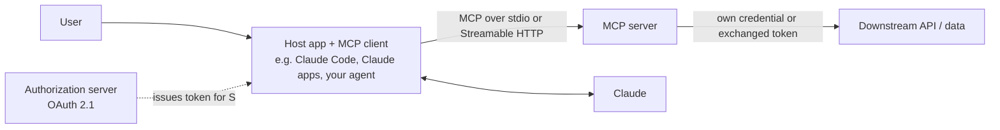

# MCP Server Security

> **Level:** Advanced · **Time:** ~50 min · **Exam relevance:** CCAR-P D3 (3.1, 3.2, 3.7), CCAR-P D5 (5.1)

> **Scope:** this page is the security team's view: vetting, approving and monitoring MCP servers across an organisation. For protocol-level threats and builder guidance, see [MCP security](../08-model-context-protocol/05-mcp-security.md).

## In plain English

The Model Context Protocol (MCP) lets an AI application (the host and its MCP client) connect to MCP servers that
expose tools, resources and prompts. An MCP server is a bridge between a model and real systems: a database, a
ticketing tool, a file system. Like any bridge, it must check who is crossing and what they are carrying.

[Module 08's MCP security page](../08-model-context-protocol/05-mcp-security.md) introduces the topic. This page goes
deeper for security engineers who build, operate or approve MCP servers, using the attack catalogue in the official
MCP [security best practices](https://modelcontextprotocol.io/specification/2025-11-25/basic/security_best_practices)
for specification version 2025-11-25 (the current version as of 2026-10-24).

## Why it matters

- MCP servers often hold the most powerful credentials in an agent system: OAuth tokens or API keys for SaaS
  products, databases and internal services.
- A vulnerable or malicious server can act as a confused deputy, an SSRF pivot, a data-exfiltration relay or a code
  execution foothold on a developer laptop.
- CCAR-P-3.2 (analyse authentication and authorisation for security gaps) and CCAR-P-3.7 (choose an integration
  mechanism) both require you to reason about MCP trust.

## How it works

### Trust relationships



Three questions frame every review: Who is the client, and has the user consented to *this* client? Was the token
issued *for this server* (audience)? With what identity and scope does the server reach downstream?

### Attack catalogue and required mitigations

The table summarises the attacks in the MCP security best practices, with the normative requirements stated there.

| Attack | What happens | Key mitigations from the specification |
|---|---|---|
| Confused deputy | A proxy server with a static OAuth client ID to a third party lets a dynamically registered malicious client ride an existing consent cookie and receive an authorization code | Proxy servers **MUST** implement per-client consent before forwarding to the third-party authorization server; validate `redirect_uri` by exact match; single-use, short-lived `state` set only after consent; secure consent cookies bound to the client ID |
| Token passthrough | Server accepts a token not issued to it and forwards it downstream, bypassing audience checks, rate limits and audit | Servers **MUST NOT** accept tokens that were not explicitly issued for the MCP server |
| SSRF during OAuth discovery | A malicious server points the client's metadata discovery at internal addresses or cloud metadata endpoints | Clients **SHOULD** require HTTPS, block private and link-local ranges, validate redirect targets, and use an egress proxy; beware DNS rebinding |
| Session hijacking | An attacker who obtains or guesses a session ID injects events or impersonates the client | Servers **MUST** verify all inbound requests and **MUST NOT** use sessions for authentication; session IDs must be secure random; bind them to the user (for example `<user_id>:<session_id>`) |
| Local server compromise | One-click install runs an arbitrary startup command; a localhost HTTP server is reachable by other processes or via DNS rebinding | Clients **MUST** show the exact command and get consent; run servers sandboxed; local servers should prefer stdio or require auth on HTTP |
| Malicious authorization URLs | A server supplies a `javascript:` URL or shell metacharacters that the client opens | Clients **MUST** allow only `https` (and `http` for loopback in development), **MUST NOT** open URLs through a shell, should apply CSP |
| Over-broad scopes | Tokens carry `*` or admin scopes, so a leak exposes everything | Progressive, least-privilege scopes with incremental elevation via `WWW-Authenticate` scope challenges |

### Server-side design rules

Beyond the specification's requirements, apply these when you build a server:

1. **Validate tokens properly.** Check signature, issuer, expiry and audience (the server's own resource identifier)
   on every request. Reject anything else.
2. **Use a separate identity downstream.** Exchange the inbound token for a downstream token (OAuth 2.0 token
   exchange, or the downstream service's own OAuth flow) rather than forwarding it. Keep per-user downstream tokens
   server-side, encrypted.
3. **Authorize per tool, per resource.** A valid token proves who the caller is, not what they may do. Check
   per-tool scopes and per-object permissions (tenant, project, record) inside every handler.
4. **Validate inputs as if from the internet.** Tool arguments come from a model that may have read attacker text.
   Enforce schemas, ranges, allow-lists and path containment.
5. **Write descriptions for humans and models, with no hidden behaviour.** Tool descriptions are part of your
   attack surface; keep them factual and review them in code review.
6. **Return minimal data.** Do not return whole records when the tool's purpose needs three fields. Smaller results
   leak less and cost fewer tokens.
7. **Rate-limit and audit.** Per-client and per-user limits; structured logs with client ID, user, tool, arguments
   (redacted) and outcome.
8. **Keep tool lists stable.** If tools change at runtime, make it intentional and logged, because clients and
   reviewers rely on what they approved.

### Client and host-side rules

- Maintain an allow-list of approved servers. In Claude Code, organisations can restrict servers with managed MCP
  configuration; project-scoped `.mcp.json` servers require approval in interactive sessions, as the
  [Claude Code security](https://code.claude.com/docs/en/security) page describes.
- Apply permissions to MCP tools like any other tool: allow reads, ask for writes, deny dangerous ones.
- When your application uses the Claude API's MCP connector, remember the API calls the remote server on your
  behalf. Only connect servers you trust and pass tokens with minimal scope.

## Example

Three building blocks for a Python MCP server's HTTP layer. They are framework-agnostic so you can drop them into
whichever server SDK you use. The token verification uses a placeholder for your JWT library's verify function.

```python
"""mcp_guards.py - audience checking, SSRF-safe URL validation and session binding."""
import ipaddress
import secrets
import socket
from urllib.parse import urlsplit

EXPECTED_AUDIENCE = "https://mcp.northwind-lending.example/"   # this server's resource identifier
EXPECTED_ISSUER = "https://login.northwind-lending.example/"


def check_token_claims(claims: dict, required_scope: str) -> str:
    """Call after your JWT library has verified the signature and expiry. Returns the subject."""
    aud = claims.get("aud")
    audiences = aud if isinstance(aud, list) else [aud]
    if EXPECTED_AUDIENCE not in audiences:
        raise PermissionError("token was not issued for this MCP server (no passthrough)")
    if claims.get("iss") != EXPECTED_ISSUER:
        raise PermissionError("unexpected issuer")
    scopes = set(str(claims.get("scope", "")).split())
    if required_scope not in scopes:
        raise PermissionError(f"missing scope {required_scope}")
    return claims["sub"]


BLOCKED_NETS = [ipaddress.ip_network(n) for n in (
    "10.0.0.0/8", "172.16.0.0/12", "192.168.0.0/16", "127.0.0.0/8", "169.254.0.0/16",
    "0.0.0.0/8", "100.64.0.0/10", "::1/128", "fc00::/7", "fe80::/10")]


def validate_outbound_url(url: str, allow_hosts: set[str]) -> str:
    """Reject non-HTTPS, non-allow-listed or private-address destinations. Returns the resolved IP to pin."""
    parts = urlsplit(url)
    if parts.scheme != "https":
        raise PermissionError("only https is allowed")
    host = (parts.hostname or "").lower()
    if host not in allow_hosts:
        raise PermissionError(f"host {host!r} not in allow-list")
    for info in socket.getaddrinfo(host, parts.port or 443, proto=socket.IPPROTO_TCP):
        ip = ipaddress.ip_address(info[4][0])
        if getattr(ip, "ipv4_mapped", None):
            ip = ip.ipv4_mapped
        if any(ip in net for net in BLOCKED_NETS):
            raise PermissionError("destination resolves to a private or reserved address")
    # Connect to this IP (with the original Host header / SNI) to avoid DNS rebinding between check and use.
    return str(ipaddress.ip_address(socket.getaddrinfo(host, 443)[0][4][0]))


def new_session_key(user_id: str) -> str:
    """Session IDs are random and bound to the authenticated user; never used as authentication."""
    return f"{user_id}:{secrets.token_urlsafe(32)}"


def session_belongs_to(session_key: str, authenticated_user_id: str) -> bool:
    return session_key.split(":", 1)[0] == authenticated_user_id
```

The MCP best-practice document warns against hand-rolled IP parsing because of encoding tricks; the code above uses
Python's `ipaddress` module and resolves names before checking. For production, route outbound requests through an
egress proxy that enforces the same policy at the network layer.

## Enterprise use case

*Northwind Lending* builds an internal MCP server that exposes loan-servicing data to Claude Code and to an internal
agent. The security review finds:

| Finding | Risk | Fix |
|---|---|---|
| Server accepted the corporate SSO access token and forwarded it to the servicing API | Token passthrough; downstream logs show the user, not the server | Server validates audience, then performs token exchange for a servicing-API token scoped to read-only |
| One `query_loans` tool with free-text filters | Excessive functionality, injection into downstream query | Split into `get_loan(loan_id)` and `list_my_queue()` with schema validation |
| Session ID reused as proof of identity on reconnect | Session hijack | Verify the bearer token on every request; bind sessions to user ID |
| Developers ran the server locally over HTTP on port 8080 with no auth | Any local process or DNS-rebinding page could call it | Local mode switched to stdio; remote mode behind HTTPS and OAuth |
| Tool descriptions edited without review | Possible hidden instructions | Descriptions moved into reviewed code; CI diff on `tools/list` output |

## Common mistakes

- "Our server is internal, so authentication is optional."
- Accepting any valid token from the corporate identity provider regardless of audience.
- Using one powerful service credential for all users instead of per-user delegated access.
- Logging full tool arguments and results, including personal data and tokens.
- Wildcard redirect URI matching in OAuth proxy flows.

## Security considerations

- MCP servers that read untrusted content (web, email, tickets) are indirect-injection carriers. Label results with
  provenance and keep them minimal (see [indirect prompt injection](03-indirect-prompt-injection.md)).
- A server that both reads untrusted content and performs privileged writes is a high-risk combination; consider
  splitting it into two servers with different credentials.
- Pen-test MCP servers like any API. Include model-driven testing: point an agent at the server with adversarial
  content in context and check what it can be made to do.

## Troubleshooting

| Symptom | Likely cause | Fix |
|---|---|---|
| Downstream API rejects calls after adding audience checks | Server was relying on passthrough | Implement token exchange or the downstream OAuth flow |
| Clients loop on 403 scope errors | Server returns the full scope catalogue or no challenge | Return a precise `WWW-Authenticate` scope challenge; client caches denials |
| Outbound fetches fail for legitimate hosts | Allow-list too narrow or IPv6 not handled | Add host; test both address families |

## Check your understanding

1. What is token passthrough and what does the MCP specification require?
2. Under which conditions does the confused-deputy attack against an MCP proxy become possible?
3. Why must MCP servers not use session IDs for authentication?
4. Why should a local MCP server prefer the stdio transport?

<details>
<summary>Answers</summary>

1. Accepting a token not issued for the MCP server and forwarding it downstream. Servers must not accept tokens that
   were not explicitly issued for the MCP server.
2. A proxy uses a static client ID with a third-party authorization server, allows dynamic client registration, the
   third party sets a consent cookie, and the proxy does not obtain per-client consent before forwarding.
3. Session IDs can be leaked or guessed; servers must verify every inbound request, and sessions should be random and
   bound to the authenticated user.
4. stdio limits access to the parent client process, whereas a localhost HTTP server can be reached by other local
   processes and potentially by web pages via DNS rebinding.

</details>

## Further reading

- MCP: [Security best practices](https://modelcontextprotocol.io/specification/2025-11-25/basic/security_best_practices)
- MCP: [Authorization](https://modelcontextprotocol.io/specification/2025-11-25/basic/authorization)
- IETF: [RFC 9700 OAuth 2.0 Security Best Current Practice](https://datatracker.ietf.org/doc/html/rfc9700)
- Anthropic: [Claude Code security](https://code.claude.com/docs/en/security)
- In this repository: [building an MCP server](../08-model-context-protocol/03-building-an-mcp-server.md),
  [MCP security](../08-model-context-protocol/05-mcp-security.md),
  [Lab 09: MCP fundamentals](../19-hands-on-labs/lab-09-mcp-fundamentals/README.md)

<!-- page-nav:start -->
---

[← Previous: Supply-Chain Risks](07-supply-chain-risks.md) · [Module overview](README.md) · [Next: Agent Identity and Permissions →](09-agent-identity-and-permissions.md)
<!-- page-nav:end -->
