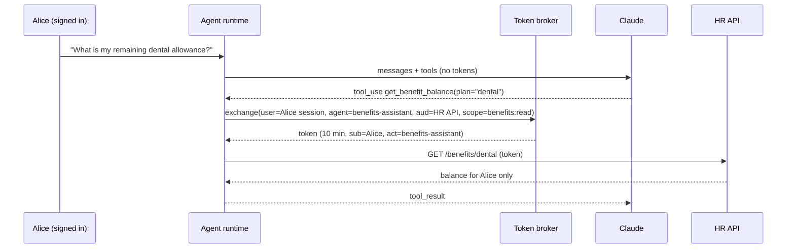

# Agent Identity and Permissions

> **Level:** Advanced · **Time:** ~45 min · **Exam relevance:** CCAR-P D3 (3.2), CCAR-P D5 (5.1), CCAR-P D1 (1.4)

## In plain English

Every action in a well-run system can be traced to an identity: a person or a service. Agents blur this. When an
agent sends an email, who sent it? The user who asked, the agent, the developer who built it, or the service account
it happens to run under? If you cannot answer, you cannot authorize correctly, audit afterwards, or revoke access
when something goes wrong.

Agent identity means giving each agent (and each running instance where it matters) a **non-human identity (NHI)**,
and giving it permissions that are **scoped** to the task, **short-lived**, and **derived from** (never larger than)
the rights of the person it is acting for. That last property is called delegation.

## Why it matters

- OWASP's agentic list includes ASI03 Identity and Privilege Abuse; LLM06 Excessive Agency in the LLM list covers
  excessive permissions.
- CCAR-P-3.2 asks you to analyse authentication and authorisation for gaps. The most common gap in agent designs is a
  shared, long-lived, over-privileged service credential.
- Regulators and auditors expect you to show who did what. "The AI did it" is not an identity.

## How it works

### Three identities in every agent action

| Identity | Question it answers | Example |
|---|---|---|
| Principal (user) | On whose behalf? | `alice@contoso-health.example` |
| Agent (NHI) | Which software actor? | `agent:benefits-assistant@prod` |
| Credential | With which proof and scope? | Token, audience = HR API, scope = `benefits:read`, expires in 10 minutes, `act` = agent |

Record all three on every tool call. OAuth 2.0 Token Exchange (RFC 8693) expresses this directly: an exchanged token
carries the user as the subject and the agent in an `act` (actor) claim.

### Patterns for credentials

| Pattern | How it works | Use when | Risk |
|---|---|---|---|
| Shared service account | One long-lived key for the agent, all users | Never for user data; maybe for public data | Confused deputy, no attribution, large blast radius |
| Per-agent workload identity | Agent has its own identity with fixed least-privilege scopes, short-lived tokens from the platform (cloud IAM roles, workload identity federation) | Back-office agents with no end user | Must still be scoped tightly; no per-user restriction |
| Delegated user token | Agent acts with a token derived from the user's session, down-scoped to the task | Assistants acting for a signed-in user | Token handling inside the agent runtime; keep out of model context |
| Brokered credentials | A broker or vault holds secrets and injects them at the network edge; the agent runtime never sees them | Agents that run untrusted code or read untrusted content | Broker becomes critical infrastructure |

### Rules for delegation

1. **Never more than the user.** Effective permission = intersection of the user's rights, the agent's allowed
   scopes and the task's needs.
2. **Short-lived.** Minutes, not days. Refresh through the broker, not the model.
3. **Audience-bound.** A token for the HR API must not work on the payroll API.
4. **Non-transitive by default.** If an orchestrator delegates to a sub-agent, the sub-agent receives a further
   down-scoped token. An orchestrator cannot grant what it does not hold.
5. **Revocable.** Kill switches per agent identity and per user grant.
6. **Never in the context window.** Tokens are handled by your tool executor, not passed through the model, because
   anything in context can be leaked (see [secrets management](10-secrets-management.md)).



### What Anthropic's platforms provide (verified 2026-10-24)

- **Claude API authentication:** besides API keys, the SDKs support OAuth profiles and Workload Identity Federation,
  where a workload exchanges an identity token from its own platform for short-lived Anthropic credentials tied to a
  service account. This removes long-lived API keys from agent hosts. See the
  [Admin API](https://platform.claude.com/docs/en/manage-claude/admin-api) for service accounts and federation rules.
- **Workspaces:** separate API keys, limits and access per workspace so one agent's key cannot spend another's
  budget (see [Workspaces](https://platform.claude.com/docs/en/manage-claude/workspaces)).
- **Claude Code cloud sessions:** Anthropic's [security page](https://code.claude.com/docs/en/security) states that
  the long-lived GitHub credential stays on Anthropic's side and is never copied into the session's virtual machine.
  Inside the VM there is only a temporary, session-limited credential, and a proxy adds the real credential to GitHub
  requests on the way out.
- **Claude Managed Agents:** credentials can be stored in vaults and substituted at egress, so they are not visible
  inside the agent's sandbox.

These are the brokered-credential pattern built into the platform. For your own agents, you implement the same
pattern with your identity provider and a token broker.

## Example

A minimal, standard-library token broker that demonstrates down-scoping and delegation chains. In production you would
use your identity provider's token exchange endpoint; the logic of intersection, audience and expiry is the same.

```python
"""delegation.py - illustrate down-scoped, short-lived, audience-bound delegated tokens."""
import base64
import hashlib
import hmac
import json
import os
import time

SIGNING_KEY = os.environ.get("BROKER_SIGNING_KEY", "").encode()  # set in your environment, never hardcode

AGENT_ALLOWED_SCOPES = {
    "benefits-assistant": {"benefits:read"},
    "claims-subagent": {"claims:read"},
}


def _sign(payload: dict) -> str:
    body = base64.urlsafe_b64encode(json.dumps(payload, sort_keys=True).encode()).decode()
    mac = hmac.new(SIGNING_KEY, body.encode(), hashlib.sha256).hexdigest()
    return f"{body}.{mac}"


def verify(token: str, audience: str) -> dict:
    body, mac = token.rsplit(".", 1)
    expected = hmac.new(SIGNING_KEY, body.encode(), hashlib.sha256).hexdigest()
    if not hmac.compare_digest(mac, expected):
        raise PermissionError("bad signature")
    claims = json.loads(base64.urlsafe_b64decode(body))
    if claims["aud"] != audience or claims["exp"] < time.time():
        raise PermissionError("wrong audience or expired")
    return claims


def exchange(user: str, user_scopes: set[str], agent: str, audience: str,
             requested: set[str], parent: dict | None = None, ttl: int = 600) -> str:
    """Effective scopes = user ∩ agent policy ∩ request (∩ parent token if delegating further)."""
    if not SIGNING_KEY:
        raise RuntimeError("BROKER_SIGNING_KEY is not set")
    effective = user_scopes & AGENT_ALLOWED_SCOPES.get(agent, set()) & requested
    chain = [agent]
    if parent is not None:
        effective &= set(parent["scope"].split())
        chain = parent["act_chain"] + [agent]
    if not effective:
        raise PermissionError("no permitted scopes for this request")
    return _sign({"sub": user, "act_chain": chain, "aud": audience,
                  "scope": " ".join(sorted(effective)), "exp": int(time.time()) + ttl})


if __name__ == "__main__":
    os.environ.setdefault("BROKER_SIGNING_KEY", "demo-only-not-a-secret")
    SIGNING_KEY = os.environ["BROKER_SIGNING_KEY"].encode()
    t = exchange("alice", {"benefits:read", "claims:read", "payroll:read"},
                 "benefits-assistant", "https://hr.contoso-health.example",
                 requested={"benefits:read", "payroll:read"})
    print(verify(t, "https://hr.contoso-health.example"))   # scope: benefits:read only
```

Notice that `payroll:read` is requested and the user holds it, but the agent's policy does not allow it, so the token
does not carry it. A sub-agent token created with `parent=` can only shrink further.

## Enterprise use case

*Contoso Health* runs three agents: a benefits assistant for employees, a claims-review agent for the claims team and
a nightly reconciliation agent with no end user. The identity design:

| Agent | Identity | Credential pattern | Notes |
|---|---|---|---|
| Benefits assistant | `agent:benefits-assistant` | Delegated user token, `benefits:read`, 10 min | Can only see the requesting employee's data |
| Claims-review agent | `agent:claims-review` | Delegated reviewer token; writes require approval | Sub-agents get read-only tokens |
| Reconciliation agent | `agent:recon-nightly` | Workload identity, fixed scopes, no user | Runs in an isolated account; outputs a report, writes nothing |

All three call the Claude API through workload identity federation instead of long-lived API keys, each in its own
workspace with its own spend limit. Audit logs record `sub`, `act_chain`, tool, outcome and request ID.

## Common mistakes

- One API key or service account shared by every agent and environment.
- Passing OAuth tokens to the model in the prompt so it can "call the API itself".
- Long-lived refresh tokens stored in agent memory or logs.
- Sub-agents inheriting the orchestrator's full credential.
- No way to revoke a single agent's access without breaking all of them.

## Security considerations

- Inventory NHIs like human accounts: owner, purpose, scopes, last used, expiry. Remove stale ones.
- Alert on unusual NHI behaviour: new tools, volume spikes, access outside working patterns.
- Separate environments: development agents must not hold production credentials.
- Human approvals should be recorded against the approver's identity as well as the agent's.

## Troubleshooting

| Symptom | Likely cause | Fix |
|---|---|---|
| Agent works for admins but fails for regular users | Delegation now enforces real user rights | This is correct; adjust the UX to explain the limit |
| Audit logs show only the service account | No actor claim or user context propagated | Use token exchange with actor claims; log both identities |
| Token expired mid-task | Long-running agent with short tokens | Refresh through the broker per tool call, not per task |

## Check your understanding

1. What three identities should be recorded for every agent tool call?
2. How do you compute the effective scope of a delegated token?
3. Why should tokens never pass through the model's context window?
4. What does "non-transitive delegation" mean for a sub-agent?

<details>
<summary>Answers</summary>

1. The principal (user), the agent (non-human identity) and the credential (with audience, scope and expiry).
2. The intersection of the user's rights, the agent's allowed scopes, the task's requested scopes, and (for further
   delegation) the parent token's scopes.
3. Anything in context can be leaked through outputs, logs or injected instructions; the tool executor should attach
   credentials outside the model.
4. A sub-agent cannot receive more than its parent holds, and does not automatically receive everything the parent
   holds; it gets a further down-scoped token.

</details>

## Further reading

- Anthropic: [Admin API](https://platform.claude.com/docs/en/manage-claude/admin-api) and
  [Workspaces](https://platform.claude.com/docs/en/manage-claude/workspaces)
- Anthropic: [Claude Code security](https://code.claude.com/docs/en/security)
- IETF: [RFC 8693 OAuth 2.0 Token Exchange](https://datatracker.ietf.org/doc/html/rfc8693)
- OWASP: [Top 10 for Agentic Applications 2026](https://genai.owasp.org/resource/owasp-top-10-for-agentic-applications-for-2026/)
- In this repository: [multi-agent architecture](../10-agentic-ai/04-multi-agent-architecture.md),
  [managed agents and the Agent SDK](../10-agentic-ai/06-managed-agents-and-agent-sdk.md),
  [Lab 20](../19-hands-on-labs/lab-20-secure-enterprise-architecture/README.md)

<!-- page-nav:start -->
---

[← Previous: MCP Server Security](08-mcp-server-security.md) · [Module overview](README.md) · [Next: Secrets Management for AI Systems →](10-secrets-management.md)
<!-- page-nav:end -->
