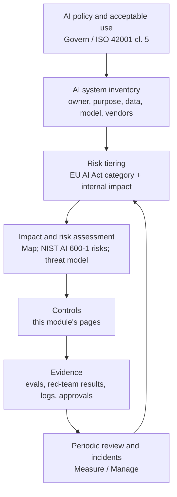

# AI Governance

> **Level:** Intermediate · **Time:** ~50 min · **Exam relevance:** CCAR-P D5 (5.4, 5.5), CCAO-F D6 (6.2, 6.3)

## In plain English

Governance is how an organisation decides, in a repeatable way, which AI uses are allowed, who is accountable for
them, which controls they need and how they are checked over time. Security controls answer "how do we stop this
going wrong?". Governance answers "who decided this was acceptable, on what basis, and who is watching?".

You do not need to be a lawyer to do this well. You need a small set of reference frameworks, an inventory of your AI
systems, a risk-tiering method, and evidence that controls work. This page introduces the four reference points most
enterprises use, at the depth an architect or security engineer needs, and shows how they connect to the technical
controls in the rest of this module.

> This page is educational, not legal advice. Regulatory obligations depend on your jurisdiction, sector and role
> (for example, provider or deployer). Involve your legal and compliance teams.

## Why it matters

- CCAR-P-5.4 (regulatory compliance) and CCAO-F-6.3 (organisational AI policy and governance) test whether you can
  connect controls to obligations.
- Without governance, AI adoption tends to fail in one of two ways: uncontrolled "shadow AI" or a blanket ban that
  pushes usage out of sight.
- Customers, auditors and regulators increasingly ask for evidence of an AI management system, not just a policy
  document.

## How it works

### The reference frameworks (verified 2026-10-24)

| Framework | Type | What it gives you | Status |
|---|---|---|---|
| NIST AI Risk Management Framework (AI RMF 1.0, NIST AI 100-1) | Voluntary US framework | Four core functions: Govern, Map, Measure, Manage; characteristics of trustworthy AI | Released 26 January 2023; NIST states it is being revised |
| NIST AI 600-1, Generative AI Profile | Companion profile to the AI RMF | Risks unique to or worsened by generative AI, with suggested actions mapped to the AI RMF | Published 26 July 2024 |
| ISO/IEC 42001:2023 | Certifiable international management-system standard | Requirements to establish, run, maintain and improve an AI management system (AIMS), using the same harmonised structure as ISO/IEC 27001 | Published 18 December 2023 (first edition) |
| EU AI Act (Regulation (EU) 2024/1689) | Binding EU regulation | Risk-based obligations: prohibited practices, high-risk systems, transparency duties, general-purpose AI (GPAI) model duties | Phased application; see timeline below |

#### NIST AI RMF 1.0

The AI RMF organises risk management into four functions:

- **Govern:** policies, accountability, culture and processes across the lifecycle. Govern is cross-cutting.
- **Map:** establish context: purpose, users, impacts, data and dependencies for each AI system.
- **Measure:** analyse, assess and track risks with qualitative and quantitative methods (this is where evals and
  red-teaming live).
- **Manage:** prioritise and act on risks, including response, recovery and communication.

It also describes characteristics of trustworthy AI: valid and reliable; safe; secure and resilient; accountable and
transparent; explainable and interpretable; privacy-enhanced; and fair with harmful bias managed.

#### NIST AI 600-1 Generative AI Profile

The profile identifies twelve risks that are unique to or exacerbated by generative AI. In summary: CBRN (chemical,
biological, radiological, nuclear) information or capabilities; confabulation; dangerous, violent or hateful content;
data privacy; environmental impacts; harmful bias and homogenisation; human-AI configuration (for example
over-reliance and automation bias); information integrity; information security; intellectual property; obscene,
degrading or abusive content; and value chain and component integration. Use the profile's suggested actions as a
checklist when you map a generative AI use case. Read the final publication for exact wording.

#### ISO/IEC 42001

ISO/IEC 42001 specifies requirements for an AI management system: context and scope, leadership and AI policy,
planning (including AI risk assessment, risk treatment and AI system impact assessment), support, operation,
performance evaluation and improvement, with an annex of reference controls. Because it shares the harmonised
structure with ISO/IEC 27001, organisations with an existing information security management system can extend it
rather than start again. It is certifiable, so it is a common answer to "how do we prove we govern AI?".

#### EU AI Act

The Act classifies AI systems by risk and assigns obligations to roles such as provider and deployer.

| Category | Examples (simplified) | Obligations in brief |
|---|---|---|
| Prohibited practices | Certain manipulative systems, social scoring, some biometric uses | Banned |
| High-risk | Systems listed in Annex III (for example certain employment, credit-scoring and essential-services uses) or safety components under Annex I product legislation | Risk management, data governance, technical documentation, record-keeping and logging, transparency to deployers, human oversight, accuracy, robustness and cybersecurity, conformity assessment |
| Transparency obligations | Chatbots, AI-generated or manipulated content | Tell people they are interacting with AI; mark synthetic content |
| General-purpose AI models | Foundation models such as large language models | Duties on model providers (documentation, copyright policy, training-content summary; more for systemic-risk models) |
| Minimal risk | Most other uses | Voluntary codes |

Key dates, per the implementation timeline maintained at
[artificialintelligenceact.eu](https://artificialintelligenceact.eu/implementation-timeline/) (page last updated
31 August 2026, checked 2026-10-24):

| Date | What applies |
|---|---|
| 1 August 2024 | Entry into force |
| 2 February 2025 | Most prohibitions and AI literacy obligations |
| 2 August 2025 | GPAI model obligations (models already on the market before this date have until 2 August 2027) |
| 2 August 2026 | General date of application for the remainder of the Act, unless otherwise specified |
| 2 December 2026 | Certain deferred items, including some synthetic-content marking for systems already on the market |
| 2 December 2027 | High-risk obligations for Annex III systems (per the timeline) |
| 2 August 2028 | High-risk obligations for Annex I systems (per the timeline) |

> **Unverified:** the 2 December 2026, 2 December 2027 and 2 August 2028 dates come from an amending regulation (the
> "Digital Omnibus on AI", reported as Regulation (EU) 2026/1744). We could not open its Official Journal text on
> 2026-10-24 because EUR-Lex blocked automated access. Confirm the regulation number and dates in the consolidated
> text of Regulation (EU) 2024/1689 on [EUR-Lex](https://eur-lex.europa.eu/eli/reg/2024/1689/oj) before relying on them.

For most enterprises using Claude, the typical role is **deployer** (and sometimes provider of an AI system built on
a GPAI model). Anthropic is the provider of the underlying GPAI model.

### From frameworks to a working programme



Practical components:

1. **AI policy and acceptable-use rules** (data classes allowed per tool, prohibited uses, disclosure rules).
2. **Inventory** of every AI system and significant AI-assisted workflow, with an owner.
3. **Risk tiering** that combines regulatory category with business impact (see the table below).
4. **Assessments** proportionate to tier: threat model, data protection impact assessment, bias and fairness review,
   AI system impact assessment.
5. **Controls** from this module, selected per tier.
6. **Evidence**: eval results ([Module 14](../14-evaluation-and-testing/README.md)), red-team reports, audit logs,
   approval records, model and prompt versions.
7. **Review cadence and change control**, including model upgrades.

| Internal tier | Example | Minimum governance |
|---|---|---|
| 1 Low | Drafting internal emails with Claude in an approved workspace | Acceptable-use policy, approved tool list |
| 2 Moderate | Internal knowledge assistant over HR policies | Owner, threat model, eval set, logging, annual review |
| 3 High | Customer-facing agent that changes accounts | Full assessment, human oversight design, red-team, sign-off board, quarterly review |
| 4 Regulated high-risk | Credit decisions, hiring, health | All of tier 3 plus legal review against applicable regulation, documentation package, conformity steps where required |

## Example

A machine-readable inventory record keeps governance close to engineering. Store it next to the code and validate it
in CI.

```python
"""ai_inventory.py - validate AI system inventory records and derive required controls."""
from dataclasses import dataclass, field

REQUIRED_BY_TIER = {
    1: {"acceptable_use_ack"},
    2: {"acceptable_use_ack", "threat_model", "eval_suite", "audit_logging"},
    3: {"acceptable_use_ack", "threat_model", "eval_suite", "audit_logging",
        "red_team_report", "human_oversight_design", "governance_signoff"},
    4: {"acceptable_use_ack", "threat_model", "eval_suite", "audit_logging",
        "red_team_report", "human_oversight_design", "governance_signoff",
        "legal_review", "dpia", "technical_documentation"},
}

@dataclass
class AISystem:
    name: str
    owner: str
    purpose: str
    model_ids: list[str]
    data_classes: set[str]           # e.g. {"public", "internal", "personal", "special_category"}
    customer_facing: bool
    takes_actions: bool
    regulated_use: bool               # e.g. credit, employment, health decisions
    evidence: set[str] = field(default_factory=set)

    def tier(self) -> int:
        if self.regulated_use:
            return 4
        if self.customer_facing and self.takes_actions:
            return 3
        if self.data_classes & {"personal", "special_category"} or self.takes_actions:
            return 2 if not self.customer_facing else 3
        return 1

    def gaps(self) -> set[str]:
        return REQUIRED_BY_TIER[self.tier()] - self.evidence


if __name__ == "__main__":
    s = AISystem(name="hardship-assistant", owner="ops-lending@northwind.example",
                 purpose="Draft hardship plan recommendations for human reviewers",
                 model_ids=["claude-opus-5-5"], data_classes={"personal"},
                 customer_facing=False, takes_actions=False, regulated_use=True,
                 evidence={"acceptable_use_ack", "threat_model", "eval_suite", "audit_logging"})
    print(s.name, "tier", s.tier(), "missing:", sorted(s.gaps()))
```

## Enterprise use case

*Northwind Lending* operates in the EU and the US. Its governance programme:

- Adopts the NIST AI RMF functions as the operating model and uses NIST AI 600-1 as the risk checklist for every
  generative AI use case.
- Extends its ISO/IEC 27001 management system towards ISO/IEC 42001, reusing the internal audit and management review
  processes.
- Classifies its hardship-recommendation assistant as potentially high-risk under the EU AI Act because it relates to
  creditworthiness, and designs it so that a human makes every decision with the AI as a drafting aid, while legal
  confirms how the Act applies.
- Keeps an inventory of 23 AI systems with owners, tiers and evidence links, reviewed quarterly by an AI governance
  board with security, legal, risk and business members.

## Common mistakes

- Writing a policy with no inventory, so nobody knows which systems it applies to.
- Treating governance as a one-time approval rather than a lifecycle with change control.
- Copying framework text into a policy without assigning owners or evidence.
- Assuming that using a vendor model transfers all obligations to the vendor. Deployers keep obligations of their own.
- Ignoring internal productivity use (chat assistants, coding agents) because it is "not a product".

## Security considerations

- Governance evidence (threat models, red-team reports) is sensitive. Control access to it.
- Make security a standing member of the governance board; many AI risks in NIST AI 600-1 (information security,
  value chain, data privacy) are security risks.
- Map technical controls to framework requirements once and reuse the mapping: for example, audit logging supports
  AI RMF Manage, ISO/IEC 42001 operational controls and EU AI Act record-keeping duties for high-risk systems.

## Troubleshooting

| Symptom | Likely cause | Fix |
|---|---|---|
| Teams bypass the review process | Process too slow for low-risk uses | Fast-track tier 1; reserve deep review for tiers 3 and 4 |
| Inventory always out of date | Manual spreadsheet | Generate inventory from code repositories and API key or workspace metadata |
| Auditors ask for evidence you cannot produce | Controls exist but are not recorded | Add evidence capture (eval reports, approvals, logs) to the delivery pipeline |

## Check your understanding

1. Name the four core functions of the NIST AI RMF 1.0.
2. What is the relationship between NIST AI 600-1 and the AI RMF?
3. Why is ISO/IEC 42001 attractive to organisations that already hold ISO/IEC 27001 certification?
4. Under the EU AI Act, what role does an enterprise that builds a customer chatbot on Claude typically hold?

<details>
<summary>Answers</summary>

1. Govern, Map, Measure and Manage.
2. NIST AI 600-1 is a profile of the AI RMF for generative AI: it lists generative-AI-specific risks and suggests
   actions organised by the AI RMF functions.
3. It shares the harmonised management-system structure, so existing processes (policy, internal audit, management
   review, improvement) can be extended to AI, and it is certifiable.
4. Typically a deployer (and possibly the provider of the AI system it built), while Anthropic is the provider of the
   underlying general-purpose AI model. The chatbot also triggers transparency duties to tell users they are
   interacting with AI.

</details>

## Further reading

- NIST: [AI Risk Management Framework](https://www.nist.gov/itl/ai-risk-management-framework)
- NIST: [AI 600-1 Generative AI Profile](https://doi.org/10.6028/NIST.AI.600-1)
- ISO: [ISO/IEC 42001:2023](https://www.iso.org/standard/42001)
- EU: [Regulation (EU) 2024/1689 on EUR-Lex](https://eur-lex.europa.eu/eli/reg/2024/1689/oj) and the
  [implementation timeline](https://artificialintelligenceact.eu/implementation-timeline/)
- Anthropic: [Trust Center](https://trust.anthropic.com)
- In this repository: [Anthropic's safety approach](../02-claude-fundamentals/04-anthropic-safety-approach.md),
  [responsible use](../02-claude-fundamentals/05-responsible-use.md),
  [data governance and compliance](../13-enterprise-ai-architecture/05-data-governance-and-compliance.md)

<!-- page-nav:start -->
---

[← Previous: Logging and Auditability](11-logging-and-auditability.md) · [Module overview](README.md) · [Next: Human Oversight →](13-human-oversight.md)
<!-- page-nav:end -->
