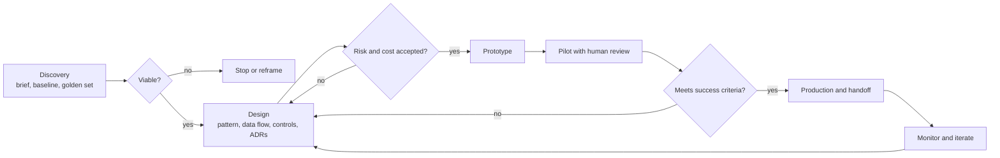

# Solution Design Process

> **Level:** Advanced · **Time:** ~40 min · **Exam relevance:** CCAR-P 1.1, 1.5, 6.1, 6.4

## In plain English

Building a Claude solution for an organisation is closer to building an extension on a house than to installing an app. Before anyone
lays a brick, an architect asks how the family lives, what they can spend, what the planning rules allow and what must not be disturbed.
Then they draw plans, get sign-off and only then call the builders. Skipping the conversation produces a beautiful room nobody uses.

The solution design process has three phases:

1. **Discovery**: understand the problem, the people, the data, the constraints and what "better" means in numbers.
2. **Design**: choose a pattern, draw the architecture, decide the controls, estimate cost and record the decisions.
3. **Delivery**: build in thin slices, evaluate against the success criteria, and hand over to the team that will run it.

Each phase produces artefacts that the next one depends on. If an artefact is missing, the later phase has to guess, and guesses about
AI systems are expensive because the failure modes (wrong answers delivered confidently, runaway cost, data leaking into the wrong place)
are not obvious until real users arrive.

## Why it matters

- **Most failed AI projects fail at discovery, not at the model.** The common causes are an unclear success measure, data that cannot be
  used for the purpose, or a workflow that nobody owns. No prompt fixes those.
- **Generative systems are probabilistic.** You cannot write a conventional acceptance test that says "output equals X". You need agreed
  evaluation criteria before you build, or every demo becomes an argument about taste.
- **Regulated organisations need evidence.** Risk, privacy and security teams want to see data flows, controls and decisions written down
  before production. Discovery and design are where that evidence is created.
- **The exam tests judgement.** Scenario questions in CCAR-P Domain 1 and Domain 6 usually reward the answer that clarifies the problem,
  starts simple and measures, over the answer that jumps to the most sophisticated architecture.

## How it works

### Phase 1: Discovery

Discovery answers five questions. Write the answers down; a one-page discovery brief is enough for most initiatives.

| Question | What you are looking for | Typical techniques |
|---|---|---|
| What problem, for whom? | A named user group, a task they do today, and the pain (time, errors, backlog, cost, risk) | Stakeholder interviews, shadowing, process maps |
| What does good look like? | Measurable success criteria with a baseline: handling time, accuracy, deflection rate, cycle time | Baseline sampling, existing KPIs, a "golden set" of 30–100 real cases |
| What data and systems are involved? | Sources, owners, sensitivity class, freshness, access paths, retention rules | Data inventory, system context diagram |
| What are the constraints? | Regulation, data residency, latency, budget, change windows, accessibility, languages | Risk and privacy workshops, procurement review |
| What happens when it is wrong? | Cost of an error, who catches it, whether it is reversible | Failure-mode walk-through, risk matrix |

Two discovery habits pay off repeatedly:

- **Collect real examples early.** Ask for 50 anonymised or synthetic-but-realistic inputs with the answer an expert would give. These
  become your first evaluation set (see [building eval datasets](../14-evaluation-and-testing/03-building-eval-datasets.md)) and they
  expose edge cases that interviews miss.
- **Separate the task from the workflow.** "Summarise a claim file" is a task. "Get the claim decision made in two days" is a workflow
  that includes queues, approvals and other systems. Claude often helps most when you redesign the workflow, not only the task.

### Decomposition

Once the problem is clear, break it into pieces before choosing technology. A useful decomposition walks the request from input to
outcome and labels each step:

1. **Deterministic**: rules, lookups, validation. Write ordinary code.
2. **Language task with a fixed shape**: classify, extract, summarise, draft. One Claude call with a clear prompt and a schema.
3. **Language task with a variable path**: investigate, research, troubleshoot, where the next step depends on what was found. This is
   where tool use and agents earn their cost.
4. **Human judgement**: approvals, exceptions, anything with legal or financial consequences. Design the hand-off explicitly.

Decomposition stops you building an agent for something that is really three fixed steps, and it shows where human review belongs.
[Workflows versus agents](../10-agentic-ai/01-workflows-vs-agents.md) and [workflow patterns](../10-agentic-ai/02-workflow-patterns.md)
cover the pattern choice in depth; [task decomposition and chaining](../03-prompt-engineering/05-task-decomposition-and-chaining.md) covers
it at the prompt level.

### Phase 2: Design

Design converts the brief into decisions. A complete design pack usually contains:

| Artefact | Purpose |
|---|---|
| Context diagram | Shows users, Claude, your services and external systems, and the trust boundaries between them |
| Pattern choice | Single call, workflow, agent or multi-agent, with the reason ([architecture patterns](02-architecture-patterns.md)) |
| Data flow and classification | Which data reaches the model, through which platform, with what retention ([governance](05-data-governance-and-compliance.md)) |
| Model and platform choice | Model tier per step, delivery platform, region ([model selection](../05-claude-products-and-models/03-model-selection.md)) |
| Control set | Guardrails, permissions, human approval points, logging, rate limits ([enterprise deployment controls](../12-ai-security/14-enterprise-deployment-controls.md)) |
| Evaluation plan | The metrics, datasets and thresholds that decide go or no-go |
| Cost and capacity model | Tokens per request, requests per day, caching and batch assumptions ([business value and ROI](08-business-value-and-roi.md)) |
| Decision records | One ADR per significant, hard-to-reverse choice ([ADRs](07-architecture-decision-records.md)) |
| Operating model | Who owns prompts, evaluations, incidents and model upgrades after go-live ([lifecycle](09-lifecycle-management.md)) |

Design is iterative. A common sequence is: sketch the simplest viable pattern, run the golden set through a prototype prompt, look at the
failures, and only then add retrieval, tools or more steps to address the specific failures you saw.

### Phase 3: Delivery

Delivery works best in thin vertical slices: one user group, one task, end to end, with evaluation and logging from day one.

1. **Prototype**: prompt plus golden set, run in a notebook or a lab harness. Goal: prove viability, not polish.
2. **Pilot**: real integration, limited users, human review of every output, metrics collected against the baseline.
3. **Production**: controls hardened, SLOs agreed, runbooks written, on-call assigned, rollback tested.
4. **Scale**: more users, more tasks, cost optimisation (caching, batch, model tiering), automation of the review that the data says is safe to automate.

Each step has an exit gate. The gate questions are always the same three: does it meet the agreed quality bar on the evaluation set, are
the risks accepted by the people who own them, and can the operating team support it?



## Example

The fragment below shows a small but realistic use of Claude inside discovery itself: turning raw interview notes into a structured
requirements draft that the architect then reviews. It uses structured outputs so the result can be loaded into a tracker. It respects the
current API rules: no sampling parameters, no prefill, and a `stop_reason` check before using the content.

> **Cost:** requires API credits (live mode).

```python
"""Draft structured requirements from discovery interview notes (architect reviews the output)."""
import json
import os

import anthropic

client = anthropic.Anthropic()  # reads ANTHROPIC_API_KEY or an `ant auth login` profile
MODEL = os.environ.get("CLAUDE_MODEL", "claude-opus-5-5")

REQUIREMENTS_SCHEMA = {
    "type": "object",
    "properties": {
        "problem_statement": {"type": "string"},
        "user_groups": {"type": "array", "items": {"type": "string"}},
        "success_metrics": {
            "type": "array",
            "items": {
                "type": "object",
                "properties": {
                    "metric": {"type": "string"},
                    "baseline": {"type": "string"},
                    "target": {"type": "string"},
                },
                "required": ["metric", "baseline", "target"],
                "additionalProperties": False,
            },
        },
        "data_sources": {"type": "array", "items": {"type": "string"}},
        "constraints": {"type": "array", "items": {"type": "string"}},
        "open_questions": {"type": "array", "items": {"type": "string"}},
    },
    "required": ["problem_statement", "user_groups", "success_metrics",
                 "data_sources", "constraints", "open_questions"],
    "additionalProperties": False,
}

notes = open("interview-notes.txt", encoding="utf-8").read()  # synthetic notes only

response = client.messages.create(
    model=MODEL,
    max_tokens=4000,
    system=(
        "You help a solution architect structure discovery notes. Use only facts stated in the notes. "
        "Where a baseline or target is not stated, write 'unknown' and add an open question instead of guessing."
    ),
    output_config={"format": {"type": "json_schema", "schema": REQUIREMENTS_SCHEMA}},
    messages=[{"role": "user", "content": f"<notes>\n{notes}\n</notes>"}],
)

if response.stop_reason != "end_turn":
    raise RuntimeError(f"Unexpected stop_reason: {response.stop_reason}")

draft = json.loads(response.content[0].text)
print(json.dumps(draft, indent=2))
```

The instruction "write 'unknown' and add an open question" is the important design choice: discovery output that invents a baseline is
worse than no output, because it looks authoritative.

## Enterprise use case

*Acme Logistics* runs a customs-documentation desk where 40 specialists check shipping paperwork against import rules. Leadership asked for
"an AI agent that clears customs automatically".

- **Discovery** showed that 70% of a specialist's time went on three fixed activities: extracting fields from commercial invoices,
  comparing them with the booking record, and drafting a query email when they disagree. Only a small share of cases needed open-ended
  investigation. Baseline: 18 minutes per file, measured over two weeks on 300 files. Errors were caught downstream by a broker, so the
  cost of a model error was a delay, not a fine, provided a human still signed the declaration.
- **Decomposition** labelled extraction and comparison as fixed-shape language tasks, query drafting as a fixed-shape task with a
  template, and the remaining exception cases as human judgement.
- **Design** chose a prompt-chaining workflow (extract, compare in code, draft) instead of an autonomous agent, kept the human signature,
  and used Claude Platform on AWS because the documents already lived in Amazon S3 in the same region. Two ADRs recorded the pattern
  choice and the platform choice.
- **Delivery** piloted with six specialists for four weeks. The success gate was "median handling time under 9 minutes with no increase in
  broker rejections". The pilot met the time target and surfaced a recurring extraction failure on handwritten annotations, which became
  the next iteration's work item.

The request for an agent was not wrong; it was premature. The discovery brief made the simpler design obviously cheaper, safer and easier
to measure, and it left room to add an investigation agent for exceptions later.

## Common mistakes

- **Starting with the technology.** "We need RAG" or "we need agents" before anyone has stated the problem and the metric.
- **No baseline.** Without the current handling time or error rate, nobody can prove value, and the project loses funding at the first budget review.
- **Golden sets made of easy cases.** If the evaluation set only contains clean inputs, the pilot will look excellent and production will not.
- **Treating risk review as the last step.** Privacy, security and legal findings late in delivery cause redesigns. Invite them to discovery.
- **Designing for the demo audience, not the operator.** The team that will run the service at 2 a.m. needs runbooks, dashboards and a rollback path.
- **One giant phase gate.** Long design phases without a prototype produce documents nobody trusts. Prototype early, inside the design phase.

## Security considerations

- Classify data during discovery, not after. The classification decides the platform, the retention settings and whether a business
  associate agreement or similar contract is needed ([data governance and compliance](05-data-governance-and-compliance.md)).
- Use synthetic or properly de-identified data for prototypes unless the agreed contracts and controls already cover real data.
- Threat-model the design before the pilot. [LLM threat modelling](../12-ai-security/01-llm-threat-modelling.md) and the
  [OWASP LLM mapping](../12-ai-security/owasp-llm-mapping.md) give you a checklist.
- When you use Claude to help with discovery (as in the example), treat its output as a draft. Notes may contain personal data, so apply
  the same handling rules to prompts and outputs as to the notes themselves.

## Troubleshooting

| Symptom | Likely cause | What to do |
|---|---|---|
| Stakeholders disagree on whether the pilot "worked" | Success criteria were not agreed before the pilot | Re-run discovery for the metric; agree thresholds in writing; re-evaluate |
| Prototype quality is high, pilot quality is low | Golden set unrepresentative | Sample real pilot inputs into the evaluation set; stratify by case type |
| Design keeps growing | Each failure is patched with a new component | Diagnose failures by category first ([diagnosing failures](../14-evaluation-and-testing/06-diagnosing-failures.md)) |
| Late "no" from privacy or legal | Data flow not shared early | Share the context diagram and data classification at the end of discovery |
| Operations team refuses handoff | No runbooks, no ownership, no SLOs | Treat the operating model as a design artefact ([lifecycle](09-lifecycle-management.md)) |

## Check your understanding

1. Name the five discovery questions and one artefact each produces.
2. Why does decomposition come before pattern selection?
3. A sponsor wants to skip the baseline measurement to "move faster". What do you tell them?
4. What three questions does every delivery gate ask?
5. In the Acme Logistics case, what evidence justified a workflow over an agent?

<details>
<summary>Answers</summary>

1. Problem and users (discovery brief), definition of good (success metrics with a baseline and a golden set), data and systems (data
   inventory and context diagram), constraints (constraint list and risk notes), cost of error (failure-mode table).
2. Because the pattern should follow the shape of the work. Decomposition shows which steps are deterministic, fixed-shape, variable-path
   or human judgement, and that drives whether you need a single call, a workflow or an agent.
3. Without a baseline you cannot show improvement, size the business case or set a fair go/no-go threshold. A short sampling exercise
   (a few hundred cases) is cheap compared with a pilot nobody can judge.
4. Does it meet the agreed quality bar on the evaluation set? Are the risks accepted by their owners? Can the operating team support it?
5. Most of the time was spent on three fixed activities with predictable steps, errors were recoverable because a human still signed,
   and the open-ended exceptions were a small share that could stay with humans or be addressed later.

</details>

## Further reading

- Anthropic engineering: [Building effective agents](https://www.anthropic.com/engineering/building-effective-agents) (start simple, add complexity only when measured value justifies it)
- Claude docs: [Define success criteria and build evaluations](https://platform.claude.com/docs/en/test-and-evaluate/develop-tests)
- In this repository: [architecture patterns](02-architecture-patterns.md), [stakeholder communication](06-stakeholder-communication.md),
  [lifecycle management](09-lifecycle-management.md), [why evaluate](../14-evaluation-and-testing/01-why-evaluate.md)
- Practice: [Lab 20: Secure enterprise architecture](../19-hands-on-labs/lab-20-secure-enterprise-architecture/README.md)

<!-- page-nav:start -->
---

[Module overview](README.md) · [Next: Architecture Patterns →](02-architecture-patterns.md)
<!-- page-nav:end -->
