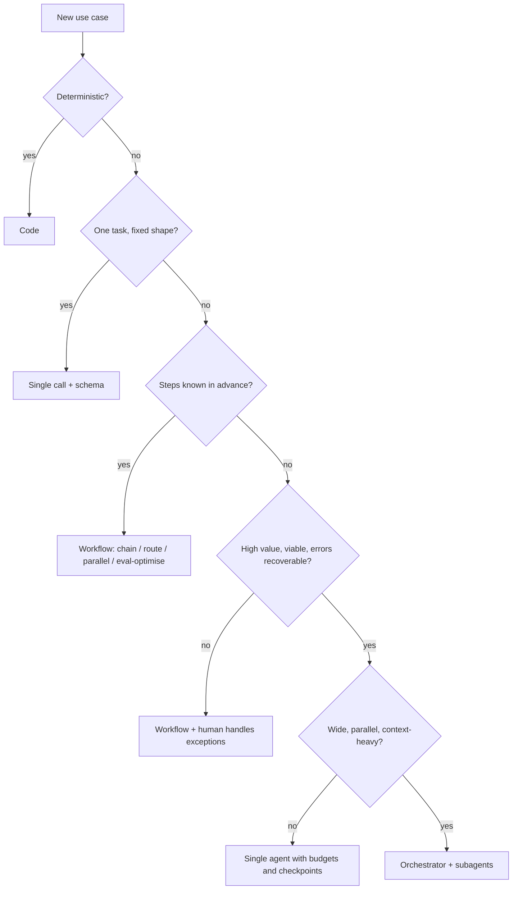

# Architecture Patterns

> **Level:** Advanced · **Time:** ~40 min · **Exam relevance:** CCAR-P 1.2, 1.3, 1.4, 1.5

## In plain English

An architecture pattern is a proven shape for a solution. Think of kitchen layouts: a galley, an L-shape, an island. None is "best"; each
suits a different room and a different way of cooking. Claude solutions have a similar small set of shapes, and most of the architect's
skill lies in choosing the smallest one that does the job, then wrapping it with the right supporting patterns (a gateway, retrieval,
human review, caching).

This page gives you two things: a **pattern ladder** for the core of the solution (how much the model decides on its own) and a set of
**cross-cutting patterns** that every production system needs regardless of which rung you are on.

## Why it matters

- Each step up the ladder adds capability and also adds cost, latency, unpredictability and testing effort. Choosing one rung too high is
  the most common architecture error in early Claude projects.
- Choosing one rung too low is the second most common: forcing an open-ended investigation into a rigid pipeline produces brittle code full
  of special cases.
- Exam scenarios in CCAR-P 1.3 and 1.4 often describe a business task and ask which pattern fits. You need a fast, defensible way to decide.

## How it works

### The pattern ladder

| Rung | Pattern | Who controls the steps | Good fit | Watch out for |
|---|---|---|---|---|
| 0 | Deterministic code | Your code only | Rules, lookups, calculations | Using a model for something a regex can do |
| 1 | Single call | Your code, one model call | Classify, extract, summarise, draft | Prompts that try to do five tasks at once |
| 2 | Augmented LLM | Your code, one call with retrieval, tools or memory | Grounded Q&A, simple lookups | Tool lists that grow without review |
| 3 | Workflow | Your code decides the sequence; the model fills each step | Known multi-step processes | Hard-coding paths that genuinely vary |
| 4 | Single agent | The model decides the next step in a loop with tools | Open-ended investigation, coding, research | Runaway loops, cost, compounding errors |
| 5 | Multi-agent | An orchestrator model delegates to subagents | Wide, parallelisable research or analysis | Token cost multiplies; coordination failures |

The distinction between rungs 3 and 4 comes from Anthropic's engineering guidance: in a **workflow**, the code path is predefined; in an
**agent**, the model directs its own process and tool use. Module 10 covers this distinction in detail in
[workflows versus agents](../10-agentic-ai/01-workflows-vs-agents.md), and the workflow shapes (prompt chaining, routing,
parallelisation, orchestrator–workers, evaluator–optimiser) in [workflow patterns](../10-agentic-ai/02-workflow-patterns.md).

### A decision procedure

Walk down this list and stop at the first "yes".

1. Can ordinary code do it reliably? Use code.
2. Is it one language task with a predictable input and output shape? Use a single call with a clear prompt and, where the output feeds
   another system, structured outputs.
3. Does it need facts the model does not have, or one or two actions? Add retrieval or a few well-designed tools (augmented LLM).
4. Are the steps known in advance even if each needs language skill? Use a workflow, and pick the workflow shape that matches
   (chain for sequences, route for distinct categories, parallelise for independent sub-tasks or voting, evaluator–optimiser for
   refinement against clear criteria).
5. Does the number and order of steps depend on what is discovered along the way, and is the value high enough to justify extra cost and
   latency, and can errors be caught? Use an agent with budgets, stopping conditions and human checkpoints.
6. Is the agent's work wide (many independent threads), and does a single context fill up with reading? Consider an orchestrator with
   subagents, and measure whether the extra tokens buy better results.

The Claude API guidance frames step 5 as four checks: complexity, value, viability and cost of error. If any is "no", stay on a lower rung.

### Cross-cutting patterns

These wrap around whichever core pattern you chose. Most enterprise designs include at least the first four.

| Pattern | What it does | Where it is covered |
|---|---|---|
| **AI gateway** | One internal entry point for all model traffic: authentication, routing, quotas, logging, redaction, model allow-list | [Reference architectures](03-reference-architectures.md) |
| **Retrieval (RAG)** | Fetches relevant, permission-filtered content and passes it to the model with citations | [Module 11](../11-rag-and-knowledge-systems/README.md) |
| **Human in the loop** | Approval gates, confidence thresholds and escalation for consequential actions | [Human in the loop](../10-agentic-ai/05-human-in-the-loop.md) |
| **Guardrails** | Input and output checks: schema validation, policy classifiers, PII detection, allow-listed actions | [Enterprise deployment controls](../12-ai-security/14-enterprise-deployment-controls.md) |
| **Model tiering** | Route easy work to a smaller, faster model and hard work to a larger one; or use effort settings within one model | [Model selection](../05-claude-products-and-models/03-model-selection.md) |
| **Prompt caching** | Keep stable content (system prompt, tools, reference documents) as a cacheable prefix | [Prompt caching](../04-context-engineering/03-prompt-caching.md) |
| **Async and batch** | Move non-interactive work off the request path, using queues or the Message Batches API | [Integration patterns](04-integration-patterns.md) |
| **Evaluation harness** | Automated regression tests on a fixed dataset before each prompt, model or tool change | [Module 14](../14-evaluation-and-testing/README.md) |
| **Observability** | Traces, token and cost metrics, quality sampling, audit logs | [Observability](../15-production-operations/02-observability.md) |

### Multi-agent orchestration strategies

When you do reach rung 5, choose an orchestration strategy deliberately:

- **Orchestrator–subagents (fan-out, fan-in)**: a lead agent plans, spawns subagents with narrow briefs, and synthesises. Each subagent has
  its own context window, which isolates noisy reading from the lead. Anthropic's multi-agent research write-up reports large gains on
  breadth-first research and also reports that such systems use many times the tokens of a chat interaction, so cost is the first thing to model.
- **Pipeline of specialists**: fixed sequence of agents (for example investigate, then draft, then review). This is really a workflow whose
  steps happen to be agents; it is easier to test than free-form delegation.
- **Supervisor with tools-as-agents**: the lead agent sees subagents as tools with typed inputs and outputs. This keeps interfaces explicit
  and makes logging simple.

Multi-agent designs are a poor fit when every agent needs the same context, when steps are tightly dependent, or when the task is low value.
Details and failure propagation are in [multi-agent architecture](../10-agentic-ai/04-multi-agent-architecture.md).



## Example

Here is a minimal routing workflow, one of the most useful patterns in enterprise systems. A small, fast model classifies the request, and
code chooses the handler. The classifier uses structured outputs so the route is always one of the allowed values.

> **Cost:** requires API credits (live mode).

```python
"""Routing workflow: classify with a fast model, then dispatch in code."""
import json

import anthropic

client = anthropic.Anthropic()

ROUTES = ["billing", "technical", "account_access", "other"]

def classify(ticket: str) -> str:
    response = client.messages.create(
        model="claude-haiku-5-5",
        max_tokens=256,
        output_config={
            "effort": "low",
            "format": {
                "type": "json_schema",
                "schema": {
                    "type": "object",
                    "properties": {"route": {"type": "string", "enum": ROUTES}},
                    "required": ["route"],
                    "additionalProperties": False,
                },
            },
        },
        system="Classify the support ticket into exactly one route.",
        messages=[{"role": "user", "content": ticket}],
    )
    if response.stop_reason != "end_turn":
        return "other"  # fail safe: send to a human queue
    return json.loads(response.content[0].text)["route"]

HANDLERS = {
    "billing": lambda t: f"queued for billing workflow: {t[:40]}",
    "technical": lambda t: f"queued for technical RAG assistant: {t[:40]}",
    "account_access": lambda t: f"sent to identity team (human only): {t[:40]}",
    "other": lambda t: f"sent to general human queue: {t[:40]}",
}

ticket = "I was charged twice for my March invoice."
print(HANDLERS[classify(ticket)](ticket))
```

Note the architectural choices: account access goes to humans because the cost of an error is high, and any unexpected stop reason falls
back to the human queue instead of guessing.

## Enterprise use case

*Fabrikam Insurance* wants to help claims handlers with three things: answering policy-wording questions, summarising claim files, and
investigating suspected duplicate claims.

| Need | Shape of the work | Pattern chosen | Why |
|---|---|---|---|
| Policy-wording questions | One question, answer must quote the policy | Augmented LLM (RAG with citations) | Facts live in documents; the answer shape is fixed |
| Claim file summary | Fixed sections, every file | Single call with a template and schema | Predictable input and output |
| Duplicate-claim investigation | Search claims, compare images and dates, query a fraud database, follow leads | Single agent with read-only tools, step and cost budgets, human decision at the end | Path depends on findings; value per case is high; the human makes the call |

Fabrikam considered a multi-agent design for investigations but rejected it in an ADR: each lead depended on the previous one, so
parallel subagents would mostly wait or duplicate work, and the extra tokens bought nothing in the pilot evaluation.

## Common mistakes

- **Pattern by fashion.** Choosing an agent because it is impressive, not because the path is unpredictable.
- **One prompt doing everything.** A 4,000-word prompt that classifies, extracts, decides and drafts is a workflow hiding inside a single
  call; split it so each step can be tested.
- **Tools without ownership.** Adding every available API as a tool. Large tool sets confuse selection and widen the attack surface
  (capability bloat, CCAR-P 3.1). Keep tools few, distinct and least-privilege.
- **Multi-agent for dependent work.** Parallel subagents only help when their work is independent.
- **Forgetting the cross-cutting layer.** A clever core pattern with no gateway, no logging and no evaluation is not production ready.

## Security considerations

- Every rung up the ladder increases **agency**: the ability of model output to cause effects. Match permissions to the rung. Single calls
  usually need none; agents need scoped, audited, preferably read-only tools with approval for writes
  ([tool misuse and excessive agency](../12-ai-security/05-tool-misuse-and-excessive-agency.md)).
- Retrieval brings untrusted content into the prompt, which is the main path for indirect prompt injection
  ([indirect prompt injection](../12-ai-security/03-indirect-prompt-injection.md)). Treat retrieved text as data, not instructions.
- Multi-agent systems need identity per agent and audit trails that show which agent did what
  ([agent identity and permissions](../12-ai-security/09-agent-identity-and-permissions.md)).
- Route high-risk categories (account access, payments, deletions) to humans by design, as in the routing example.

## Troubleshooting

| Symptom | Likely cause | Fix |
|---|---|---|
| Agent takes 30 steps for a task a person does in 4 | Task was fixed-path; agent explores needlessly | Move to a workflow; or give the agent a plan template and a step budget |
| Workflow full of `if` branches for special cases | Path genuinely varies | Consider an agent for the variable part only, inside the workflow |
| Costs far above estimate after adding subagents | Token multiplication from parallel contexts | Measure single-agent baseline; cap subagent count; use a smaller model for workers |
| Router sends many tickets to the wrong place | Overlapping categories or vague descriptions | Make categories mutually exclusive; add examples; evaluate on a labelled set |

## Check your understanding

1. What is the defining difference between a workflow and an agent?
2. List the four checks you should pass before choosing an agent.
3. Give two situations where a multi-agent design is a poor fit.
4. Why does the routing example fall back to a human queue on an unexpected `stop_reason`?
5. Name four cross-cutting patterns that almost every production Claude system needs.

<details>
<summary>Answers</summary>

1. In a workflow, your code defines the sequence of steps. In an agent, the model decides the next step and which tool to use, in a loop,
   based on what it observes.
2. Complexity (multi-step, hard to specify in advance), value (justifies extra cost and latency), viability (Claude is capable at it), and
   cost of error (mistakes can be caught and recovered).
3. Any two of: all agents need the same context; sub-tasks depend tightly on one another; the task is low value relative to token cost;
   most coding tasks with few parallel parts.
4. Because the classifier output cannot be trusted if generation did not end normally (for example `max_tokens` or `refusal`). Failing safe
   to a human is better than guessing a route.
5. Any four of: AI gateway, retrieval, human in the loop, guardrails, model tiering, prompt caching, async/batch, evaluation harness, observability.

</details>

## Further reading

- Anthropic engineering: [Building effective agents](https://www.anthropic.com/engineering/building-effective-agents)
- Anthropic engineering: [How we built our multi-agent research system](https://www.anthropic.com/engineering/multi-agent-research-system)
- Claude docs: [Structured outputs](https://platform.claude.com/docs/en/build-with-claude/structured-outputs)
- In this repository: [workflow patterns](../10-agentic-ai/02-workflow-patterns.md), [the agent loop](../10-agentic-ai/03-the-agent-loop.md),
  [reference architectures](03-reference-architectures.md), [tool design best practices](../07-tool-use-and-function-calling/05-tool-design-best-practices.md)
- Practice: [Lab 12: Agentic task execution](../19-hands-on-labs/lab-12-agentic-task-execution/README.md),
  [Agentic investigation assistant project](../20-real-world-projects/05-agentic-investigation-assistant/README.md)
