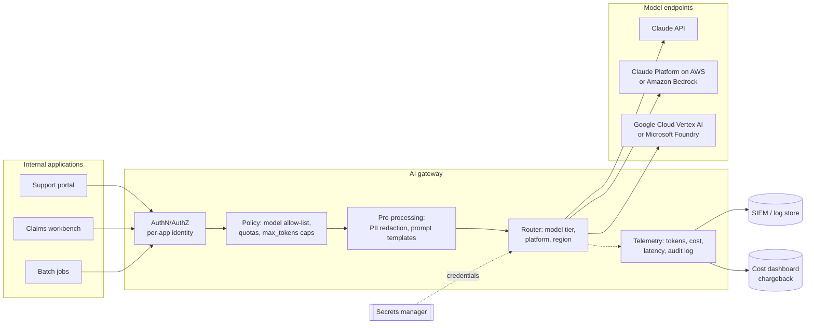
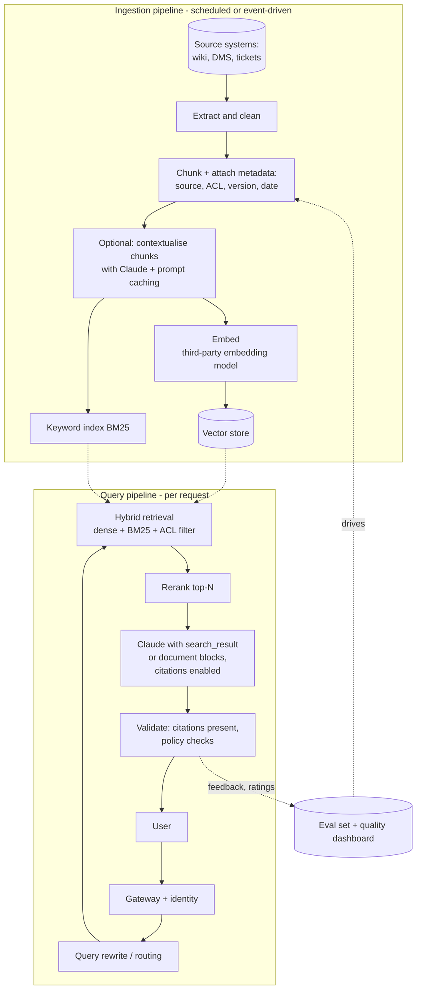
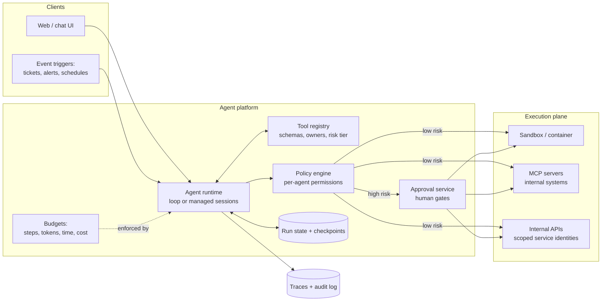
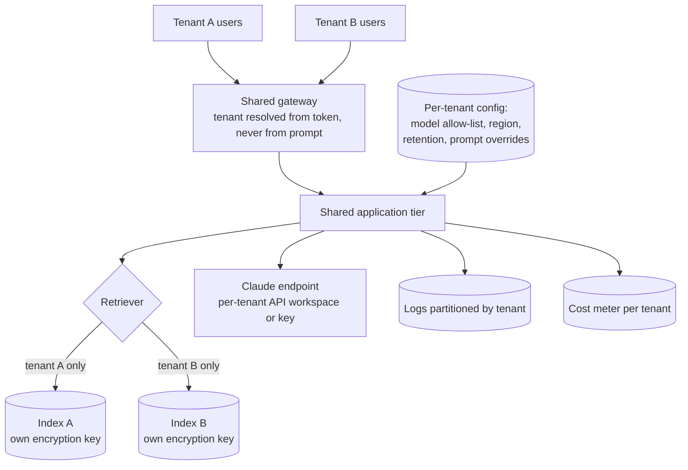

# Reference Architectures

> **Level:** Advanced · **Time:** ~50 min · **Exam relevance:** CCAR-P 1.2, 1.4, 6.4

## In plain English

A reference architecture is a labelled drawing of a solution shape that has worked before, with the reasons behind each box. It is not a
blueprint you copy line by line; it is a starting point that saves you from forgetting something important, such as where logs go or who
is allowed to call the model.

This page gives four reference architectures that cover most enterprise Claude work:

1. **AI gateway**: the shared front door for all model traffic.
2. **RAG service**: grounded question answering over private content.
3. **Agent platform**: running tool-using agents safely and repeatably.
4. **Multi-tenant SaaS**: serving many customer organisations from one deployment without mixing their data.

Each one is drawn in Mermaid so you can paste it into your own design document and edit it.

## Why it matters

- Reference architectures make reviews faster. A risk reviewer who has approved the gateway pattern once can focus on what is different
  in the next project.
- They encode lessons that are easy to miss: permission filtering before retrieval, per-tenant cache and log separation, step budgets for agents.
- CCAR-P 1.2 asks you to design end-to-end architectures including input, processing, output and feedback loops. Each diagram below shows
  all four, and you should be able to redraw them from memory.

## How it works

### 1. AI gateway pattern

An AI gateway is an internal service that sits between every application and every model endpoint. Applications never hold model
credentials; they call the gateway with their own identity.



**Responsibilities**

| Concern | Gateway responsibility |
|---|---|
| Identity | Authenticate each calling application; map it to a team, cost centre and data classification ceiling |
| Policy | Allow-list models and features per application; cap `max_tokens`; enforce rate limits and budgets |
| Data protection | Optional redaction or tokenisation of identifiers; block disallowed data classes |
| Routing | Choose model tier and platform; fail over between regions or platforms where contracts allow |
| Observability | Record request metadata, token usage (including `cache_read_input_tokens`), latency, `stop_reason`, errors |
| Cost | Attribute spend per application; alert on anomalies |

**Design notes**

- Keep the gateway thin. It should not rewrite prompts in ways the application cannot see, or debugging becomes impossible. Prompt templates
  that the gateway applies should be versioned and visible.
- Preserve prompt caching. Caching is a prefix match, so any per-request value injected at the top of the system prompt (a timestamp, a
  request ID) silently destroys cache hits. Inject such values after the cached prefix or into metadata.
- Pass streaming through. Interactive applications need server-sent events end to end; a gateway that buffers responses ruins perceived latency.
- Log content selectively. Full prompt and response logging may itself create a regulated data store. Decide per data class.

### 2. RAG reference architecture

The RAG architecture has two pipelines: an **ingestion** pipeline that keeps the index current, and a **query** pipeline that answers questions.



**Design notes**

- Apply access control at retrieval time, using metadata copied from the source system. Filtering after the model has seen the text is too late.
- Anthropic does not offer its own embedding model; its documentation points to third-party providers and names Voyage AI as one option
  (as of 2026-10-24). Record the embedding model and version in the index metadata so you can re-embed safely. See
  [embeddings and indexing](../11-rag-and-knowledge-systems/03-embeddings-and-indexing.md).
- The citations feature returns exact passages that support each claim; it cannot be combined with structured outputs in the same request.
  See [grounding and citations](../11-rag-and-knowledge-systems/05-grounding-and-citations.md).
- If the whole knowledge base is small enough to fit in the context window, putting it all in a cached prompt may beat building a
  pipeline at all. See [RAG versus long context](../11-rag-and-knowledge-systems/07-rag-vs-long-context.md).

### 3. Agent platform

When several teams build agents, a shared platform stops each team from reinventing tool registries, sandboxes and approval flows.



**Design notes**

- **Runtime choice**: you can run your own loop with the Claude API (manual loop or the SDK Tool Runner), embed the Claude Agent SDK in a
  service you host, or use Claude Managed Agents, where Anthropic runs the loop and hosts a per-session sandbox. Managed Agents was in beta
  and available on the Claude API and Claude Platform on AWS, not on Bedrock, Vertex AI or Foundry, as of 2026-10-24. See
  [Managed Agents and the Agent SDK](../10-agentic-ai/06-managed-agents-and-agent-sdk.md).
- **Tool registry**: every tool has an owner, a risk tier (read, reversible write, irreversible write) and a description reviewed for clarity.
  The policy engine decides which agent may call which tool, and which tier needs approval.
- **State and checkpoints**: long-running agents fail mid-task. Persist state after each step so a run can resume, and make write tools
  idempotent (accept an idempotency key) so a retry does not double-apply. See [agent reliability](../10-agentic-ai/07-agent-reliability.md).
- **Budgets and stopping conditions**: cap steps, tokens, wall-clock time and cost per run, and define what "done" means.
- **Identity**: each agent runs with its own service identity, never a human's personal token, so actions are attributable.

### 4. Multi-tenant designs

A software-as-a-service (SaaS) vendor serving many customer organisations must keep each tenant's data, prompts, caches, logs and costs
separate. There are three common isolation models.

| Model | Description | Isolation | Cost and operations |
|---|---|---|---|
| **Silo** | Separate deployment, index, keys (and often cloud account) per tenant | Strongest | Highest cost; many deployments to upgrade |
| **Pool** | Shared services and stores; tenant ID enforced on every query and record | Depends on code discipline | Cheapest; one deployment |
| **Bridge** | Shared compute and gateway, but per-tenant indexes, keys or workspaces | Strong for data at rest | Moderate; common compromise |



**Design notes**

- Resolve the tenant from the authenticated session, never from text in the prompt. A prompt saying "I am tenant B" must not change anything.
- Keep per-tenant prompt material (custom instructions, examples) after the shared, cacheable prefix, so the shared prefix caches across
  tenants while tenant content stays separate.
- Use separate Claude API workspaces or keys per tenant (or per tier of tenant) when you need separate rate limits, spend limits or usage
  reporting. See [rate limits and capacity](../15-production-operations/06-rate-limits-and-capacity.md).
- Offer per-tenant configuration for region and retention, because tenants in different jurisdictions will ask for different answers.
- Test isolation explicitly: an evaluation that tries cross-tenant retrieval and prompt injection should be part of every release.

## Example

The configuration below is a compact way to document a gateway's policy for each calling application. It is plain data that the gateway
loads, reviewers can read, and change control can track.

```yaml
# gateway-policy.yaml (illustrative; synthetic applications)
applications:
  claims-workbench:
    owner: claims-platform-team
    data_ceiling: confidential          # highest data class this app may send
    allowed_models: [claude-sonnet-5-5, claude-haiku-5-5]
    max_tokens_cap: 8000
    monthly_budget_usd: 6000
    platform: claude-platform-on-aws
    log_content: metadata_only          # do not store prompt or response bodies
  policy-qa:
    owner: knowledge-team
    data_ceiling: internal
    allowed_models: [claude-opus-5-5, claude-haiku-5-5]
    max_tokens_cap: 16000
    monthly_budget_usd: 2500
    platform: claude-api
    log_content: full_with_30_day_retention
```

And a small gateway check written in Python that enforces the allow-list and the cap before forwarding:

```python
import yaml

POLICY = yaml.safe_load(open("gateway-policy.yaml", encoding="utf-8"))["applications"]

def authorise(app_id: str, request: dict) -> dict:
    policy = POLICY.get(app_id)
    if policy is None:
        raise PermissionError(f"unknown application {app_id}")
    if request["model"] not in policy["allowed_models"]:
        raise PermissionError(f"{app_id} may not use {request['model']}")
    for banned in ("temperature", "top_p", "top_k"):
        request.pop(banned, None)  # not supported on current models; strip rather than fail
    request["max_tokens"] = min(request.get("max_tokens", 1024), policy["max_tokens_cap"])
    return request
```

## Enterprise use case

*Contoso Health* runs a patient-communications platform for 30 clinics, each a separate legal entity. It adopted a **bridge** model:

- One gateway and application tier, with the tenant resolved from the clinic's single sign-on token.
- A separate retrieval index per clinic, encrypted with a clinic-specific key, because clinics' document sets and retention rules differ.
- A shared, cached system prompt describing tone and safety rules, followed by each clinic's own instructions.
- Content logging off by default; metadata logging (tokens, latency, stop reason, tenant) on for all clinics.
- Only features covered by Contoso's business associate agreement with Anthropic were enabled for workloads touching protected health
  information; the governance page explains why that check matters ([data governance and compliance](05-data-governance-and-compliance.md)).
- A release gate that runs a cross-tenant leakage test set: queries from clinic A that ask about clinic B's documents must return no B content.

## Common mistakes

- **Applications holding model keys directly.** You lose central control of models, spend and logging.
- **ACL filtering after generation.** Once restricted text is in the prompt, the model may use it.
- **A gateway that breaks caching or streaming.** Injecting per-request IDs at the start of prompts, or buffering streams.
- **Shared indexes with "tenant" as a soft filter.** One missing `WHERE tenant_id` and you have a breach.
- **Agents running as a human's account.** Actions cannot be attributed and permissions are far too broad.

## Security considerations

- The gateway is a high-value target: it holds credentials and sees all traffic. Harden it like an identity provider, store credentials in a
  secrets manager, and rotate them ([secrets management](../12-ai-security/10-secrets-management.md)).
- Log enough to investigate incidents without creating an uncontrolled copy of sensitive data ([logging and auditability](../12-ai-security/11-logging-and-auditability.md)).
- For agents, enforce least privilege per tool, approval for irreversible actions, and egress restrictions on sandboxes.
- For multi-tenant systems, include prompt injection that attempts tenant switching in your red-team set ([prompt injection](../12-ai-security/02-prompt-injection.md)).

## Troubleshooting

| Symptom | Likely cause | Fix |
|---|---|---|
| `cache_read_input_tokens` stays at zero behind the gateway | Gateway adds variable content to the prefix | Move variable content after the last cache breakpoint |
| Users see answers from documents they cannot open | ACL metadata missing or not applied at retrieval | Copy ACLs at ingestion; filter in the retriever; add a leakage test |
| Agent runs never finish | No step or cost budget, unclear completion criteria | Add budgets and an explicit definition of done |
| One tenant's spike throttles others | Shared rate limit | Separate workspaces or keys per tenant tier; per-tenant quotas in the gateway |

## Check your understanding

1. List four responsibilities of an AI gateway.
2. Why must access-control filtering happen in the retriever rather than after generation?
3. What three runtime options does an agent platform have for running the agent loop, and which one hosts the sandbox for you?
4. Compare the silo, pool and bridge tenancy models in one sentence each.
5. How can a gateway accidentally destroy prompt-cache hit rates?

<details>
<summary>Answers</summary>

1. Any four of: per-application authentication and authorisation, model allow-listing and quotas, redaction, routing across tiers and
   platforms, telemetry and audit logging, cost attribution, credential custody.
2. Because once restricted content is in the prompt, the model can use or reveal it; there is no reliable way to "un-see" it.
3. Your own loop on the Claude API (manual or Tool Runner), the Claude Agent SDK in a service you host, or Claude Managed Agents. Managed
   Agents runs the loop and hosts the per-session sandbox.
4. Silo: separate everything per tenant, strongest isolation, highest cost. Pool: shared everything with tenant IDs enforced in code,
   cheapest, riskiest. Bridge: shared compute with per-tenant data stores or keys, a common middle ground.
5. By inserting per-request values (timestamps, request IDs, user names) before the cached prefix, which changes the prefix bytes on every call.

</details>

## Further reading

- Claude docs: [Prompt caching](https://platform.claude.com/docs/en/build-with-claude/prompt-caching),
  [Citations](https://platform.claude.com/docs/en/build-with-claude/citations),
  [Embeddings](https://platform.claude.com/docs/en/build-with-claude/embeddings)
- Claude docs: [Managed Agents overview](https://platform.claude.com/docs/en/managed-agents/overview)
- Claude Code docs: [Agent SDK overview](https://code.claude.com/docs/en/agent-sdk/overview)
- In this repository: [integration patterns](04-integration-patterns.md), [RAG fundamentals](../11-rag-and-knowledge-systems/01-rag-fundamentals.md),
  [multi-agent architecture](../10-agentic-ai/04-multi-agent-architecture.md), [MCP architecture](../08-model-context-protocol/02-architecture.md)
- Practice: [Lab 20](../19-hands-on-labs/lab-20-secure-enterprise-architecture/README.md), [Lab 11](../19-hands-on-labs/lab-11-rag-pipeline/README.md),
  [Knowledge base Q&A assistant project](../20-real-world-projects/02-knowledge-base-qa-assistant/README.md)
