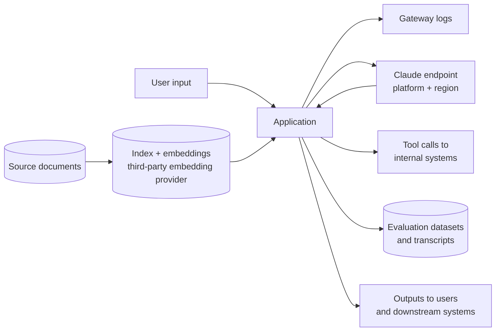

# Data Governance and Compliance

> **Level:** Advanced · **Time:** ~50 min · **Exam relevance:** CCAR-P 5.4, 5.2, 1.2

> **Not legal advice.** This page explains regulatory concepts so that you can ask the right questions and design for them. Your legal,
> privacy and compliance teams decide what applies to your organisation. Attestations and contract terms change; every vendor fact below is
> dated and linked so that you can re-check it.

## In plain English

Data governance is the set of rules about what data you have, who may use it, for what, where it may go and how long you keep it.
Compliance is showing that you follow the rules that law and contracts impose on you.

For a Claude solution, the questions are concrete:

- What data will be in prompts, retrieved documents, tool results and logs?
- Which laws or frameworks apply to that data (for example, the EU General Data Protection Regulation (GDPR) for personal data of people in
  the EU, the US Health Insurance Portability and Accountability Act (HIPAA) for protected health information, and the US Federal Risk and
  Authorization Management Program (FedRAMP) for cloud services used by federal agencies)?
- Which Claude offering, on which platform and in which configuration, is covered by the attestations and contracts those rules require?

The architect's job is to make the data flow visible, map each flow to its obligations, and pick offerings and settings that satisfy them,
with evidence.

## Why it matters

- Regulated data sent through an offering that is not covered by the required contract (for example, a business associate agreement under
  HIPAA) can be a compliance breach even if nothing leaks.
- Coverage is often **feature-specific**, not product-wide. A provider may cover its core messaging API but exclude certain beta features or
  file-handling endpoints. An architecture that routes regulated data through an excluded feature fails review.
- Data protection obligations reach logs, caches, evaluation datasets and backups, not only the live request.
- CCAR-P 5.4 asks you to ensure regulatory compliance using GDPR, HIPAA and FedRAMP as examples. Scenario questions usually test whether you
  check coverage and design data flows correctly, not whether you can recite articles of law.

## How it works

### Step 1: Map the data flow

Draw every place data goes. For a typical RAG or agent solution:



For each arrow, record: data categories, classification, legal basis or purpose, processor or sub-processor involved, region, retention, and
the control that protects it. Note that an embedding provider is a separate processor with its own terms.

### Step 2: Understand the obligations conceptually

#### GDPR (and similar privacy laws)

| Concept | What it means for a Claude architecture |
|---|---|
| Lawful basis and purpose limitation | Know why you process each personal-data field; do not reuse support transcripts for unrelated model evaluation without a basis |
| Data minimisation | Send only what the task needs; redact or pseudonymise identifiers the model does not need |
| Controller and processor roles | Your organisation is usually the controller; the model provider acts as a processor under a data processing agreement (DPA) |
| International transfers | Know where inference and storage happen; use contractual safeguards and, where offered, regional processing controls |
| Data subject rights | Be able to find and delete a person's data in your logs, indexes, caches and eval sets |
| Data protection impact assessment (DPIA) | Usually expected for new, large-scale or high-risk processing; AI use cases often qualify |
| Automated decision-making | Decisions with legal or similarly significant effects need safeguards, typically meaningful human review |

#### HIPAA

| Concept | What it means |
|---|---|
| Protected health information (PHI) | Health information linked to an individual, handled by covered entities and their business associates |
| Business associate agreement (BAA) | A vendor that handles PHI on your behalf must sign a BAA; without one, do not send PHI |
| Minimum necessary | Use and disclose only the PHI needed for the purpose |
| Safeguards | Administrative, physical and technical safeguards: access control, audit logs, encryption, integrity |
| Feature scope | A BAA may cover only specific products, endpoints or configurations; anything outside scope must not receive PHI |

#### FedRAMP

| Concept | What it means |
|---|---|
| Authorisation | A standardised US federal security assessment of a cloud service offering, at impact levels (Low, Moderate, High) |
| Boundary | The authorisation covers a defined system boundary; services outside it are not covered |
| Inheritance | An agency system inherits controls from the authorised cloud service and remains responsible for its own controls |
| Related programmes | US Department of Defense impact levels (IL) apply additional requirements for defence workloads |

### Step 3: Check what the vendor actually offers (verified facts)

The following facts were checked against Anthropic's official pages on 2026-10-24. Re-check them before relying on them; the
[Anthropic Trust Center](https://trust.anthropic.com) is the place to request current reports.

**Certifications for commercial products.** Anthropic's privacy center article
[What certifications has Anthropic obtained?](https://privacy.claude.com/en/articles/10015870-what-certifications-has-anthropic-obtained)
(dated 2026-03-16 when checked) lists, for commercial products such as Claude for Work and the Anthropic API:

- SOC 2 Type I and Type II
- ISO/IEC 27001:2022 (information security management)
- ISO/IEC 42001:2023 (AI management systems)
- A HIPAA-ready configuration, with a business associate agreement available

Consumer plans are covered by a separate article. That article did not mention FedRAMP.

**HIPAA and the BAA.** Anthropic's article
[Business Associate Agreements (BAA) for commercial customers](https://privacy.claude.com/en/articles/8114513-business-associate-agreements-baa-for-commercial-customers)
describes coverage at the feature level. When checked on 2026-10-24 it stated, in summary:

- The BAA covers only the organisation that accepted it, and enabling PHI use requires steps by the organisation (for the first-party API,
  signing the BAA and then contacting Anthropic to enable PHI use; for Claude Enterprise, turning on a HIPAA setting and accepting the BAA).
- Covered API features included the Messages API (with features such as prompt caching, structured outputs, memory, web search, bash and text
  editor tools), token counting, the Models API and computer use.
- **Not covered** on the API: the Message Batches API, the Files API, the Skills API, code execution and web fetch, plus external MCP servers
  when data goes to third parties. Beta features and the non-ZDR Console were also listed as not covered.
- Some models ("Covered Models") require 30-day retention and are not available under zero data retention (ZDR) unless Anthropic authorises it.
- Coverage for some features depended on accepting a BAA version after a stated date.

The architectural consequence is direct: a HIPAA workload that wants batch pricing or file uploads must either keep PHI out of those paths
(for example, de-identify first) or use a different design.

**FedRAMP.** Anthropic announced that Claude models are available for FedRAMP High and US Department of Defense IL4 and IL5 workloads through
Amazon Bedrock in AWS GovCloud (US)
([announcement](https://www.anthropic.com/news/claude-in-amazon-bedrock-fedramp-high)), and that Claude models are authorised for FedRAMP High
workloads through Google Cloud's Vertex AI ([announcement](https://www.anthropic.com/news/claude-on-google-cloud-fedramp-high)). In both cases
the authorisation belongs to the cloud provider's service boundary; check that the specific model, region and features you plan to use are inside it.

> **Unverified:** Third-party reports describe a "Claude for Government" offering and FedRAMP High availability for Claude Code and other
> Claude apps for government customers. These could not be confirmed against an official Anthropic page during this review (2026-10-24).
> Ask Anthropic or check the Trust Center before relying on them.

> **Unverified:** The exact list of regions and data-residency commitments for each platform changes frequently and was not verified
> here. Confirm with the platform documentation and your contract.

**Data residency controls.** On the Claude API, the `inference_geo` request parameter lets you request where inference runs (supported on
recent models; the response's `usage.inference_geo` reports where it ran), as of 2026-10-24. Cloud platforms offer their own regional
controls. Residency of inference is only one part: also check where your logs, indexes, embeddings and backups live.

### Step 4: Design the controls

| Control | Purpose | Example implementation |
|---|---|---|
| Data classification at the gateway | Block data classes an application may not send | Gateway policy with a per-app data ceiling |
| Minimisation and pseudonymisation | Reduce exposure | Replace names and account numbers with tokens before the call; re-identify after |
| Feature allow-list per data class | Keep regulated data in covered features | PHI workloads may not call batch, files, code execution or web fetch |
| Retention settings | Meet retention and deletion duties | Content logging off or short-lived; ZDR where available and appropriate |
| Regional routing | Meet residency and transfer rules | Platform and region per tenant; `inference_geo` where supported |
| Access control on retrieval | Prevent disclosure to the wrong user | ACL metadata enforced in the retriever |
| Audit logging | Evidence and investigation | Who called what, when, with which model and outcome |
| Human review | Safeguard for significant decisions | Approval gates for adverse decisions ([human in the loop](../10-agentic-ai/05-human-in-the-loop.md)) |
| Records of processing and DPIA | Accountability | Living documents linked from the ADRs |

## Example

A feature allow-list enforced in code is one of the simplest and most effective compliance controls. This sketch assumes each request is
tagged with a data class by the calling application or a classifier.

```python
"""Block regulated data from features outside contractual coverage (illustrative policy)."""

# Illustrative only. Derive the real lists from your own contract and the vendor's current coverage page.
ALLOWED_FEATURES = {
    "public":       {"messages", "batches", "files", "code_execution", "web_fetch", "web_search"},
    "confidential": {"messages", "batches", "files", "web_search"},
    "phi":          {"messages"},  # only what the signed agreement covers, re-checked each quarter
}

class PolicyViolation(Exception):
    pass

def check_feature(data_class: str, feature: str) -> None:
    allowed = ALLOWED_FEATURES.get(data_class)
    if allowed is None:
        raise PolicyViolation(f"unknown data class {data_class!r}: deny by default")
    if feature not in allowed:
        raise PolicyViolation(f"{feature!r} is not approved for {data_class!r} data")

check_feature("phi", "messages")          # passes
try:
    check_feature("phi", "batches")       # blocked: route to a de-identification step first
except PolicyViolation as exc:
    print(f"blocked: {exc}")
```

Two design points: deny by default for unknown classes, and keep the list in reviewed configuration rather than scattered through code.

## Enterprise use case

*Contoso Health* wants to summarise clinician notes for discharge letters and, separately, to run a nightly analysis of anonymised
appointment-cancellation reasons.

- **Discharge summaries** contain PHI. Contoso signed a BAA, enabled PHI use as the vendor's process requires, and limited this workload to
  the covered Messages API path through its gateway. Content logging is off; metadata logging is on. A clinician reviews and signs every letter.
- **Cancellation analysis** wants batch pricing. Because the Message Batches API was listed as not covered by the BAA when checked, Contoso
  added a de-identification step that removes the identifiers HIPAA lists before the data leaves the clinical network; the privacy officer
  signed off on the method, and the batch job only ever receives de-identified text.
- **EU patients** at one clinic bring GDPR into scope. Contoso recorded a DPIA, confirmed the DPA with Anthropic, and set regional processing
  for that tenant. Data subject deletion requests trigger a purge across logs, indexes and evaluation sets.
- **Evidence**: each decision is recorded in an ADR with the date the coverage pages were checked, and a quarterly task re-checks them.

## Common mistakes

- **Assuming "the vendor is HIPAA compliant" covers every feature.** Coverage is feature- and configuration-specific.
- **Forgetting secondary stores.** Logs, caches, eval sets, vector indexes and analytics exports all hold the same data.
- **Treating embeddings as anonymous.** Embeddings derived from personal data can still be personal data, and the embedding provider is a processor.
- **Relying on a cloud provider's FedRAMP authorisation without checking the boundary** (model, region, feature).
- **Undated compliance claims.** A design document that says "covered" without a date and a link cannot be audited.

## Security considerations

- Compliance and security overlap but are not the same. A covered feature can still be misused by an insecure design (for example, prompt
  injection that causes disclosure). Pair this page with [data exfiltration and disclosure](../12-ai-security/04-data-exfiltration-and-disclosure.md)
  and [enterprise deployment controls](../12-ai-security/14-enterprise-deployment-controls.md).
- Third-party MCP servers and connectors may send data outside covered boundaries; review them as sub-processors
  ([MCP server security](../12-ai-security/08-mcp-server-security.md), [supply chain risks](../12-ai-security/07-supply-chain-risks.md)).
- Governance frameworks such as ISO/IEC 42001 and the NIST AI Risk Management Framework help structure AI-specific controls
  ([AI governance](../12-ai-security/12-ai-governance.md)).

## Troubleshooting

| Symptom | Likely cause | Fix |
|---|---|---|
| Privacy review blocks go-live late | Data flow not mapped early | Produce the data-flow diagram and classification at the end of discovery |
| Cannot honour a deletion request | Personal data copied into logs and eval sets without an index | Tag records with subject identifiers or avoid storing content; build a purge job |
| Regulated workload needs an excluded feature | Coverage gap | De-identify first, choose another design, or ask the vendor about coverage |
| Auditor asks "how do you know it is covered?" | No dated evidence | Link the vendor page, the date checked and the contract clause in the ADR |

## Check your understanding

1. Why is "the vendor signs a BAA" not enough to approve a HIPAA architecture?
2. Name three data stores outside the live request that GDPR obligations also reach.
3. As of the 2026-10-24 check, which certifications did Anthropic list for its commercial products?
4. Through which platforms did Anthropic announce FedRAMP High availability for Claude models?
5. What does `inference_geo` control, and what does it not control?

<details>
<summary>Answers</summary>

1. Because BAA coverage is feature- and configuration-specific, and the organisation must complete enablement steps. You must confirm that
   every path carrying PHI uses a covered feature and that the excluded features (for example batch or files, when checked) never receive PHI.
2. Any three of: logs, caches, evaluation datasets, vector indexes and embeddings, backups, analytics exports.
3. SOC 2 Type I and Type II, ISO/IEC 27001:2022, ISO/IEC 42001:2023, and a HIPAA-ready configuration with a BAA available.
4. Amazon Bedrock in AWS GovCloud (US), also covering DoD IL4 and IL5, and Google Cloud Vertex AI.
5. It requests the geography where model inference runs on the Claude API for supported models. It does not control where your own logs,
   indexes, embeddings or backups are stored, or where a cloud platform processes requests.

</details>

## Further reading

- Anthropic: [Trust Center](https://trust.anthropic.com),
  [Certifications article](https://privacy.claude.com/en/articles/10015870-what-certifications-has-anthropic-obtained),
  [BAA article](https://privacy.claude.com/en/articles/8114513-business-associate-agreements-baa-for-commercial-customers)
- Anthropic news: [Claude in Amazon Bedrock FedRAMP High](https://www.anthropic.com/news/claude-in-amazon-bedrock-fedramp-high),
  [Claude on Google Cloud FedRAMP High](https://www.anthropic.com/news/claude-on-google-cloud-fedramp-high)
- Claude docs: [API and data retention](https://platform.claude.com/docs/en/manage-claude/api-and-data-retention)
- Regulators and standards: [European Commission data protection](https://commission.europa.eu/law/law-topic/data-protection_en),
  [HHS HIPAA for professionals](https://www.hhs.gov/hipaa/for-professionals/index.html), [FedRAMP](https://www.fedramp.gov/),
  [NIST AI RMF](https://www.nist.gov/itl/ai-risk-management-framework)
- In this repository: [AI governance](../12-ai-security/12-ai-governance.md), [human oversight](../12-ai-security/13-human-oversight.md),
  [Lab 15: Sensitive data protection](../19-hands-on-labs/lab-15-sensitive-data-protection/README.md),
  [Lab 20](../19-hands-on-labs/lab-20-secure-enterprise-architecture/README.md)
