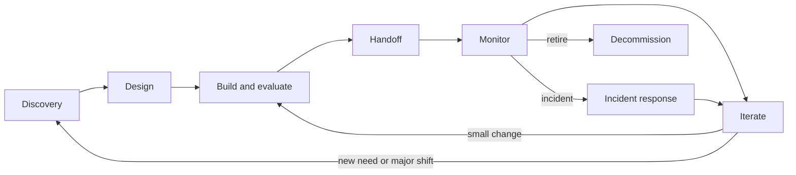

# Lifecycle Management

> **Level:** Advanced · **Time:** ~40 min · **Exam relevance:** CCAR-P 6.5, 6.1, 6.3, 6.4, 4.6

## In plain English

A Claude solution is never "finished". The model behind it is upgraded, the documents it reads change, users find new ways to use it and
regulations move. Lifecycle management is the routine that keeps the solution useful and safe across all of that, from the first discovery
conversation to the day it is retired.

Think of it like looking after a garden rather than building a wall. A wall, once built, mostly stands. A garden needs planting, then regular
watering, weeding and replanting as the seasons change. AI solutions behave like gardens.

The lifecycle has five phases: **discovery**, **design**, **handoff**, **monitoring** and **iteration**, with iteration feeding back into
discovery for the next improvement.

## Why it matters

- **Drift is constant.** Content changes, user behaviour shifts and models are upgraded or retired. Without monitoring and evaluation, quality
  decays silently.
- **Ownership gaps kill solutions.** Many AI pilots succeed and then degrade because no team owns prompts, evaluations and model upgrades after
  the project team moves on.
- **Change needs control.** A one-line prompt edit can change behaviour as much as a code release. It needs the same review and testing.
- CCAR-P 6.5 tests your support of every lifecycle phase; 6.3 tests feedback loops and expectations; 4.6 tests monitoring.

## How it works



### Phase 1: Discovery

Covered in detail in the [solution design process](01-solution-design-process.md). The lifecycle view adds two outputs that later phases
need: the **baseline** (so monitoring has a comparison point) and the **success criteria** (so iteration knows what to optimise).

### Phase 2: Design

Design produces the architecture, controls, evaluation plan and ADRs. From a lifecycle perspective, design must also define:

- **Versioned artefacts**: prompts, tool definitions, retrieval configuration and model IDs are versioned together as a release unit.
- **Evaluation gates**: which datasets and thresholds every change must pass.
- **Telemetry**: which signals the solution emits from day one (tokens, latency, `stop_reason`, tool errors, retrieval hit rates, feedback).

### Phase 3: Handoff

Handoff moves the solution from the team that built it to the team that will run it. A good handoff package contains:

| Item | Contents |
|---|---|
| Architecture pack | Diagrams, ADR log, data-flow map, threat model |
| Runbooks | Common alerts and responses: rate limiting, elevated refusals, latency spikes, retrieval failures, cost anomalies |
| Evaluation suite | Datasets, graders, thresholds, how to run them, where results go |
| Dashboards | Service, quality and cost views |
| Ownership map | Named owners for prompts, knowledge content, tools, evaluations, model upgrades, incidents |
| Change process | How a prompt or model change is proposed, evaluated, approved and released |
| Known limitations | What the solution does not do well; what users were told |
| Compliance evidence | Vendor coverage checks with dates, DPIA, retention settings |

Run a **shadow period** in which the operating team handles alerts with the build team available, and only then transfer on-call.

### Phase 4: Monitoring

Monitor three families of signals. [Observability](../15-production-operations/02-observability.md) covers implementation.

| Family | Signals | Example alert |
|---|---|---|
| Service | Error rates by type (429, 5xx), latency (time to first token, total), throughput | p95 latency above SLO for 15 minutes |
| Quality | Sampled reviewer scores, citation validity, refusal and `max_tokens` stop rates, escalation rate, user feedback | Thumbs-down rate doubles week on week |
| Cost and usage | Tokens per request, cache read ratio, calls per task, spend per application | Cache read ratio drops below 50% after a release |

Also monitor the **inputs**: new document types, new languages, longer conversations, or a shift in question topics often precede quality drops.
A small online evaluation (sampling live traffic and grading it) catches drift that offline test sets miss.

### Phase 5: Iteration

Iteration turns monitoring and feedback into improvements, safely.

1. **Diagnose**: categorise failures (retrieval miss, prompt ambiguity, tool error, model limitation, data quality). See
   [diagnosing failures](../14-evaluation-and-testing/06-diagnosing-failures.md).
2. **Add cases**: put real failures into the evaluation set before fixing them, so the fix is proven and regressions are caught.
3. **Change one thing**: prompt, retrieval, tool, model or effort setting; version it.
4. **Evaluate**: run the offline suite; for significant changes, A/B test on live traffic ([A/B testing and iteration](../14-evaluation-and-testing/05-ab-testing-and-iteration.md)).
5. **Release** with a rollback path; announce user-visible changes.
6. **Record** the change and, if significant, an ADR.

### Model upgrades

Model upgrades deserve their own procedure because they change many behaviours at once. Model IDs, parameters and defaults can change
between generations (for example, as of 2026-10-24 current models reject `temperature`, `top_p` and `top_k`, and default effort differs by
model). A safe upgrade:

1. Read the migration notes for the target model.
2. Pin the current model ID in configuration so the upgrade is an explicit change.
3. Run the full evaluation suite on the new model, including safety and red-team sets; compare quality, latency and cost.
4. Re-tune prompts and effort where results differ; prompts written for older models are sometimes too prescriptive.
5. Canary release to a small share of traffic; watch quality and cost signals.
6. Complete the rollout, update ADRs and runbooks, and schedule the old model's removal before its retirement date.

[Model upgrades and change management](../15-production-operations/08-model-upgrades-and-change-management.md) covers this in depth.

### Decommissioning

When a solution is retired, delete or archive indexes, logs, caches and evaluation data according to retention rules; revoke keys and
service identities; remove tools from registries; and tell users what replaces it.

## Example

A lightweight release gate that compares a candidate configuration with the current production configuration on the same evaluation set.
It is model-agnostic: plug in your own evaluation runner. The thresholds come from the agreed SLOs.

```python
"""Release gate: block a prompt/model/config change that regresses quality, cost or latency."""
from dataclasses import dataclass

@dataclass
class EvalSummary:
    accuracy: float           # share of cases graded acceptable
    safety_pass_rate: float   # share of red-team cases handled safely
    p95_latency_s: float
    cost_per_task_usd: float

THRESHOLDS = {
    "min_accuracy": 0.90,
    "max_accuracy_drop": 0.01,
    "min_safety_pass_rate": 0.99,
    "max_latency_increase": 0.20,   # +20%
    "max_cost_increase": 0.25,      # +25%
}

def gate(prod: EvalSummary, cand: EvalSummary) -> list[str]:
    failures = []
    if cand.accuracy < THRESHOLDS["min_accuracy"]:
        failures.append(f"accuracy {cand.accuracy:.2%} below floor")
    if prod.accuracy - cand.accuracy > THRESHOLDS["max_accuracy_drop"]:
        failures.append("accuracy regression vs production")
    if cand.safety_pass_rate < THRESHOLDS["min_safety_pass_rate"]:
        failures.append("safety pass rate below floor")
    if cand.p95_latency_s > prod.p95_latency_s * (1 + THRESHOLDS["max_latency_increase"]):
        failures.append("p95 latency increase above limit")
    if cand.cost_per_task_usd > prod.cost_per_task_usd * (1 + THRESHOLDS["max_cost_increase"]):
        failures.append("cost per task increase above limit")
    return failures

prod = EvalSummary(accuracy=0.93, safety_pass_rate=1.00, p95_latency_s=3.1, cost_per_task_usd=0.021)
cand = EvalSummary(accuracy=0.94, safety_pass_rate=0.995, p95_latency_s=3.4, cost_per_task_usd=0.018)

problems = gate(prod, cand)
print("PASS" if not problems else "BLOCK: " + "; ".join(problems))
```

Wire a gate like this into continuous integration so that prompt and model changes cannot reach production without passing it.

## Enterprise use case

*Fabrikam Insurance* runs its policy Q&A assistant under a lifecycle plan agreed at handoff:

- **Owners**: the knowledge team owns policy documents and re-indexing; the AI platform team owns prompts, the gateway and model upgrades;
  the claims operations lead owns success metrics and user communication.
- **Monitoring**: weekly sampled review of 50 answers by two claims handlers; daily dashboards for latency, refusals and cost; alerts on
  citation-validity drops.
- **Iteration cadence**: a fortnightly improvement release; emergency fixes through the same gate with a faster approval path.
- **A drift event**: after a product relaunch, citation validity fell from 97% to 88% in a week. Diagnosis showed that new policy documents
  had been uploaded as scanned images without extractable text, so they were never indexed. The fix was an ingestion check that rejects
  unreadable documents and alerts the knowledge team, plus 20 new evaluation cases on the relaunched products.
- **A model upgrade**: the team evaluated a newer model on the full suite, found better accuracy and lower cost per task but longer answers,
  adjusted the prompt's length guidance, canaried at 10% for a week, then completed the rollout and recorded ADR-0011.

## Common mistakes

- **Handoff by email.** No runbooks, no ownership map, no shadow period.
- **Prompt edits in production** without evaluation or version control.
- **Monitoring only availability**, so the service is "green" while answers quietly get worse.
- **Unpinned model aliases or silent upgrades** that change behaviour without a release.
- **Letting the evaluation set fossilise.** If it never grows with real failures, it stops predicting production quality.
- **Forgetting decommissioning**, leaving indexes full of sensitive data long after the solution is gone.

## Security considerations

- Treat prompts, tool definitions and retrieval configuration as code: review, version, and restrict who can change them. A malicious or
  careless prompt change is a security change.
- Include security regression tests (prompt injection, data disclosure, tool misuse) in every release gate ([safety and red-team evals](../14-evaluation-and-testing/07-safety-and-red-team-evals.md)).
- Re-check vendor compliance coverage and data-retention settings during model or platform changes; coverage can differ by model or feature
  ([data governance and compliance](05-data-governance-and-compliance.md)).
- Keep audit logs across the lifecycle and through decommissioning as retention rules require ([logging and auditability](../12-ai-security/11-logging-and-auditability.md)).

## Troubleshooting

| Symptom | Likely cause | Fix |
|---|---|---|
| Quality drops with no code change | Content or input drift; upstream data change | Monitor inputs; add online evaluation; check ingestion |
| Costs jump after a release | Longer prompts, lost cache hits, more agent steps | Compare tokens per task and cache ratio between versions; gate on cost |
| Operations team escalates everything to builders | Incomplete handoff | Add runbooks for top alerts; run a shadow period |
| Upgrade breaks requests with 400 errors | Removed or changed parameters on the new model | Read migration notes; run integration tests on the new model before rollout |

## Check your understanding

1. List the five lifecycle phases and one key output of each.
2. What belongs in a handoff package?
3. Name the three families of monitoring signals, with one example each.
4. Why add a failure to the evaluation set before fixing it?
5. Describe a safe model-upgrade procedure in five or six steps.

<details>
<summary>Answers</summary>

1. Discovery (baseline and success criteria), design (architecture, controls, evaluation plan, ADRs), handoff (runbooks, ownership map,
   evaluation suite), monitoring (dashboards and alerts on service, quality and cost), iteration (versioned, evaluated changes).
2. Architecture pack and ADRs, runbooks, evaluation suite, dashboards, ownership map, change process, known limitations and compliance evidence.
3. Service (latency, error rates), quality (reviewer scores, citation validity, refusal rate, feedback), cost and usage (tokens per request,
   cache read ratio, spend per application).
4. So the fix is proven against a real example and any future regression on that case is caught automatically.
5. Read the migration notes; pin the current model; run the full evaluation suite (including safety) on the new model and compare quality,
   latency and cost; re-tune prompts and effort; canary release with monitoring; complete rollout, update ADRs and runbooks, and remove the old model before retirement.

</details>

## Further reading

- Claude docs: [Models overview](https://platform.claude.com/docs/en/about-claude/models/overview),
  [Model deprecations](https://platform.claude.com/docs/en/about-claude/model-deprecations)
- Anthropic engineering: [How we built our multi-agent research system](https://www.anthropic.com/engineering/multi-agent-research-system)
  (production lessons on tracing, checkpoints and gradual deployments)
- In this repository: [production readiness](../15-production-operations/01-production-readiness.md),
  [incident response](../15-production-operations/07-incident-response.md), [why evaluate](../14-evaluation-and-testing/01-why-evaluate.md),
  [architecture decision records](07-architecture-decision-records.md)
- Practice: [Lab 16: Evaluation framework](../19-hands-on-labs/lab-16-evaluation-framework/README.md),
  [Lab 19: Observability](../19-hands-on-labs/lab-19-observability/README.md),
  [Lab 20](../19-hands-on-labs/lab-20-secure-enterprise-architecture/README.md)
