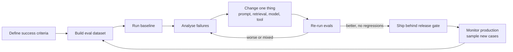

# Why Evaluate

> **Level:** Beginner · **Time:** ~25 min · **Exam relevance:** CCAR-P D4 (4.1, 4.2), CCAO-F D2 (2.1), CCAO-F D7 (7.2)

## In plain English

An evaluation (an "eval") is a repeatable test of how well your AI system does its job. You give it a set of inputs
whose good answers you know or can judge, run the system, score the outputs, and track the score over time.

Traditional software tests check that the same input always gives the same, exactly correct output. LLM applications
are different: outputs vary in wording, many answers can be acceptable, and small changes to a prompt, a model, a
retrieval setting or a tool description can improve one case while breaking another. Evals are how you see those
effects instead of guessing.

A useful analogy: tasting a dish once tells you whether that plate is good. A restaurant that wants consistent quality
tastes regularly, against a standard, with several people, and writes it down.

## Why it matters

- **Changes are constant.** You will edit prompts, add tools, change retrieval, and move to new models (see
  [model upgrades and change management](../15-production-operations/08-model-upgrades-and-change-management.md)).
  Without evals, each change is a gamble.
- **Intuition misleads.** Teams tend to judge a prompt by the three examples they tried. Evals over dozens or
  hundreds of cases reveal trade-offs those examples hide.
- **Stakeholders need evidence.** "Accuracy is 94 percent on 400 representative tickets, up from 88" lets a product
  owner make a decision. "It feels better" does not (CCAR-P-6.2, communicating trade-offs).
- **Safety and security need proof.** Guardrails that are not tested are assumptions
  ([safety and red-team evals](07-safety-and-red-team-evals.md)).
- **Cost and latency are part of quality.** A version that is 2 percent more accurate and three times the cost may be
  the wrong choice. Evals put numbers on that trade-off.

## How it works

### Start from success criteria

Anthropic's documentation on [defining success criteria](https://platform.claude.com/docs/en/test-and-evaluate/define-success)
recommends criteria that are **specific** (define exactly what you want), **measurable** (quantitative metrics or
consistently applied qualitative scales), **achievable** (grounded in benchmarks, experiments or expert knowledge) and
**relevant** (aligned with the application's purpose). It lists common dimensions such as task fidelity,
consistency, relevance and coherence, tone and style, privacy preservation, context utilisation, latency and price,
and notes that most use cases need several dimensions at once.

A weak criterion: "The summariser should be good."
A strong one: "On a held-out set of 300 internal incident reports, at least 95 percent of summaries contain every
affected system named in the report (checked by code), at least 90 percent score 4 or 5 on a 5-point faithfulness
rubric (judged by a calibrated LLM grader), no summary contains personal data (checked by code), and the 95th
percentile latency is under 8 seconds."

### The eval-driven development loop



The loop never really ends: production traffic shows you new failure modes, which become new eval cases.

### Types of evals

| Type | Question it answers | Example |
|---|---|---|
| Capability eval | Can the system do the task at all, and how well? | Accuracy of extracting invoice fields |
| Regression eval | Did a change break something that used to work? | Fixed suite run on every prompt edit |
| Comparison eval | Which of two versions is better? | Prompt v6 vs v7; Claude Sonnet 5.5 vs Claude Opus 5.5 at different effort settings |
| Safety and security eval | Do guardrails hold under adversarial input? | Prompt-injection suite, harmful-request refusals |
| Performance eval | How fast and how expensive? | p95 latency, cost per completed task |
| Online evaluation | How does it behave with real users? | A/B test, user feedback, sampled human review |

### Where evals sit in the lifecycle

- **Design:** success criteria and a first small dataset, before writing much code.
- **Build:** run evals on every meaningful change; keep the suite fast enough to run often.
- **Release:** evals become a release gate in CI or the deployment pipeline.
- **Operate:** sample production traffic, grade it, watch for drift
  ([observability](../15-production-operations/02-observability.md)).
- **Change:** model upgrades and major prompt rewrites go through the full suite plus targeted new cases.

### How big does an eval need to be?

Anthropic's guidance on [developing tests](https://platform.claude.com/docs/en/test-and-evaluate/develop-tests)
recommends making evals task-specific, automating grading where possible, and favouring more cases with automated
grading over a few hand-graded ones. As a rough starting point: 20 to 50 cases to begin iterating, a few hundred
for a release gate on an important workflow, and more for rare but critical behaviours. [Page 5](05-ab-testing-and-iteration.md)
explains how sample size relates to the differences you can detect.

## Example

The smallest useful eval harness. It runs offline in mock mode through the repository's lab helper and shows the
structure every larger harness shares: cases, a system under test, a grader, and a report.

```python
"""tiny_eval.py - the minimum viable eval loop (runs offline in mock mode)."""
import sys
from pathlib import Path

sys.path.insert(0, str(Path(__file__).resolve().parents[1] / "19-hands-on-labs" / "common"))
from claude_lab import MODEL, get_client, register_mock, text_of  # noqa: E402

CASES = [
    {"id": "c1", "ticket": "VPN drops every 10 minutes since this morning.", "expected": "network"},
    {"id": "c2", "ticket": "I was charged twice for my subscription.", "expected": "billing"},
    {"id": "c3", "ticket": "Can't log in, password reset email never arrives.", "expected": "account"},
]
LABELS = {"network", "billing", "account", "other"}


@register_mock
def fake(**request):
    text = request["messages"][-1]["content"].lower()
    for word, label in (("vpn", "network"), ("charged", "billing"), ("log in", "account")):
        if word in text:
            return label
    return "other"


def system_under_test(client, ticket: str) -> str:
    response = client.messages.create(
        model=MODEL,
        max_tokens=16,
        system=f"Classify the support ticket. Reply with exactly one word from: {', '.join(sorted(LABELS))}.",
        messages=[{"role": "user", "content": ticket}],
    )
    if response.stop_reason != "end_turn":
        return f"<{response.stop_reason}>"
    return text_of(response).strip().lower()


def grade(output: str, expected: str) -> bool:
    return output == expected


if __name__ == "__main__":
    client = get_client()
    results = [(c["id"], system_under_test(client, c["ticket"]), c["expected"]) for c in CASES]
    passed = sum(grade(out, exp) for _, out, exp in results)
    for cid, out, exp in results:
        print(f"{cid}: got={out!r} expected={exp!r} {'PASS' if out == exp else 'FAIL'}")
    print(f"accuracy = {passed}/{len(results)} = {passed / len(results):.0%}")
```

Run it from the repository root with `python 14-evaluation-and-testing/tiny_eval.py` after saving it there, or adapt
it inside [Lab 16](../19-hands-on-labs/lab-16-evaluation-framework/README.md), which extends this skeleton with
datasets, multiple graders and reports.

> **Cost:** requires API credits (live mode) when run with `CLAUDE_LAB_MODE=live`.

## Enterprise use case

*Acme Logistics* built a customer-email classifier that routed messages to eight queues. The first version was
tuned by trying a dozen emails in the Console. After launch, the claims team reported that damaged-goods emails kept
landing in the general queue.

The team built a 350-case eval from a month of real, anonymised emails labelled by two queue leads, plus 40 edge cases
(multilingual emails, forwarded chains, emails mentioning several issues). The baseline scored 81 percent overall but
only 52 percent on damaged-goods emails. Three prompt iterations, each checked against the full suite, raised the
damaged-goods class to 91 percent without dropping any other class by more than one point. The suite now runs on
every prompt change and blocks deployment if any class drops by more than three points.

## Common mistakes

- Testing on the same handful of examples used to write the prompt.
- One headline accuracy number that hides a collapsing minority class.
- No baseline, so nobody knows whether a change helped.
- Evals that do not match production configuration (different system prompt, tools or model).
- Treating evals as a one-time project instead of a living asset.

## Security considerations

- Eval datasets built from production traffic contain real user data. Anonymise or synthesise, restrict access, and
  set retention.
- Protect eval sets and graders from tampering; an altered golden set can hide regressions (see
  [supply-chain risks](../12-ai-security/07-supply-chain-risks.md)).
- Include security and safety cases in the regular suite, not only in a separate annual exercise.

## Troubleshooting

| Symptom | Likely cause | Fix |
|---|---|---|
| Scores swing between runs with no change | Model output variance, too few cases | Run multiple trials, increase cases, report intervals |
| Evals pass but users complain | Dataset does not match real traffic | Sample production inputs into the dataset |
| Every change looks like an improvement | Grader too lenient, or overfitting to the eval | Spot-check grader; hold out a test split |

## Check your understanding

1. What are the four characteristics of good success criteria in Anthropic's guidance?
2. Name three types of eval and when each is used.
3. Why are evals especially important for model upgrades?
4. Why should eval datasets be refreshed from production traffic?

<details>
<summary>Answers</summary>

1. Specific, measurable, achievable and relevant.
2. Any three: capability (can it do the task), regression (did a change break something), comparison (which version
   is better), safety/security (do guardrails hold), performance (latency, cost), online (behaviour with real users).
3. A new model can change behaviour across many cases at once, improving some and regressing others; only a broad,
   repeatable suite shows the net effect before users see it.
4. Real usage shifts and reveals failure modes nobody anticipated; a static dataset slowly stops representing what the
   system actually faces.

</details>

## Further reading

- Anthropic: [Define your success criteria](https://platform.claude.com/docs/en/test-and-evaluate/define-success)
- Anthropic: [Develop tests](https://platform.claude.com/docs/en/test-and-evaluate/develop-tests)
- In this repository: [iterating on prompts](../03-prompt-engineering/08-iterating-on-prompts.md),
  [Lab 16](../19-hands-on-labs/lab-16-evaluation-framework/README.md)
