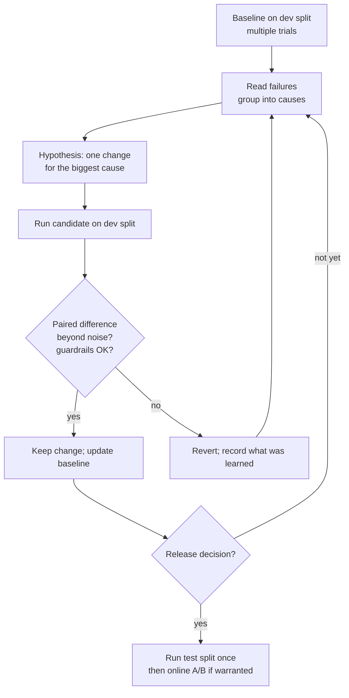

# A/B Testing and Iteration

> **Level:** Intermediate · **Time:** ~45 min · **Exam relevance:** CCAR-P D4 (4.3, 4.5), CCAO-F D7 (7.2)

## In plain English

When you change a prompt, a model, a retrieval setting or an effort level, you want to know whether the new version
is really better, or whether you are seeing noise. A/B testing compares version A (the current one) with version B
(the candidate) under fair conditions and uses simple statistics to decide whether the difference is real.

There are two settings. **Offline** comparisons run both versions on the same eval dataset before release. **Online**
A/B tests split real traffic between versions after release and compare outcomes such as resolution rate or user
ratings. You usually do offline first, then online for changes that pass.

## Why it matters

- CCAR-P-4.3 asks you to run A/B tests and iterative improvement.
- LLM outputs vary between runs. On a 100-case eval, a 3-point difference can easily be noise. Shipping noise wastes
  effort and can make things worse.
- A disciplined loop (one change at a time, measured, kept or reverted) is how teams improve steadily instead of
  oscillating.

## How it works

### Offline versus online

| Aspect | Offline comparison | Online A/B test |
|---|---|---|
| Data | Fixed eval dataset | Live traffic |
| Grading | Code, judges, humans | Business outcomes, user feedback, sampled grading |
| Speed | Minutes to hours | Days to weeks |
| Risk | None to users | Some users see the worse version |
| Best for | Rapid iteration, regression gating, model and prompt comparisons | Validating impact on real behaviour, metrics that need users |
| Main pitfall | Dataset not representative | Contamination, peeking, novelty effects |

### Statistical basics you need

**Variance comes from two places**: the cases you happened to include, and run-to-run model variation. Reduce the
first with more cases; measure the second by running each case more than once (for example three trials) and
reporting the spread.

**Use paired comparisons offline.** Both versions run on the same cases, so compare case by case. For pass/fail
outcomes, count the cases where A passed and B failed (`b`) and where A failed and B passed (`c`). McNemar's test asks
whether `b` and `c` differ more than chance would explain. Cases where both pass or both fail carry no information
about the difference.

**Use confidence intervals.** Report "B is 4.2 points better, 95 percent interval 1.1 to 7.3" rather than just "B is
better". A bootstrap interval (resample cases with replacement many times and recompute the difference) works for
almost any metric.

**Know your detectable effect.** For a pass rate around 85 percent, a difference of 5 points needs roughly several
hundred independent cases per arm to detect reliably in an unpaired test; paired designs need fewer because they
remove case difficulty from the comparison. If your dataset is small, you can only detect large differences, so do not
over-interpret small ones.

**Online tests need extra discipline:**

- Randomise by user or session, not by request, so one user sees one version consistently.
- Decide the primary metric, guardrail metrics, minimum detectable effect and duration before starting.
- Do not stop the test the moment it looks significant ("peeking" inflates false positives); use the planned duration
  or a sequential-testing method designed for early stopping.
- Watch for novelty effects in the first days.
- Keep everything else equal: same tools, same retrieval, same traffic mix.

### An iteration loop that works



Rules that keep the loop honest:

1. Change one thing at a time, so you know what caused the effect.
2. Keep an experiment log: hypothesis, change, scores with intervals, decision.
3. Watch guardrail metrics (cost, latency, safety) on every iteration, not just the primary metric.
4. Look at the test split only at release decisions.
5. Measure the simple alternatives before complex ones. For example, before building a multi-model cascade, test the
   stronger model at a lower `effort` setting, which can match quality at lower cost and keeps a single prompt cache.

### What to iterate on, roughly in order

1. Task definition and instructions (clarity usually beats cleverness).
2. Context: what is retrieved or supplied, and how it is structured.
3. Examples (few-shot) and output format (structured outputs).
4. Tool descriptions and tool set.
5. Model choice and `effort` level.
6. Architecture (chaining, routing, agents), only when simpler levers are exhausted.

## Example

Offline paired comparison with McNemar's exact test and a bootstrap confidence interval. Standard library only.

```python
"""compare.py - paired offline comparison of two variants on the same cases."""
import random
from math import comb


def mcnemar_exact(b: int, c: int) -> float:
    """Two-sided exact p-value; b = A pass/B fail, c = A fail/B pass."""
    n = b + c
    if n == 0:
        return 1.0
    k = min(b, c)
    tail = sum(comb(n, i) for i in range(k + 1)) / 2 ** n
    return min(1.0, 2 * tail)


def bootstrap_diff(a: list[int], b: list[int], iters: int = 5000, seed: int = 7) -> tuple[float, float, float]:
    """Mean difference (B - A) with a 95% percentile interval, resampling paired cases."""
    rng = random.Random(seed)
    n = len(a)
    point = (sum(b) - sum(a)) / n
    diffs = []
    for _ in range(iters):
        idx = [rng.randrange(n) for _ in range(n)]
        diffs.append(sum(b[i] - a[i] for i in idx) / n)
    diffs.sort()
    return point, diffs[int(0.025 * iters)], diffs[int(0.975 * iters)]


def compare(results_a: dict, results_b: dict) -> dict:
    ids = sorted(set(results_a) & set(results_b))
    a = [int(results_a[i]) for i in ids]
    b = [int(results_b[i]) for i in ids]
    b_only = sum(1 for x, y in zip(a, b) if x == 0 and y == 1)
    a_only = sum(1 for x, y in zip(a, b) if x == 1 and y == 0)
    point, lo, hi = bootstrap_diff(a, b)
    return {"n": len(ids), "pass_a": sum(a) / len(a), "pass_b": sum(b) / len(b),
            "a_only": a_only, "b_only": b_only, "p_value": round(mcnemar_exact(a_only, b_only), 4),
            "diff": round(point, 4), "ci95": (round(lo, 4), round(hi, 4))}


if __name__ == "__main__":
    rng = random.Random(1)
    # Synthetic illustration: 300 cases, B fixes some failures and breaks a few passes.
    a = {f"c{i}": rng.random() < 0.82 for i in range(300)}
    b = {k: (v or rng.random() < 0.35) and not (v and rng.random() < 0.04) for k, v in a.items()}
    print(compare(a, b))
```

Read the output this way: if the 95 percent interval for the difference excludes zero and the p-value is small
(commonly below 0.05), the improvement is unlikely to be noise. Then check the guardrail metrics before keeping the
change. For multi-trial runs, first average each case's trials into a per-case score, then compare per case.

## Enterprise use case

*Acme Logistics* wants to reduce cost on a shipment-exception summariser. The team tests, offline on 320 paired
cases with three trials each:

| Variant | Rubric pass rate | Change vs baseline (95% CI) | Cost per summary |
|---|---|---|---|
| Baseline: Claude Opus 5.5, effort high | 90.3% | n/a | baseline |
| A: Claude Opus 5.5, effort low | 89.4% | -0.9 (-2.8 to +1.0) | lower |
| B: Claude Haiku 5.5, effort medium | 84.1% | -6.2 (-8.9 to -3.6) | much lower |

Figures are illustrative. Variant A's interval includes zero, so the team cannot claim it is worse; variant B is
clearly worse. Variant A ships to 10 percent of users for two weeks with "summary marked unhelpful" as the online
guardrail; the rate does not change measurably, so A becomes the new default.

## Common mistakes

- Declaring victory on a 2-point difference from a single run of 80 cases.
- Changing prompt, model and retrieval at once, so nobody knows what helped.
- Peeking at an online test daily and stopping when it looks good.
- Comparing variants evaluated with different grader versions.
- Optimising the primary metric while cost or latency quietly doubles.

## Security considerations

- Online A/B tests expose some users to an unproven version. Run safety and security evals offline first, and never
  A/B test a version that fails them.
- Assign variants server-side so users cannot select a less-guarded variant.
- Log the variant on every request so incidents can be traced to a configuration.

## Troubleshooting

| Symptom | Likely cause | Fix |
|---|---|---|
| Results flip between runs | Too few cases or trials | More cases, multiple trials, paired analysis |
| Offline win, no online effect | Dataset unrepresentative or metric mismatch | Refresh dataset from production; align offline metric with online outcome |
| Online test shows huge early effect that fades | Novelty effect or peeking | Run planned duration; analyse by week |
| Cost differences look random | Variants ran with different cache warmth | Warm caches equally or compare cache-adjusted cost |

## Check your understanding

1. Why are paired comparisons more efficient than unpaired ones for offline evals?
2. In McNemar's test, which cases carry information about the difference between A and B?
3. What is "peeking" and why is it a problem?
4. Why change only one thing per iteration?

<details>
<summary>Answers</summary>

1. Both versions run on the same cases, so differences in case difficulty cancel out and only the effect of the change
   remains, which reduces variance.
2. Only the discordant cases: those where one variant passed and the other failed.
3. Repeatedly checking an online test and stopping when it looks significant; it inflates the false-positive rate
   because random fluctuations eventually cross the threshold.
4. So that any measured effect can be attributed to that change, and harmful changes can be reverted cleanly.

</details>

## Further reading

- Anthropic: [Develop tests](https://platform.claude.com/docs/en/test-and-evaluate/develop-tests)
- Anthropic: [Effort](https://platform.claude.com/docs/en/build-with-claude/effort)
- In this repository: [iterating on prompts](../03-prompt-engineering/08-iterating-on-prompts.md),
  [model selection](../05-claude-products-and-models/03-model-selection.md),
  [Lab 06: model comparison](../19-hands-on-labs/lab-06-model-comparison/README.md),
  [Lab 16](../19-hands-on-labs/lab-16-evaluation-framework/README.md)
