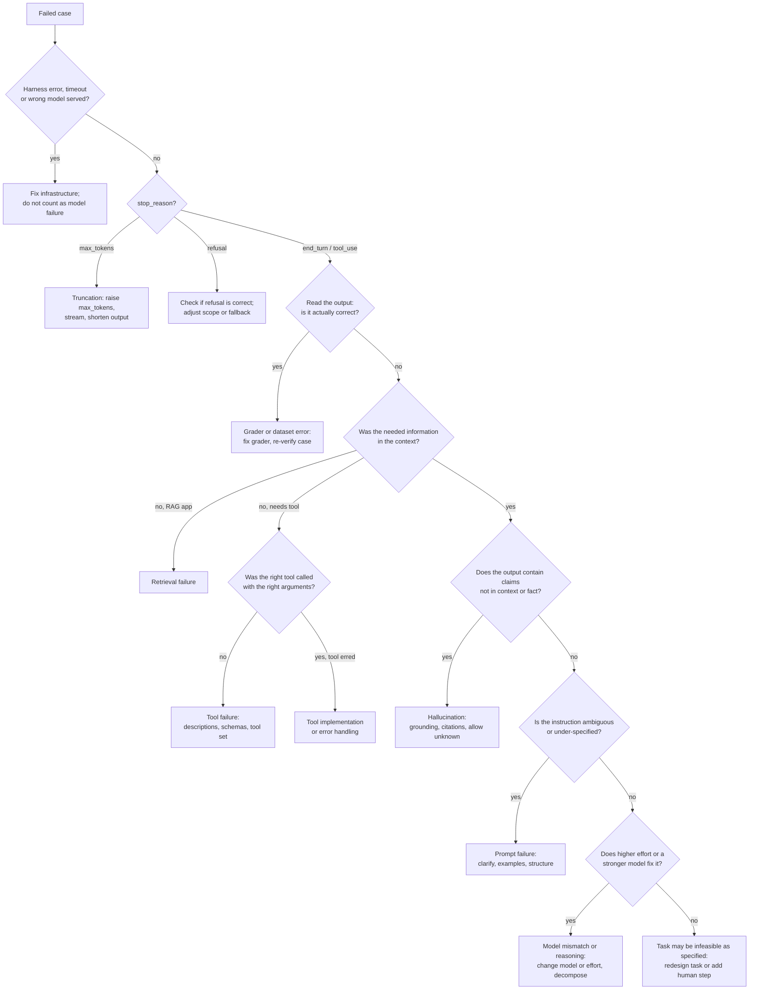

# Diagnosing Failures

> **Level:** Advanced · **Time:** ~45 min · **Exam relevance:** CCAR-P D4 (4.4), CCAR-P D7 (7.3), CCAO-F D2 (2.2), CCAO-F D7 (7.1)

## In plain English

When an eval case fails, the instinct is to edit the prompt. Often that is the wrong fix. The failure might come from
the retrieval step that never found the right document, a tool that returned an error, an output cut off by a token
limit, a grader that marked a correct answer wrong, or a model that is not suited to the task. Diagnosing means
finding which layer failed before changing anything.

This page gives you a taxonomy of failures, the evidence that identifies each one, and a decision tree to walk.

## Why it matters

- CCAR-P-4.4 asks you to diagnose prompt failure, hallucination and model mismatch. CCAO-F-7.1 asks you to diagnose
  and fix underperforming prompts.
- Fixing the wrong layer wastes time and can make things worse: adding "do not hallucinate" to a prompt does nothing
  if retrieval returned the wrong documents.
- Good diagnosis needs good evidence: saved transcripts, retrieval results, tool calls, `stop_reason` and usage for
  every case. If your harness does not save them, fix that first.

## How it works

### Failure taxonomy

| Category | What it looks like | Evidence | Typical fixes |
|---|---|---|---|
| Harness or infrastructure | Timeouts, rate-limit errors, missing files, wrong model served | Errors in logs; `stop_reason` missing; response `model` differs from requested | Retries with backoff, isolate state per case, assert served model |
| Truncation | Answer stops mid-sentence; JSON invalid | `stop_reason == "max_tokens"` | Raise `max_tokens`; stream long outputs; ask for shorter output |
| Refusal | Model declines | `stop_reason == "refusal"` (safety classifier), or a text refusal | Check whether refusal is correct; adjust scope instructions; for classifier refusals consider server-side fallbacks where available |
| Grader error | Output looks correct but scored wrong | Manual read of failures disagrees with grader | Normalise formats, fix rubric, recalibrate judge |
| Dataset error | Expected answer wrong or stale | Re-derive the answer independently | Fix case, record provenance and verification date |
| Retrieval failure | Answer wrong because the right passage was not in context | Gold passage absent from retrieved set | Chunking, embeddings, hybrid search, reranking, query rewriting ([retrieval strategies](../11-rag-and-knowledge-systems/04-retrieval-strategies.md)) |
| Context failure | Right information present but buried, conflicting, or truncated | Gold passage present but deep in a long context, or contradicted | Reorder, trim, structure with tags, resolve conflicts, quote-then-answer |
| Prompt (instruction) failure | Model does something reasonable but not what you wanted | Output follows a plausible reading of an ambiguous instruction | Clarify task, add constraints and examples, specify format, use structured outputs |
| Hallucination (confabulation) | Confident claims not supported by context or fact | Claims absent from sources; fabricated citations or IDs | Grounding instructions, allow "I don't know", citations, verification step, retrieval fixes |
| Tool failure | Wrong tool, wrong arguments, ignores tool errors | Tool-call log | Better tool descriptions, fewer overlapping tools, strict schemas, clearer error messages |
| Reasoning failure | Multi-step logic wrong despite correct inputs | Steps visible in output or summarised thinking | Raise `effort`, decompose into steps or a chain, give worked examples |
| Model mismatch | Consistent shortfall that prompts do not fix, or unnecessary cost and latency | Same failures across prompt variants; a stronger model or higher effort fixes them; or a smaller model scores the same | Change model or effort level, route by difficulty |
| Agent loop failure | Loops, gives up early, exceeds budget | Turn count, repeated identical calls | Iteration caps, progress checks, better stopping criteria, task budgets |

### The decision tree



### Working at scale: cluster before you fix

Do not fix failures one at a time. Read 20 to 50 failed cases, label each with a category from the taxonomy, and
count. The largest cluster is usually where one change helps most. Re-run after each change and re-cluster: fixing
retrieval often reveals prompt failures that were hidden behind it.

### Distinguishing hallucination from retrieval failure

A useful test: put the gold passage directly into the prompt for the failed cases ("oracle context").

- If the answer becomes correct, retrieval was the problem.
- If it stays wrong but now contradicts the passage it was given, it is a grounding or instruction problem.
- If it stays wrong in a way that needs multi-step reasoning, try higher effort or decomposition.

### Distinguishing prompt failure from model mismatch

Run two or three clearly different prompt variants and two model or effort settings on the failed cluster.

- If prompt variants change the outcome a lot, it is a prompt problem.
- If only the stronger model or higher effort helps, it is a capability or reasoning-depth gap (model mismatch).
- If a cheaper model or lower effort scores the same, you may be over-provisioned: also a mismatch, in the other
  direction.

## Example

A triage script that pre-classifies failed rows from saved eval results using the evidence the harness recorded, so
humans only need to read the cases that need judgement.

```python
"""triage_failures.py - first-pass failure categorisation from recorded eval rows."""
from collections import Counter


def categorise(row: dict) -> str:
    if row.get("error"):
        return "harness"
    if row.get("served_model") and row["served_model"] != row["requested_model"]:
        return "harness:wrong-model"
    stop = row.get("stop_reason")
    if stop == "max_tokens":
        return "truncation"
    if stop == "refusal":
        return "refusal"
    if row.get("gold_passage_ids"):
        retrieved = set(row.get("retrieved_ids", []))
        if not retrieved & set(row["gold_passage_ids"]):
            return "retrieval"
    if row.get("expected_tool") and row.get("tools_called") is not None:
        if row["expected_tool"] not in row["tools_called"]:
            return "tool:not-called"
        if any(t.get("is_error") for t in row.get("tool_results", [])):
            return "tool:error"
    if row.get("unsupported_claims", 0) > 0:
        return "hallucination"
    return "needs-human-review"  # prompt vs reasoning vs grader: read the transcript


if __name__ == "__main__":
    failed = [
        {"stop_reason": "max_tokens"},
        {"stop_reason": "end_turn", "gold_passage_ids": ["p7"], "retrieved_ids": ["p2", "p3"]},
        {"stop_reason": "end_turn", "gold_passage_ids": ["p1"], "retrieved_ids": ["p1"], "unsupported_claims": 2},
        {"stop_reason": "tool_use", "expected_tool": "get_order", "tools_called": ["search_orders"]},
        {"stop_reason": "end_turn", "requested_model": "claude-sonnet-5-5", "served_model": "claude-sonnet-5-5"},
    ]
    counts = Counter(categorise(r) for r in failed)
    for category, n in counts.most_common():
        print(f"{category:<20} {n}")
```

The `unsupported_claims` field comes from a claim-checking judge (see [grading methods](04-grading-methods.md)); the
retrieval fields come from your RAG pipeline's logs.

## Enterprise use case

*Northwind Lending's* policy assistant scores 78 percent on its eval. The team reads 60 failures and clusters them:

| Cluster | Count | Diagnosis method | Fix |
|---|---|---|---|
| Gold passage not retrieved | 24 | Retrieved IDs vs gold IDs | Hybrid search (keyword plus embeddings) and smaller chunks for rate tables |
| Grader marked correct answers wrong | 11 | Manual read | Normalise currency and percentage formats in the grader |
| Answered from outdated policy | 9 | Two versions retrieved | Filter retrieval by effective date; tell the model to prefer the latest version |
| Invented a fee | 7 | Unsupported claim check | Instruction to say when information is missing; citations required |
| Multi-step eligibility logic wrong | 6 | Oracle context still wrong; high effort fixes 5 of 6 | Raise effort for eligibility questions only |
| Truncated tables | 3 | `stop_reason` | Raise `max_tokens` |

After these changes the score is 91 percent. Most of the improvement came from retrieval and grader fixes, not prompt
edits.

## Common mistakes

- Editing the prompt for every failure without checking whether the right information was in context.
- Counting harness errors and truncations as model failures.
- Trusting the grader without reading failed outputs.
- Fixing one case at a time instead of clustering.
- Switching to a bigger model before checking prompt and retrieval, or keeping a bigger model when a smaller one
  scores the same.

## Security considerations

- Saved transcripts used for diagnosis contain user data and possibly secrets; store them with access control and
  retention limits.
- Some "failures" are guardrails working (a correct refusal of an injected instruction). Label them so they are not
  "fixed" away.
- Unexpected tool calls in transcripts can indicate prompt injection rather than a tool-description problem; check
  what untrusted content was in context ([indirect prompt injection](../12-ai-security/03-indirect-prompt-injection.md)).

## Troubleshooting

| Symptom | Likely cause | Fix |
|---|---|---|
| Cannot tell why a case failed | Harness does not save transcripts, retrieval or tool logs | Save full per-case trajectories |
| Fix improves one cluster and breaks another | Change too broad | Narrow the change (route by case type), re-run full suite |
| Same failures across all models | Dataset, grader or task definition problem | Re-verify cases and grader; clarify task |

## Check your understanding

1. What should you check before reading the output text of a failed case?
2. How does the "oracle context" test separate retrieval failure from hallucination?
3. What evidence suggests model mismatch rather than prompt failure?
4. Why cluster failures before fixing them?

<details>
<summary>Answers</summary>

1. Whether it was a harness or infrastructure error (including the wrong model being served) and the `stop_reason`
   (truncation or refusal).
2. Supplying the gold passage directly: if the answer becomes correct, retrieval was the cause; if it is still wrong
   and contradicts the passage, it is a grounding or instruction problem.
3. Failures persist across clearly different prompt variants but disappear with a stronger model or higher effort (or
   the reverse: a cheaper setting performs equally, showing over-provisioning).
4. To find the largest shared cause, apply one change that fixes many cases, and avoid overfitting to individual cases.

</details>

## Further reading

- Anthropic: [Reduce hallucinations](https://platform.claude.com/docs/en/test-and-evaluate/strengthen-guardrails/reduce-hallucinations)
- Anthropic: [Handling stop reasons](https://platform.claude.com/docs/en/build-with-claude/handling-stop-reasons)
- In this repository: [hallucinations](../01-ai-and-llm-fundamentals/06-hallucinations.md),
  [prompts and outputs troubleshooting](../24-troubleshooting/prompts-and-outputs.md),
  [RAG troubleshooting](../24-troubleshooting/rag.md),
  [Lab 11: RAG pipeline](../19-hands-on-labs/lab-11-rag-pipeline/README.md)
