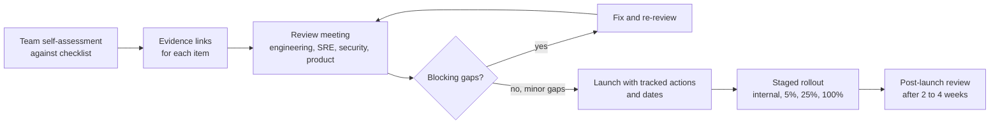

# Production Readiness

> **Level:** Intermediate · **Time:** ~35 min · **Exam relevance:** CCAR-P D6 (6.3, 6.5), CCAR-P D1 (1.6), CCAR-P D4 (4.6)

## In plain English

A production-readiness review is a structured check, before launch, that a system can be run safely by the people who
will be on call for it. It asks: Do we know whether it is working? Can we afford it? What happens when the model
provider is slow or a request is refused? Who gets paged? How do we roll back? Is it secure?

LLM applications need all the usual checks for a web service plus a set of their own, because they can fail in ways
that do not produce errors: a correct HTTP 200 response with a wrong, truncated, refused or unsafe answer.

## Why it matters

- The most common post-launch problems for LLM features are predictable: unexpected cost, rate-limit errors at peak,
  silent quality drops after a prompt or model change, and no way to tell which user saw what.
- CCAR-P-6.3 covers managing expectations including SLAs, and CCAR-P-6.5 covers lifecycle phases including handoff
  and monitoring. A readiness review is where those meet.
- A checklist makes launch decisions explicit and repeatable, instead of depending on who happens to be in the room.

## How it works

### The readiness checklist

Use this as a review template. Each item needs an owner and evidence (a link to a dashboard, test result, runbook or
document).

**1. Purpose and success**

- [ ] Use case, users and success criteria are written down
  ([why evaluate](../14-evaluation-and-testing/01-why-evaluate.md)).
- [ ] Service-level objectives (SLOs) agreed: availability, latency (p95), quality (eval score), cost per task.
- [ ] Business owner has accepted the known limitations.

**2. Quality**

- [ ] Eval suite exists, runs in CI and gates releases.
- [ ] Baseline results recorded with model ID, prompt version and effort level.
- [ ] Production sampling and grading plan in place (quality drift detection).
- [ ] User feedback mechanism (thumbs, flags) connected to triage.

**3. API usage correctness**

- [ ] Model IDs pinned explicitly (for example `claude-opus-5-5`), in configuration, not scattered through code.
- [ ] Every response path checks `stop_reason` (`end_turn`, `max_tokens`, `tool_use`, `pause_turn`, `refusal`)
  before using `content`.
- [ ] `max_tokens` sized for the longest legitimate output; streaming used for long outputs.
- [ ] No unsupported parameters (sampling parameters, assistant prefill, forced `tool_choice` on current models) per
  the current API rules.
- [ ] Structured outputs or strict tool schemas used where downstream code parses output.

**4. Reliability** ([reliability engineering](05-reliability-engineering.md))

- [ ] Timeouts set per call type; retries with exponential backoff and jitter; retry budget.
- [ ] Fallback behaviour defined for overload, rate limits, refusals and full outage.
- [ ] Idempotency for any side-effecting tool or workflow step.
- [ ] Agent loops have iteration caps and budgets.

**5. Capacity and cost** ([rate limits](06-rate-limits-and-capacity.md), [cost](03-cost-optimisation.md))

- [ ] Peak RPM, input and output tokens per minute estimated and compared with current limits, with headroom.
- [ ] Prompt caching designed and verified (`cache_read_input_tokens` non-zero on repeated prefixes).
- [ ] Non-interactive work routed to the Message Batches API where latency allows.
- [ ] Spend limits and workspace limits configured; cost alerts in place.
- [ ] Cost per task within budget at forecast volume.

**6. Observability** ([observability](02-observability.md))

- [ ] Structured logs with correlation ID, Anthropic request ID, model, prompt version, `stop_reason`, usage.
- [ ] Dashboards for traffic, errors by type, latency percentiles, tokens, cost, cache hit rate, refusals, quality
  scores.
- [ ] Alerts with runbooks; on-call rota knows the system.

**7. Security and privacy** ([Module 12](../12-ai-security/README.md))

- [ ] Threat model reviewed; OWASP LLM mapping walked.
- [ ] Prompt-injection and data-leakage evals pass.
- [ ] Least-privilege tools, scoped credentials, approval gates for high-risk actions.
- [ ] Output handling safe for every sink; no secrets in prompts or logs.
- [ ] Data retention and residency confirmed for every feature used.

**8. Operations and change**

- [ ] Runbooks for the incident types on [the incident response page](07-incident-response.md).
- [ ] Rollback tested: previous prompt and model configuration can be restored quickly.
- [ ] Feature flag or kill switch for the AI feature.
- [ ] Model deprecation dates tracked; upgrade process defined
  ([model upgrades](08-model-upgrades-and-change-management.md)).
- [ ] Documentation and handoff complete ([lifecycle management](../13-enterprise-ai-architecture/09-lifecycle-management.md)).

### Running the review



Classify gaps as **blocking** (no eval suite, no `stop_reason` handling, failing injection tests, no rollback) or
**tracked** (dashboard polish, documentation gaps). Launch in stages so problems surface on a small share of traffic.

### SLOs for LLM features

Classic SLOs (availability and latency) are necessary but not enough. Add:

- **Quality SLO**: for example, "rolling 7-day sampled rubric pass rate at least 90 percent".
- **Cost SLO**: "cost per resolved conversation under the agreed budget".
- **Safety SLO**: "zero confirmed data-leakage incidents; blocked-attempt rate monitored".

Set the availability SLO with your dependency in mind: your service cannot be more available than the model API plus
your fallbacks allow. Design fallbacks (cached answers, degraded mode, human queue) if the business needs more.

## Example

A readiness gate script that reads a simple JSON evidence file and fails CI if blocking items are missing.

```python
"""readiness_gate.py - fail the pipeline if blocking readiness items lack evidence."""
import json
import sys
from pathlib import Path

BLOCKING = {
    "eval_suite_in_ci", "baseline_recorded", "model_id_pinned", "stop_reason_handling",
    "timeouts_and_retries", "fallback_defined", "rate_limit_headroom", "spend_limits_set",
    "structured_logging", "alerts_with_runbooks", "injection_evals_pass", "least_privilege_tools",
    "rollback_tested", "kill_switch",
}


def check(evidence: dict) -> list[str]:
    missing = []
    for item in sorted(BLOCKING):
        entry = evidence.get(item, {})
        if not entry.get("done") or not entry.get("evidence_url") or not entry.get("owner"):
            missing.append(item)
    return missing


if __name__ == "__main__":
    path = Path(sys.argv[1]) if len(sys.argv) > 1 else None
    evidence = json.loads(path.read_text()) if path else {
        "eval_suite_in_ci": {"done": True, "owner": "ml-eng", "evidence_url": "https://ci.example/evals"},
    }
    gaps = check(evidence)
    print("blocking gaps:" if gaps else "ready", *gaps, sep="\n  ")
    sys.exit(1 if gaps else 0)
```

## Enterprise use case

*Acme Logistics* prepares to launch a customer-facing delivery assistant. The readiness review finds three blocking
gaps: no handling for `stop_reason: "refusal"` (refused responses showed an empty message), rate-limit headroom of
only 15 percent at forecast peak (holiday season would exceed it), and no rollback path for prompt changes (prompts
were edited directly in production configuration).

Fixes: a refusal path that shows a polite handover to a human agent; a tier increase request plus prompt caching that
moved most input tokens to cache reads (which do not count towards input-token rate limits on current models); and
versioned prompts deployed with the application, with a one-click rollback. The launch goes ahead in four stages over
two weeks, with a post-launch review that adds a quality SLO based on sampled grading.

## Common mistakes

- Treating the AI feature as "just another API call" and skipping quality, cost and safety checks.
- Launching to 100 percent of traffic on day one.
- SLOs that measure only uptime, so a silent quality collapse looks healthy.
- No owner for the eval suite after the project team moves on.
- Prompt and model configuration changed outside the normal release process.

## Security considerations

- The readiness review is the natural gate for the security checks in Module 12; do not run them as a separate,
  optional process.
- Kill switches must be protected (authorised users only, audited), and tested.
- Staged rollouts should include security monitoring from the first stage.

## Troubleshooting

| Symptom | Likely cause | Fix |
|---|---|---|
| Review keeps slipping | Checklist too long for small features | Scale the checklist by risk tier; keep blocking items minimal |
| Items marked done without evidence | Checkbox culture | Require evidence links and owners |
| Problems found only after full launch | No staged rollout | Use feature flags and percentage rollouts |

## Check your understanding

1. Name three LLM-specific items that a generic web-service readiness checklist would miss.
2. Why is an availability-only SLO insufficient for an LLM feature?
3. What makes a gap "blocking"?
4. Why launch in stages?

<details>
<summary>Answers</summary>

1. Any three: `stop_reason` handling (including refusals and truncation), eval suite as release gate, prompt caching
   verification, token-based rate-limit headroom, cost per task, injection and leakage evals, model deprecation
   tracking, prompt version control.
2. LLM features can return successful responses that are wrong, truncated, refused or unsafe; quality, cost and safety
   SLOs catch those.
3. A gap that would leave you unable to detect, contain or reverse a serious failure (for example, no evals, no
   rollback, failing security tests, no stop-reason handling).
4. To expose problems on a small share of traffic, where impact is limited and rollback is cheap.

</details>

## Further reading

- Anthropic: [Handling stop reasons](https://platform.claude.com/docs/en/build-with-claude/handling-stop-reasons)
- Anthropic: [Rate limits](https://platform.claude.com/docs/en/api/rate-limits)
- Google SRE book: [Service Level Objectives](https://sre.google/sre-book/service-level-objectives/)
- In this repository: [lifecycle management](../13-enterprise-ai-architecture/09-lifecycle-management.md),
  [stakeholder communication](../13-enterprise-ai-architecture/06-stakeholder-communication.md),
  [Lab 20](../19-hands-on-labs/lab-20-secure-enterprise-architecture/README.md)
