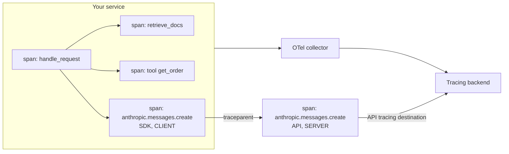

# Observability

> **Level:** Advanced · **Time:** ~45 min · **Exam relevance:** CCAR-P D4 (4.6), CCAR-P D3 (3.4), CCAR-P D7 (7.3)

## In plain English

Observability is being able to answer questions about your running system from the data it emits, including
questions you did not think of in advance. For a web service the usual signals are logs, metrics and traces. An LLM
application needs those plus signals about the model's work: which model and prompt version answered, how many
tokens were used and cached, why generation stopped, whether the answer was any good, and how much it cost.

The goal is that when someone says "the assistant gave a strange answer to a customer at 10:42", you can find that
exact request in minutes and see everything that led to it.

[Logging and auditability](../12-ai-security/11-logging-and-auditability.md) covers the security and audit side. This
page covers operational observability.

## Why it matters

- CCAR-P-4.6 asks you to monitor performance with logging and observability tooling; CCAR-P-3.4 asks you to analyse
  observability challenges at scale.
- LLM failures are often silent: a 200 response with a truncated, refused or wrong answer. Without model-specific
  signals, dashboards look green while users suffer.
- Cost and rate-limit problems build up gradually. Token and cache metrics show them before they become outages.

## How it works

### The signals

| Signal | What to capture | Source |
|---|---|---|
| Correlation ID | Your own ID for the user request, propagated through every layer | Your application |
| Anthropic request ID | The `request-id` response header; in the Python SDK, `response._request_id` | SDK / HTTP response |
| Message ID | `response.id` | Response body |
| Model | Requested model and `response.model` (what actually served the request) | Request and response |
| Configuration | Prompt template version, tool set version, `effort`, `max_tokens` | Your application |
| Stop reason | `stop_reason`, and `stop_details` when it is `refusal` | Response body |
| Usage | `usage.input_tokens`, `output_tokens`, `cache_creation_input_tokens`, `cache_read_input_tokens` | Response body |
| Latency | Time to first token (streaming), total time, per tool call | Your timers |
| Errors | HTTP status and error type (`rate_limit_error`, `overloaded_error`, `api_error`, ...), retry count | SDK exceptions |
| Rate-limit headroom | `anthropic-ratelimit-*` response headers (remaining and reset for requests, input and output tokens) | Response headers |
| Agent behaviour | Turns per task, tool calls by name and outcome, denied calls, approvals | Your agent loop |
| Quality | Sampled grading results, user feedback, escalation rate | Eval pipeline, UI |

Note a subtle point when summing tokens: in the Messages API response, `usage.input_tokens` counts only the tokens
after the last cache breakpoint, so total input is `input_tokens + cache_creation_input_tokens +
cache_read_input_tokens`. In OpenTelemetry spans emitted by Anthropic's SDK and API, `gen_ai.usage.input_tokens`
already includes cache reads and writes. Do not mix the two conventions in one dashboard.

### Tracing with OpenTelemetry

OpenTelemetry (OTel) is the open standard for traces, metrics and logs. A **trace** represents one request end to
end; it is made of **spans** (timed operations such as "retrieve documents", "call Claude", "run tool") linked by a
shared trace ID and parent-child relationships. Context is propagated between services with the W3C `traceparent`
header.

As of 2026-10-24, Anthropic offers OpenTelemetry support in beta (see the
[OpenTelemetry documentation](https://platform.claude.com/docs/en/manage-claude/opentelemetry)):

- **SDK tracing**: the Claude SDKs emit spans (for example an `anthropic.messages.create` span per call) in your
  process through whatever tracer provider your application registers. It works with the first-party API and the
  cloud platform clients.
- **API tracing**: the Claude API emits server-side spans to an OTLP destination that an organisation admin
  configures, including individual model requests and server tools. When the SDK sends `traceparent`, API spans nest
  under the SDK span in the same trace.
- Spans use the OpenTelemetry GenAI semantic conventions (`gen_ai.*` attributes).
- The default **content mode is metadata only**; full content mode exports prompts and responses to your backend.
  Decide deliberately, with your privacy team, before turning it on.



Beta features can change; pin the SDK version and check the docs when upgrading.

### Dashboards

Build dashboards around questions:

| Dashboard | Panels |
|---|---|
| Health | Requests per minute, error rate by error type, p50/p95/p99 latency, TTFT, retries |
| Model behaviour | `stop_reason` distribution (watch `max_tokens` and `refusal`), average output tokens, turns per agent task |
| Cost and efficiency | Tokens by type and model, cache hit rate, cost per task, top routes by spend |
| Capacity | Rate-limit headroom from headers, 429 counts, queue depth |
| Quality | Sampled rubric pass rate, user feedback, escalation rate, by prompt version |
| Safety and security | Screen blocks, denied tool calls, sanitiser findings, refusal rate |

Slice everything by model, prompt version and route so a regression after a change is visible immediately.

### Alerts

Alert on symptoms users feel, with runbooks:

- Error rate or p95 latency above SLO thresholds.
- Share of `max_tokens` stop reasons above baseline (output truncation).
- Refusal rate spike (possible attack, or a prompt change that pushes requests into classifier territory).
- Cache hit rate drops sharply (a prefix changed; cost and rate-limit pressure will follow).
- Rate-limit headroom below a threshold, or 429s above zero for sustained periods.
- Quality score below SLO on the rolling sample.
- Spend rate above forecast.

## Example

A thin instrumentation wrapper around the Messages API that emits one structured log line per call and an optional
OTel span. It works with the real SDK or the lab mock client.

```python
"""instrumented_call.py - structured, correlated logging around Claude calls."""
import json
import logging
import sys
import time
import uuid
from pathlib import Path

sys.path.insert(0, str(Path(__file__).resolve().parents[1] / "19-hands-on-labs" / "common"))
from claude_lab import MODEL, get_client  # noqa: E402

logging.basicConfig(level=logging.INFO, format="%(message)s")
log = logging.getLogger("claude")

try:  # optional: emit an application span if OpenTelemetry is installed and configured
    from opentelemetry import trace
    tracer = trace.get_tracer("assistant-service")
except ImportError:
    tracer = None

PROMPT_VERSION = "support-v12"


def call_claude(client, correlation_id: str, route: str, **request):
    start = time.monotonic()
    span_ctx = tracer.start_as_current_span(f"claude.{route}") if tracer else None
    if span_ctx:
        span_ctx.__enter__()
    try:
        response = client.messages.create(**request)
        u = response.usage
        record = {
            "event": "claude_call", "correlation_id": correlation_id, "route": route,
            "prompt_version": PROMPT_VERSION, "requested_model": request["model"],
            "served_model": response.model, "message_id": response.id,
            "request_id": getattr(response, "_request_id", None),
            "stop_reason": response.stop_reason,
            "input_tokens": u.input_tokens, "output_tokens": u.output_tokens,
            "cache_write_tokens": getattr(u, "cache_creation_input_tokens", 0) or 0,
            "cache_read_tokens": getattr(u, "cache_read_input_tokens", 0) or 0,
            "latency_ms": round((time.monotonic() - start) * 1000),
        }
        if response.stop_reason == "refusal" and getattr(response, "stop_details", None):
            record["refusal_category"] = getattr(response.stop_details, "category", None)
        log.info(json.dumps(record))
        return response
    except Exception as exc:  # log, then let the caller's retry/fallback policy decide
        log.info(json.dumps({"event": "claude_error", "correlation_id": correlation_id, "route": route,
                             "error_type": type(exc).__name__,
                             "latency_ms": round((time.monotonic() - start) * 1000)}))
        raise
    finally:
        if span_ctx:
            span_ctx.__exit__(None, None, None)


if __name__ == "__main__":
    client = get_client()
    call_claude(client, correlation_id=str(uuid.uuid4()), route="answer",
                model=MODEL, max_tokens=512,
                messages=[{"role": "user", "content": "Where is my parcel AC-4471?"}])
```

For SDK-native spans, register a tracer provider before creating the client; the Python SDK then emits
`anthropic.messages.create` spans automatically. See the Python SDK OpenTelemetry docs for the exact options, which
may change during the beta. [Lab 19](../19-hands-on-labs/lab-19-observability/README.md) builds a full dashboard from
logs like these.

## Enterprise use case

*Contoso Health's* scheduling assistant shows normal error rates and latency, but call-centre volume rises. The
observability data tells the story:

- The `stop_reason` panel shows `max_tokens` rising from 0.2 to 6 percent of responses after a prompt change that
  asked for more detailed confirmations. Truncated confirmations confused patients, who then phoned.
- The cache hit rate panel shows a drop from 85 to 10 percent on the same day: the new prompt inserted the current
  date at the top of the system prompt, changing the cached prefix on every request.

The team moves the date into the latest user turn, raises `max_tokens` for the confirmation route, and adds alerts for
both signals. Cost and call volume return to baseline within a day.

## Common mistakes

- Logging only HTTP status and latency, so `stop_reason`, tokens and model are invisible.
- Not logging the Anthropic request ID, which slows down support cases.
- Turning on full-content tracing without a privacy review.
- Summing `gen_ai.usage.input_tokens` from spans together with cache attributes (double counting).
- Dashboards that cannot be sliced by prompt version or model.

## Security considerations

- Observability backends become data stores; apply retention and access controls, especially in full content mode.
- Never put personal data or secrets in correlation IDs, conversation IDs or span names.
- Make sure security-relevant events (screen blocks, denied tool calls) reach the security team's tooling as well as
  engineering dashboards.

## Troubleshooting

| Symptom | Likely cause | Fix |
|---|---|---|
| No SDK spans appear | Tracer provider registered after the client was created, or tracing disabled | Register the provider first; check SDK options |
| Spans from the API do not join your trace | `traceparent` not propagated (or using a platform where it is ignored) | Call through the SDK inside your span; check platform support |
| Token totals do not match the bill | Mixed conventions, missing cache tokens, or judge and retry calls not counted | Use one convention; include every call |
| A stream's span never ends | Stream not fully read or closed | Close streams you stop reading early |

## Check your understanding

1. Name five fields you should log for every Claude call.
2. How do you calculate total input tokens from a Messages API response, and how does that differ from the OTel
   `gen_ai.usage.input_tokens` attribute?
3. Why alert on the share of `max_tokens` stop reasons?
4. What is the default content mode for Anthropic's OpenTelemetry support, and why does it matter?

<details>
<summary>Answers</summary>

1. Any five of: correlation ID, Anthropic request ID, message ID, requested and served model, prompt version,
   `stop_reason`, usage fields, latency, error type, route.
2. `input_tokens + cache_creation_input_tokens + cache_read_input_tokens`; the OTel attribute already includes cache
   reads and writes, so adding them again double counts.
3. A rising share means outputs are being truncated, which harms quality silently while HTTP status stays 200.
4. Metadata only; prompts and responses are not exported unless you choose full content mode, which has privacy and
   retention implications for your tracing backend.

</details>

## Further reading

- Anthropic: [OpenTelemetry](https://platform.claude.com/docs/en/manage-claude/opentelemetry)
- Anthropic: [Rate limits (response headers)](https://platform.claude.com/docs/en/api/rate-limits)
- Anthropic: [Errors](https://platform.claude.com/docs/en/api/errors)
- OpenTelemetry: [GenAI semantic conventions](https://opentelemetry.io/docs/specs/semconv/gen-ai/)
- In this repository: [Lab 19](../19-hands-on-labs/lab-19-observability/README.md),
  [logging and auditability](../12-ai-security/11-logging-and-auditability.md),
  [API errors troubleshooting](../24-troubleshooting/api-errors.md)
