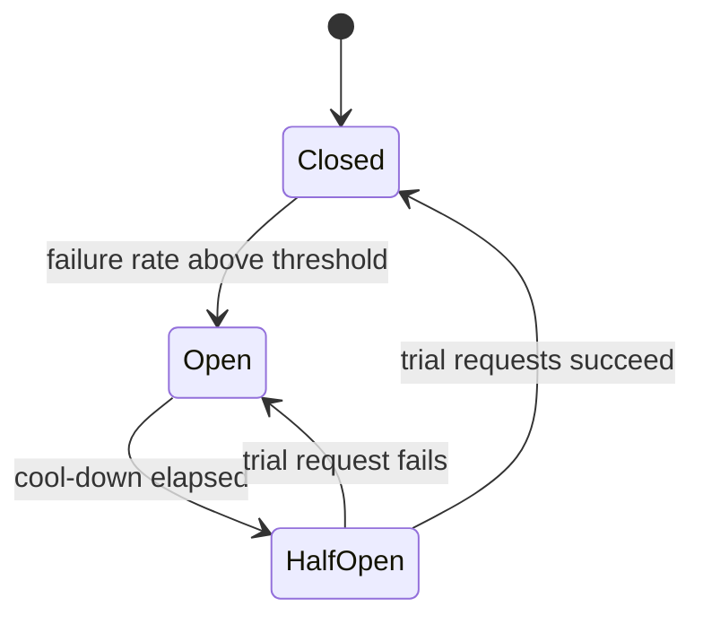

# Reliability Engineering

> **Level:** Advanced · **Time:** ~50 min · **Exam relevance:** CCAR-P D7 (7.3), CCAR-P D4 (4.6), CCAR-P D6 (6.3), CCAR-P D1 (1.2)

## In plain English

Reliability engineering is designing a system so it keeps doing something sensible when parts of it misbehave. With
Claude in your architecture, the things that misbehave include: the API being slow or overloaded, rate limits, network
failures, responses cut off at `max_tokens`, refusals, tool calls that fail, agents that loop, and your own downstream
systems.

The classic patterns still apply (timeouts, retries, fallbacks, circuit breakers, idempotency). This page shows how
they apply to LLM calls, which are slower, more variable in duration, token-metered and sometimes refused.

## Why it matters

- CCAR-P-7.3 covers supporting debugging and operational issue resolution; CCAR-P-6.3 covers SLAs. Your SLA depends
  on how you handle dependency failure.
- Naive retry loops can multiply cost, worsen overload and duplicate side effects such as sending an email twice.
- Agents amplify failures: one bad tool result can cascade through many steps (agentic risk ASI08 Cascading
  Failures).

## How it works

### Failure modes and responses

| Failure | Signal | Retry? | Response |
|---|---|---|---|
| Network error, connection reset | SDK connection error | Yes, with backoff | Retry; then fallback |
| Timeout | SDK timeout error | Yes, carefully | Retry once or twice with backoff; for long generations, stream instead of extending timeouts |
| Rate limit | HTTP 429 `rate_limit_error`, `retry-after` header | Yes, after `retry-after` | Honour the header; queue or shed load; see [rate limits](06-rate-limits-and-capacity.md) |
| Spend limit reached | HTTP 429 with `error.details.error_code` of `enforced_spend_limit_reached` (no `retry-after`), or HTTP 400 for your own configured limit | No | Alert; degrade gracefully; do not retry |
| Overloaded | HTTP 529 `overloaded_error` | Yes, with backoff | Retry; fallback model or degraded mode |
| Server error | HTTP 500 `api_error` | Yes, with backoff | Retry; fallback |
| Bad request, auth, permission, not found | 400, 401, 403, 404 | No | Fix the request or configuration; alert |
| Truncation | `stop_reason == "max_tokens"` | Not blindly | Raise `max_tokens`, stream, or continue the generation; do not parse partial structured output |
| Refusal | `stop_reason == "refusal"` | Not the same request | Show a safe message, route to a human, or use server-side fallbacks where supported |
| Pause | `stop_reason == "pause_turn"` (long-running server tools) | Continue | Send the response back to let the model continue |
| Tool failure | Exception in your tool | Maybe | Return `tool_result` with `is_error: true` so Claude can adapt; retry idempotent tools |
| Agent loop | Turn count grows, repeated identical calls | No | Iteration cap, loop detection, budget, escalate |

The Anthropic SDKs retry connection errors, 408, 409, 429 and 5xx responses automatically with exponential backoff
(two retries by default in the Python SDK, configurable with `max_retries`), and their default request timeout is
10 minutes, as of 2026-10-24. Tune both per call type rather than adding a second retry loop on top.

### Timeouts

Set timeouts per route, based on the expected output length:

- Short classification: seconds.
- Interactive answers: stream, and set a generous overall ceiling plus an inactivity guard.
- Long generations: always stream; the SDKs expect streaming for large `max_tokens`.

Remember that wall-clock time can reach `timeout x (max_retries + 1)`. Your end-to-end budget must account for it.

### Retries done right

- Exponential backoff with jitter (randomised delays) to avoid synchronised retry storms.
- Honour `retry-after` on 429s.
- A **retry budget**: cap the share of traffic that can be retries (for example 10 percent) so retries cannot double
  your load during an incident.
- Only retry idempotent operations, or make them idempotent first.

### Fallbacks

| Fallback | When | Notes |
|---|---|---|
| Same model, later (queue) | Non-interactive work | Simplest and keeps quality |
| Different model | Overload of one model, or a refusal from a safety classifier where a fallback model is appropriate | Prompts may behave differently; evaluate the fallback configuration too |
| Server-side refusal fallback | Refusals on supported models | Anthropic offers a `fallbacks` request parameter (beta, Claude API; as of 2026-10-24) that re-runs a declined request on another model; check the docs for models, platforms and billing |
| Different deployment (another region or cloud platform) | Regional or platform outage | Requires parity testing and separate capacity |
| Degraded mode | Full outage | Cached answers, templates, search results without generation, or "we'll get back to you" |
| Human queue | High-stakes requests | Preserve the user's request and context |

### Circuit breakers

A circuit breaker stops calling a failing dependency for a while, so you fail fast and give it room to recover.



While open, route to the fallback immediately. Count only retryable dependency failures (429, 5xx, 529, timeouts)
towards the breaker, not 400s caused by your own bad requests.

### Idempotency

LLM workflows often end in side effects: create a ticket, send an email, update a record. If a retry happens after the
side effect succeeded but before you recorded success, you can do it twice.

- Give every side-effecting operation an idempotency key derived from the business intent (for example
  `refund:{order_id}:{request_id}`), and have the tool or downstream API reject duplicates.
- Record tool-call outcomes durably before acknowledging them to the agent loop.
- For agents, keep a ledger of completed tool calls per task so a resumed task does not repeat them.

### Graceful handling of stop reasons

Every code path that reads `response.content` must first branch on `stop_reason`. Treat `max_tokens` and `refusal` as
first-class outcomes with their own user experience, metrics and alerts.

## Example

A resilient call wrapper: per-route timeouts, SDK retries, a circuit breaker, a fallback model and explicit
stop-reason handling. It uses the official SDK's typed exceptions (live mode).

```python
"""resilient.py - circuit breaker, fallback model and stop-reason handling around Claude calls."""
import random
import time

import anthropic

PRIMARY = "claude-opus-5-5"
FALLBACK = "claude-sonnet-5-5"


class CircuitBreaker:
    def __init__(self, threshold: int = 5, window_s: float = 60, cooldown_s: float = 30):
        self.threshold, self.window_s, self.cooldown_s = threshold, window_s, cooldown_s
        self.failures: list[float] = []
        self.opened_at: float | None = None

    def allow(self) -> bool:
        if self.opened_at is None:
            return True
        if time.monotonic() - self.opened_at >= self.cooldown_s:
            return True            # half-open: let a trial request through
        return False

    def record(self, ok: bool) -> None:
        now = time.monotonic()
        if ok:
            self.failures.clear()
            self.opened_at = None
            return
        self.failures = [t for t in self.failures if now - t < self.window_s] + [now]
        if len(self.failures) >= self.threshold:
            self.opened_at = now


breakers = {PRIMARY: CircuitBreaker(), FALLBACK: CircuitBreaker()}
client = anthropic.Anthropic(max_retries=2, timeout=60.0)   # SDK retries 408/409/429/5xx with backoff
RETRYABLE = (anthropic.RateLimitError, anthropic.InternalServerError,
             anthropic.APIConnectionError, anthropic.APITimeoutError)


def answer(question: str) -> dict:
    for model in (PRIMARY, FALLBACK):
        if not breakers[model].allow():
            continue
        try:
            r = client.messages.create(model=model, max_tokens=2048,
                                       messages=[{"role": "user", "content": question}])
        except anthropic.RateLimitError as e:
            body = e.body if isinstance(e.body, dict) else {}
            code = (body.get("error") or {}).get("details", {}).get("error_code")
            if code == "enforced_spend_limit_reached":
                return {"status": "unavailable", "reason": "spend limit"}   # retrying will not help
            breakers[model].record(False)
            continue
        except RETRYABLE:
            breakers[model].record(False)
            time.sleep(random.uniform(0.1, 0.5))   # small jitter before trying the fallback
            continue
        except anthropic.APIStatusError as e:
            return {"status": "error", "reason": f"non-retryable {e.status_code}"}  # fix request; alert
        breakers[model].record(True)
        if r.stop_reason == "end_turn":
            return {"status": "ok", "model": model,
                    "text": "".join(b.text for b in r.content if b.type == "text")}
        if r.stop_reason == "max_tokens":
            return {"status": "truncated", "model": model}      # raise max_tokens or stream; do not show partial JSON
        if r.stop_reason == "refusal":
            return {"status": "refused", "model": model}        # safe message or human handover
        return {"status": "unexpected", "stop_reason": r.stop_reason}
    return {"status": "degraded", "text": "We're busy right now. Your request has been queued."}
```

`InternalServerError` covers 5xx responses including 529 overloaded in the Python SDK's error hierarchy; check the SDK
error reference for your language. [Lab 18](../19-hands-on-labs/lab-18-reliability-engineering/README.md) runs this
pattern against a fault-injecting mock so you can watch the breaker open and close.

> **Cost:** requires API credits (live mode).

## Enterprise use case

*Contoso Health's* triage assistant must keep working during provider incidents because nurses rely on it at shift
change. The reliability design:

- Interactive route: streaming, a 90-second ceiling, SDK retries, a circuit breaker per model, fallback from Claude
  Opus 5.5 to Claude Sonnet 5.5 (both configurations evaluated and approved), then a degraded mode that shows the
  relevant protocol documents without generation.
- Refusals show a standard message and offer a one-click handover to the clinical lead.
- Ticket creation uses idempotency keys; a duplicate-detection test runs in CI.
- Agent loops are capped at 10 tool calls and three minutes, with escalation when reached.

During a regional incident later that year, the breaker opened within a minute, traffic moved to the fallback, and the
degraded mode handled the remaining peak. Nurses saw slower answers but no outage.

## Common mistakes

- Wrapping the SDK in another retry loop, multiplying retries.
- Retrying 400 errors or spend-limit 429s.
- Parsing JSON from a `max_tokens` response.
- Fallback models that were never evaluated with the production prompt.
- Side-effecting tools without idempotency keys.

## Security considerations

- Fallback paths must have the same guardrails as primary paths; attackers look for degraded modes with weaker
  checks.
- Do not log full request bodies when recording failures; log IDs and error types.
- Circuit-breaker and kill-switch controls should be protected and audited.

## Troubleshooting

| Symptom | Likely cause | Fix |
|---|---|---|
| Retry storms during incidents | No jitter or retry budget | Add jitter, budgets and breakers |
| Duplicate emails or tickets | Retries after successful side effects | Idempotency keys and outcome ledger |
| Breaker flaps open and closed | Threshold too low or counting non-retryable errors | Tune thresholds; count only dependency failures |
| Users see blank answers | Refusal or truncation not handled | Branch on `stop_reason` everywhere |

## Check your understanding

1. Which errors should be retried, and which should not?
2. What problem does a circuit breaker solve that retries do not?
3. Why do side-effecting tools need idempotency keys?
4. How should your code respond to `stop_reason: "max_tokens"` when it expected JSON?

<details>
<summary>Answers</summary>

1. Retry connection errors, timeouts, 429 rate limits (after `retry-after`), 500 and 529; do not retry 400, 401, 403,
   404 or spend-limit 429s.
2. It stops sending traffic to a failing dependency, so you fail fast to a fallback and avoid piling load on a service
   that is trying to recover.
3. Because retries or resumed tasks can repeat an action that already succeeded; the key lets the downstream system
   reject duplicates.
4. Treat it as truncated: do not parse partial JSON; raise `max_tokens`, stream, or reduce the requested output, and
   track it as its own outcome.

</details>

## Further reading

- Anthropic: [Errors](https://platform.claude.com/docs/en/api/errors)
- Anthropic: [Handling stop reasons](https://platform.claude.com/docs/en/build-with-claude/handling-stop-reasons)
- Anthropic: [Refusals and fallbacks](https://platform.claude.com/docs/en/build-with-claude/refusals-and-fallback)
- In this repository: [errors, rate limits and retries](../06-claude-api/06-errors-rate-limits-retries.md),
  [agent reliability](../10-agentic-ai/07-agent-reliability.md),
  [Lab 18](../19-hands-on-labs/lab-18-reliability-engineering/README.md),
  [tools and agents troubleshooting](../24-troubleshooting/tools-and-agents.md)
