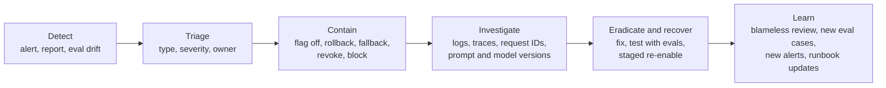

# Incident Response for AI Systems

> **Level:** Advanced · **Time:** ~40 min · **Exam relevance:** CCAR-P D7 (7.3), CCAR-P D5 (5.2), CCAR-P D6 (6.3)

## In plain English

An incident is anything that disrupts the service or harms users, the business or data, and needs a coordinated
response. AI systems have the familiar incidents (outages, latency, errors) and some new ones: answers quietly become
wrong after a change, the assistant starts producing harmful or off-brand content, an attacker uses prompt injection to
leak data, or an agent takes actions nobody intended. Costs can also spike overnight.

Incident response for AI systems uses the same lifecycle as any other (prepare, detect, contain, eradicate, recover,
learn), with AI-specific playbooks, evidence and containment levers.

## Why it matters

- CCAR-P-7.3 covers supporting debugging and operational issue resolution. CCAR-P-5.2 covers failure modes.
- AI incidents can be hard to see: a quality regression produces no errors. Detection depends on the signals from
  [observability](02-observability.md) and [logging and auditability](../12-ai-security/11-logging-and-auditability.md).
- Containment options differ: you can switch prompts, models or tools, disable a capability, or move to a degraded mode
  without taking the whole product down, if you have prepared those levers.

## How it works

### AI incident taxonomy

| Type | Example signals | Typical containment |
|---|---|---|
| Provider degradation or outage | 5xx, 529 overloaded, timeouts, latency spike; provider status page | Circuit breaker, fallback model or deployment, degraded mode |
| Capacity or rate limiting | 429s, low rate-limit headroom | Shed or defer low-priority work, batch, request limit increase |
| Spend anomaly | Spend rate far above forecast, one key or workspace dominating | Lower workspace limits, disable runaway route, rotate a leaked key |
| Quality regression | Sampled grading drops, user complaints, `max_tokens` share rises | Roll back prompt or model configuration |
| Harmful or policy-violating output | Reports, classifier flags, refusal pattern changes | Tighten scope, add output filter, disable feature for affected route |
| Prompt-injection or abuse campaign | Spike in screen blocks, denied tool calls, sanitiser findings | Block offending sources and users, quarantine content, disable risky tools |
| Data leakage | Canary hits, other-tenant data reports, unexpected outbound requests | Disable feature or tool, revoke credentials, preserve evidence, notify per policy |
| Unintended agent actions | Unexpected writes, emails, tickets; audit-log anomalies | Kill switch for the agent, revoke its tokens, reverse actions |
| Supply-chain compromise | Changed MCP tool list, compromised package or Skill | Remove the component, rotate credentials it could reach, review actions |
| Model deprecation surprise | 404 or errors after a retirement date | Move to the replacement model (should never happen with tracking) |

### Preparation: levers to have ready

- **Feature flags and kill switches** per AI feature, per tool and per agent.
- **Configuration rollback**: versioned prompts, tool sets and model IDs that can be reverted in minutes.
- **Fallback paths** tested in advance ([reliability engineering](05-reliability-engineering.md)).
- **Credential revocation** procedures for API keys, agent identities and downstream tokens.
- **Evidence capture**: correlation IDs, Anthropic request IDs, model and prompt versions in logs; protected audit
  logs.
- **Runbooks** per incident type, with owners and contacts (including your Anthropic account team and support for
  provider issues, and privacy and legal for data incidents).
- **Severity definitions** that include AI harms, not just downtime.

| Severity | Example |
|---|---|
| SEV1 | Confirmed data leakage; harmful content at scale to customers; agent taking damaging actions |
| SEV2 | Feature down or badly degraded for many users; significant quality regression in a customer-facing flow |
| SEV3 | Partial degradation, elevated refusals or truncation, cost anomaly within budget |
| SEV4 | Minor issue, workaround available |

### The response flow



**Contain first, investigate second.** For security incidents, preserve evidence while containing: snapshot logs,
export relevant transcripts to the protected audit store, and record the configuration in effect.

### Investigation questions specific to AI

- Which model, prompt version, tool set and retrieval configuration were in effect? Did any change recently?
- What was in the context window for affected requests (retrieved documents, tool results, untrusted content)?
- Which tools were called, with what arguments, and what did the policy enforcement point decide?
- Is the behaviour reproducible with the same inputs? (Expect some variance; reproduce several times.)
- Is it isolated to one route, tenant, language or input type?
- Did the provider report an incident in the same window?

### Learning: close the loop

Every AI incident should produce:

1. **New eval cases** reproducing the failure, added to the regression suite
   ([safety and red-team evals](../14-evaluation-and-testing/07-safety-and-red-team-evals.md)).
2. **New or tuned alerts** so the same issue is detected sooner.
3. **Control improvements**, preferably architectural (narrower tools, better isolation) rather than prompt-only.
4. **Runbook updates.**

## Example

A small containment toolkit backed by a configuration store. In production the store would be your feature-flag
service; here it is a JSON file so the example runs anywhere.

```python
"""containment.py - feature flags, kill switches and config rollback for AI incidents."""
import json
import time
from pathlib import Path

STORE = Path("ai_runtime_config.json")
DEFAULT = {
    "features": {"assistant": True, "agent_actions": True},
    "disabled_tools": [],
    "active": {"model": "claude-opus-5-5", "prompt_version": "support-v12"},
    "history": [],
}


def load() -> dict:
    return json.loads(STORE.read_text()) if STORE.exists() else json.loads(json.dumps(DEFAULT))


def save(cfg: dict, actor: str, reason: str) -> None:
    cfg["history"].append({"ts": time.time(), "actor": actor, "reason": reason,
                           "snapshot": {k: cfg[k] for k in ("features", "disabled_tools", "active")}})
    STORE.write_text(json.dumps(cfg, indent=2))


def kill_feature(name: str, actor: str, reason: str) -> None:
    cfg = load()
    cfg["features"][name] = False
    save(cfg, actor, f"kill {name}: {reason}")


def disable_tool(tool: str, actor: str, reason: str) -> None:
    cfg = load()
    if tool not in cfg["disabled_tools"]:
        cfg["disabled_tools"].append(tool)
    save(cfg, actor, f"disable tool {tool}: {reason}")


def rollback(actor: str, steps: int = 1) -> dict:
    """Restore an earlier model/prompt configuration; containment flags stay as they are."""
    cfg = load()
    if len(cfg["history"]) <= steps:
        raise RuntimeError("no earlier configuration to roll back to")
    target = cfg["history"][-(steps + 1)]["snapshot"]
    cfg["active"] = json.loads(json.dumps(target["active"]))
    save(cfg, actor, f"rollback {steps} step(s)")
    return cfg["active"]


if __name__ == "__main__":
    save(load(), "deploy-bot", "baseline")
    cfg = load()
    cfg["active"]["prompt_version"] = "support-v13"
    save(cfg, "deploy-bot", "release v13")
    disable_tool("send_email", "oncall@acme.example", "suspected injection campaign INC-2291")
    print("after containment:", load()["disabled_tools"])
    print("rolled back to:", rollback("oncall@acme.example", steps=2))
```

The agent loop reads this configuration on every request and refuses to offer disabled tools, so containment takes
effect immediately without a deployment. [Lab 19](../19-hands-on-labs/lab-19-observability/README.md) includes an
incident drill.

## Enterprise use case

*Northwind Lending's* internal operations agent drafts customer emails from servicing notes. At 09:10, the security
monitoring dashboard shows a jump in sanitiser findings: drafts contained links to an unknown domain. Timeline:

- **09:12 detect**: alert on sanitiser findings above threshold; on-call security engineer paged.
- **09:15 contain**: `create_email_draft` disabled through the runtime flag; drafts already created quarantined.
- **09:30 investigate**: request IDs lead to 14 conversations; all retrieved servicing notes from one borrower
  account where a free-text note contained planted instructions submitted through the web portal.
- **10:20 eradicate**: note quarantined; retrieval now wraps borrower-authored notes as untrusted tool results with
  provenance; output link allow-list enforced in the draft tool, not only in the UI.
- **11:00 recover**: injection eval suite extended with 25 variants; all pass; tool re-enabled for 10 percent of users,
  then everyone the next day.
- **Learn**: blameless review; new alert on links to non-allow-listed domains in drafts; portal input now flagged as
  untrusted in the data catalogue.

No email had been sent, because drafts required a human to send them. The human-oversight design limited the impact.

## Common mistakes

- No kill switch, so the only containment is a full rollback or outage.
- Investigating before containing a live data-leak incident.
- Not recording which prompt and model versions were active.
- Fixing an injection incident only by adding a sentence to the system prompt.
- Skipping the learning step, so the same failure recurs.

## Security considerations

- Follow your organisation's security incident process for leaks and abuse, including legal and privacy notification
  requirements.
- Preserve evidence in protected storage; restrict who can read transcripts collected during the investigation.
- Rotate any credential an affected agent or tool could reach, even without evidence of use.
- Report suspected vulnerabilities in Anthropic products through Anthropic's disclosure channels (for Claude Code, the
  [security page](https://code.claude.com/docs/en/security) points to its HackerOne programme).

## Troubleshooting

| Symptom | Likely cause | Fix |
|---|---|---|
| Cannot tell which configuration produced a bad answer | Version fields missing from logs | Log model, prompt and tool-set versions on every call |
| Rollback restores the prompt but problem persists | Cause was retrieval data, a tool or the provider | Check other layers; look for recent data or dependency changes |
| Incident not detected for days | Quality and security signals not monitored | Add sampled grading and security alerts |

## Check your understanding

1. Name three AI-specific incident types that would not show up as HTTP errors.
2. Why should containment usually come before investigation?
3. What four outputs should every AI incident review produce?
4. Which containment levers should be prepared before launch?

<details>
<summary>Answers</summary>

1. Any three: quality regression, harmful or off-policy output, prompt-injection campaign, data leakage, unintended
   agent actions, cost anomaly, increased truncation or refusals.
2. To stop ongoing harm (data leaving, actions being taken) quickly; evidence can be preserved while containing.
3. New eval cases, new or tuned alerts, control improvements (preferably architectural) and runbook updates.
4. Feature flags and kill switches (feature, tool, agent), configuration rollback, tested fallbacks, credential
   revocation procedures and evidence capture.

</details>

## Further reading

- NIST: [SP 800-61 Rev. 3, Incident Response Recommendations](https://csrc.nist.gov/pubs/sp/800/61/r3/final)
- Anthropic: [Status page](https://status.claude.com)
- Anthropic: [Claude Code security](https://code.claude.com/docs/en/security)
- In this repository: [indirect prompt injection](../12-ai-security/03-indirect-prompt-injection.md),
  [human oversight](../12-ai-security/13-human-oversight.md),
  [Lab 19](../19-hands-on-labs/lab-19-observability/README.md),
  [Project 03](../20-real-world-projects/03-security-alert-triage-assistant/README.md)

<!-- page-nav:start -->
---

[← Previous: Rate Limits and Capacity](06-rate-limits-and-capacity.md) · [Module overview](README.md) · [Next: Model Upgrades and Change Management →](08-model-upgrades-and-change-management.md)
<!-- page-nav:end -->
