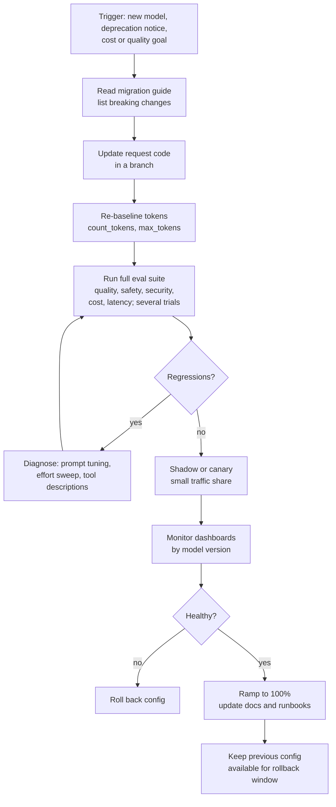

# Model Upgrades and Change Management

> **Level:** Advanced · **Time:** ~40 min · **Exam relevance:** CCAR-P D6 (6.5), CCAR-P D4 (4.3, 4.4), CCAR-P D3 (3.3), CCAR-P D2 (2.1)

## In plain English

Claude models improve regularly, and older models are eventually retired. Your prompts, tools and evals were tuned for
the model you launched with. Moving to a new model can improve quality, cut cost or latency, and add features, but it
can also change behaviour in ways that matter to you: different output length, different tool-use habits, a different
tokenizer, or API parameters that are no longer accepted.

Change management for LLM systems treats the model ID, the prompt, the tool definitions and key parameters (such as
`effort`) as versioned configuration that goes through the same review, testing and staged rollout as code.

## Why it matters

- Retired models stop working: requests to a model past its retirement date fail. You need to know dates in advance
  and migrate on your own schedule.
- Upgrades are the largest single source of behaviour change in a mature LLM application. Without regression evals,
  you find out from users.
- CCAR-P-6.5 covers lifecycle phases including monitoring and iteration; CCAR-P-4.3 and 4.4 cover A/B testing and
  diagnosing model mismatch.

## How it works

### Pin model IDs

Use explicit model IDs in configuration, for example `claude-opus-5-5`, `claude-sonnet-5-5`, `claude-haiku-5-5` (as
of 2026-10-24; see the [models overview](https://platform.claude.com/docs/en/about-claude/models/overview)). Keep them
in one configuration file or service, not scattered through code, and record the model ID in every log line. On
cloud platforms, model identifiers follow each platform's conventions; check the platform's model table.

### Know the lifecycle

Anthropic's [model deprecations page](https://platform.claude.com/docs/en/about-claude/model-deprecations) (checked
2026-10-24) defines the lifecycle:

| State | Meaning |
|---|---|
| Active | Fully supported and recommended |
| Legacy | No longer receives updates; may be deprecated in future |
| Deprecated | Still works but not recommended; a replacement and retirement date are assigned |
| Retired | No longer available; requests fail |

Anthropic notifies customers with active deployments of upcoming retirements, with at least 60 days' notice for
publicly released models, and lists tentative retirement dates for active models ("not sooner than" dates) on the
same page. Dates apply to Anthropic-operated platforms; Amazon Bedrock and Google-managed Google Cloud deployments set
their own schedules. The page also recommends auditing usage by exporting per-key, per-model usage from the Console.

API parameters can be deprecated too. For example, as of the `2026-10-21` API version, the sampling parameters
`temperature`, `top_p` and `top_k` return a 400 error; use prompting instead. Track the
[API versioning](https://platform.claude.com/docs/en/api/versioning) page alongside model deprecations.

### What can change in an upgrade

| Area | Example changes to check |
|---|---|
| Request surface | Parameters rejected (sampling parameters, assistant prefill, forced `tool_choice` on Opus 5.5, Sonnet 5.5, Fable 5.1 and Mythos 5.1, legacy thinking budgets), thinking and effort defaults differ by model |
| Tokenizer | Same text may produce a different number of tokens; re-baseline costs, limits and `max_tokens` with `count_tokens` |
| Output behaviour | Length, formatting, verbosity, how literally instructions are followed |
| Tool use | More or fewer tool calls, parallel calls, different argument formatting (always parse with a JSON parser) |
| Safety behaviour | Different refusal categories or rates; check `stop_reason: "refusal"` handling |
| Performance | Latency, output speed, rate-limit pools (newer models may have separate limits) |
| Price | Per-token prices and cache-read rates differ by model |

Anthropic publishes [migration guides](https://platform.claude.com/docs/en/about-claude/models/migration-guide) that
list breaking changes per model; read the relevant section before starting.

### The upgrade process



Practical guidance:

1. **Run the same suite on both models**, with multiple trials, and compare with paired statistics
   ([A/B testing](../14-evaluation-and-testing/05-ab-testing-and-iteration.md)).
2. **Do not use the old model's outputs as gold answers** when comparing old and new models; it rewards imitation.
3. **Sweep effort.** Defaults differ between models, and a newer model at lower effort may match an older one at
   higher effort for less cost.
4. **Re-tune prompts lightly.** Prompts written for older models are often more prescriptive than newer models need;
   remove outdated workarounds and re-test.
5. **Shadow first** for high-stakes flows: send a copy of traffic to the new configuration, grade both, show users only
   the old one.
6. **Canary, then ramp**, with dashboards sliced by model version and an automatic rollback condition.
7. **Re-run safety and security evals.** Changes in refusal behaviour and tool-use eagerness affect your guardrails.

### Change management beyond models

Treat these as versioned, reviewed changes with eval gates: system prompts and templates, tool definitions and tool
sets, retrieval configuration (chunking, embeddings, top-k), effort and `max_tokens` settings, guardrail and screening
prompts, and MCP servers and Skills. A tiny prompt edit can affect behaviour as much as a model change.

## Example

A deprecation watcher and release gate. It reads your configured models, compares them with a list you maintain from
the deprecations page, and fails when a retirement is near or an eval comparison shows a regression.

```python
"""upgrade_gate.py - flag approaching retirements and block regressions on model changes."""
from datetime import date

# Maintain from https://platform.claude.com/docs/en/about-claude/model-deprecations (checked 2026-10-24).
LIFECYCLE = {
    # Deprecated, retirement date not yet announced (shown as "TBD" on the deprecations page).
    "claude-sonnet-4-20250514": {"state": "deprecated", "retires": None, "replacement": "claude-sonnet-5-5"},
    "claude-opus-5-5": {"state": "active", "retires": None, "replacement": None},
    "claude-sonnet-5-5": {"state": "active", "retires": None, "replacement": None},
}
WARN_DAYS = 60


def retirement_findings(configured: dict[str, str], today: date) -> list[str]:
    out = []
    for route, model in configured.items():
        info = LIFECYCLE.get(model)
        if info is None:
            out.append(f"{route}: model {model} not in lifecycle table; check the deprecations page")
        elif info["retires"] and (info["retires"] - today).days <= WARN_DAYS:
            out.append(f"{route}: {model} retires {info['retires']}; migrate to {info['replacement']}")
        elif info["state"] == "deprecated":
            out.append(f"{route}: {model} is deprecated (retirement date not yet announced); "
                       f"plan the move to {info['replacement']}")
    return out


def regression_findings(baseline: dict, candidate: dict, tolerances: dict) -> list[str]:
    """Metrics where higher is better unless listed in lower_is_better."""
    lower_is_better = {"p95_latency_s", "cost_per_task", "attack_success_rate", "over_refusal_rate"}
    out = []
    for metric, tol in tolerances.items():
        b, c = baseline[metric], candidate[metric]
        worse = (c - b) if metric in lower_is_better else (b - c)
        if worse > tol:
            out.append(f"{metric}: baseline {b} -> candidate {c} exceeds tolerance {tol}")
    return out


if __name__ == "__main__":
    configured = {"triage": "claude-sonnet-4-20250514", "answer": "claude-opus-5-5"}
    print(retirement_findings(configured, today=date(2026, 10, 24)))
    baseline = {"rubric_pass": 0.91, "p95_latency_s": 6.2, "cost_per_task": 0.012,
                "attack_success_rate": 0.0, "over_refusal_rate": 0.012}
    candidate = {"rubric_pass": 0.92, "p95_latency_s": 5.1, "cost_per_task": 0.009,
                 "attack_success_rate": 0.0, "over_refusal_rate": 0.031}
    print(regression_findings(baseline, candidate, {"rubric_pass": 0.01, "p95_latency_s": 0.5,
                                                    "cost_per_task": 0.001, "attack_success_rate": 0.0,
                                                    "over_refusal_rate": 0.01}))
```

In this illustration the candidate is better on quality, latency and cost, but over-refusal has risen beyond tolerance,
so the gate blocks release until the team investigates.

## Enterprise use case

*Contoso Health* receives a deprecation notice for the model behind its claims-coding assistant, with a retirement
date about two months away. Its process:

1. **Week 1**: read the migration guide; update request code (removing a sampling parameter and an assistant prefill
   that the new model rejects; moving to structured outputs); re-baseline tokens with `count_tokens`.
2. **Week 2**: full eval suite on the old and new models with three trials. Quality improves; output length rises
   by about a third, and two tool-description ambiguities cause extra tool calls.
3. **Week 3**: trim outdated prompt instructions, clarify tool descriptions, run an effort sweep (`low` holds quality
   for 70 percent of routes). Safety evals show a slightly higher refusal rate on one category; the team adds benign
   examples to the system prompt and re-tests.
4. **Week 4**: shadow traffic for a week, then a 10 percent canary, then full rollout with the old configuration kept
   available for rollback until the retirement date.

The migration finishes a month before retirement, with lower cost per task than before.

## Common mistakes

- Using unpinned aliases or scattering model IDs through code.
- Waiting for the retirement date (or the first 404) to start migrating.
- Swapping the model ID without reading the migration guide.
- Comparing models on a dataset whose gold answers came from the old model.
- Re-running only quality evals and skipping safety, security, cost and latency.

## Security considerations

- New models can change how strictly they follow untrusted content or how eagerly they call tools; re-run injection
  and excessive-agency evals.
- Keep guardrail models (screens, judges) on the same change process; an upgraded screen can change detection rates.
- Record the model and configuration version in audit logs so investigations can tell which version acted.

## Troubleshooting

| Symptom | Likely cause | Fix |
|---|---|---|
| 400 errors after switching models | Parameters the new model rejects | Follow the migration guide; remove or replace parameters |
| Costs rose although per-token price fell | Tokenizer differences or longer outputs | Re-baseline with `count_tokens`; tune output length and effort |
| More tool calls than before | Model more agentic; ambiguous tool descriptions | Clarify descriptions; adjust instructions; check effort |
| Quality regressions on a narrow slice | Prompt tuned for old model's quirks | Diagnose the slice; remove outdated workarounds |

## Check your understanding

1. What are the four lifecycle states on Anthropic's model deprecations page?
2. How much notice does Anthropic commit to before retiring a publicly released model?
3. Why should you sweep `effort` when upgrading?
4. Name four kinds of change, other than the model, that should go through the same change process.

<details>
<summary>Answers</summary>

1. Active, legacy, deprecated and retired.
2. At least 60 days' notice for publicly released models, notified to customers with active deployments.
3. Defaults and effort calibration differ between models; a lower effort on the new model may match quality at lower
   cost and latency, or a higher one may be needed.
4. Any four: system prompts and templates, tool definitions and tool sets, retrieval configuration, effort and
   `max_tokens` settings, guardrail and screening prompts, MCP servers and Skills.

</details>

## Further reading

- Anthropic: [Model deprecations](https://platform.claude.com/docs/en/about-claude/model-deprecations)
- Anthropic: [Migration guide](https://platform.claude.com/docs/en/about-claude/models/migration-guide)
- Anthropic: [Models overview](https://platform.claude.com/docs/en/about-claude/models/overview)
- Anthropic: [API versioning](https://platform.claude.com/docs/en/api/versioning)
- In this repository: [model families](../05-claude-products-and-models/02-model-families.md),
  [model selection](../05-claude-products-and-models/03-model-selection.md),
  [lifecycle management](../13-enterprise-ai-architecture/09-lifecycle-management.md),
  [Lab 16](../19-hands-on-labs/lab-16-evaluation-framework/README.md)

<!-- page-nav:start -->
---

[← Previous: Incident Response for AI Systems](07-incident-response.md) · [Module overview](README.md) · [Next module: 16 · Certification Tracks →](../16-certification-tracks/README.md)
<!-- page-nav:end -->
