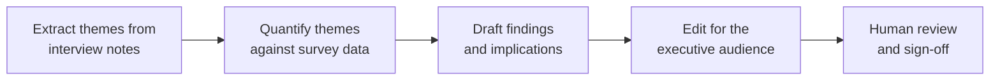

# Domain 1 · Prompting and Task Execution (14%)

> Part of the [CCAO-F track](../README.md). Objective IDs and weights come from [`registry.yaml`](../../registry.yaml).
> Objectives are paraphrased; the official exam guide is the source of truth.

## Objectives

| ID | What you must be able to do (paraphrased) |
|---|---|
| CCAO-F-1.1 | Write prompts that get useful results for business and technical tasks |
| CCAO-F-1.2 | Break a complex request into structured sub-tasks |
| CCAO-F-1.3 | Improve output quality by iterating on a prompt |
| CCAO-F-1.4 | Change your prompting approach to suit the task: analysis, research, drafting or brainstorming |

## Concepts to master

- The parts of a strong prompt: goal, context, audience, constraints, output format, success criteria.
- Why Claude cannot read your mind: it only knows what is in the conversation, the Project and any connected sources.
- Examples (sometimes called few-shot prompting) as the fastest way to communicate a style or format.
- Separating instructions from material using clear labels or tags.
- Decomposition: splitting a big job into steps whose outputs feed each other (prompt chaining).
- Iteration as diagnosis: change one thing at a time and compare.
- Task-type patterns: analysis wants evidence and reasoning; research wants sources and scope; drafting wants audience
  and voice; brainstorming wants volume and variety.

## Detailed notes

### 1.1 Writing effective prompts

Think of Claude as a capable new colleague who joined this morning. They are quick and well read, but they know nothing
about your team, your customer or what "good" looks like for this task. Every useful prompt fills that gap.

A practical checklist, in roughly the order it matters:

| Element | Question it answers | Weak | Strong |
|---|---|---|---|
| Goal | What do you want produced? | "Look at this survey data." | "Identify the three biggest drivers of dissatisfaction in this survey." |
| Context | Why, and what background matters? | (none) | "We are deciding which onboarding fix to fund next quarter." |
| Audience | Who reads the result? | (none) | "For the operations director, who has five minutes." |
| Constraints | What must or must not happen? | (none) | "Use only the attached data. Flag anything you cannot support." |
| Format | What shape should the answer take? | (none) | "A table with driver, evidence and estimated share, then a two-sentence recommendation." |
| Success criteria | How will you judge it? | (none) | "Each driver must cite at least two verbatim comments." |

Other habits that pay off:

- **Say what to do, not only what to avoid.** "Write in plain English at a reading level a new customer understands"
  works better than "don't be technical".
- **Explain the reason behind a rule.** "Keep it under 150 words because it goes into an SMS-length notification"
  lets Claude make sensible choices in edge cases.
- **Put long material first and the question last** when you paste a long document, and label the parts so Claude
  can tell instructions from source text (for example, "Here is the contract:" ... "Task:").
- **Show, don't describe, when style matters.** One or two short examples of the tone or format you want beat a
  paragraph of adjectives. Vary the examples so Claude copies the pattern, not the specific wording.
- **Ask for uncertainty to be flagged.** "If the document does not say, write 'not stated' rather than guessing" is one
  of the most effective anti-hallucination instructions available to a business user.

Prompts for technical tasks (a spreadsheet formula, a regular expression, a SQL query for an analyst) follow the same
rules, plus two more: state the tool and version ("Google Sheets", "Excel 365") and give a tiny sample of real-looking
input and the output you expect.

### 1.2 Decomposing complex requests

One giant prompt that asks for everything at once tends to produce something shallow everywhere. Decomposition splits
the job into stages so each gets Claude's full attention and so you can check the work between stages.

A typical decomposition for "write our quarterly customer-insights report":

Ways to decompose:

- **Sequential chain.** Each step's output is the next step's input (extract, then analyse, then draft). Check the
  intermediate output before moving on: an error caught at step 1 does not spread.
- **Parallel split.** Independent parts handled separately and then combined (one chat per region, then a summary).
- **Plan first.** Ask Claude to propose the steps before doing them: "Before you start, list the steps you would take
  and what you need from me." You review the plan, then run it.
- **Checklist inside one prompt.** For moderate tasks, numbered steps in one prompt are enough: "1. List the
  requirements. 2. Map each to a section of the policy. 3. Mark gaps."

Decompose when the task has distinct phases, needs different expertise per phase, is too long to review in one go, or
when an early error would be expensive. Do not decompose a simple task just for the sake of it; that only adds
overhead.

### 1.3 Iterating to improve quality

First drafts are a starting point. Good iteration is diagnostic, not random:

1. **Name what is wrong** specifically: too long, wrong audience, missed the second document, invented a figure.
2. **Find the cause in the prompt.** Was the audience unstated? Was the length unspecified? Was the source unclear?
3. **Change one thing** and compare against the previous version.
4. **Keep what works.** When a prompt is good, save it (in Project instructions, a Skill or a team prompt library) so
   you do not rebuild it next week.

Two ways to iterate:

| Approach | When to use it |
|---|---|
| Follow-up in the same chat ("shorter, and lead with the recommendation") | Small adjustments where the existing context is still useful |
| Edit the original prompt and regenerate | The first attempt went off track; carrying the bad draft forward would anchor later answers |

You can also ask Claude to help: "Here is my prompt and the output. The output was too generic. What information
should I have added?" This prompt-critique step is a fast way to learn.

### 1.4 Adapting to task type

| Task type | What Claude needs from you | Prompt moves that help | What to watch for |
|---|---|---|---|
| **Analysis** | Data or documents, the question, the decision it supports | Ask for reasoning before the conclusion; ask for evidence per claim; let Claude think step by step on hard problems | Confident conclusions not supported by the data |
| **Research** | Scope, time frame, preferred source types, what to exclude | Use research mode for multi-source questions; ask for citations; ask what it could not find | Out-of-date or uncited claims; sources that do not say what is claimed |
| **Drafting** | Audience, purpose, voice, length, key points, examples | Provide a sample of house style; specify structure; give the call to action | Generic tone; facts added that were not in your brief |
| **Brainstorming** | The challenge, constraints, what has been tried | Ask for many options and for variety across categories; defer judgement; then ask Claude to rank against criteria | Converging too early; ideas that ignore constraints |

A role ("You are an experienced procurement analyst") can help set tone and focus, but it is not a substitute for
context. A role plus a clear task, audience and format beats a role alone.

For hard analytical problems, giving Claude room to reason (asking it to work through the problem before answering, or
using a model and setting that think more deeply) usually improves results. For simple drafting it mostly adds time.

## Decision rules and heuristics

- If the output is generic, the prompt was probably missing **context or audience**.
- If the output has the wrong shape, the prompt was probably missing a **format specification or an example**.
- If the output invents things, add **"use only the provided material; say 'not stated' when it is missing"** and then
  verify (Domain 2).
- If a task has more than one deliverable or more than one phase, **decompose** it and check between steps.
- If a prompt works well and will be reused, **save it** in Project instructions or a Skill (Domain 5).
- Brainstorm **wide first, narrow second**: ask for volume, then ask for ranking against explicit criteria.

## Worked mini-scenarios

**Scenario 1 – The vague request.** Priya, an events coordinator at *Fabrikam Events*, asks: "Write an email about the
conference." The result is bland. *Better:* state the audience (registered attendees), the purpose (venue change), key
facts (new address, same date, shuttle from the old venue), tone (apologetic but brief) and the call to action
(confirm attendance by Friday). One revision, not five.

**Scenario 2 – The everything prompt.** Marcus at *Contoso Health* pastes 40 pages of policy and asks for a gap analysis,
a training plan and a slide outline in one go. Each part comes back thin. *Better:* chain it: first list the policy
requirements, check that list, then map gaps, then draft the training plan from the confirmed gaps, then build the
outline.

**Scenario 3 – Brainstorm that converges too early.** A marketing lead asks for "the best campaign name" and gets one
answer. *Better:* "Give me 20 names across five styles (descriptive, playful, aspirational, technical, local). Then
pick the top three against these criteria: memorable, available as a web domain, works in Spanish."

## Common traps

- Believing longer prompts are always better. Relevant detail helps; padding and contradictory rules hurt.
- Writing only prohibitions ("don't do X") without saying what you want instead.
- Fixing a bad first draft through ten follow-ups when editing the original prompt would be faster and cleaner.
- Changing several things at once while iterating, so you cannot tell which change helped.
- Using a role as a magic phrase while leaving out the task, audience and format.
- Treating examples as templates to copy word for word (vary them so Claude learns the pattern).

## Modules and labs

| Objective | Module pages | Labs |
|---|---|---|
| 1.1 | [Clear, direct instructions](../../../03-prompt-engineering/01-clear-direct-instructions.md), [Prompt fundamentals](../../../02-claude-fundamentals/03-prompt-fundamentals.md), [Examples (few-shot)](../../../03-prompt-engineering/03-examples-few-shot.md) | [Lab 02](../../../19-hands-on-labs/lab-02-prompt-improvement/README.md), [Lab 01](../../../19-hands-on-labs/lab-01-first-claude-interaction/README.md) |
| 1.2 | [Task decomposition and chaining](../../../03-prompt-engineering/05-task-decomposition-and-chaining.md), [Structure with XML tags](../../../03-prompt-engineering/02-structure-with-xml-tags.md) | [Lab 02](../../../19-hands-on-labs/lab-02-prompt-improvement/README.md), [Lab 12](../../../19-hands-on-labs/lab-12-agentic-task-execution/README.md) |
| 1.3 | [Iterating on prompts](../../../03-prompt-engineering/08-iterating-on-prompts.md) | [Lab 02](../../../19-hands-on-labs/lab-02-prompt-improvement/README.md), [Lab 16](../../../19-hands-on-labs/lab-16-evaluation-framework/README.md) |
| 1.4 | [Reasoning and thinking](../../../03-prompt-engineering/04-reasoning-and-thinking.md), [System prompts and roles](../../../03-prompt-engineering/07-system-prompts-and-roles.md) | [Lab 02](../../../19-hands-on-labs/lab-02-prompt-improvement/README.md), [Lab 03](../../../19-hands-on-labs/lab-03-structured-outputs/README.md) |

Hands-on: [practical exercises for Domain 1](../practical-exercises.md#domain-1--prompting-and-task-execution).

## Self-check

1. Name four elements you would add to "Summarise this report" to make it a strong prompt.
2. When should you edit the original prompt instead of sending a follow-up?
3. Give one sign that a task should be decomposed.
4. How does a brainstorming prompt differ from an analysis prompt?
5. Why does explaining the reason behind a constraint help?

Answers

1. Any four of: purpose or decision it supports, audience, length, format, focus areas, constraints such as "use only
   this report", success criteria.
2. When the first attempt went off track and carrying it forward would anchor later answers, or when the fix is a
   missing piece of context that belongs in the original request.
3. Distinct phases, several deliverables, different expertise per phase, too long to review at once, or an early error
   that would be costly downstream.
4. Brainstorming asks for many varied options with judgement deferred, then ranking; analysis asks for evidence-based
   reasoning towards a supported conclusion.
5. Claude can apply the intent to cases the rule did not anticipate, instead of following it rigidly or ignoring it.

