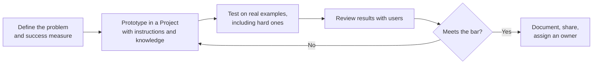

# Domain 4 · Workflow Integration and Solution Design (16%)

> Part of the [CCAO-F track](../README.md). Objective IDs and weights come from [`registry.yaml`](../../registry.yaml).
> Objectives are paraphrased; the official exam guide is the source of truth.

## Objectives

| ID | What you must be able to do (paraphrased) |
|---|---|
| CCAO-F-4.1 | Use Claude to analyse requirements and candidate use cases |
| CCAO-F-4.2 | Use Claude for research, planning and process improvement |
| CCAO-F-4.3 | Use Claude to support designing, building and refining a solution |
| CCAO-F-4.4 | Fit Claude into existing workflows, either augmenting steps or redesigning the process |
| CCAO-F-4.5 | Explain Claude's value and its limitations to stakeholders honestly |

## Concepts to master

- A use case is a combination of a task, a user, data, a quality bar and a measurable benefit.
- Good first use cases: frequent, time-consuming, text-heavy, low-to-medium risk, easy to check.
- Augment versus automate versus redesign.
- The human-in-the-loop checkpoint: where a person reviews before anything leaves the team or changes a record.
- Baselines and measures: you cannot claim a time saving you never measured.
- Escalation: when a workflow needs integrations, automation or API work, the Associate hands design to Architects or
  Developers.

## Detailed notes

### 4.1 Analysing requirements and use cases

Claude is a strong thinking partner for the analysis that precedes any change. Useful prompts:

- "Here are interview notes from five team members about our invoice-approval process. Extract the steps, pain points,
  hand-offs and the time each step takes, and list any contradictions between interviews."
- "Turn these meeting notes into a requirements list with must-have, should-have and could-have, and flag ambiguous
  requirements as questions for the sponsor."
- "Here are eight ideas for using Claude in our team. Score each on frequency, time saved, risk, data sensitivity and
  ease of checking the output, and explain the scores."

A quick screening grid for use cases:

| Criterion | Good sign | Warning sign |
|---|---|---|
| Frequency | Weekly or daily | Once a year |
| Effort today | Hours of reading, drafting or reformatting | Already quick |
| Checkability | A person can verify the output quickly | Errors are hard to spot |
| Risk | Internal, reversible | Regulated decisions, decisions about individuals, irreversible actions |
| Data | Non-sensitive or approved | Restricted data without approval |
| Fit | Language, summarising, drafting, extracting, analysing text | Needs guaranteed precise calculation, real-time system control, or authoritative legal or medical judgement |

Claude's analysis is an input. Validate requirements with the people who own the process.

### 4.2 Research, planning and process optimisation

- **Research:** use research mode or web search to gather background (industry practices, vendor options, regulatory
  overviews), then verify key findings (Domain 2).
- **Planning:** ask for a project plan with phases, dependencies, risks and owners as an artifact you can edit; ask
  Claude to stress-test it ("What are the five most likely reasons this plan slips?").
- **Process optimisation:** describe the current process step by step and ask Claude to find bottlenecks, duplicated
  effort, unnecessary approvals and steps that Claude could draft or pre-check. Ask for options at three levels of
  change (quick fixes, moderate redesign, full redesign) with trade-offs.

### 4.3 Supporting solution design and iteration

For an Associate, "solution" usually means a Claude-based way of working: a Project, a set of prompts, a Skill, an
artifact-based tool, a connector-enabled routine. A simple design loop:

Practical tips:

- Build a small **test set** of real examples (easy, typical and awkward) and rerun it after each change.
- Use artifacts to prototype small tools (a checklist, an intake form, a calculator, a dashboard) so stakeholders can
  try the idea instead of reading about it.
- Write down the decisions you made and why, so the next person can maintain the solution.
- Know the boundary: when the solution needs integration with business systems, automated processing at scale, custom
  connectors or anything touching production data flows, involve Claude Architects or Developers and your IT or
  security team.

### 4.4 Integrating Claude into existing workflows

Three levels of integration:

| Level | Description | Example |
|---|---|---|
| **Augment** | Claude helps a person do an existing step faster or better; the process is unchanged | A support agent asks Claude to draft a reply, then edits and sends it |
| **Automate a step** | A defined step is done by Claude with review of the output | Weekly status reports are drafted from tracker exports and reviewed by the project lead |
| **Redesign** | The process is rethought around what Claude makes possible | Instead of three rounds of document review, the draft is pre-checked by Claude against a checklist, so humans review only flagged issues |

Integration principles:

- **Start with augmentation** on a contained step, measure, then expand.
- **Put the human checkpoint before anything external, irreversible or affecting people.**
- **Connect to where the work lives** (connectors to Drive, email or calendar) only with approved connectors and least
  access.
- **Measure** against a baseline: time per item, error rate, rework, satisfaction.
- **Change management matters**: people need training, clear guidance on what is allowed, and a way to raise issues.

Redesign is more valuable but riskier. A redesign that removes a review step must replace it with an equal or better
control.

### 4.5 Communicating value and limitations

Stakeholders need an honest picture. A useful structure for a one-page brief:

1. **Problem and baseline**: what it costs today (hours, delays, errors).
2. **What Claude does in the new workflow**, and what people still do.
3. **Evidence**: results from a pilot on real examples, including failures.
4. **Limitations and controls**: hallucination risk and how outputs are verified; data handling; where humans decide.
5. **Cost**: plan or usage cost, plus time spent reviewing.
6. **Next step and decision needed.**

Avoid overselling ("Claude will replace the review team", "it is always accurate") and underselling ("it is just a
chatbot"). Credibility comes from showing both the gains and the failure modes, with the controls that handle them.

## Decision rules and heuristics

- **First use cases: frequent, text-heavy, checkable, low risk.**
- **Augment before you automate; automate before you redesign.**
- **Every workflow needs a named human checkpoint before external or irreversible steps.**
- **Measure a baseline before the pilot, not after.**
- **Integration, scale or system access beyond the Claude apps → escalate to Architects or Developers and IT.**
- **Communicate value with evidence and limitations together.**

## Worked mini-scenarios

**Scenario 1 – Picking the pilot.** A customer-success team at *Woodgrove Software* lists ideas: drafting renewal
reminder emails, deciding which customers get discounts, summarising call notes, and translating legal terms for
contracts. *Best first pilot:* call-note summaries (frequent, internal, easy to check). Discount decisions affect
customers financially and need policy-based human decisions; contract translation needs legal review.

**Scenario 2 – Process map from interviews.** An operations lead pastes notes from six interviews about onboarding new
suppliers. Claude produces a process map and flags that two interviewees describe different approval thresholds. The
lead takes that discrepancy to the process owner rather than letting Claude choose. *Lesson:* Claude surfaces the
question; people resolve it.

**Scenario 3 – The over-promising update.** After a two-week pilot that cut report drafting from three hours to one,
a manager wants to tell leadership that "reporting is now automated". *Better:* report the measured saving, the review
step that remains, two errors the review caught, and what scaling would require.

**Scenario 4 – Beyond the Associate's remit.** A team wants Claude to read every incoming order email, update the ERP
system and email customers automatically. *Lesson:* this is automation touching systems of record and customers. Draft
the requirements with Claude, then escalate to the Architect/Developer team and IT for design, security and approvals.

## Common traps

- Choosing a flashy, high-risk first use case instead of a frequent, checkable one.
- Removing a human review step without an equivalent control.
- Claiming savings without a baseline.
- Letting Claude settle disagreements between stakeholders instead of surfacing them.
- Treating a prototype as production-ready.
- Trying to build system integrations yourself when the task needs Architect, Developer or IT involvement.

## Modules and labs

| Objective | Module pages | Labs |
|---|---|---|
| 4.1 | [Solution design process](../../../13-enterprise-ai-architecture/01-solution-design-process.md), [Capabilities and limitations](../../../01-ai-and-llm-fundamentals/07-capabilities-and-limitations.md) | [Lab 02](../../../19-hands-on-labs/lab-02-prompt-improvement/README.md), [Lab 04](../../../19-hands-on-labs/lab-04-document-grounded-qa/README.md) |
| 4.2 | [Product ecosystem](../../../05-claude-products-and-models/01-product-ecosystem.md), [Workflow patterns](../../../10-agentic-ai/02-workflow-patterns.md) | [Lab 12](../../../19-hands-on-labs/lab-12-agentic-task-execution/README.md), [Lab 04](../../../19-hands-on-labs/lab-04-document-grounded-qa/README.md) |
| 4.3 | [Solution design process](../../../13-enterprise-ai-architecture/01-solution-design-process.md), [Architecture patterns](../../../13-enterprise-ai-architecture/02-architecture-patterns.md), [Iterating on prompts](../../../03-prompt-engineering/08-iterating-on-prompts.md) | [Lab 12](../../../19-hands-on-labs/lab-12-agentic-task-execution/README.md), [Lab 02](../../../19-hands-on-labs/lab-02-prompt-improvement/README.md) |
| 4.4 | [Workflows vs agents](../../../10-agentic-ai/01-workflows-vs-agents.md), [Workflow patterns](../../../10-agentic-ai/02-workflow-patterns.md), [Integration patterns](../../../13-enterprise-ai-architecture/04-integration-patterns.md), [Connectors](../../../05-claude-products-and-models/06-connectors-and-integrations.md) | [Lab 12](../../../19-hands-on-labs/lab-12-agentic-task-execution/README.md), [Lab 13](../../../19-hands-on-labs/lab-13-human-in-the-loop/README.md) |
| 4.5 | [Stakeholder communication](../../../13-enterprise-ai-architecture/06-stakeholder-communication.md), [Business value and ROI](../../../13-enterprise-ai-architecture/08-business-value-and-roi.md) | [Lab 06](../../../19-hands-on-labs/lab-06-model-comparison/README.md), [Lab 17](../../../19-hands-on-labs/lab-17-cost-optimisation/README.md) |

Hands-on: [practical exercises for Domain 4](../practical-exercises.md#domain-4--workflow-integration-and-solution-design).

## Self-check

1. List four characteristics of a good first use case.
2. What is the difference between augmenting and redesigning a workflow?
3. Where should the human checkpoint sit in a workflow that produces customer emails?
4. What belongs in a one-page brief to leadership about a Claude pilot?
5. Give an example of work an Associate should escalate rather than build.

Answers

1. Frequent, time-consuming today, easy to check, low to medium risk, uses non-sensitive or approved data, and plays to
   Claude's strengths with language.
2. Augmenting helps a person do an existing step better without changing the process; redesigning changes the process
   itself around what Claude makes possible, which usually needs new controls.
3. After drafting and before sending: a person reviews and approves each email (or a defined sample, if policy allows
   and risk is low).
4. Problem and baseline, what Claude does and what people do, pilot evidence including failures, limitations and
   controls, cost, and the decision needed.
5. Anything requiring system integrations, automated processing at scale, custom connectors, writing to systems of
   record, or production data flows, for example automatically updating an ERP from emails.

