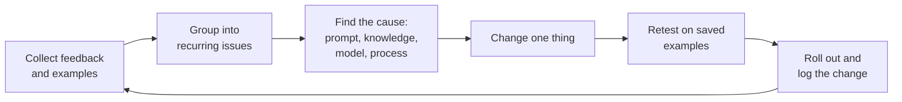

# Domain 7 · Troubleshooting and Optimization (10%)

> Part of the [CCAO-F track](../README.md). Objective IDs and weights come from [`registry.yaml`](../../registry.yaml).
> Objectives are paraphrased; the official exam guide is the source of truth.

## Objectives

| ID | What you must be able to do (paraphrased) |
|---|---|
| CCAO-F-7.1 | Find out why a prompt or output is underperforming, and fix it |
| CCAO-F-7.2 | Adjust your approach based on feedback and results |
| CCAO-F-7.3 | Make Claude-based workflows more efficient and effective |

## Concepts to master

- Symptom → likely cause → fix, rather than trial and error.
- Separating prompt problems from knowledge problems, context problems, model-choice problems and task-fit problems.
- Feedback loops: collecting what users and reviewers find, and turning it into changes.
- A test set of real examples to confirm that a fix helped and did not break something else.
- Efficiency levers in the Claude apps: reuse (Projects, Skills, saved prompts), right-sized models, shorter chats,
  batching similar work, and cutting unnecessary review loops safely.

## Detailed notes

### 7.1 Diagnosing and fixing poor outputs

Start by naming the symptom precisely, then work through the likely causes.

| Symptom | Likely causes | Fixes to try |
|---|---|---|
| Generic, bland answer | Missing context, audience or purpose | Add the why, the reader and what good looks like; add an example |
| Wrong format or length | Format not specified, or conflicting instructions | State the structure and length; remove contradictions in Project instructions |
| Invented facts or figures | Asked for facts not in the material; no fallback rule; no source | Provide the source; add "say 'not stated' when missing"; ask for quotes; verify |
| Ignores part of the input | Too much material, unclear labelling, important part buried | Label documents; ask about each explicitly; decompose; put the question after the material |
| Ignores a Project rule | Rule vague, buried in long instructions or contradicted elsewhere | Make it specific, explain why, move it up, remove conflicts; retest |
| Out-of-date answer | Old file in knowledge; question about recent events with no search | Replace the file; enable web search or research; ask for dates |
| Inconsistent answers across chats | Duplicate or conflicting knowledge files; instructions vary; different users with different connector access | De-duplicate knowledge; standardise instructions; check access |
| Quality fell during a long chat | Context drift, stale instructions, earlier errors anchoring | Summarise and restart; persist key facts in the Project |
| Shallow on a hard problem | Model too light for the reasoning; no room to think | Ask Claude to reason step by step before concluding; try a more capable model |
| Refuses or hedges unexpectedly | Request ambiguous or resembles something risky | Clarify legitimate purpose and context; if it is genuinely out of policy, accept that and escalate |

Debugging habits:

- **Reproduce the problem** with the same input before changing anything.
- **Change one variable at a time** (instructions, knowledge, prompt wording, model, chat length).
- **Ask Claude to explain**: "Which part of my instructions led you to include section 4?" This is often revealing,
  though the explanation is not guaranteed to be accurate.
- **Check the inputs first.** Many "model problems" are really an outdated or wrong document.
- **Retest on your saved examples** after the fix.

### 7.2 Adjusting based on feedback and results

Feedback comes from three places: your own review, reviewers and end users, and results (did the email get replies,
did the summary lead to the right decision?).

Turn feedback into improvements with a lightweight loop:

- Ask reviewers for **specific** feedback ("the tone is too casual for the board"), and keep the example.
- Fix **recurring** issues in the configuration (instructions, knowledge, Skill), not chat by chat.
- Compare before and after on the same examples, against criteria written in advance.
- Sometimes the right adjustment is to **stop**: if repeated fixes do not reach the quality bar, the task may not suit
  Claude, may need a different design, or may need escalation to Architects or Developers.

### 7.3 Optimising workflows for efficiency and effectiveness

| Lever | How it helps | Watch-out |
|---|---|---|
| Reuse via Projects | Instructions and knowledge set once; Project content is cached, so reuse counts less against usage | Keep knowledge current |
| Skills and saved prompts | Repeatable procedures done the same way every time | Version and maintain them |
| Right-size the model | Faster, lower usage for simple tasks | Confirm quality on real examples first |
| Shorter, focused chats | Less context per message, less drift, lower usage | Persist what must carry over |
| Batch similar items | One structured request for many similar items (for example, a table of 20 rows) instead of 20 chats | Spot-check for consistency across the batch |
| Structured outputs | Results drop straight into the next tool | Validate a sample |
| Templates and examples | Fewer iteration rounds | Refresh examples when standards change |
| Right-size review | Effort matches risk (spot-checks for low risk, full expert review for high) | Never remove review for high-stakes or external outputs |
| Connect to the source | Connectors avoid copy-paste and stale copies | Least access; approved connectors only |

Effectiveness matters as much as speed. A workflow that is 50% faster but sends more errors to customers is not an
optimisation. Track at least one quality measure (error rate, rework, reviewer score) alongside time saved.

Usage limits in the Claude apps are shared across features. Research, very long chats and heavy file work consume them
faster. If a team regularly hits limits, the fixes above (shorter chats, Projects, lighter models for simple work) are
the first step, before asking for a larger plan.

## Decision rules and heuristics

- **Name the symptom, then the cause, then the fix.**
- **Check the inputs (files, instructions, access) before blaming the model.**
- **One change at a time, retest on the same examples.**
- **Fix recurring issues in configuration, not in individual chats.**
- **Optimise for quality per unit of effort, not speed alone.**
- **If repeated fixes fail, reconsider task fit or escalate.**

## Worked mini-scenarios

**Scenario 1 – The ignored word limit.** A comms team's Project instructions say "keep it short", but drafts run to 600
words. Another line in the instructions says "be comprehensive and cover every relevant detail". *Fix:* remove the
conflict and state a number ("under 200 words; link to the full policy for details").

**Scenario 2 – Wrong price list.** Sales reps at *Acme Logistics* get quotes based on last year's prices. The Project
knowledge still contains the old price list alongside the new one. *Fix:* remove the old file, add an instruction to
cite the price-list date, retest the three most common quote requests.

**Scenario 3 – Feedback loop.** Reviewers keep correcting the same three issues in Claude-drafted case summaries:
missing case reference, passive voice and no next step. *Fix:* add the three requirements and a short example to the
instructions; after a week the correction rate falls, which confirms the change.

**Scenario 4 – Hitting limits.** An analyst hits usage limits by midday. They run one long chat all day, re-upload the
same 60-page report each morning and use the most capable model for simple reformatting. *Fix:* put the report in a
Project, use shorter task-specific chats, and use a lighter model for reformatting.

## Common traps

- Rewriting the whole prompt at once and losing track of what fixed the problem.
- Blaming the model when the knowledge file is outdated.
- Fixing the same issue in every chat instead of once in the instructions.
- Measuring only time saved and ignoring quality.
- Removing review steps to speed things up on high-stakes outputs.
- Persisting with a task Claude is poorly suited to instead of redesigning or escalating.

## Modules and labs

| Objective | Module pages | Labs |
|---|---|---|
| 7.1 | [Iterating on prompts](../../../03-prompt-engineering/08-iterating-on-prompts.md), [Diagnosing failures](../../../14-evaluation-and-testing/06-diagnosing-failures.md), [Troubleshooting prompts and outputs](../../../24-troubleshooting/prompts-and-outputs.md) | [Lab 02](../../../19-hands-on-labs/lab-02-prompt-improvement/README.md), [Lab 16](../../../19-hands-on-labs/lab-16-evaluation-framework/README.md) |
| 7.2 | [Iterating on prompts](../../../03-prompt-engineering/08-iterating-on-prompts.md), [A/B testing and iteration](../../../14-evaluation-and-testing/05-ab-testing-and-iteration.md) | [Lab 16](../../../19-hands-on-labs/lab-16-evaluation-framework/README.md), [Lab 02](../../../19-hands-on-labs/lab-02-prompt-improvement/README.md) |
| 7.3 | [Cost optimisation](../../../15-production-operations/03-cost-optimisation.md), [Managing long context](../../../04-context-engineering/02-managing-long-context.md), [Workflow patterns](../../../10-agentic-ai/02-workflow-patterns.md) | [Lab 17](../../../19-hands-on-labs/lab-17-cost-optimisation/README.md), [Lab 05](../../../19-hands-on-labs/lab-05-context-management/README.md) |

Hands-on: [practical exercises for Domain 7](../practical-exercises.md#domain-7--troubleshooting-and-optimization).

## Self-check

1. A Project gives different answers to the same question on different days. Name two likely causes.
2. Why change only one thing at a time when fixing a prompt?
3. Give three ways to reduce usage in the Claude apps without reducing quality.
4. When is stopping the right response to repeated poor results?
5. What should you check before concluding the model is at fault?

Answers

1. Any two of: conflicting or duplicate knowledge files, contradictory instructions, different users with different
   connector access, long drifting chats, different models selected.
2. So you can tell which change made the difference and avoid introducing new problems unnoticed.
3. Any three of: reuse Project knowledge instead of re-uploading, shorter focused chats, a lighter model for simple
   tasks, batching similar items, Skills or templates that cut iteration rounds.
4. When several well-diagnosed fixes still miss the quality bar, suggesting the task is a poor fit, needs a different
   design, or needs escalation.
5. The inputs: whether the knowledge files are current and consistent, whether instructions conflict, whether the right
   sources and access were available, and whether the prompt actually asked for what you wanted.

