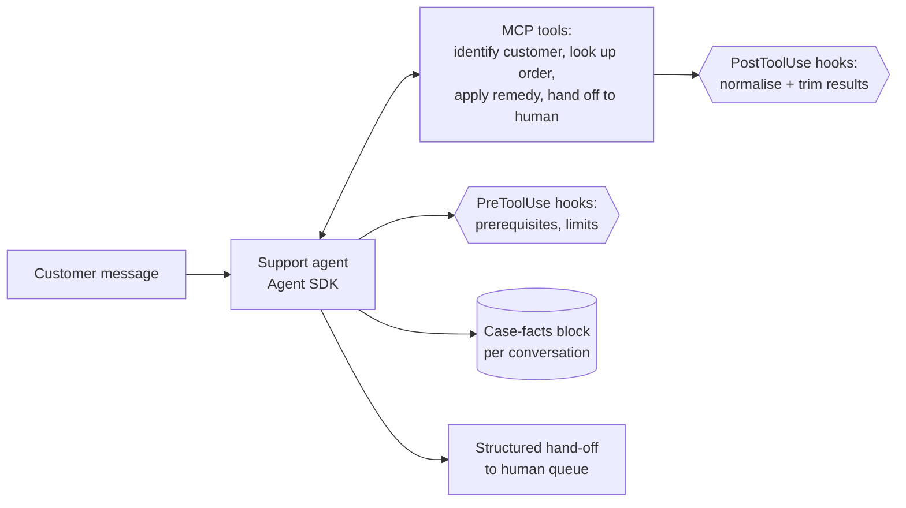
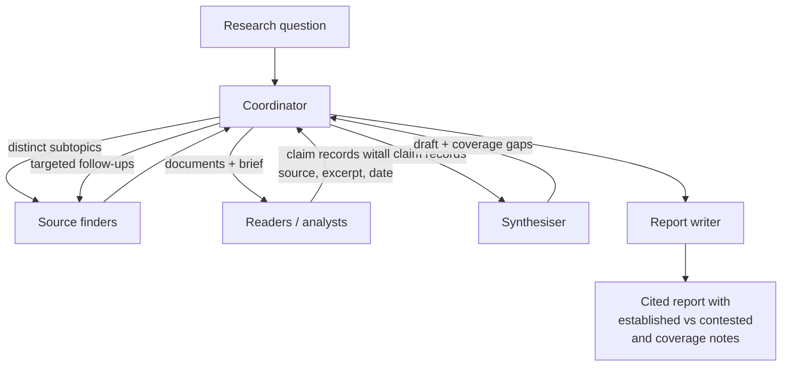
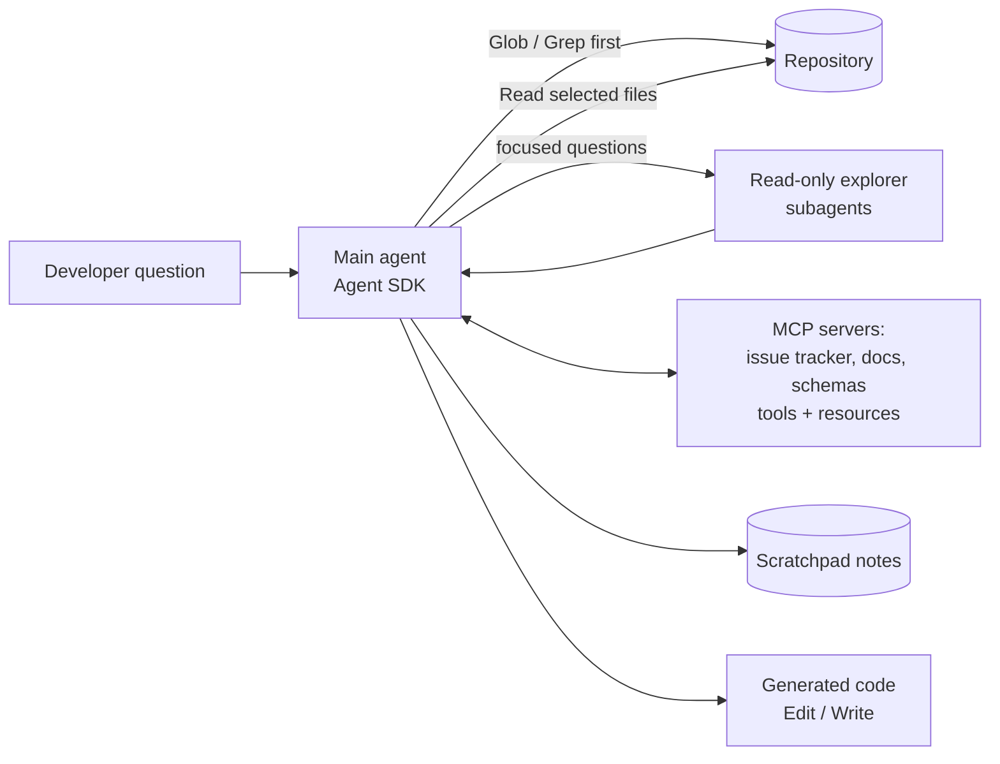
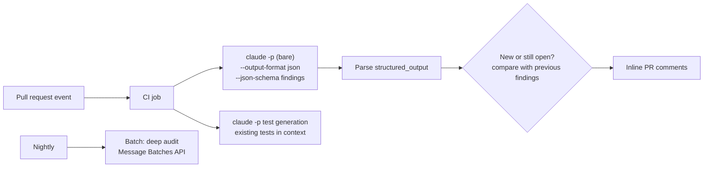
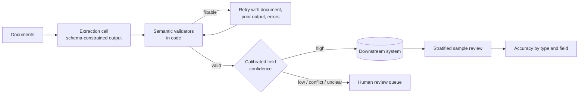

# CCAR-F Scenario Study Guide

> A study guide for each of the six scenarios published in the CCAR-F exam guide v1.0. Scenario names and primary
> domains come from [`registry.yaml`](../registry.yaml). Everything else on this page is original teaching
> material for this repository: the example organisations are fictional, and nothing here is, reproduces or
> reconstructs an exam item. Product facts are as of 2026-10-24.

## How to use this page

On exam day you get **four of these six scenarios at random**, and each one frames a group of questions. You
cannot choose which four, so prepare all six. For each scenario:

1. Read the **context** and sketch the **architecture to master** from memory before looking at the diagram.
2. For each **key decision**, say which option you would choose and why, then compare.
3. Read the **common traps**; most wrong answers on scenario exams are one of these.
4. Follow the **study links** for anything you could not explain.

The exam is a practical test of judgement: which configuration, hook, schema or workflow change best solves the
problem described. Keep asking "where is this rule enforced?" and "what does this agent actually see in its
context?"

| # | Scenario | Primary domains | Weight of those domains |
|---|---|---|---|
| 1 | [Customer Support Resolution Agent](#scenario-1--customer-support-resolution-agent) | 1, 2, 5 | 27 + 18 + 15 = 60% |
| 2 | [Code Generation with Claude Code](#scenario-2--code-generation-with-claude-code) | 3, 5 | 20 + 15 = 35% |
| 3 | [Multi-Agent Research System](#scenario-3--multi-agent-research-system) | 1, 2, 5 | 60% |
| 4 | [Developer Productivity with Claude](#scenario-4--developer-productivity-with-claude) | 2, 3, 1 | 18 + 20 + 27 = 65% |
| 5 | [Claude Code for Continuous Integration](#scenario-5--claude-code-for-continuous-integration) | 3, 4 | 20 + 20 = 40% |
| 6 | [Structured Data Extraction](#scenario-6--structured-data-extraction) | 4, 5 | 20 + 15 = 35% |

---

## Scenario 1 — Customer Support Resolution Agent

**Context in brief.** An Agent SDK agent resolves ambiguous customer requests (returns, billing disputes, account
problems) through custom MCP tools onto back-office systems. The goal is a high first-contact resolution rate
without failing to escalate when it should.

### Architecture to master



Our worked example is *Contoso Outfitters* with tools `find_account`, `get_order`, `issue_credit` and
`open_handoff`.

### Key decisions and trade-offs

| Decision | Recommended choice | Why / trade-off |
|---|---|---|
| How to guarantee identity is verified before money moves | `PreToolUse` hook that blocks remedy tools until verification succeeded in this session | A prompt rule works most of the time; a hook works every time. Costs a little state handling |
| How to enforce monetary limits | Hook or server-side check that denies and tells the agent to hand off | Same reasoning; the denial reason doubles as recovery guidance |
| How tools report failures | `isError: true` with category, retryable flag and a customer-safe message | Lets the agent retry a timeout, explain a policy refusal, and stop retrying a permission error |
| What the agent keeps in context over a long chat | Case-facts block (IDs, amounts, dates, promises) plus summarised history | Summaries lose numbers; the block keeps them verbatim |
| When to escalate | Explicit request for a person; policy gap; no progress; beyond authority | Not on sentiment alone, not on self-reported confidence |
| Several customer records match | Ask for another identifier | Guessing risks acting on the wrong account |
| What the human receives | Structured summary: customer, issues, evidence, actions taken, recommendation, customer expectation | The human does not read the transcript |
| Several issues in one message | Split into items, investigate each, answer once | Prevents dropped issues and contradictory replies |

### Common traps

- Choosing "add a stronger instruction to the system prompt" when the requirement is a guarantee.
- Escalating every frustrated customer (lowers resolution) or refusing a direct request for a person.
- Generic tool errors that make the agent retry a business-rule refusal.
- Raw 60-field backend responses filling context.
- Ending the loop on the agent's text rather than `stop_reason`.

### Study links

[Domain 1](study-guide/domain-1.md) (1.1, 1.4, 1.5), [Domain 2](study-guide/domain-2.md) (2.1, 2.2),
[Domain 5](study-guide/domain-5.md) (5.1, 5.2) · [Hooks](../../09-claude-code/06-hooks.md) ·
[Human in the loop](../../10-agentic-ai/05-human-in-the-loop.md) ·
[Lab 12](../../19-hands-on-labs/lab-12-agentic-task-execution/README.md),
[Lab 13](../../19-hands-on-labs/lab-13-human-in-the-loop/README.md),
[Lab 09](../../19-hands-on-labs/lab-09-mcp-fundamentals/README.md)

---

## Scenario 2 — Code Generation with Claude Code

**Context in brief.** A development team uses Claude Code day to day for generating, refactoring, debugging and
documenting code, and wants to standardise it with shared commands, CLAUDE.md configuration and good judgement
about planning versus acting.

### Architecture to master

```text
repo/
  CLAUDE.md                      # short, team-wide: purpose, build/test commands, pointers
  CLAUDE.local.md                # personal, git-ignored
  .claude/
    rules/                       # topic rules; some scoped with `paths:` globs
    skills/<name>/SKILL.md       # team skills and commands (/name)
    commands/<name>.md           # older command format, still honoured
    agents/<name>.md             # project subagents
    settings.json                # permissions, hooks (enforcement)
  .mcp.json                      # shared MCP servers with ${VAR} secrets
~/.claude/CLAUDE.md, ~/.claude/skills/, ~/.claude/rules/   # personal, every project
```

### Key decisions and trade-offs

| Decision | Recommended choice | Why / trade-off |
|---|---|---|
| Where team conventions live | Project CLAUDE.md and `.claude/rules/` | User-level files are not shared; a teammate will never see them |
| Conventions for a file type spread across the repo | Rule with `paths` globs | Loads only when relevant; subdirectory CLAUDE.md files would need copies everywhere |
| Big CLAUDE.md | Split into topic rules and `@import`s | Less context per session; easier ownership |
| Reusable team prompts | Project skills (`.claude/skills/`) or commands | Version-controlled, discoverable with `/` |
| A verbose analysis skill | `context: fork` (optionally `agent: Explore`) | Keeps output out of the main conversation |
| Plan or act | Plan mode for multi-file, multi-option or architectural work; direct for scoped fixes | Planning costs a few minutes; rework costs hours |
| Getting a transformation right | Two or three concrete input/output examples; tests first | Prose descriptions are interpreted inconsistently |
| Long exploratory sessions | Explore subagent, scratchpad notes, `/compact` | Avoids context degradation |

### Common traps

- Assuming `allowed-tools` in a skill blocks unlisted tools (it pre-approves; use `disallowed-tools`).
- Treating CLAUDE.md as enforcement for something that must never happen (use deny rules or hooks).
- Using plan mode for trivial edits, or direct execution for a 40-file migration.
- Sending fixes for interacting problems one at a time, so each fix breaks the previous one.

### Study links

[Domain 3](study-guide/domain-3.md) (all), [Domain 5](study-guide/domain-5.md) (5.4) ·
[CLAUDE.md and memory](../../09-claude-code/03-claude-md-and-memory.md) ·
[Commands, skills and subagents](../../09-claude-code/05-commands-skills-subagents.md) ·
[Lab 10](../../19-hands-on-labs/lab-10-claude-code-workflows/README.md)

---

## Scenario 3 — Multi-Agent Research System

**Context in brief.** An Agent SDK coordinator delegates to specialised subagents (finding sources, analysing
documents, synthesising, writing the report) to produce thorough, cited research reports.

### Architecture to master



Our worked example is *Fabrikam Labs* producing market briefs.

### Key decisions and trade-offs

| Decision | Recommended choice | Why / trade-off |
|---|---|---|
| Who talks to whom | Everything through the coordinator | One place for error handling, checks and tracing |
| What a subagent receives | Full brief: goal, scope, prior findings, output schema | Subagents start with no parent context |
| How work is split | Distinct subtopics or source types per subagent; coordinator checks coverage | Avoids duplication and gaps from over-narrow splits |
| Parallelism | Several Agent tool calls in one coordinator turn | Separate turns run sequentially |
| Tool sets | Finders search; readers fetch approved documents; synthesiser gets at most a narrow citation lookup | Off-role tools get misused |
| Output between agents | Structured claim records (claim, source, location, excerpt, date) | Preserves provenance through summarisation |
| Conflicting figures | Report both with sources and context | Picking one silently misleads |
| Failures | Local retry; escalate with attempted actions and partial results; never silent empties | Coordinator can decide to retry, reroute or report a gap |
| Quality loop | Coordinator compares draft to goal, re-delegates for gaps, re-synthesises | Iterative refinement within a budget |

### Common traps

- Assuming the synthesiser "knows" what readers found.
- Always running every subagent for every question.
- Coordinator prompts that dictate step-by-step procedures instead of goals and quality criteria.
- Losing dates, so a 2023 and a 2026 figure look contradictory.
- Unbounded fan-out: set depth, concurrency and spend limits.

### Study links

[Domain 1](study-guide/domain-1.md) (1.2, 1.3, 1.6), [Domain 2](study-guide/domain-2.md) (2.1, 2.3),
[Domain 5](study-guide/domain-5.md) (5.3, 5.6) ·
[Multi-agent architecture](../../10-agentic-ai/04-multi-agent-architecture.md) ·
[Grounding and citations](../../11-rag-and-knowledge-systems/05-grounding-and-citations.md) ·
[Lab 12](../../19-hands-on-labs/lab-12-agentic-task-execution/README.md),
[Lab 04](../../19-hands-on-labs/lab-04-document-grounded-qa/README.md)

---

## Scenario 4 — Developer Productivity with Claude

**Context in brief.** An Agent SDK tool helps engineers explore unfamiliar or legacy codebases, generate
boilerplate and automate repetitive work, using the built-in file and shell tools plus MCP servers.

### Architecture to master



Our worked example is *Northwind Freight's* internal "repo guide" agent.

### Key decisions and trade-offs

| Decision | Recommended choice | Why / trade-off |
|---|---|---|
| Finding things | Glob for names/paths, Grep for content, then Read selectively | Reading everything wastes context |
| Tracing usage through re-exports | Find every exported alias, then search each | Direct name search misses wrappers |
| Edit fails on a non-unique anchor | More context, replace-all, or Read then Write | Edit needs a unique match |
| MCP vs built-in tools | Describe MCP tools well enough that the agent prefers them where they are better | Agents default to familiar built-ins |
| Showing what data exists | MCP resources for catalogues and schemas | Fewer exploratory calls |
| Team vs personal servers | `.mcp.json` (project) vs user scope | Sharing and secrets handled correctly |
| Long investigations | Subagents for discovery, scratchpad, phase summaries, named sessions | Context stays coherent across days |
| Branching approaches | Fork the session from the shared analysis | Compare two refactoring strategies without losing the baseline |
| Restricting the agent | Explorer subagents get `tools=["Read", "Grep", "Glob"]`; `allowedTools` only pre-approves | Least privilege set in configuration |

### Common traps

- Confusing `allowedTools` (approval) with a restriction mechanism.
- Writing a custom MCP server for a standard system that has a maintained one.
- Resuming an old session after major code changes without telling the agent what changed.
- Letting the main agent read hundreds of files itself.

### Study links

[Domain 2](study-guide/domain-2.md) (2.4, 2.5), [Domain 3](study-guide/domain-3.md) (3.2, 3.4),
[Domain 1](study-guide/domain-1.md) (1.3, 1.7), [Domain 5](study-guide/domain-5.md) (5.4) ·
[Agent SDK](../../10-agentic-ai/06-managed-agents-and-agent-sdk.md) ·
[MCP in Claude Code](../../09-claude-code/07-mcp-in-claude-code.md) ·
[Lab 10](../../19-hands-on-labs/lab-10-claude-code-workflows/README.md),
[Lab 09](../../19-hands-on-labs/lab-09-mcp-fundamentals/README.md)

---

## Scenario 5 — Claude Code for Continuous Integration

**Context in brief.** Claude Code runs in a CI/CD pipeline to review pull requests, generate tests and comment on
changes; feedback must be actionable and false positives few.

### Architecture to master



Our worked example is *Litware's* platform team.

### Key decisions and trade-offs

| Decision | Recommended choice | Why / trade-off |
|---|---|---|
| Non-interactive execution | `-p` with pre-approved read-only tools and a permission mode that denies anything else | Avoids hangs; least privilege |
| Machine-readable output | `--output-format json --json-schema`, read `structured_output` | Reliable posting of inline comments |
| Project context for CI | CLAUDE.md in a normal run, or an appended system prompt file in `--bare` runs | Standards and fixtures must reach the job either way |
| Precision | Explicit report/skip criteria, severity definitions with examples, few-shot pairs | Confidence adjectives do not cut false positives |
| A noisy category | Disable temporarily, fix its criteria, re-enable | Protects trust in the rest |
| Re-runs after new commits | Pass previous findings; report only new or unresolved | No duplicate comments |
| Reviewer independence | Separate review invocation from generation | Self-review is weak |
| Large PRs | Per-file passes plus an integration pass | Avoids attention dilution |
| Pre-merge vs nightly | Synchronous for blocking checks, Batches for overnight audits | Batches can take up to 24 hours |
| Learning from dismissals | Record the rule or pattern behind each finding | Shows which rules cause false positives |

### Common traps

- Omitting `-p` so the job waits for input.
- Free-text output scraped with regular expressions.
- "Be conservative" as the precision fix.
- Batching a check developers wait on.
- Generating tests that duplicate existing ones because the job never saw them.

### Study links

[Domain 3](study-guide/domain-3.md) (3.6), [Domain 4](study-guide/domain-4.md) (4.1, 4.2, 4.5, 4.6) ·
[Headless, CI and the Agent SDK](../../09-claude-code/09-headless-ci-and-agent-sdk.md) ·
[Batch processing](../../06-claude-api/05-batch-processing.md) ·
[Lab 10](../../19-hands-on-labs/lab-10-claude-code-workflows/README.md),
[Lab 16](../../19-hands-on-labs/lab-16-evaluation-framework/README.md)

---

## Scenario 6 — Structured Data Extraction

**Context in brief.** A Claude-based system pulls information out of unstructured documents, validates it against
JSON schemas, keeps accuracy high, copes with edge cases and feeds downstream systems.

### Architecture to master



Our worked example is *Litware Insurance's* claim-letter pipeline.

### Key decisions and trade-offs

| Decision | Recommended choice | Why / trade-off |
|---|---|---|
| Guaranteeing shape | `output_config.format` or `strict: true` tools | Removes JSON syntax errors |
| Forcing an extraction tool | On models that accept it, `tool_choice` `any`/forced; on Opus 5.5, Sonnet 5.5, Fable 5.1, Mythos 5.1 use `auto` + instruction + `strict`, or structured outputs | Forced choice returns a 400 on those models |
| Optional data | Nullable fields and "use null when absent" | Required fields invite invention |
| Growing categories | `enum` with `"other"` + detail; `"unclear"` for ambiguity | Extensible without breaking consumers |
| Correctness | Code validators for sums, dates, cross-field rules | Schemas cannot check meaning |
| Retries | Targeted, with specific errors; none when data is absent | Saves calls and avoids loops |
| Volume | Batches with `custom_id`, submission cadence sized to the deadline, re-submit failures only | Half price; up to 24 hours |
| Before a big run | Tune on a sample synchronously | First-pass success avoids expensive re-runs |
| Reducing review | Only after per-type, per-field accuracy and calibrated thresholds | Aggregates hide weak segments |
| Varied layouts | Few-shot examples across formats | Fewer empty or wrong fields |

### Common traps

- Believing schema-valid means correct.
- Retrying indefinitely for information the document does not contain.
- Matching batch results by order rather than `custom_id`.
- Cutting human review because overall accuracy is high.
- Using forced `tool_choice` on a model that rejects it.

### Study links

[Domain 4](study-guide/domain-4.md) (4.2–4.5), [Domain 5](study-guide/domain-5.md) (5.5) ·
[Structured output](../../03-prompt-engineering/06-structured-output.md) ·
[Batch processing](../../06-claude-api/05-batch-processing.md) ·
[Lab 03](../../19-hands-on-labs/lab-03-structured-outputs/README.md),
[Lab 17](../../19-hands-on-labs/lab-17-cost-optimisation/README.md)

---

## Cross-scenario themes

These ideas recur in several scenarios; master them once.

| Theme | Appears in |
|---|---|
| Deterministic enforcement (hooks, permission rules) beats prompt instructions for must-hold rules | 1, 2, 4 |
| Subagents start with no parent context; brief them fully | 1, 3, 4 |
| Structured errors; "could not look" differs from "found nothing" | 1, 3, 4 |
| Structured output with schemas, plus semantic validation in code | 5, 6 |
| Explicit criteria and few-shot examples for precision | 1, 5, 6 |
| Context hygiene: case facts, trimming, scratchpads, summaries | 1, 2, 3, 4 |
| Calibrated human review instead of trust in aggregates | 1, 6 |
| `tool_choice` forcing is rejected by the newest models | 3, 6 |

Next: practise with the [decision scenarios](decision-scenarios.md) and the
[practice questions](../../17-practice-questions/README.md).
