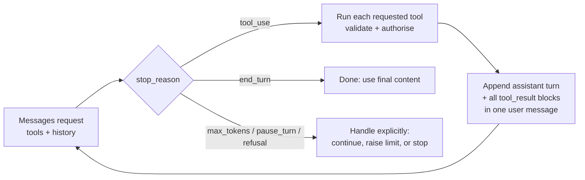
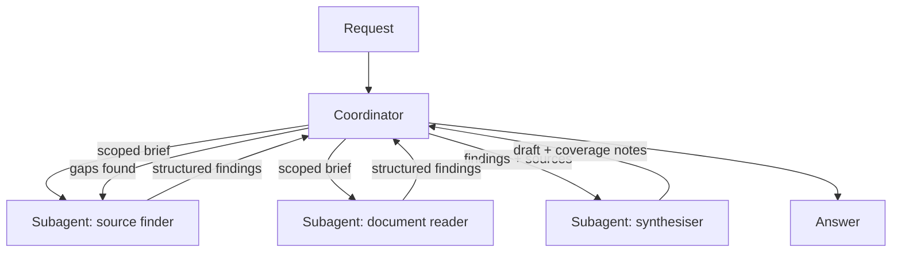

# CCAR-F Domain 1 — Agentic Architecture & Orchestration (27%)

> **Track:** [CCAR-F](../README.md) · **Weight:** 27%, the largest domain (see [`registry.yaml`](../../registry.yaml)) ·
> **Objectives:** CCAR-F-1.1 to 1.7 · **Time:** ~9 hours including labs

This domain is about the machinery of agents: the loop that keeps an agent running, the coordinator that hands
work to subagents, the hooks that enforce rules the model cannot be trusted to follow, and the sessions that
let work pause, resume and branch. It is a primary domain in the support-agent, research-system and
developer-productivity [scenarios](../scenarios.md), so expect it to dominate whichever four you draw.

SDK facts on this page were checked against the [Agent SDK documentation](https://code.claude.com/docs/en/agent-sdk/overview)
and the `claude-api` reference on **2026-10-24**. The SDK releases often; re-check option names before you rely
on them in code.

## Objectives

| ID | Objective | Where to study |
|---|---|---|
| CCAR-F-1.1 | Design and build agentic loops for autonomous task execution | [The agent loop](../../../10-agentic-ai/03-the-agent-loop.md), [The tool-use loop](../../../07-tool-use-and-function-calling/03-the-tool-use-loop.md) |
| CCAR-F-1.2 | Orchestrate multi-agent systems with coordinator and subagent patterns | [Multi-agent architecture](../../../10-agentic-ai/04-multi-agent-architecture.md), [Workflow patterns](../../../10-agentic-ai/02-workflow-patterns.md) |
| CCAR-F-1.3 | Configure subagent invocation, context passing and spawning | [Agent SDK](../../../10-agentic-ai/06-managed-agents-and-agent-sdk.md), [Commands, skills and subagents](../../../09-claude-code/05-commands-skills-subagents.md) |
| CCAR-F-1.4 | Build multi-step workflows with enforcement and handoff patterns | [Human in the loop](../../../10-agentic-ai/05-human-in-the-loop.md), [Agent reliability](../../../10-agentic-ai/07-agent-reliability.md) |
| CCAR-F-1.5 | Use Agent SDK hooks to intercept tool calls and normalise data | [Hooks](../../../09-claude-code/06-hooks.md) |
| CCAR-F-1.6 | Choose task decomposition strategies for complex workflows | [Task decomposition and chaining](../../../03-prompt-engineering/05-task-decomposition-and-chaining.md), [Workflows vs agents](../../../10-agentic-ai/01-workflows-vs-agents.md) |
| CCAR-F-1.7 | Manage session state, resumption and forking | [Headless, CI and the Agent SDK](../../../09-claude-code/09-headless-ci-and-agent-sdk.md), [Memory and persistence](../../../04-context-engineering/04-memory-and-persistence.md) |

## Key concepts

- **Agentic loop.** Send a request; if the response stops because Claude wants a tool (`stop_reason ==
  "tool_use"`), run the tool, append the result and call again; stop when Claude finishes its turn
  (`end_turn`). The model, not your code, decides the next step.
- **Coordinator (orchestrator).** An agent whose job is to plan, delegate to subagents, check what comes back
  and assemble the answer. It is the hub in a hub-and-spoke design.
- **Subagent.** A separate agent instance with its own context window, system prompt and tool set. It sees only
  what it is given and returns only its final message.
- **Hook.** Your code, run by the SDK at a lifecycle event (before a tool runs, after it returns, when a
  subagent stops). Hooks are deterministic; prompts are not.
- **Session.** The persisted conversation history of an SDK or Claude Code run. It can be *continued* (most
  recent), *resumed* (by ID or name) or *forked* (copied into a new, independent branch).

## Detailed technical notes

### 1.1 The agentic loop



A minimal manual loop on the Messages API (Python, current request rules: no sampling parameters, no prefill):

```python
import anthropic

client = anthropic.Anthropic()          # reads ANTHROPIC_API_KEY from the environment

def run_agent(messages: list, tools: list, execute_tool) -> list:
    while True:
        response = client.messages.create(
            model="claude-opus-5-5",
            max_tokens=16000,
            tools=tools,
            messages=messages,
        )
        messages.append({"role": "assistant", "content": response.content})
        if response.stop_reason == "tool_use":
            results = []
            for block in response.content:
                if block.type == "tool_use":
                    results.append(execute_tool(block))   # returns a tool_result dict
            messages.append({"role": "user", "content": results})   # all results, one message
            continue
        if response.stop_reason == "end_turn":
            return messages
        if response.stop_reason == "pause_turn":           # a long server tool paused; send it back
            continue
        raise RuntimeError(f"Stopped early: {response.stop_reason}")   # max_tokens, refusal, ...
```

> **Cost:** requires API credits (live mode).

What the exam rewards:

| Do | Do not |
|---|---|
| Branch on `stop_reason` | Parse the model's prose for "I'm done" or "FINISHED" |
| Append the whole assistant `content` (including `tool_use` blocks) and every `tool_result` | Append only the text, or drop a failed tool's result |
| Return tool failures as `tool_result` with `is_error: true` so Claude can adapt | Raise and abandon the loop on the first tool error |
| Keep a turn or budget cap as a **safety net** | Use an iteration cap as the *main* way the loop ends |
| Treat "assistant text present" as normal (Claude often narrates before calling tools) | Treat any text block as a sign the task is complete |

In the Agent SDK you do not write this loop: `query()` runs it and yields messages. You still choose the
guard rails, for example `max_turns` and `max_budget_usd` in Python (`maxTurns`, `maxBudgetUsd` in
TypeScript). The final `ResultMessage` tells you how it ended: `success`, or an error subtype such as
`error_max_turns` or `error_max_budget_usd`.

**Model-driven versus pre-scripted.** In an agent, Claude picks the next tool from what it has learned so far.
If you find yourself hard-coding "call A, then B, then C" for every input, you have a workflow; that is fine
when the steps are fixed (see 1.6), but do not call it an agent and do not pay agent costs for it.

### 1.2 Coordinator and subagent patterns



Design rules:

- **Hub and spoke.** Subagents report to the coordinator, not to each other. The coordinator sees every
  hand-off, so errors are handled in one place, traces are readable and nothing reaches the final answer
  without passing a check.
- **Isolated context.** A subagent starts fresh. It does not inherit the coordinator's conversation, earlier
  tool results or system prompt (unless it is a *fork*, below). Whatever it needs must be in its brief.
- **Select, do not always fan out.** A good coordinator reads the request and invokes only the subagents it
  needs. A one-line factual question should not trigger the full research pipeline.
- **Partition to avoid overlap.** Give each subagent a distinct slice (subtopic, source type, time window or
  repository area). Overlapping briefs waste tokens and produce duplicate, sometimes contradictory, findings.
- **Watch for over-narrow decomposition.** If the coordinator splits a broad question into three narrow
  sub-questions, the report will miss whatever fell between them. Ask the coordinator to state the coverage it
  expects and to check the result against it.
- **Iterate on gaps.** After synthesis, the coordinator compares the draft with the goal, sends targeted
  follow-up work to the right subagent and re-synthesises until coverage is good enough or the budget is spent.

Costs to remember: every subagent makes its own model calls, so multi-agent runs use many more tokens than a
single agent. The SDK can cap growth: nesting depth (`CLAUDE_CODE_MAX_SUBAGENT_SPAWN_DEPTH`, default 3 layers;
`1` disables nesting), concurrency (`CLAUDE_CODE_MAX_CONCURRENT_SUBAGENTS`, default 20) and total spend per
query (`max_budget_usd`), as of 2026-10-24.

### 1.3 Subagent invocation, context passing and spawning

In the Agent SDK you define subagents programmatically with the `agents` option, a map of names to
`AgentDefinition` objects. The required fields are `description` (when to use it; Claude reads this to decide)
and `prompt` (its system prompt). Optional fields include `tools` (an allow-list), `disallowedTools`, `model`,
`skills`, `mcpServers` and `maxTurns`. Claude invokes subagents through the **Agent tool**.

> **Naming change.** Claude delegates through the `Agent` tool, called `Task` in the v1.0 exam guide. Current
> SDK releases emit `"Agent"` in `tool_use` blocks, while the `system:init` tool list still shows `"Task"`; code
> that detects subagent calls should match both names. If an exam item says "Task", read it as the same mechanism.
>
> **`allowed_tools` approves; it does not restrict.** Listing `Agent` in `allowed_tools` (`allowedTools`) lets the
> coordinator delegate without a permission prompt. Tools you leave off that list are not removed; they fall back
> to normal permission handling. To restrict what an agent can use, set `AgentDefinition.tools` (a subagent's
> allow-list: omitted tools are absent from its session), `disallowed_tools`, or deny rules.

```python
from claude_agent_sdk import query, ClaudeAgentOptions, AgentDefinition

options = ClaudeAgentOptions(
    allowed_tools=["Read", "Grep", "Glob", "Agent"],      # auto-approved (not a restriction)
    agents={
        "dependency-tracer": AgentDefinition(
            description="Traces where a function or module is used. Use for 'who calls X' questions.",
            prompt="You trace call sites. Report file, line and caller for each use. Do not edit files.",
            tools=["Read", "Grep", "Glob"],                # read-only
        ),
    },
)

async for message in query(prompt="Which services still call billing.legacy_tax()?", options=options):
    ...
```

> **Cost:** requires API credits (live mode). Install with `pip install claude-agent-sdk`.

Context-passing rules the exam probes:

| Rule | Why |
|---|---|
| Put everything the subagent needs in its brief: goal, scope, file paths, prior findings, output format | It cannot see the parent conversation |
| Pass prior agents' output **in full** (or as a structured digest) when a later agent depends on it | A synthesiser that never saw the reader's findings cannot cite them |
| Separate content from metadata, for example `{"claim": ..., "source_url": ..., "page": ...}` | Keeps attribution intact through hand-offs (see [Domain 5](domain-5.md), 5.6) |
| Emit several Agent tool calls **in one coordinator response** to run them in parallel | Calls spread across turns run one after another |
| Brief subagents with the goal and quality bar, not a step-by-step script | Lets them adapt to what they find |

**Forks.** A *fork* is a subagent that copies the conversation so far instead of starting fresh. Use one when the
branch genuinely needs the shared analysis, for example "try approach B from here". At session level, the
equivalent is `fork_session` (1.7). Do not fork just to save writing a brief: forks carry the whole history,
which costs tokens and imports any stale results.

### 1.4 Enforcement and hand-off patterns

The central idea: **a prompt instruction is guidance with a non-zero failure rate; a programmatic gate is a
guarantee.** When an ordering or limit is a compliance requirement, enforce it in code.

| Requirement | Prompt-only approach (weak) | Programmatic approach (strong) |
|---|---|---|
| Verify identity before changing an account | "Always verify the customer first." | A `PreToolUse` hook denies account-changing tools until a verification tool has returned a verified ID in this session |
| Never exceed a credit limit | "Do not issue credits above the limit." | The hook (or the tool server) checks the amount and denies, returning a reason that tells Claude to escalate |
| Escalate certain request types | "Escalate legal threats." | Explicit criteria plus examples in the prompt **and** a deterministic check on the hand-off tool for categories that must always go to people |

Prerequisite gates are small state machines: the hook records that the prerequisite succeeded (keyed by session)
and blocks the dependent tool until then. Keep the state outside the model.

**Multi-concern requests.** When a single message contains several issues ("my parcel is late, I was charged
twice and I want to change my address"), split them into separate items, investigate each (in parallel where
independent), then compose one reply. Track each item's status so none is dropped.

**Structured hand-offs.** When escalating to a person who will not read the transcript, send a compact,
structured summary:

```json
{
  "case_id": "CS-20817",
  "customer_ref": "ACCT-55102",
  "issues": [
    {"summary": "Duplicate charge on order 7781", "evidence": "two captures of 42.10 on 2026-10-19",
     "action_taken": "none", "recommended_action": "refund one capture", "amount": 42.10}
  ],
  "why_escalated": "amount needs supervisor approval under policy section 4",
  "customer_expectation": "refund before 2026-10-31"
}
```

### 1.5 Agent SDK hooks

Hooks are callbacks you register in `options.hooks`, keyed by event name, each with an optional `matcher`
(for tool events, matched against the tool name; MCP tools look like `mcp__<server>__<tool>`).

| Event (Python and TypeScript) | Fires | Typical use |
|---|---|---|
| `PreToolUse` | Before a tool runs | Block (`permissionDecision: "deny"`), approve, or rewrite input (`updatedInput`) |
| `PostToolUse` | After a tool returns | Normalise or trim output (`updatedToolOutput`), add context (`additionalContext`), audit |
| `PostToolUseFailure` | A tool failed | Log, classify, add recovery guidance |
| `SubagentStart` / `SubagentStop` | Subagent lifecycle | Trace fan-out, aggregate results |
| `PreCompact` | Before compaction | Archive the full transcript |
| `UserPromptSubmit`, `Stop`, `Notification`, `PermissionRequest` | Various | Context injection, final checks, alerts |

Some events (for example `SessionStart`, `SessionEnd`) are TypeScript-only as SDK callbacks; in Python they are
available only as shell hooks in settings files (as of 2026-10-24).

A `PreToolUse` gate that blocks a policy breach and steers Claude to escalate:

```python
from claude_agent_sdk import ClaudeAgentOptions, HookMatcher

CREDIT_LIMIT = 150.00   # synthetic policy value for Contoso Outfitters

async def enforce_credit_limit(input_data, tool_use_id, context):
    amount = float(input_data["tool_input"].get("amount", 0))
    if amount > CREDIT_LIMIT:
        return {
            "hookSpecificOutput": {
                "hookEventName": input_data["hook_event_name"],
                "permissionDecision": "deny",
                "permissionDecisionReason": (
                    f"Credits above {CREDIT_LIMIT:.2f} need a supervisor. "
                    "Call open_handoff with a structured summary instead."
                ),
            }
        }
    return {}   # allow

options = ClaudeAgentOptions(
    hooks={"PreToolUse": [HookMatcher(matcher="mcp__billing__issue_credit", hooks=[enforce_credit_limit])]}
)
```

A `PostToolUse` hook that normalises timestamps from two backends (one returns epoch seconds, the other ISO 8601
with offsets) so the model always sees one format. Returning `updatedToolOutput` replaces what Claude sees;
`additionalContext` only appends.

Points to remember:

- When several `PreToolUse` hooks disagree, the most restrictive wins (`deny` beats `defer`, which beats
  `ask`, which beats `allow`).
- A matcher of `"Write|Edit"` does not see a Bash command that writes the same file. Enforce at the right
  layer (tool server, sandbox, permission rules) for anything that must hold whatever tool is used.
- A `PreToolUse` callback that times out blocks the tool call; post-tool timeouts keep the result.
- Hooks are code: test them, version them and log their decisions.

### 1.6 Task decomposition strategies

| Strategy | Use when | Example |
|---|---|---|
| **Prompt chaining** (fixed sequence) | The steps are known in advance and each benefits from focus | Review each changed file on its own, then run one cross-file pass for interactions |
| **Dynamic decomposition** (adaptive plan) | The work is open-ended and the next step depends on what you find | "Get this legacy service under test": map the structure, find the riskiest paths, plan, revise the plan as dependencies appear |
| **Parallel sectioning** | Independent parts can run at once | One subagent per microservice for a dependency inventory |
| **Hybrid** | A fixed outer pipeline with an adaptive step inside | Fixed intake → adaptive investigation → fixed report template |

Why split a large review into per-file passes plus an integration pass: one pass over 40 files dilutes
attention, misses local defects and can contradict itself. Focused passes find local issues; a separate pass
with summaries of every file looks only for cross-file problems (data flow, contract mismatches).

### 1.7 Sessions: resume, continue and fork

| Need | Claude Code CLI | Agent SDK (Python / TypeScript) |
|---|---|---|
| Carry on the most recent conversation in this directory | `claude --continue` (`-c`) | `continue_conversation=True` / `continue: true` |
| Return to a specific session | `claude --resume <id-or-name>` (`-r`) | `resume=session_id` / `resume: sessionId` |
| Give a session a memorable name | `claude -n "auth-audit"` or `/rename` | `rename_session()` / `renameSession()` |
| Branch without changing the original | `claude --resume <id> --fork-session` | `resume=...` plus `fork_session=True` / `forkSession: true` |

Capture the ID from the `session_id` on the result message. Forks get their own ID; the original stays as it
was. Sessions are stored locally (under `~/.claude/projects/`), so resuming on another host needs a session
store adapter or a copied transcript file.

**Resume or start fresh?**

| Situation | Choose |
|---|---|
| The earlier context is still accurate and you want to build on it | Resume |
| Files changed since the session read them, but only a few | Resume **and tell the agent exactly which files changed** so it re-reads those |
| Much of the earlier tool output is now stale (big refactor, new branch, data refreshed) | Start a new session and inject a structured summary of the conclusions that still hold |
| You want to compare two approaches from the same analysis | Fork twice (or fork once and resume the original) |

Two cautions: sessions persist the **conversation, not the filesystem** (a fork that edits files changes the
real files; use file checkpointing or git to branch code), and a resumed session trusts its old tool results
unless you say otherwise.

## Worked design scenario

*Contoso Outfitters* runs an Agent SDK support agent with four MCP tools: `find_account`, `get_shipment`,
`issue_credit` and `open_handoff`. Reviews show three problems: occasional credits on unverified accounts, a
loop that sometimes stops after Claude writes "Let me check that for you", and escalations that arrive without
enough context.

1. **Loop:** the integration checked "is there text?" to decide completion. Replace with `stop_reason`
   branching; keep `max_turns=25` and `max_budget_usd` only as safety nets.
2. **Verification:** a `PreToolUse` hook on `issue_credit` denies the call unless `find_account` returned
   `verified: true` for this session; a second check denies amounts above the policy cap and tells Claude to
   use `open_handoff`.
3. **Normalisation:** a `PostToolUse` hook converts both backends' dates to ISO 8601 and drops the 30 shipment
   fields the agent never uses.
4. **Hand-off:** `open_handoff` takes a strict schema (case, customer, issues with evidence, action taken,
   recommended action, customer expectation) so the human agent does not need the transcript.
5. **Sessions:** each customer conversation is a named session so a returning customer can be resumed; if the
   order data has since changed, the agent starts fresh with a case-facts summary.

## Anti-patterns

- Ending the loop when the model's text "sounds finished", or when an iteration counter runs out.
- A coordinator that always runs every subagent, whatever the request.
- Subagents that talk to each other directly, bypassing the coordinator's checks.
- Briefs that say "continue the analysis" to a subagent that has never seen the analysis.
- Business rules that exist only as sentences in the system prompt.
- Resuming a week-old session after a large refactor and trusting its earlier reads.

## Labs and further practice

- [Lab 12: Agentic task execution](../../../19-hands-on-labs/lab-12-agentic-task-execution/README.md)
- [Lab 13: Human-in-the-loop approvals](../../../19-hands-on-labs/lab-13-human-in-the-loop/README.md)
- [Lab 08: Tool invocation](../../../19-hands-on-labs/lab-08-tool-invocation/README.md)
- [Lab 10: Claude Code workflows](../../../19-hands-on-labs/lab-10-claude-code-workflows/README.md)
- Practical exercises 1, 2 and 3 in [`practical-exercises.md`](../practical-exercises.md)

## Self-check

1. Which `stop_reason` keeps the loop going, and which one ends it normally?
2. A synthesis subagent produces a report with no citations, although the reader subagent found sources. What
   is the most likely cause?
3. Why is a `PreToolUse` hook preferred over a system-prompt rule for a credit limit?
4. What is the difference between resuming and forking a session?
5. When should you start a new session with a summary instead of resuming?

<details>
<summary>Answers</summary>

1. `tool_use` continues the loop (run the tools, append results, call again); `end_turn` ends it. Other values
   (`max_tokens`, `pause_turn`, `refusal`) need explicit handling.
2. The coordinator did not pass the reader's findings (with their source metadata) into the synthesiser's
   brief. Subagents do not inherit context.
3. The hook runs every time and cannot be talked out of the rule; a prompt instruction is followed most of the
   time but not always, and can be undermined by injected content.
4. Resume continues the same session and adds to its history; fork copies the history into a new session with
   its own ID and leaves the original unchanged.
5. When much of the earlier tool output is stale (files or data changed substantially), so the old reads would
   mislead the agent.

</details>
