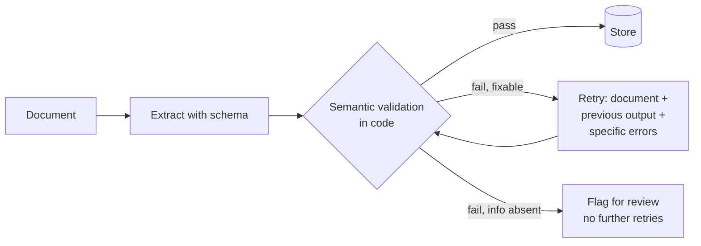

# CCAR-F Domain 4 — Prompt Engineering & Structured Output (20%)

> **Track:** [CCAR-F](../README.md) · **Weight:** 20% (see [`registry.yaml`](../../registry.yaml)) ·
> **Objectives:** CCAR-F-4.1 to 4.6 · **Time:** ~7 hours including labs

This domain is about getting output that downstream code and people can trust: criteria precise enough to cut
false positives, examples that make format and judgement consistent, schemas that guarantee shape, validation
loops that fix what schemas cannot, batch processing for volume, and review architectures that catch what a
single pass misses. It is a primary domain in the CI and data-extraction [scenarios](../scenarios.md).

API facts were checked with the `claude-api` reference and
[platform.claude.com/docs](https://platform.claude.com/docs) on **2026-10-24**. Current request rules that every
example here follows: no `temperature`/`top_p`/`top_k`, no assistant prefill, adaptive thinking with `effort` for
depth, and no forced `tool_choice` on models that reject it.

## Objectives

| ID | Objective | Where to study |
|---|---|---|
| CCAR-F-4.1 | Write prompts with explicit criteria to raise precision and cut false positives | [Clear, direct instructions](../../../03-prompt-engineering/01-clear-direct-instructions.md), [Metrics](../../../14-evaluation-and-testing/02-metrics.md) |
| CCAR-F-4.2 | Use few-shot examples for consistent, high-quality output | [Few-shot examples](../../../03-prompt-engineering/03-examples-few-shot.md) |
| CCAR-F-4.3 | Enforce structured output with tool use and JSON schemas | [Structured output](../../../03-prompt-engineering/06-structured-output.md), [Defining tools](../../../07-tool-use-and-function-calling/02-defining-tools.md) |
| CCAR-F-4.4 | Build validation, retry and feedback loops for extraction quality | [Structured output](../../../03-prompt-engineering/06-structured-output.md), [Diagnosing failures](../../../14-evaluation-and-testing/06-diagnosing-failures.md) |
| CCAR-F-4.5 | Design efficient batch processing strategies | [Batch processing](../../../06-claude-api/05-batch-processing.md), [Cost optimisation](../../../15-production-operations/03-cost-optimisation.md) |
| CCAR-F-4.6 | Design multi-instance and multi-pass review architectures | [Grading methods](../../../14-evaluation-and-testing/04-grading-methods.md), [Workflow patterns](../../../10-agentic-ai/02-workflow-patterns.md) |

## Key concepts

- **Precision.** Of the findings reported, how many were real. Low precision (many false positives) erodes trust
  faster than a few misses.
- **Few-shot examples.** Worked input/output pairs placed in the prompt to show format and judgement.
- **Structured outputs.** API features that constrain shape: `output_config.format` with a JSON schema for the
  response, and `strict: true` on a tool for its arguments.
- **Syntactic vs semantic validity.** A schema guarantees valid JSON in the right shape. It cannot guarantee the
  values are true or consistent with each other.
- **Message Batches API.** Asynchronous processing of many independent requests at 50% of standard prices,
  finishing within 24 hours.

## Detailed technical notes

### 4.1 Explicit criteria for precision

Vague instructions ("be thorough but conservative", "only report high-confidence issues") do not move precision
much, because the model has no definition of what counts. Categorical criteria do.

| Vague | Explicit |
|---|---|
| "Check that comments are accurate." | "Report a comment only when it states behaviour the code does not have, for example a docstring that says the function retries when it does not." |
| "Flag security problems." | "Report: user input reaching SQL, shell or file paths without validation; secrets in code; missing authorisation checks on handlers in `api/`. Do not report: style, naming, missing type hints, or patterns used consistently elsewhere in this repository." |
| "Rate severity." | "`high`: exploitable or data-corrupting in production. `medium`: incorrect behaviour on an edge case. `low`: maintainability. One code example per level follows." |

Two operational practices:

- **Disable a noisy category temporarily.** If one category produces most false positives, turn it off while
  you improve its criteria. Developers who learn to ignore one category start ignoring the accurate ones too.
- **Define what to skip**, not only what to report. Exclusions are where precision comes from.

### 4.2 Few-shot examples

Few-shot examples are the strongest tool for consistency when instructions alone produce variable output.

| Goal | What the examples show |
|---|---|
| Consistent format | Every finding with the same fields: location, issue, severity, suggested fix |
| Ambiguous-case judgement | Two to four borderline cases with a short explanation of why one action was chosen over the plausible alternative |
| Fewer false positives | Pairs: an acceptable pattern that looks suspicious, and a genuine issue that looks similar |
| Varied document layouts in extraction | The same field pulled from a table, from running prose and from a footnote |
| Fewer empty or invented values | A document missing a field, with the output showing `null` rather than a guess |

Good practice: keep examples diverse (not five near-copies), wrap them in tags such as `<example>`, include the
reasoning for borderline ones, and make sure no example contradicts the written criteria. Examples teach a
pattern the model generalises from, so choose ones that illustrate the *principle*, not just the specific case.

### 4.3 Enforcing structured output

| Mechanism | What it guarantees | Use when |
|---|---|---|
| `output_config.format` (`type: "json_schema"`), or `client.messages.parse()` | The response text is JSON matching the schema | You want Claude's answer itself as data |
| Tool with `strict: true` | Tool arguments match the tool's `input_schema` | Claude is choosing among actions, or you route by which "extraction tool" it calls |
| Tool without `strict` | Usually valid, not guaranteed | Legacy designs; add validation |
| Prompt instructions only | Nothing | Prototypes |

Notes (as of 2026-10-24): structured outputs are incompatible with citations and with prefill; a `refusal` or
`max_tokens` stop can leave output that does not match, so check `stop_reason` first; numeric and string-length
constraints (`minimum`, `maxLength`) are not enforced by the API (the Python and TypeScript SDKs strip them and
check them client-side).

```python
response = client.messages.create(
    model="claude-opus-5-5",
    max_tokens=4000,
    output_config={"format": {"type": "json_schema", "schema": INVOICE_SCHEMA}},
    messages=[{"role": "user", "content": [doc_block, {"type": "text", "text": EXTRACTION_INSTRUCTIONS}]}],
)
if response.stop_reason != "end_turn":
    raise ExtractionIncomplete(response.stop_reason)
```

> **Cost:** requires API credits (live mode).

**The exam's tool-use approach and `tool_choice`.** The v1.0 guide teaches extraction by defining a tool whose
`input_schema` is the target shape and reading the `tool_use` block, using `tool_choice: "any"` when several
extraction tools exist and forced selection when one must run first. That still works on models that accept
forced tool use (for example Claude Haiku 5.5). On Claude Opus 5.5, Sonnet 5.5, Fable 5.1 and Mythos 5.1, `any`
and forced selection return a 400, so use `auto` with an instruction and `strict: true`, check that the call
happened, or use `output_config.format` directly. See [Domain 2](domain-2.md), 2.3.

**Schema design.**

| Problem | Schema fix |
|---|---|
| The source may not contain a value, and the model invents one to fill a required field | Make the field nullable (`"type": ["string", "null"]`) and say "use null when absent" |
| Categories will grow | `enum` plus an `"other"` value and a free-text `category_detail` field |
| Some inputs are genuinely ambiguous | Add an `"unclear"` enum value and route those records to review |
| Source formats vary (dates, currencies, units) | Put normalisation rules in the prompt (ISO 8601 dates, ISO 4217 currency codes) alongside the schema |
| Objects accept stray fields | `additionalProperties: false` (required for strict schemas) |

### 4.4 Validation, retry and feedback loops



- Schemas remove **syntax** errors. Code must still check **semantics**: line items that do not add up to the
  total, an end date before a start date, a value in the wrong field, a currency that does not match the
  country.
- **Retry with error feedback:** send the original document, the failed output and the precise validation errors
  ("`line_items` sum to 1,180.00 but `total` is 1,810.00; re-read the totals table on page 2"). Generic "try
  again" retries waste calls.
- **Know when retrying is pointless.** If the information is not in the document (it lives in a referenced
  contract you did not provide), no number of retries will produce it. Detect this and route to review or fetch
  the missing source.
- **Self-checking fields:** extract both the stated value and a computed one (`total_as_printed`, `total_recomputed`)
  and a `source_inconsistent` flag when the source contradicts itself. Do the arithmetic check in code.
- **Feedback for reviewers' dismissals:** in code review, record which rule or pattern produced each finding
  (for example a `rule_id` field). When developers dismiss findings, you can see which rules generate false
  positives and fix them.

Pydantic (or any validation library) is the natural place for semantic validators, with errors that are
specific enough to paste into a retry.

### 4.5 Batch processing

Message Batches API facts (as of 2026-10-24): 50% of standard token prices; up to 100,000 requests or 256 MB
per batch; most batches finish within an hour, all within **24 hours**, with no latency guarantee; results stay
available for 29 days; each request carries a `custom_id`, and results come back **in any order**, so match on
`custom_id`, never on position. Each result is `succeeded`, `errored`, `canceled` or `expired`.

| Workload | API |
|---|---|
| Pre-merge check a developer is waiting for | Synchronous Messages API |
| Nightly test generation, weekly audit, overnight document backlog | Batches |
| An agent that must call tools and continue | Synchronous (each batch request is a single Messages call; if it stops at `tool_use`, the loop cannot continue inside the batch) |

Planning around the 24-hour window: if the business needs results within 36 hours of a document arriving and a
batch can take up to 24 hours, submit at least every 12 hours (36 − 24 = 12), with some margin for retries.

Handling failures: re-submit only the failed `custom_id`s, changed as needed (split an over-long document, fix a
malformed request). Before a large batch, tune the prompt on a representative sample with the synchronous API so
the first pass succeeds as often as possible; re-running thousands of items is the expensive mistake.

### 4.6 Multi-instance and multi-pass review

- **Self-review is weak.** A model reviewing its own output in the same conversation carries its earlier
  reasoning and tends to confirm it. Asking it to "double-check" or think longer helps less than a fresh look.
- **Independent instance.** Run review in a separate request or session that sees the artefact and the criteria
  but not the generator's reasoning.
- **Multi-pass for large inputs.** Per-file passes for local defects, then an integration pass that sees summaries
  (interfaces, data flow) of all files and looks only for cross-file problems. This avoids attention dilution and
  contradictory findings.
- **Confidence for routing.** Ask the reviewer to attach a confidence level to each finding, then calibrate the
  thresholds on a labelled set before using them to decide what a human must check (see [Domain 5](domain-5.md),
  5.5). Self-reported confidence is uncalibrated until you measure it.

## Worked design scenario

*Litware Insurance* extracts 12 fields from 40,000 scanned claim letters a month into a claims system.

1. **Schema:** `output_config.format` with nullable fields for optional data, an `incident_type` enum with
   `"other"` plus `incident_type_detail`, and `"unclear"` for illegible values.
2. **Prompt:** explicit normalisation rules (ISO dates, currency codes) and four few-shot examples covering a
   typed letter, a handwritten form, a letter with the amount only in a table, and one with no policy number.
3. **Validation:** code checks that `claimed_amount` equals the sum of itemised costs and that the incident date
   precedes the letter date; failures get one targeted retry; absent information goes to review.
4. **Batching:** letters arrive continuously and must be processed within 48 hours, so batches are submitted
   every 12 hours; failures are re-submitted by `custom_id`.
5. **Review:** a separate verifier request checks a stratified sample and every record with low field
   confidence.

## Anti-patterns

- "Be conservative" as the only precision control.
- Ten near-identical few-shot examples, or examples that contradict the criteria.
- Required fields for data that may be absent, which invites invention.
- Trusting schema-valid output as correct output.
- Blind retries, or retrying when the data is simply not in the source.
- Batching a blocking pre-merge check; matching batch results by position.
- Asking the generating session to review its own work.

## Labs and further practice

- [Lab 03: Structured outputs](../../../19-hands-on-labs/lab-03-structured-outputs/README.md)
- [Lab 02: Prompt improvement](../../../19-hands-on-labs/lab-02-prompt-improvement/README.md)
- [Lab 16: Evaluation framework](../../../19-hands-on-labs/lab-16-evaluation-framework/README.md)
- [Lab 17: Cost optimisation](../../../19-hands-on-labs/lab-17-cost-optimisation/README.md)
- Practical exercises 6 and 7 in [`practical-exercises.md`](../practical-exercises.md)

## Self-check

1. Why does "only report high-confidence findings" rarely fix a false-positive problem?
2. What does a strict schema guarantee, and what does it not?
3. How do you stop a model inventing a value for a field the document does not contain?
4. A nightly job and a pre-merge check both review code. Which should use the Batches API?
5. Why is a separate review instance better than asking the generator to check its work?

<details>
<summary>Answers</summary>

1. The model has no definition of "high confidence"; explicit criteria for what to report and what to skip
   change behaviour, a confidence adjective does not.
2. It guarantees syntactically valid JSON in the schema's shape. It does not guarantee the values are correct,
   consistent or placed in the right fields.
3. Make the field nullable, instruct "use null when absent", and show an example with a missing value.
4. The nightly job. The pre-merge check blocks a developer and needs a synchronous answer; batches have no
   latency guarantee within their 24-hour window.
5. The independent instance does not carry the generator's reasoning, so it is less likely to accept the same
   mistakes.

</details>
