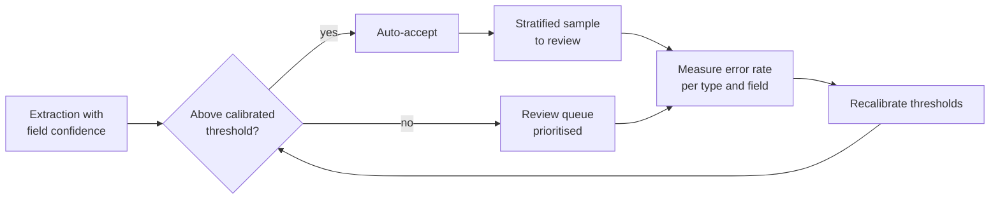

# CCAR-F Domain 5 — Context Management & Reliability (15%)

> **Track:** [CCAR-F](../README.md) · **Weight:** 15% (see [`registry.yaml`](../../registry.yaml)) ·
> **Objectives:** CCAR-F-5.1 to 5.6 · **Time:** ~6 hours including labs

The smallest domain by weight, but it is a primary domain in **five** of the six [scenarios](../scenarios.md),
so its ideas show up everywhere. It covers keeping the right facts in context over long interactions, deciding
when an agent should escalate or ask, propagating errors usefully, exploring large codebases without drowning in
output, calibrating human review, and keeping track of where every claim came from.

Product facts were checked on **2026-10-24** against the Claude Code and Agent SDK docs and the `claude-api`
reference.

## Objectives

| ID | Objective | Where to study |
|---|---|---|
| CCAR-F-5.1 | Preserve critical information across long interactions | [Managing long context](../../../04-context-engineering/02-managing-long-context.md), [Compaction and context editing](../../../04-context-engineering/05-compaction-and-context-editing.md) |
| CCAR-F-5.2 | Design escalation and ambiguity-resolution patterns | [Human in the loop](../../../10-agentic-ai/05-human-in-the-loop.md), [Human oversight](../../../12-ai-security/13-human-oversight.md) |
| CCAR-F-5.3 | Propagate errors sensibly across multi-agent systems | [Agent reliability](../../../10-agentic-ai/07-agent-reliability.md), [Reliability engineering](../../../15-production-operations/05-reliability-engineering.md) |
| CCAR-F-5.4 | Manage context when exploring large codebases | [Commands, skills and subagents](../../../09-claude-code/05-commands-skills-subagents.md), [Compaction and context editing](../../../04-context-engineering/05-compaction-and-context-editing.md) |
| CCAR-F-5.5 | Design human review workflows and calibrate confidence | [Grading methods](../../../14-evaluation-and-testing/04-grading-methods.md), [Human oversight](../../../12-ai-security/13-human-oversight.md) |
| CCAR-F-5.6 | Keep provenance and handle uncertainty in multi-source synthesis | [Grounding and citations](../../../11-rag-and-knowledge-systems/05-grounding-and-citations.md), [Multi-agent architecture](../../../10-agentic-ai/04-multi-agent-architecture.md) |

## Key concepts

- **Context window.** Everything the model sees in one request: system prompt, tools, history, tool results.
  The Messages API is stateless, so you resend the history each turn.
- **Progressive summarisation.** Replacing old history with summaries. It saves tokens and loses detail,
  especially numbers, dates and promises.
- **Position effects ("lost in the middle").** Models attend most reliably to the start and end of long inputs;
  material buried in the middle is more likely to be missed.
- **Escalation.** Handing a case to a person (or a more capable process) with enough context to act.
- **Calibration.** Making a confidence score mean something: of the items scored 0.9, about 90% should be correct.
- **Provenance.** The mapping from each claim to the source (and date) it came from.

## Detailed technical notes

### 5.1 Preserving critical information

What goes wrong in long interactions:

| Risk | Example | Mitigation |
|---|---|---|
| Summaries blur specifics | "Customer had a billing issue" replaces "charged 42.10 twice on 19 Oct; wants refund by 31 Oct" | Keep a **case-facts block** (amounts, dates, IDs, statuses, promises made) outside the summarised history and include it in every request |
| Tool results bloat context | An order lookup returns 60 fields when 6 matter | Trim to the relevant fields before appending (in your tool, or a `PostToolUse` hook) |
| Middle of long inputs ignored | A 30-section aggregate where key findings sit in section 17 | Put a key-findings summary first; use clear section headings; keep detail below |
| Several issues in one session | Three orders, each at a different stage | Keep a structured per-issue state (ID, amount, status, next step) as its own context layer |
| History dropped between turns | A client that sends only the latest message | Send the full conversation (or a deliberate compacted form) every request |

Subagents feeding a coordinator should return **structured, compact output** (key facts, citations, relevance,
dates) rather than prose and reasoning chains, especially when the downstream agent has a limited context budget.

API-level tools that help (as of 2026-10-24): server-side **compaction** (beta) summarises earlier context near a
threshold; **context editing** (beta) clears old tool results or thinking blocks; Claude Code's `/compact`
summarises a long session. All of these lose detail, which is why the case-facts block stays outside them.

### 5.2 Escalation and ambiguity resolution

Good escalation triggers:

- The customer **explicitly asks for a person**. Honour it promptly; do not insist on investigating first.
- **Policy is silent or ambiguous** for this request (the policy covers price adjustments on your own site; the
  customer asks about a marketplace seller's listing). A gap is a reason to escalate, not to improvise.
- **No meaningful progress** after reasonable attempts, or a required action is outside the agent's authority.

Weak triggers:

- **Sentiment alone.** A frustrated customer with a simple, solvable problem is better served by a fast fix.
  Acknowledge the frustration, offer the resolution, and escalate if they repeat that they want a person.
- **The model's self-reported confidence.** Uncalibrated scores are a poor proxy for case complexity.

Ambiguity patterns:

| Situation | Right move |
|---|---|
| A lookup returns several matching customers | Ask for another identifier (postcode, order number); never pick the "most likely" one |
| The request could mean two different actions | Ask a short clarifying question before acting |
| The policy wording admits two readings | Escalate with both readings stated |

Make the criteria explicit in the system prompt and add a few examples of "resolve" versus "escalate" cases with
the reasoning. Pair this with programmatic enforcement for anything that must always escalate (see
[Domain 1](domain-1.md), 1.4).

### 5.3 Error propagation in multi-agent systems

A subagent's error report should let the coordinator decide what to do next:

```json
{
  "status": "partial",
  "failure_type": "transient",
  "attempted": ["registry search 'battery recycling 2025' x3 (timeouts)", "fallback: archive search (ok)"],
  "partial_results": [{"claim": "...", "source_id": "arch-2291", "date": "2025-11-04"}],
  "not_covered": ["regulatory filings after 2026-03"],
  "suggested_alternatives": ["retry registry later", "use national statistics portal"]
}
```

| Anti-pattern | Why it hurts |
|---|---|
| Returning "search unavailable" with nothing else | The coordinator cannot tell whether to retry, switch source or report a gap |
| Returning an empty list as success after a timeout | The coordinator concludes there is no data; the report states a false negative |
| Aborting the whole workflow on one subagent's failure | Throws away good partial results |
| Retrying non-retryable errors | Wastes budget; the outcome cannot change |

Practices:

- **Recover locally first.** Subagents retry transient failures and try alternatives; they escalate only what they
  cannot fix, together with what they tried and what they have.
- **Distinguish "could not look" from "looked and found nothing".** These lead to different conclusions.
- **Annotate coverage in the final output.** The report should say which sections are well supported and which
  have gaps because a source was unavailable.

### 5.4 Context in large codebase exploration

Symptoms of context degradation in a long session: answers become inconsistent, and Claude talks about "typical
patterns" instead of the specific classes it found earlier.

| Technique | How |
|---|---|
| Delegate discovery | Send specific questions ("list every consumer of the `orders.v2` topic") to subagents such as the read-only Explore agent; the main session keeps only their summaries |
| Scratchpad files | Have the agent write key findings to a file (for example `notes/exploration.md`) and re-read it when needed, so facts survive compaction and new sessions |
| Phase summaries | At the end of each phase, write a summary and pass it into the next phase's subagents as their starting context |
| `/compact` | Compact a long session when verbose discovery output fills it; check the scratchpad holds anything you cannot lose |
| Crash-safe state | In multi-agent runs, each agent writes its state to a known location and the coordinator keeps a manifest; on restart it loads the manifest and passes each agent its saved state |
| Fresh start | When the session is long and confused, start a new one with the scratchpad and a summary rather than continuing |

### 5.5 Human review and confidence calibration

- **Aggregate accuracy hides weak segments.** A pipeline that is 96% accurate overall may be 70% accurate on
  handwritten forms or on one field. Measure accuracy **by document type and by field** before reducing review.
- **Stratified random sampling.** Keep sampling high-confidence output (stratified by type and field) so you keep
  measuring the real error rate and spot new error patterns, instead of reviewing only what the model flags.
- **Calibrated field-level confidence.** Ask for a confidence per field, then compare against a labelled
  validation set to set thresholds (for example, auto-accept only where measured precision at that score is at
  least 99%).
- **Route by value of review.** Send low-confidence fields, contradictory sources and ambiguous documents to people
  first, because reviewer time is limited.



### 5.6 Provenance and uncertainty in multi-source synthesis

- **Attribution is lost in summarisation** unless the claim-to-source mapping travels as data. Require subagents to
  output records such as `{claim, source_id, source_title, location, excerpt, published}` and require the synthesiser
  to keep and merge them.
- **Conflicting values:** when two credible sources disagree, report both with their sources and context
  (methodology, sample, date). Do not silently pick one. The reader can finish analysis with the conflict
  annotated and let the coordinator decide how to reconcile it.
- **Dates prevent false contradictions.** A 2023 figure and a 2026 figure may both be right. Require publication or
  collection dates in every structured finding.
- **Separate established from contested findings** in the report, preserving how the original sources
  characterised them.
- **Render content to fit its type:** financial figures as tables, narrative developments as prose, technical
  findings as structured lists. Forcing everything into one format loses information.

## Worked design scenario

*Adventure Works Travel* runs a support agent that handles multi-issue conversations of 40+ turns and a research
assistant that summarises supplier reports.

1. The support agent keeps a case-facts block (booking references, amounts, dates, promises) at the top of each
   request; summarised history sits below it. A `PostToolUse` hook trims booking lookups to nine fields.
2. Escalation criteria: explicit request for a person (immediate), policy silent on the request, more than one
   matching traveller (ask for date of birth or booking reference instead), refunds above authority.
3. The research assistant's readers return claim records with source IDs and dates; the synthesiser reports
   conflicts side by side and lists sources that timed out under "coverage gaps".
4. Review: accuracy is measured per supplier and per field; a stratified 2% sample of auto-accepted summaries is
   checked weekly.

## Anti-patterns

- Summarising amounts and dates into prose and then relying on the summary.
- Escalating on frustration alone, or refusing a direct request for a person.
- Picking one of several matching records "because it is probably right".
- Silent empty results after failures; aborting everything on one failure.
- Removing human review because the overall accuracy number looks high.
- Synthesis that drops sources or averages conflicting figures.

## Labs and further practice

- [Lab 05: Context management](../../../19-hands-on-labs/lab-05-context-management/README.md)
- [Lab 13: Human-in-the-loop approvals](../../../19-hands-on-labs/lab-13-human-in-the-loop/README.md)
- [Lab 18: Reliability engineering](../../../19-hands-on-labs/lab-18-reliability-engineering/README.md)
- [Lab 04: Document-grounded Q&A](../../../19-hands-on-labs/lab-04-document-grounded-qa/README.md)
- Practical exercises 3, 7 and 8 in [`practical-exercises.md`](../practical-exercises.md)

## Self-check

1. What belongs in a case-facts block, and why keep it outside summarised history?
2. A customer is angry but their problem is a simple address change. Escalate?
3. Why is returning an empty list after a timeout dangerous?
4. Name two techniques that keep a long codebase exploration coherent.
5. Overall extraction accuracy is 95%. What must you check before reducing human review?

<details>
<summary>Answers</summary>

1. Amounts, dates, identifiers, statuses and commitments. Summaries tend to blur exactly these details, so they
   are kept verbatim and included in every request.
2. Not on sentiment alone. Acknowledge the frustration and offer to make the change; escalate if they repeat
   that they want a person.
3. The coordinator treats it as "no data exists", so the final output states a false negative instead of
   reporting a gap.
4. Any two of: delegating discovery to subagents, scratchpad files, phase summaries, `/compact`, starting fresh
   with a summary.
5. Accuracy broken down by document type and by field, and calibrated confidence thresholds from a labelled set;
   keep stratified sampling of auto-accepted output.

</details>
