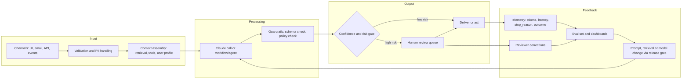
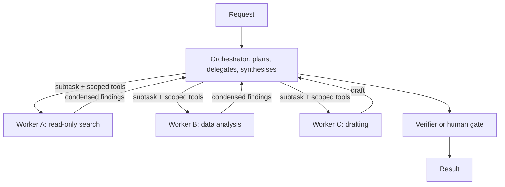
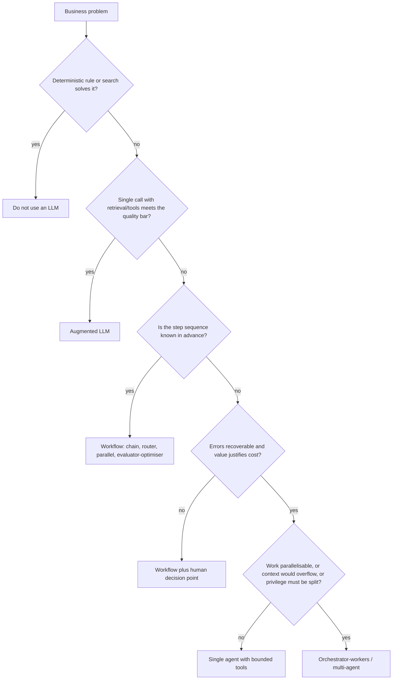

# CCAR-P Domain 1 — Solution Design & Architecture (17%)

> **Track:** [CCAR-P](../README.md) · **Weight:** 17% (see [`registry.yaml`](../../registry.yaml)) ·
> **Objectives:** CCAR-P-1.1 to 1.6 · **Time:** ~5 hours including labs

This is the second-heaviest domain and the one that frames every other domain. Items here describe a
business situation and ask you to pick the architecture, the pattern or the decomposition that best fits the
constraints. The trap answers are usually *over-engineered* (an autonomous multi-agent system where a
three-step workflow would do) or *under-controlled* (an agent with write access and no checkpoint).

## Objectives

| ID | Objective (paraphrased from the official guide) | Where to study |
|---|---|---|
| CCAR-P-1.1 | Translate business problems into Claude-based solutions | [Solution design process](../../../13-enterprise-ai-architecture/01-solution-design-process.md) |
| CCAR-P-1.2 | Design end-to-end architectures (input, processing, output, feedback loops) | [Architecture patterns](../../../13-enterprise-ai-architecture/02-architecture-patterns.md), [Reference architectures](../../../13-enterprise-ai-architecture/03-reference-architectures.md) |
| CCAR-P-1.3 | Select architectural patterns (workflow, agentic, augmented LLM) | [Workflows vs agents](../../../10-agentic-ai/01-workflows-vs-agents.md), [Workflow patterns](../../../10-agentic-ai/02-workflow-patterns.md) |
| CCAR-P-1.4 | Design multi-agent systems and orchestration strategies | [Multi-agent architecture](../../../10-agentic-ai/04-multi-agent-architecture.md), [The agent loop](../../../10-agentic-ai/03-the-agent-loop.md) |
| CCAR-P-1.5 | Apply decomposition techniques to complex problems | [Task decomposition and chaining](../../../03-prompt-engineering/05-task-decomposition-and-chaining.md) |
| CCAR-P-1.6 | Align solutions to business value (efficiency, transformation, productivity, cost, SLAs) | [Business value and ROI](../../../13-enterprise-ai-architecture/08-business-value-and-roi.md) |

## Key concepts

- **Augmented LLM.** A single model call enriched with retrieval, tools and memory. It is the building block
  of every higher pattern, and many production systems never need more than this.
- **Workflow.** A system in which *your code* decides the sequence of steps. LLM calls are steps inside a
  predefined path (chain, router, parallel fan-out, evaluator–optimiser).
- **Agent.** A system in which *the model* decides the next step in a loop: it chooses tools, observes
  results and decides when it is done. Control flow is dynamic.
- **Orchestrator–workers.** A lead model breaks a task into subtasks at run time and delegates to workers,
  then synthesises. It sits between a workflow and a fully autonomous agent.
- **Feedback loop.** Any path by which production outcomes change the system: human corrections feed an eval
  set, eval results drive prompt changes, and monitoring triggers re-indexing or rollback.
- **Value hypothesis.** A falsifiable statement of the business result ("cut median triage time from
  40 minutes to 10 without raising the miss rate above 2%") that the architecture must serve.

## Detailed technical notes

### 1.1 From business problem to Claude solution

Treat the model as one component, not the solution. A disciplined translation goes through five questions:

1. **What decision or artefact does the business need?** A classification, a draft, an answer with
   citations, an action in a system of record. The output shape drives everything downstream.
2. **What is the cost of a wrong output, and who catches it?** This sets the autonomy level and whether a
   human review step is mandatory (see [Domain 5](domain-5.md)).
3. **What knowledge does the task need, and where does it live?** Stable instructions go in the system
   prompt, reference material goes behind retrieval or in a cached prefix, and live data comes from tools.
4. **How will we know it works?** Write the success criteria and a first eval set *before* building
   (see [Domain 4](domain-4.md)).
5. **Is an LLM the right tool at all?** Deterministic rules, a search index or a conventional ML classifier
   can be cheaper and more predictable. Claude is strongest where inputs are unstructured, varied and
   language-heavy, and where judgement or synthesis is required.

The Claude API skill guidance captures the "should I build an agent?" test in four criteria, all of which
must hold before you choose an agent: the task is **complex** (hard to specify in advance), the outcome has
enough **value** to justify the cost and latency, Claude is **viable** at the task type, and the **cost of
error** is manageable (errors can be caught and recovered from through tests, review or rollback).

### 1.2 End-to-end architecture

Every production design has the same four stages. Exam items often hide the flaw in the stage the
candidate is least likely to look at: the feedback loop.

Design notes per stage:

| Stage | Architect decisions | Typical mistakes |
|---|---|---|
| Input | Schema validation, size limits, PII redaction or tokenisation, provenance tagging of untrusted content | Passing raw email bodies straight into a tool-using agent |
| Processing | Pattern, model tier per step, effort level, structured outputs, timeouts, retries | One giant prompt doing five jobs; no `stop_reason` handling |
| Output | Schema validation, policy checks, output encoding before rendering, risk-based routing | Treating model output as trusted HTML, SQL or shell |
| Feedback | Logging with redaction, outcome capture, eval refresh, controlled release | No ground-truth capture, so quality is unknowable after launch |

Two API facts matter at this level (as of 2026-10-24, per the Claude API reference): always branch on
`stop_reason` (`end_turn`, `max_tokens`, `tool_use`, `pause_turn`, `refusal`) before using `content`, and
use structured outputs (`output_config.format`, or `client.messages.parse(...)` in the SDK) when a
downstream system consumes the result. Assistant-message prefill is not supported on current models, so do
not design around it.

### 1.3 Choosing the pattern

Start with the simplest tier that meets the need, and escalate only with evidence.

| Signal in the scenario | Favoured pattern | Why |
|---|---|---|
| One input, one output, well-defined (classify, extract, summarise) | Single augmented LLM call | Cheapest, fastest, easiest to evaluate |
| Fixed sequence of distinct steps, each checkable | Prompt chain with gates | Each step is simpler; failures are localised |
| Inputs fall into distinct categories needing different handling | Router | Specialised prompts and cheaper models per category |
| Independent subtasks or multiple opinions needed | Parallelisation (sectioning or voting) | Lower latency; voting improves reliability on high-stakes judgements |
| Clear quality criteria and iterative refinement helps | Evaluator–optimiser | A critic loop raises quality where criteria are articulable |
| Subtasks cannot be known in advance | Orchestrator–workers | Dynamic decomposition with bounded workers |
| Open-ended, many steps, environment feedback available, recoverable errors | Agent | Flexibility justifies cost and unpredictability |

#### Workflow versus agent: the trade-off table

| Dimension | Workflow | Agent |
|---|---|---|
| Control flow | Code-defined, predictable | Model-defined, adaptive |
| Latency and cost | Bounded and forecastable | Variable; long tails |
| Testability | Unit-test each step | Needs trajectory and outcome evals |
| Failure modes | Step failure, schema mismatch | Loops, drift, tool misuse, compounding errors |
| Auditability | Easy: fixed path | Harder: log every tool call and decision |
| Best when | The path is known | The path depends on what is discovered |

A hybrid is common and often the best answer: a deterministic workflow outer shell (intake, policy check,
approval, write-back) with a bounded agent inside one step (investigation or drafting).

### 1.4 Multi-agent systems and orchestration

Multi-agent designs pay off when work is **parallelisable**, when sub-tasks would otherwise **flood one
context window** with reading, or when you need **separation of privilege** (a read-only researcher and a
separate, tightly scoped actor). They cost more tokens, add coordination failure modes and make debugging
harder. Do not choose them for prestige.

Orchestration strategies:

| Strategy | Description | Use when | Risk |
|---|---|---|---|
| Centralised orchestrator | One lead agent plans and delegates | Most enterprise cases; easy to audit | Orchestrator context grows; single point of failure |
| Pipeline (hand-off) | Agent A's output is agent B's input in fixed order | Stages are known | Errors propagate; no back-tracking |
| Hierarchical | Orchestrators of orchestrators | Very large fan-out | Coordination cost; hard to debug |
| Peer / agent-to-agent | Independent agents negotiate over a protocol | Crossing organisational or vendor boundaries | Trust, identity and contract versioning |

Design rules that score well on scenario items:

- Give each worker the **minimum tool set** for its subtask, and a clear task description, output format and
  stopping condition. Vague delegation causes duplicated or missing work.
- Return **condensed** results to the orchestrator, not raw transcripts, to protect its context.
- Use a cheaper model for reading-heavy workers when evals show quality holds, and keep the orchestrator on a
  stronger model. Measure first: the API skill notes that a single strong model at lower effort is often the
  simpler, cheaper baseline, partly because prompt caches are model-scoped.
- Put **budgets** on the loop (max turns, token or task budgets, wall-clock timeouts) and an escalation path.
- Log every delegation, tool call and result with a correlation ID so you can reconstruct a trajectory.

Hosting options (as of 2026-10-24): you can run your own loop over the Messages API (manual loop or the SDK
tool runner), use the Claude Agent SDK (the Claude Code harness as a library, self-hosted), or use Claude
Managed Agents (beta), where Anthropic runs the loop and hosts a per-session sandbox. See
[Managed agents and the Agent SDK](../../../10-agentic-ai/06-managed-agents-and-agent-sdk.md).

### 1.5 Decomposition techniques

| Technique | What it does | Example |
|---|---|---|
| Functional decomposition | Split by capability (extract, classify, draft, check) | Claims intake: extract fields, classify claim type, draft acknowledgement |
| Data decomposition (map-reduce) | Split a large corpus, process chunks in parallel, merge | Summarise 400 contract amendments, then synthesise themes |
| Temporal decomposition | Split by phase with checkpoints | Plan, then approve, then execute |
| Risk-based decomposition | Isolate the risky step behind stronger controls | Model drafts a refund decision; deterministic rules and a human approve it |
| Verification split | Separate generation from checking | One call drafts; another checks citations against sources |

Good decomposition creates steps that are individually **testable**, have **typed interfaces** (structured
outputs between steps) and isolate **privilege**. Over-decomposition adds latency and loses context between
steps; if two steps always need the same context and never fail independently, merge them.

### 1.6 Aligning to business value

Value categories you should be able to distinguish:

| Category | Metric examples | Architecture implication |
|---|---|---|
| Efficiency | Handling time, cost per case, backlog | Optimise cost per completed task; batch where latency allows |
| Productivity | Throughput per employee, cycle time | Assistive UX with human in control; fast models for interactive steps |
| Transformation | New product or service, new revenue | Higher investment in evals, governance and change management |
| Cost reduction | Spend per unit, vendor or licence replacement | Caching, model routing, Batch API (asynchronous, discounted) |
| Service levels | Latency percentiles, availability, accuracy floor | Streaming, fallbacks, capacity planning, SLOs with error budgets |

Calculate value per **completed** task, not per request: a cheaper configuration that needs retries or
human rework may cost more overall. Include run costs (tokens, infrastructure, review effort) and change
costs (evaluation upkeep, model upgrades).

## Decision framework: the design ladder

## Worked design scenario

**Fictional context.** *Acme Logistics* runs a network-operations desk that receives shipment exception
events (customs holds, missed connections, temperature excursions, damaged pallets) from carrier feeds and
driver notes. Planners currently read each exception, check the shipment, contract and alternative routes,
and decide whether to re-route, re-book, or open an insurance case. Leadership wants faster decisions without
more planners.

**Design.**

1. *Pattern:* a router workflow. A fast model classifies each exception (informational, re-route candidate,
   insurance candidate, other) with structured output. Informational events are logged with a one-line
   summary. Insurance candidates go to a human queue with a model-drafted case summary. Re-route candidates go
   to a bounded agent that can read shipment, contract, lane-capacity and cost data and proposes up to three
   options with trade-offs.
2. *Controls:* the agent has read-only tools; booking a new route is a separate deterministic step that a
   planner approves. Driver notes and carrier free text are wrapped and labelled as untrusted content.
3. *Models:* the classifier runs on the smallest tier that passes the classification eval at the target
   accuracy; the re-route agent runs on a stronger tier. Both are tuned with `effort` before swapping models.
4. *Feedback:* the option each planner picks (or overrides) is captured as a labelled example; weekly eval
   runs gate any prompt change; dashboards track misroute rate and median time to decision.
5. *Value:* hypothesis "reduce median time from exception to decision from 4 hours to 45 minutes while keeping
   on-time delivery for affected shipments at or above the current baseline".

**Why not a single autonomous agent?** Most events are predictable; a router keeps cost and latency bounded,
and the consequential action (booking capacity that costs money) stays outside model control.

## Anti-patterns

- **Agent-first design.** Choosing an autonomous agent because it is fashionable, then fighting
  unpredictability with ever-longer prompts.
- **The god prompt.** One prompt that classifies, retrieves, reasons, formats and polices itself.
- **No feedback loop.** Shipping without outcome capture, so drift and regressions are invisible.
- **Shared super-credential.** All agents use one service account with write access everywhere.
- **Raw transcript hand-offs.** Workers return their full context to the orchestrator, which then overflows.
- **Value measured per request.** Ignoring retries, human rework and review costs.

## Labs and further practice

- [Lab 12: Agentic task execution](../../../19-hands-on-labs/lab-12-agentic-task-execution/README.md)
- [Lab 20: Secure enterprise architecture](../../../19-hands-on-labs/lab-20-secure-enterprise-architecture/README.md)
- [Lab 17: Cost optimisation](../../../19-hands-on-labs/lab-17-cost-optimisation/README.md)
- [Decision scenarios](../decision-scenarios.md) 1–4 and [practical exercise 1](../practical-exercises.md)

## Self-check

1. Name the four criteria that must all hold before an agent is the right tier.
2. A process has five known steps, one of which requires open-ended investigation. What pattern do you choose?
3. Give two reasons to split work across multiple agents and two costs of doing so.
4. Where in an end-to-end architecture do reviewer corrections go, and what do they feed?
5. Why should value be measured per completed task rather than per request?

Answers

1. Complexity (hard to specify in advance), value (justifies cost and latency), viability (Claude is capable at
   the task) and manageable cost of error (errors can be caught and recovered from).
2. A workflow outer shell with a bounded agent inside the investigation step, plus a checkpoint before any
   consequential action.
3. Reasons: parallelisable work; protecting context from reading-heavy subtasks; separation of privilege.
   Costs: more tokens and latency; coordination failures and harder debugging.
4. Into the feedback stage: they become labelled examples in the eval set and inform prompt, retrieval or model
   changes that pass through a release gate.
5. Because retries, extra turns and human rework are real costs; a cheaper request that fails more often can
   make each finished task more expensive.

