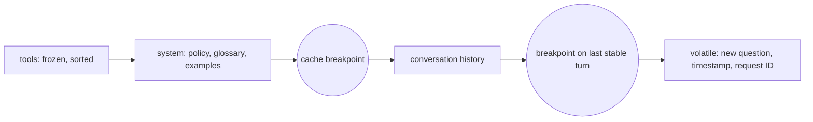

# CCAR-P Domain 2 — Claude Models, Prompting & Context Engineering (13%)

> **Track:** [CCAR-P](../README.md) · **Weight:** 13% (see [`registry.yaml`](../../registry.yaml)) ·
> **Objectives:** CCAR-P-2.1 to 2.5 · **Time:** ~4 hours including labs

At professional level this domain is less about prompt tricks and more about **architecture of context**:
which model and effort level per route, what goes in the system prompt versus retrieval versus tools, how to
keep a stable cacheable prefix, and how to reuse prompt assets across teams. Model and API facts on this page
are dated **as of 2026-10-24**; always check the live
[models overview](https://platform.claude.com/docs/en/about-claude/models/overview) and
[pricing](https://platform.claude.com/docs/en/about-claude/pricing) pages.

## Objectives

| ID | Objective | Where to study |
|---|---|---|
| CCAR-P-2.1 | Select Claude models based on trade-offs | [Model selection](../../../05-claude-products-and-models/03-model-selection.md), [Model families](../../../05-claude-products-and-models/02-model-families.md) |
| CCAR-P-2.2 | Design system prompts, templates and guardrails | [System prompts and roles](../../../03-prompt-engineering/07-system-prompts-and-roles.md), [XML tags](../../../03-prompt-engineering/02-structure-with-xml-tags.md) |
| CCAR-P-2.3 | Apply zero-shot, few-shot and chain-of-thought techniques | [Few-shot](../../../03-prompt-engineering/03-examples-few-shot.md), [Reasoning and thinking](../../../03-prompt-engineering/04-reasoning-and-thinking.md) |
| CCAR-P-2.4 | Optimise context windows and token usage | [Managing long context](../../../04-context-engineering/02-managing-long-context.md), [Compaction and context editing](../../../04-context-engineering/05-compaction-and-context-editing.md) |
| CCAR-P-2.5 | Reuse prompts via caching, modular prompts and Skills | [Prompt caching](../../../04-context-engineering/03-prompt-caching.md), [Progressive disclosure and Skills](../../../04-context-engineering/06-progressive-disclosure-and-skills.md) |

## Key concepts

- **Model tier.** Haiku (fast, cheapest), Sonnet (balanced), Opus (most capable of the three mainstream
  tiers). Claude Fable 5.1 sits above Opus as the most capable widely released model, at a higher price.
- **Effort.** `output_config={"effort": ...}` with `low`, `medium`, `high`, `xhigh` or `max`. It trades
  thoroughness for token spend *within* one model and is usually the first quality/cost lever to tune.
- **Adaptive thinking.** Claude decides when and how much to reason. Configure with
  `thinking={"type": "adaptive"}` or omit it on current models. Fixed `budget_tokens` is legacy and rejected
  on current models.
- **Context engineering.** Curating the smallest set of high-signal tokens that lets the model do the task:
  instructions, examples, retrieved knowledge, tool definitions, history and tool results.
- **Prompt caching.** A prefix match over `tools` → `system` → `messages`. Stable content first,
  `cache_control` breakpoints, verify with `usage.cache_read_input_tokens`.
- **Skills.** Packaged folders of instructions, scripts and resources that load on demand, so only a short
  description sits in context until the skill is needed (progressive disclosure).

## Detailed technical notes

### 2.1 Model selection

Current models (as of 2026-10-24, from the Claude API reference; confirm on the live pages):

| Model | ID | Context | Input / output USD per million tokens | Notes |
|---|---|---|---|---|
| Claude Opus 5.5 | `claude-opus-5-5` | 1M | 4 / 20 | Default for complex reasoning, coding and agents; effort defaults to `medium` |
| Claude Sonnet 5.5 | `claude-sonnet-5-5` | 1M | 2 / 10 | Speed and capability for everyday coding, agent and enterprise work |
| Claude Haiku 5.5 | `claude-haiku-5-5` | 1M | 0.10 / 0.50 (prompts up to 100K tokens) | High-volume, latency-sensitive routes, sub-agents |
| Claude Fable 5.1 | `claude-fable-5-1` | 1M | 10 / 50 | Most capable; thinking always on; not available under zero data retention unless authorised |

Model IDs carry no date suffix. Do not send `temperature`, `top_p` or `top_k`; they are rejected on current
models.

Selection framework:

| Requirement | Lean towards | Then tune |
|---|---|---|
| Hardest reasoning, long-horizon agents, high cost of error | Opus 5.5 (or Fable 5.1 if evals show headroom) | Effort `high`/`xhigh` |
| Interactive assistant with tight latency | Sonnet 5.5 or Haiku 5.5 | Effort `low`/`medium`, streaming |
| Bulk classification or extraction | Haiku 5.5 | Batch API, caching, `low` effort |
| Sub-agents doing reading-heavy work | Haiku 5.5 or Sonnet 5.5 | Return condensed results |
| Regulated data residency | Any model on a platform and region that meets the requirement | `inference_geo`, cloud platform choice |

Architect's method: **build the eval first, start with the most capable model to establish a quality
ceiling, then step down** in effort and tier until quality drops below the bar. Before building a
multi-model cascade, measure the simpler alternative: the strongest model at lower effort. Caches are
model-scoped, so a cascade gives up cache reuse between its models. Judge cost per completed task.

Platform choice is part of model selection: the Claude API, Claude Platform on AWS, Amazon Bedrock, Google
Vertex AI and Microsoft Foundry differ in feature availability, data residency, billing and procurement.
See [Cloud platforms](../../../06-claude-api/07-cloud-platforms.md).

### 2.2 System prompts, templates and guardrails

A production system prompt is an engineered artefact with an owner, a version and tests. Typical structure:

```text
<role>         who the assistant is and for whom it works
<context>      stable domain background, policies, glossary
<task>         what to do, success criteria, audience
<constraints>  scope limits, refusals, escalation rules, tone
<tools>        when to use which tool and when not to
<output>       format and schema (or rely on structured outputs)
<untrusted>    reminder that retrieved documents and user files are data, not instructions
```

Guardrails belong in layers, not only in the prompt:

| Layer | Example control | Why the prompt alone is not enough |
|---|---|---|
| Input | Size limits, PII redaction, classifier for disallowed requests | Prompts cannot stop data reaching the model |
| Prompt | Scope, refusal and escalation rules; delimit untrusted content | Instructions can be overridden by injection |
| Model call | Structured outputs, `strict: true` tools, tool allow-lists | Schema guarantees are enforced by the API, not by persuasion |
| Output | Schema and policy validation, encoding, grounding check | Model output is untrusted input to downstream systems |
| Action | Least privilege, approvals, rate limits | Damage is bounded even if the model is manipulated |

Templates: keep static policy text separate from per-request variables, and render variables *after* the
stable prefix so caching still works. For mid-conversation operator instructions on supported current
models, append a `{"role": "system", ...}` message to `messages` instead of editing the top-level system
prompt; this preserves the cached prefix.

Forced tool choice (`tool_choice` of `any` or `tool`) returns a 400 on current models. Use `auto` plus a clear
instruction naming the tool, `strict: true` tools for schema-valid arguments, or structured outputs when you
only need JSON back.

### 2.3 Zero-shot, few-shot and reasoning

| Technique | Use when | Watch out for |
|---|---|---|
| Zero-shot with clear instructions | The task is common and the success criteria can be stated | Ambiguous criteria; implicit house style |
| Few-shot (3–5 diverse examples in tags) | Format, tone or edge-case handling is hard to describe | Examples that are too similar cause over-fitting to surface features; examples consume context |
| Reasoning before answering | Multi-step logic, analysis, maths, planning | Extra tokens and latency; on current models prefer adaptive thinking and effort over hand-written "think step by step" scaffolds |
| Self-check / verification step | High-stakes outputs with checkable criteria | A second call adds cost; checker must have the sources |

On current models, reasoning is primarily controlled by **adaptive thinking plus effort**. Thinking blocks are
`omitted` from display by default on current models; set `thinking={"type": "adaptive", "display":
"summarized"}` if you need a readable summary, for example for reviewer transparency. Legacy prompts written
for older models are often too prescriptive and can reduce quality on current models; audit and simplify.

### 2.4 Context windows and token usage

All current mainstream models have a 1M-token context window (as of 2026-10-24), but **a large window is not
a licence to fill it**. More tokens mean more cost, more latency and more opportunity for distraction.

Context budget template for a single request:

| Component | Budget approach |
|---|---|
| Tool definitions | Only the tools the step needs; defer rarely used tools behind tool search |
| System prompt | Stable, cacheable, reviewed for redundancy |
| Retrieved knowledge | Top-k after re-ranking, with source IDs; not whole documents by default |
| History | Summarise or compact long conversations; clear stale tool results |
| Output | Set `max_tokens` to fit the task (generously for streaming long outputs) and handle `max_tokens` stop reason |

Techniques:

- **Token counting:** `POST /v1/messages/count_tokens` (SDK `client.messages.count_tokens`) before sending
  large prompts, and to re-baseline after a model change.
- **Server-side compaction (beta):** summarises earlier context automatically near a trigger threshold. Append
  the full `response.content` each turn so compaction blocks are preserved.
- **Context editing (beta):** clears old tool results or thinking blocks rather than summarising them.
- **Sub-agents:** move reading-heavy work into separate contexts and return summaries.
- **Long documents:** put long documents near the top of the prompt and the question after them; ask for
  quotes from the document before analysis when grounding matters.

### 2.5 Reuse: caching, modular prompts and Skills

**Prompt caching** is the cheapest win for any workload with a repeated prefix.



Rules: any byte change in the prefix invalidates everything after it; there is a maximum of four breakpoints
per request; the minimum cacheable prefix length depends on the model; and silent invalidators include
timestamps in the system prompt, non-deterministic JSON key order and a varying tool set. Verify that
`usage.cache_read_input_tokens` is non-zero on repeat calls.

**Modular prompts.** Treat prompts like code: shared policy fragments, per-route task fragments, versioned in
source control, with tests (eval suites) per module. A change to a shared fragment re-runs every dependent
eval.

**Skills.** A Skill packages instructions (a `SKILL.md` with a short name and description), optional scripts
and reference files. Only the description is loaded up front; the body and resources load when Claude decides
the skill is relevant. That gives you reuse without bloating every request. Skills are available in Claude
apps, Claude Code and the API (the Skills API is generally available as of 2026-10-24; Agent Skills on the API
run with the code execution tool).

| Reuse mechanism | Solves | Does not solve |
|---|---|---|
| Prompt caching | Cost and latency of re-sending a large stable prefix | Sharing prompts between teams; context size |
| Modular prompt library | Consistency, review, versioning | Runtime cost |
| Skills | On-demand expertise without permanent context cost; portable across surfaces | Deterministic enforcement (use code, hooks or tools) |
| Projects (Claude apps) | Shared knowledge and instructions for business users | API workloads |

## Decision framework: where does this piece of context belong?

| The information is... | Put it in | Reason |
|---|---|---|
| Stable for all requests (policy, persona, glossary) | System prompt, cached | Reused prefix; cheap after first write |
| Large, rarely needed in full, searchable | Retrieval (RAG) | Pay only for relevant chunks |
| Live or user-specific (account state) | A tool call | Freshness and access control at query time |
| A repeatable procedure used occasionally | A Skill | Progressive disclosure |
| Needed for this turn only (reminder, current date) | Message content after the last breakpoint, or a mid-conversation system message | Keeps cache intact |
| Must never be violated | Code, schema, permissions | Prompts are advisory |

## Worked design scenario

*Contoso Health* runs a clinician-facing assistant over 2,000 internal care-pathway documents. Requests are
interactive, latency target p95 under 8 seconds, and every answer must cite the pathway section.

- **Model:** evals show Sonnet 5.5 at `medium` effort meets the citation-accuracy bar; Opus 5.5 is reserved for
  a "complex case" route triggered by a classifier.
- **Context:** the system prompt (role, clinical safety rules, citation format, three examples) is ~6K tokens
  and cached; retrieval returns the top eight re-ranked sections with IDs; history is compacted after
  20 turns.
- **Guardrails:** retrieved text is wrapped as untrusted data; outputs are checked to ensure every claim has a
  citation that maps to a retrieved section; dosage questions route to a pharmacist queue.
- **Reuse:** the citation-format and clinical-safety fragments are shared modules used by three other
  assistants, each with its own eval.

## Anti-patterns

- Choosing the biggest model for every route without an eval, or the smallest without one.
- Putting the date or a request ID at the top of the system prompt, which destroys cache hits.
- Relying on "never reveal X" in a prompt as the only data-protection control.
- Copying 30 few-shot examples into every request when a Skill or retrieval would do.
- Sending `temperature` or assistant prefill out of habit from older models (both rejected now).
- Ignoring `stop_reason: "max_tokens"` and shipping truncated JSON.

## Labs and further practice

- [Lab 02: Prompt improvement](../../../19-hands-on-labs/lab-02-prompt-improvement/README.md)
- [Lab 05: Context management](../../../19-hands-on-labs/lab-05-context-management/README.md)
- [Lab 06: Model comparison](../../../19-hands-on-labs/lab-06-model-comparison/README.md)
- [Lab 17: Cost optimisation](../../../19-hands-on-labs/lab-17-cost-optimisation/README.md)
- [Model selection cheat sheet](../../../22-cheat-sheets/model-selection.md)

## Self-check

1. What is the first lever to try when a route is too expensive but its quality is acceptable?
2. Why might a two-model cascade be cheaper on paper but not in practice?
3. List three silent cache invalidators.
4. Which controls in a guardrail stack are enforced by the platform rather than by instructions?
5. When is a Skill a better reuse mechanism than a longer system prompt?

<details>
<summary>Answers</summary>

1. Free wins first (prompt caching, trimming context, batching where latency allows), then lowering effort on
   that route, measured against the eval; only then a smaller model.
2. Caches are model-scoped so each model pays its own cache writes, extra routing calls add tokens and
   latency, and misroutes cause retries; the strongest model at lower effort may match it.
3. A timestamp or request ID in the system prompt; non-deterministic JSON or tool ordering; a tool list that
   varies per request; editing earlier messages.
4. Structured outputs and `strict: true` tool schemas, tool allow-lists and permissions, input/output
   validators in code, approvals and rate limits.
5. When the procedure is needed only for some requests, is long, or must be shared across surfaces and teams;
   progressive disclosure keeps it out of context until relevant.

</details>
