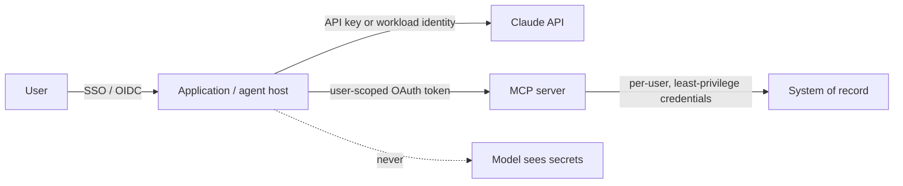
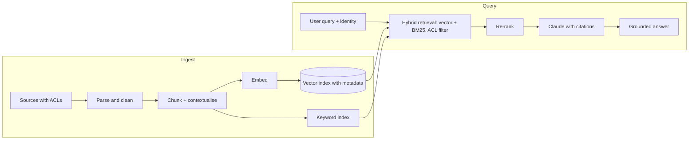

# CCAR-P Domain 3 — Integration (19%)

> **Track:** [CCAR-P](../README.md) · **Weight:** 19%, the largest domain (see [`registry.yaml`](../../registry.yaml)) ·
> **Objectives:** CCAR-P-3.1 to 3.8 · **Time:** ~7 hours including labs

Integration is where Claude meets the rest of the enterprise: tools, identity, retrieval, protocols and
telemetry. Items are typically "analyse this configuration and identify the gap" or "choose the mechanism
that best fits". Facts below are dated **as of 2026-10-24**; check the
[tool use docs](https://platform.claude.com/docs/en/agents-and-tools/tool-use/overview) and the
[MCP specification](https://modelcontextprotocol.io/specification) for changes.

## Objectives

| ID | Objective | Where to study |
|---|---|---|
| CCAR-P-3.1 | Evaluate tool and agent configuration for capability bloat | [Tool design best practices](../../../07-tool-use-and-function-calling/05-tool-design-best-practices.md), [Excessive agency](../../../12-ai-security/05-tool-misuse-and-excessive-agency.md) |
| CCAR-P-3.2 | Analyse authentication and authorisation to find security gaps | [Agent identity and permissions](../../../12-ai-security/09-agent-identity-and-permissions.md), [MCP security](../../../08-model-context-protocol/05-mcp-security.md), [Secrets management](../../../12-ai-security/10-secrets-management.md) |
| CCAR-P-3.3 | Evaluate accuracy–latency trade-offs and justify configuration | [Latency optimisation](../../../15-production-operations/04-latency-optimisation.md) |
| CCAR-P-3.4 | Analyse observability challenges and choose monitoring at scale | [Observability](../../../15-production-operations/02-observability.md), [Logging and auditability](../../../12-ai-security/11-logging-and-auditability.md) |
| CCAR-P-3.5 | Design RAG pipelines with suitable chunking and indexing | [Chunking strategies](../../../11-rag-and-knowledge-systems/02-chunking-strategies.md), [Embeddings and indexing](../../../11-rag-and-knowledge-systems/03-embeddings-and-indexing.md) |
| CCAR-P-3.6 | Match retrieval strategy to data shape and query pattern | [Retrieval strategies](../../../11-rag-and-knowledge-systems/04-retrieval-strategies.md), [RAG vs long context](../../../11-rag-and-knowledge-systems/07-rag-vs-long-context.md) |
| CCAR-P-3.7 | Choose integration mechanism (MCP, API/CLI, agent-to-agent) | [MCP vs alternatives](../../../08-model-context-protocol/06-mcp-vs-alternatives.md), [Integration patterns](../../../13-enterprise-ai-architecture/04-integration-patterns.md) |
| CCAR-P-3.8 | Evaluate progressive discovery versus monolithic context | [Progressive disclosure and Skills](../../../04-context-engineering/06-progressive-disclosure-and-skills.md), [Using MCP with Claude](../../../08-model-context-protocol/04-using-mcp-with-claude.md) |

## Key concepts

- **Client tools vs server tools.** Client (user-defined) tools run in your code; you return `tool_result`
  blocks. Server tools (web search, web fetch, code execution, tool search) run on Anthropic's infrastructure.
- **Capability bloat.** Exposing more tools, scopes or autonomy than the task needs. It increases attack
  surface, confuses tool selection and inflates context.
- **Confused deputy.** A component with privileges is tricked into using them for an unauthorised party; the
  classic agent case is an agent acting with a service account's rights on a user's behalf.
- **MCP.** The Model Context Protocol: an open protocol in which *hosts* (applications) run *clients* that
  connect to *servers* exposing tools, resources and prompts over stdio or Streamable HTTP.
- **Agent-to-agent (A2A).** Delegating a task to an independent agent, possibly owned by another team or
  organisation, over a protocol with its own identity, contract and lifecycle.
- **Progressive discovery.** Loading tool definitions, skills or knowledge only when needed instead of
  placing everything in context up front.

## Detailed technical notes

### 3.1 Capability bloat

Review checklist for a tool or agent configuration:

| Question | Red flag | Fix |
|---|---|---|
| Does every tool map to a task requirement? | "General" tools such as `run_sql` or `http_request` | Replace with narrow, intent-level tools (`get_order_status(order_id)`) |
| Are write and read separated? | One tool that can both read and mutate | Split; gate writes behind approval |
| Are parameters constrained? | Free-text fields that are passed to shells or queries | Enums, patterns, `strict: true` schemas, server-side validation |
| How many tools are loaded per request? | Dozens of tools from several MCP servers always loaded | Tool search with `defer_loading`, per-route tool sets, sub-agents |
| What can the agent do without a human? | Payments, deletions, external messages auto-executed | Human approval or deterministic policy checks |
| Are overlapping tools present? | Three ways to search the same system | Consolidate; overlapping tools cause wrong selections |

Tool design principles: name and describe tools for the model (what it does, when to use it, when not to,
what it returns), return concise high-signal results with identifiers the model can use next, return
errors as `tool_result` with `is_error: true` and a useful message, and paginate or truncate large results.

### 3.2 Authentication and authorisation

Key principles:

- **Model never holds credentials.** Secrets live in the host or a vault and are injected at execution time;
  never put keys in prompts, tool descriptions or tool results.
- **Act as the user where the user's rights matter.** Use delegated, user-scoped tokens so the agent cannot
  read what the user could not. Service accounts are for system tasks with their own narrow scope.
- **MCP authorisation.** For HTTP-based transports the MCP specification defines an OAuth 2.1-based
  authorisation flow. MCP servers must validate that tokens were issued for them; passing a client's token
  straight through to downstream APIs ("token passthrough") is explicitly discouraged in the MCP security
  best practices because it breaks audience validation and enables confused-deputy attacks.
- **Workload identity.** For server-to-server calls to the Claude API, Workload Identity Federation exchanges
  a platform identity token for short-lived credentials instead of a long-lived API key (as of 2026-10-24).
- **Separate environments and keys.** Workspaces and keys per environment and team; rotate; monitor usage.
- **Authorise every tool call server-side.** The model's decision to call a tool is a request, not an
  authorisation.

Common gaps to spot in scenario items: a shared admin token in an MCP server's configuration; an agent
that reads documents across tenants because retrieval ignores the caller's ACLs; a webhook endpoint with no
signature validation; secrets in `CLAUDE.md` or a committed settings file; stdio MCP servers launched from
untrusted packages.

### 3.3 Accuracy–latency trade-offs

| Lever | Accuracy effect | Latency effect | Cost effect |
|---|---|---|---|
| Larger model tier | Usually higher | Slower | Higher |
| Higher effort | Higher on hard tasks | Slower | Higher |
| More retrieved chunks | Higher recall, possible distraction | Slower | Higher |
| Re-ranking | Higher precision | Adds a step | Small |
| Evaluator–optimiser loop | Higher | Much slower | Higher |
| Parallel voting | Higher reliability | Same wall-clock if parallel | Multiplied |
| Streaming | None | Better perceived latency | None |
| Prompt caching | None | Lower time to first token on long prefixes | Lower |
| Fast mode (research preview, Opus only, Claude API) | None (same model) | Faster output tokens per second | Premium pricing |

Justify a configuration with numbers from an eval: "Sonnet 5.5 at `medium` effort scores 94% on the
extraction set at p95 3.1 s; Opus 5.5 at `high` scores 95% at p95 9.4 s; the SLA is p95 5 s and the accuracy
bar is 92%, so Sonnet at `medium` is chosen, with Opus as an escalation route for low-confidence cases."

### 3.4 Observability at scale

LLM observability challenges and responses:

| Challenge | Response |
|---|---|
| Non-deterministic outputs make "error" fuzzy | Track quality signals: eval scores on sampled traffic, user feedback, escalation rate |
| Multi-step agents hide where things went wrong | Distributed tracing: one trace per task, spans per model call and tool call (OpenTelemetry) |
| Logs contain sensitive prompts | Redact or tokenise before storage; tiered retention; access control on traces |
| Cost surprises | Per-route token metrics including `cache_read_input_tokens` and `cache_creation_input_tokens` |
| Silent truncation and refusals | Alert on `stop_reason` distribution (`max_tokens`, `refusal`) |
| Volume makes full review impossible | Stratified sampling plus LLM-graded checks plus human audit of a slice |

Golden signals for a Claude workload: request rate, error rate (HTTP and tool errors), latency (time to first
token and total), tokens per task, cost per completed task, `stop_reason` mix, cache hit ratio, quality score
and escalation rate.

### 3.5 RAG pipelines: chunking and indexing

Chunking strategies:

| Strategy | Good for | Weakness |
|---|---|---|
| Fixed-size with overlap | Homogeneous prose, quick start | Splits mid-thought; loses headings |
| Structure-aware (headings, sections, clauses) | Policies, contracts, manuals | Uneven chunk sizes |
| Semantic (split at topic shifts) | Long narrative documents | More compute at ingest |
| Parent–child (small chunks for matching, larger parent for context) | Precise matching with enough context to answer | More storage and logic |
| Contextual chunking (prepend a short document-level summary to each chunk before embedding) | Chunks that are ambiguous out of context | Ingest cost (mitigate with caching) |
| Row/record level | Tables, FAQs, tickets | Needs metadata to be useful |

Indexing decisions: embedding model and dimension; metadata for filtering (tenant, ACL group, date, document
type, version); hybrid search (dense plus BM25) for queries containing identifiers and rare terms; re-indexing
strategy and versioned indexes so you can roll back; deletion propagation for data-subject requests.

### 3.6 Retrieval strategy versus data shape and query pattern

| Data shape / query pattern | Strategy |
|---|---|
| Natural-language questions over prose | Dense retrieval plus re-ranking |
| Queries with codes, SKUs, error strings | Hybrid (BM25 + dense) |
| Structured data (tables, metrics) | Text-to-query through a constrained tool, not embeddings |
| Multi-hop questions | Agentic retrieval: iterative search with query rewriting |
| Small, stable corpus that fits comfortably | Long context with caching instead of RAG |
| Rapidly changing data | Live tool/API lookup rather than an index |
| Relationship questions ("which suppliers share a parent company?") | Graph or relational query tools |
| Strict permissions per user | Retrieval filtered by caller identity before ranking |

RAG versus long context: long context is simpler and avoids retrieval misses when the corpus is small and
stable; RAG wins when the corpus is large, changes often, needs per-user filtering or when per-request cost
must stay low.

### 3.7 Choosing the integration mechanism

| Criterion | Direct API / function tool | CLI tool (via bash or Claude Code) | MCP server | Agent-to-agent |
|---|---|---|---|---|
| Best for | One app, a few well-defined operations | Developer and ops workflows where a mature CLI exists | Reusable integration across many hosts and agents | Delegating whole tasks to an independently owned agent |
| Reuse across hosts | Low | Medium | High (standard protocol) | High |
| Who owns logic | Your app | The CLI | The server owner | The remote agent |
| Discovery | Static | Help text, conventions | Runtime listing of tools, resources, prompts | Agent descriptions or cards |
| Security considerations | Your code validates everything | Shell injection, broad OS access; sandbox and allow-lists | Server trust, auth, tool poisoning, supply chain | Cross-boundary identity, contracts, data sharing agreements |
| Context cost | Low | Low (model learns CLI) | Can be high if many tools load | Low (one delegation interface) |

Rules of thumb:

- One application calling two internal endpoints: **direct tools**. An MCP server adds a process, a
  protocol and an attack surface without reuse benefits.
- The same system must be reachable from Claude Code, a support agent and Claude apps: **MCP**.
- A mature CLI already exists and the consumer is a developer agent: **CLI** inside a sandboxed shell with
  permission rules.
- Another business unit or partner owns a capability end to end (its own data, policies and model): **A2A**
  delegation with a clear contract, rather than exposing their raw tools.

On the Claude API, the MCP connector lets the API connect to remote MCP servers: it requires both an
`mcp_servers` entry and a matching `mcp_toolset` tool, with the `mcp-client-2025-11-20` beta (as of
2026-10-24).

### 3.8 Progressive discovery versus monolithic context

| Approach | Pros | Cons | Use when |
|---|---|---|---|
| Monolithic (all tools, instructions and knowledge in every request) | Simple; deterministic; cache-friendly if stable | Context bloat, slower, wrong-tool selection, higher cost | Few tools, small stable instruction set |
| Progressive (tool search with `defer_loading`, Skills, retrieval, sub-agents) | Lean context, scales to hundreds of tools | Extra discovery step; discovery can miss; more moving parts | Large tool catalogues, many skills, varied tasks |

Facts: with tool search, mark rarely used tools `defer_loading: true`; at least one tool must stay non-deferred
and the search tool itself must not be deferred. Skills load only their name and description until needed.
Programmatic tool calling lets Claude call tools from inside code execution so intermediate results do not
flow through context.

## Worked design scenario

*Northwind Lending* wants a loan-servicing copilot used by 400 agents. It must read loan records, payment
history and policy documents and draft borrower letters. A proposed design gives the copilot one MCP server
with `execute_sql`, `send_email` and `read_file` tools, authenticated with a database admin account.

Findings and redesign:

1. **Capability bloat:** replace `execute_sql` with `get_loan(loan_id)` and `get_payments(loan_id, since)`;
   remove `read_file`; move `send_email` out of the agent entirely; the human agent sends letters.
2. **Auth gap:** the admin account lets any user read any loan. Use the agent's SSO identity with delegated,
   user-scoped tokens, and enforce branch-level ACLs in the MCP server.
3. **RAG:** policy documents are chunked by section with headings preserved, embedded with metadata (product,
   state, effective date) and retrieved with hybrid search filtered by product and state.
4. **Observability:** OpenTelemetry traces per conversation, redacted payloads, alerts on refusal and
   `max_tokens` rates, a weekly sample graded for letter accuracy.
5. **Mechanism:** MCP is justified because the same loan tools will be used by a collections assistant and in
   Claude Code by the servicing engineering team.

## Anti-patterns

- A "Swiss-army" tool that accepts arbitrary SQL, URLs or shell strings.
- One service account for all users, so retrieval and tools ignore per-user permissions.
- Loading every tool from every MCP server into every request.
- Embedding whole documents as single vectors, or chunking tables as prose.
- Logging full prompts with personal data into a general-purpose log store.
- Building an MCP server for a single internal call path that will never be reused.

## Labs and further practice

- [Lab 08: Tool invocation](../../../19-hands-on-labs/lab-08-tool-invocation/README.md)
- [Lab 09: MCP fundamentals](../../../19-hands-on-labs/lab-09-mcp-fundamentals/README.md)
- [Lab 11: RAG pipeline](../../../19-hands-on-labs/lab-11-rag-pipeline/README.md)
- [Lab 19: Observability](../../../19-hands-on-labs/lab-19-observability/README.md)
- [Lab 20: Secure enterprise architecture](../../../19-hands-on-labs/lab-20-secure-enterprise-architecture/README.md)
- [MCP cheat sheet](../../../22-cheat-sheets/mcp.md)

## Self-check

1. Give three signs of capability bloat in an agent configuration.
2. Why is token passthrough from an MCP server to a downstream API a problem?
3. A query pattern is dominated by part numbers and error codes. Which retrieval approach do you choose?
4. When is an MCP server the wrong choice compared with a direct tool?
5. What are the two constraints when using tool search with deferred loading?

Answers

1. Generic tools that accept arbitrary code, queries or URLs; read and write combined in one tool; many
   overlapping or unused tools loaded per request; consequential actions without approval.
2. The downstream service cannot verify that the token was issued for the MCP server, audience checks are
   bypassed, and the server can be used as a confused deputy.
3. Hybrid retrieval (BM25 keyword plus dense vectors), usually with re-ranking.
4. When a single application needs a few operations that no other host will reuse: MCP adds a process, a
   protocol and an attack surface with no reuse benefit.
5. At least one tool must not be deferred, and the tool search tool itself must not be deferred.

