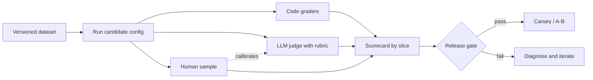

# CCAR-P Domain 4 — Evaluation, Testing & Optimization (16%)

> **Track:** [CCAR-P](../README.md) · **Weight:** 16% (see [`registry.yaml`](../../registry.yaml)) ·
> **Objectives:** CCAR-P-4.1 to 4.6 · **Time:** ~5 hours including labs

The architect's position on evaluation is simple: **no eval, no change**. Every model choice, prompt edit,
retrieval tweak and cost optimisation is a hypothesis that an evaluation confirms or rejects. Items in this
domain test whether you can pick the right metric and grading method, design a trustworthy dataset,
run a fair comparison and diagnose *why* something fails.

## Objectives

| ID | Objective | Where to study |
|---|---|---|
| CCAR-P-4.1 | Define evaluation metrics (accuracy, latency, cost, safety, security) | [Metrics](../../../14-evaluation-and-testing/02-metrics.md), [Why evaluate](../../../14-evaluation-and-testing/01-why-evaluate.md) |
| CCAR-P-4.2 | Design evaluation datasets and mixed-method test frameworks | [Building eval datasets](../../../14-evaluation-and-testing/03-building-eval-datasets.md), [Grading methods](../../../14-evaluation-and-testing/04-grading-methods.md) |
| CCAR-P-4.3 | Run A/B tests and iterative improvement | [A/B testing and iteration](../../../14-evaluation-and-testing/05-ab-testing-and-iteration.md) |
| CCAR-P-4.4 | Diagnose prompt failure, hallucination and model mismatch | [Diagnosing failures](../../../14-evaluation-and-testing/06-diagnosing-failures.md), [Hallucinations](../../../01-ai-and-llm-fundamentals/06-hallucinations.md) |
| CCAR-P-4.5 | Optimise token usage, latency and cost-performance | [Cost optimisation](../../../15-production-operations/03-cost-optimisation.md), [Latency optimisation](../../../15-production-operations/04-latency-optimisation.md) |
| CCAR-P-4.6 | Monitor performance with logging and observability tooling | [Observability](../../../15-production-operations/02-observability.md) |

## Key concepts

- **Offline evaluation.** Scoring a system against a fixed dataset before release.
- **Online evaluation.** Measuring live traffic: A/B tests, shadow mode, sampled grading, user signals.
- **Grader.** The mechanism that scores an output: code (exact match, regex, schema, unit tests), a model
  (LLM-as-judge with a rubric) or a human.
- **Golden set.** A curated, labelled, versioned dataset representing real traffic and known edge cases.
- **Regression suite.** Cases that once failed and were fixed; they must keep passing.
- **Cost per completed task.** Total spend (tokens, retries, review) divided by tasks finished to the
  quality bar.

## Detailed technical notes

### 4.1 Metrics

| Category | Example metrics | Typical grader |
|---|---|---|
| Task accuracy | Exact match, field-level F1, pass@k on code, rubric score | Code; LLM judge for open-ended |
| Grounding | Citation precision/recall, unsupported-claim rate | LLM judge with sources; code for citation existence |
| Format | Schema validity rate, parse failure rate | Code |
| Latency | Time to first token p50/p95/p99, total time, turns per task | Telemetry |
| Cost | Input/output/cache tokens per task, cost per completed task | Telemetry and price table |
| Safety | Harmful-content rate, policy-violation rate, over-refusal rate | Classifiers, LLM judge, human review |
| Security | Injection success rate, data leakage rate, unauthorised tool-call rate | Red-team suite with code checks on side effects |
| Business | Deflection, handling time, CSAT, escalation rate | Product analytics |

Choose metrics that the **business owner** recognises and that **move with quality**. Pair every
optimisation target with a guardrail metric (for example "reduce cost per ticket" with "accuracy no lower
than 93%" and "over-refusal no higher than 2%").

### 4.2 Datasets and mixed-method frameworks

Dataset design:

1. **Source** from real (de-identified) traffic first; add synthetic cases for rare but important situations;
   add adversarial cases for safety and security.
2. **Stratify** by intent, difficulty, language, channel and customer segment so that aggregate scores do not
   hide a weak slice.
3. **Label** with clear guidelines; measure inter-annotator agreement on a subset.
4. **Split** into development (iterate freely), validation (choose between variants) and held-out test
   (report only) sets to avoid over-fitting prompts to the eval.
5. **Version** the dataset alongside prompts and code; record which version produced which score.
6. **Refresh** with production failures and reviewer corrections.

Mixed-method grading:

| Method | Strengths | Weaknesses | Use for |
|---|---|---|---|
| Code-based | Fast, cheap, deterministic | Only checks what is mechanically checkable | Schemas, exact fields, tool-call correctness, side effects |
| LLM-as-judge | Scales nuanced judgements | Bias (position, verbosity, self-preference), drift; needs calibration | Helpfulness, tone, faithfulness with a rubric |
| Human | Ground truth for subjective and high-stakes cases | Slow, expensive, inconsistent without guidelines | Calibration sets, safety-critical samples, disputes |

Make LLM judges trustworthy: a specific rubric with anchored score levels, the source material included when
judging faithfulness, a reasoning field before the score (and a structured output for the score), randomised
order in pairwise comparisons, and periodic agreement checks against human labels.

### 4.3 A/B testing and iteration

- **Offline first:** compare variants on the validation set; only promising variants go online.
- **Online methods:** shadow mode (new variant runs silently, outputs compared), canary (small percentage of
  traffic), full A/B with random assignment and a pre-registered primary metric and sample size.
- **Change one thing at a time** where possible (prompt, model, effort, retrieval), or use a factorial design.
- **Watch for novelty and selection effects**, and do not stop early because the dashboard looks good.
- **Iteration loop:** baseline → hypothesis → change → offline eval → online test → decision recorded in an
  ADR → regression cases added.

### 4.4 Diagnosing failure

| Symptom | Likely cause | First diagnostic | Typical fix |
|---|---|---|---|
| Wrong format or invalid JSON | No schema enforcement; truncated output | Check `stop_reason`, parse errors | Structured outputs; raise `max_tokens`; handle `max_tokens` |
| Confident wrong facts | Missing or poor retrieval; question outside the corpus | Inspect retrieved chunks for failing cases | Improve retrieval; require citations; allow "not found" |
| Answers ignore part of the instructions | Instruction overload, conflicting rules, buried constraints | Ablate prompt sections; check for contradictions | Simplify, order by priority, move rules to code |
| Good on dev set, bad in production | Dataset not representative; drift | Compare production slice distribution with dataset | Refresh dataset from production samples |
| Quality drops after model upgrade | Prompts tuned for the old model; behaviour changes | Run full eval on both models; read migration notes | Re-tune effort and prompts; remove legacy scaffolding |
| Simple tasks slow and expensive | Model mismatch: over-powered tier or high effort | Effort and tier sweep | Lower effort or tier for that route |
| Complex tasks fail at all effort levels on a small tier | Model mismatch: under-powered tier | Same cases on a stronger tier | Route to a stronger tier |
| Agent loops or stops early | Weak stopping criteria, ambiguous tool results | Read trajectories | Clear done-criteria, better tool errors, budgets |
| Unexpected refusals | Classifier-triggered `refusal` stop reason or over-cautious prompt | Inspect `stop_details` | Rephrase legitimate context; enable fallbacks where appropriate; route for review |

Hallucination is not one problem: separate **intrinsic** errors (contradicting the provided source) from
**extrinsic** ones (adding unsupported content) and measure each.

### 4.5 Optimising tokens, latency and cost-performance

Apply levers in order, measuring each against the eval:

1. **Free wins:** prompt caching on stable prefixes; trimming redundant instructions and examples; fewer and
   leaner tool definitions; concise tool results; right-sized `max_tokens`.
2. **Workload shape:** Message Batches API for non-urgent work (asynchronous, discounted); parallel calls for
   independent steps; streaming for perceived latency.
3. **Effort tuning per route:** `low` for chat and classification, higher for agentic and hard reasoning.
4. **Model tier per route:** smaller tier where evals hold.
5. **Architecture:** sub-agents to keep contexts small; retrieval instead of whole documents.

Track **cost per completed task** and **p95 latency** together; an optimisation that raises retries or
escalations is not an optimisation.

### 4.6 Monitoring with logging and observability tooling

- **What to log per call:** model, effort, prompt version, route, input/output/cache token counts,
  latency, `stop_reason`, tool calls and errors, trace and correlation IDs, grader scores for sampled traffic.
  Redact personal and secret data before storage.
- **Tooling:** OpenTelemetry tracing (the Anthropic SDKs can emit spans as of 2026-10-24), your APM or log
  platform, the Claude Console usage and cost views, and the Usage and Cost Admin API for organisation-level
  reporting.
- **Dashboards and alerts:** quality score trend by slice, refusal and truncation rates, cache hit ratio,
  cost per task, p95 latency, escalation rate. Alert on change, not only thresholds.
- **Closing the loop:** sampled production failures become new eval cases.

## Decision framework: picking a grading method

| The criterion is... | Grader |
|---|---|
| Mechanically checkable (schema, value, tool called with right args, test passes) | Code |
| Nuanced but describable in a rubric | LLM judge, calibrated against humans |
| Subjective, high-stakes or novel | Human, with guidelines and agreement checks |
| About behaviour under attack | Red-team harness with code checks on side effects |

## Worked design scenario

*Fabrikam Insurance* plans to move its claims-summary assistant from Opus 5.5 at `high` effort to Sonnet 5.5 to
reduce cost. The eval plan:

- **Dataset:** 600 de-identified claims stratified by line of business and complexity, plus 60 adversarial
  cases (embedded instructions in claim notes), split 300/150/150 for dev/validation/test.
- **Metrics:** field accuracy (code), summary faithfulness (LLM judge with source and rubric, calibrated on
  100 human-labelled items), schema validity (code), p95 latency, cost per completed summary, injection
  success rate (code checks that no tool was called).
- **Comparison:** four arms: Opus `high`, Opus `medium`, Sonnet `high`, Sonnet `medium`. The validation set
  chooses; the test set reports.
- **Online:** shadow mode for one week on 10% of traffic, then a canary at 20% with a rollback trigger if the
  adjuster correction rate rises by more than 1 percentage point.
- **Result recorded** in an ADR including the rejected options.

## Anti-patterns

- "Vibe checks" on five examples as the release gate.
- Iterating on the test set until it passes (over-fitting the eval).
- An LLM judge without a rubric, sources or human calibration.
- Aggregate accuracy only, hiding a failing customer segment.
- Optimising tokens per request while retries and escalations rise.
- Logging full prompts with personal data into an unrestricted analytics store.

## Labs and further practice

- [Lab 16: Evaluation framework](../../../19-hands-on-labs/lab-16-evaluation-framework/README.md)
- [Lab 17: Cost optimisation](../../../19-hands-on-labs/lab-17-cost-optimisation/README.md)
- [Lab 19: Observability](../../../19-hands-on-labs/lab-19-observability/README.md)
- [Lab 04: Document-grounded Q&A](../../../19-hands-on-labs/lab-04-document-grounded-qa/README.md)
- [Practical exercise 4: eval plan](../practical-exercises.md)

## Self-check

1. Why split a dataset into development, validation and test sets?
2. Name three biases of LLM judges and one mitigation for each.
3. What does a rising `max_tokens` stop-reason rate tell you, and what do you check next?
4. List the cost levers in the order you would apply them.
5. How do you tell a model mismatch from a prompt failure?

Answers

1. To iterate freely on one set, choose between variants on another, and report an unbiased score on a held-out
   set that was never used for tuning.
2. Position bias (randomise order), verbosity bias (rubric that rewards correctness not length; length-normalised
   checks), self-preference (use a different judge configuration and human calibration).
3. Outputs are being truncated; check whether `max_tokens` is too low for the task, whether outputs became more
   verbose after a change, and whether truncated outputs are failing parsing downstream.
4. Free wins (caching, trimming, leaner tools and results), workload shape (batch, parallel, streaming), effort per
   route, model tier per route, architectural changes.
5. Sweep the same failing cases across tiers and effort levels: if a stronger tier fixes them with the same
   prompt, it is a mismatch; if all tiers fail similarly, the prompt, context or retrieval is the cause.

