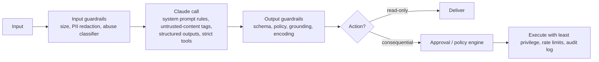

# CCAR-P Domain 5 — Governance, Safety & Risk Management (14%)

> **Track:** [CCAR-P](../README.md) · **Weight:** 14% (see [`registry.yaml`](../../registry.yaml)) ·
> **Objectives:** CCAR-P-5.1 to 5.5 · **Time:** ~5 hours including labs

The architect is accountable for making an AI system **safe enough to operate and defensible to an
auditor**. Scenario items usually present a design with a missing control and ask which control matters most,
or present a regulated context and ask which architecture choice satisfies it. This page is educational and
is not legal advice; compliance conclusions need your organisation's counsel and compliance team.

## Objectives

| ID | Objective | Where to study |
|---|---|---|
| CCAR-P-5.1 | Implement guardrails and safety controls | [Enterprise deployment controls](../../../12-ai-security/14-enterprise-deployment-controls.md), [Insecure output handling](../../../12-ai-security/06-insecure-output-handling.md) |
| CCAR-P-5.2 | Identify risks, limitations and failure modes of LLM systems | [LLM threat modelling](../../../12-ai-security/01-llm-threat-modelling.md), [Capabilities and limitations](../../../01-ai-and-llm-fundamentals/07-capabilities-and-limitations.md) |
| CCAR-P-5.3 | Apply human-in-the-loop validation | [Human in the loop](../../../10-agentic-ai/05-human-in-the-loop.md), [Human oversight](../../../12-ai-security/13-human-oversight.md) |
| CCAR-P-5.4 | Ensure regulatory compliance (e.g. GDPR, HIPAA, FedRAMP) | [Data governance and compliance](../../../13-enterprise-ai-architecture/05-data-governance-and-compliance.md), [AI governance](../../../12-ai-security/12-ai-governance.md) |
| CCAR-P-5.5 | Address bias, fairness and transparency | [AI governance](../../../12-ai-security/12-ai-governance.md), [Responsible use](../../../02-claude-fundamentals/05-responsible-use.md) |

## Key concepts

- **Defence in depth.** Independent layers of control so that no single failure (including a successful
  prompt injection) causes harm.
- **Excessive agency.** An LLM system that has more functionality, permissions or autonomy than it needs
  (an entry in the [OWASP Top 10 for LLM Applications](https://genai.owasp.org/llm-top-10/)).
- **Indirect prompt injection.** Malicious instructions arriving through content the model reads (web pages,
  emails, documents, tool results) rather than from the user.
- **Human-in-the-loop (HITL), on-the-loop, and out-of-the-loop.** A human approves before action; a human
  monitors and can intervene; no human involvement.
- **Data minimisation.** Sending only the data the task needs, for only as long as needed.
- **Transparency.** Users know they are interacting with AI, know its limits and can contest outcomes.

## Detailed technical notes

### 5.1 Guardrails and safety controls

| Control | Mitigates | Notes |
|---|---|---|
| Untrusted-content delimiting and instruction hierarchy | Prompt injection | Helps, but is not sufficient alone |
| Least-privilege tools, read/write split | Excessive agency | The most reliable way to cap impact |
| Approval for consequential actions | Unauthorised actions | Design the approval UI so reviewers see what will happen |
| Output encoding and validation | Insecure output handling (XSS, SQL, command injection) | Treat model output as untrusted |
| PII detection and redaction | Data leakage | At input, in logs and in outputs |
| Rate limits and budgets | Runaway agents, cost attacks | Per user, per tool, per session |
| Refusal handling | Classifier-triggered refusals | Check `stop_reason == "refusal"`; current models support server-side fallbacks on the Claude API (as of 2026-10-24) |
| Audit logging | Accountability, forensics | Immutable, access-controlled, with retention policy |

### 5.2 Risks, limitations and failure modes

| Failure mode | Example | Primary control |
|---|---|---|
| Hallucination | Invented policy clause | Grounding with citations, "not found" path, eval on faithfulness |
| Prompt injection (direct and indirect) | Email tells the agent to forward invoices | Least privilege, content isolation, approval, detection evals |
| Data exfiltration | Agent writes secrets into a URL it fetches | Egress allow-lists, no secrets in context, output filters |
| Excessive agency | Agent with delete rights "cleans up" records | Narrow tools, approvals |
| Insecure output handling | Model output rendered as HTML | Encode and validate |
| Supply-chain compromise | Malicious MCP server or skill package | Pin versions, review, allow-lists, provenance |
| Over-reliance | Reviewers rubber-stamp drafts | Spot audits, calibrated confidence, UX friction for risky approvals |
| Drift | Quality degrades as data or users change | Monitoring and eval refresh |
| Bias | Different quality across languages or groups | Sliced evals, fairness review |
| Availability | Rate limits or outage during peak | Retries with backoff, fallbacks, queueing, capacity planning |

Use a structured method: draw the data flow, mark trust boundaries (user, untrusted content, model, tools,
systems of record), apply STRIDE plus LLM-specific threats, rank by likelihood and impact, and assign controls
and owners. See [practical exercise 3](../practical-exercises.md).

### 5.3 Human-in-the-loop validation

Decide oversight level by **impact × reversibility × confidence**:

| Impact if wrong | Reversible? | Oversight |
|---|---|---|
| Low | Yes | Automate; monitor samples |
| Medium | Yes | Human on the loop: automate, with alerts and easy undo |
| High | Yes | Human in the loop for low-confidence cases; sampled audit for others |
| High | No (payments, legal notices, clinical decisions, deletions) | Human approval always; model drafts, human decides |

Good HITL design: show the reviewer the evidence (sources, tool results, the proposed action) not just the
conclusion; make "reject" and "edit" as easy as "approve"; measure reviewer agreement and time; capture edits
as training data for evals; avoid alert fatigue by routing only cases that need judgement. In agent
frameworks, approvals are implemented as a pause before tool execution (for example, permission prompts or
`ask` rules in Claude Code, confirmation events in Managed Agents, or your own approval step in a tool loop).

### 5.4 Regulatory compliance

The architect's job is to translate obligations into **controls and evidence**.

| Regime | Core obligations relevant to LLM systems | Architecture controls |
|---|---|---|
| GDPR (EU/EEA personal data) | Lawful basis, purpose limitation, minimisation, transparency, data-subject rights (access, erasure), DPIA for high-risk processing, international transfer safeguards, processor agreements | Data maps; minimisation and pseudonymisation before the model call; regional processing where required; retention limits for prompts, logs and vector stores; deletion propagation into indexes; DPA with providers; DPIA |
| HIPAA (US protected health information) | Business associate agreement with vendors handling PHI, minimum necessary use, access controls, audit controls, transmission security | Only use services covered by a BAA; minimum-necessary context; encryption in transit and at rest; access logging; de-identification where possible |
| FedRAMP (US federal cloud services) | Use of cloud services with an appropriate FedRAMP authorisation level and boundary | Deploy through a platform and region whose authorisation covers the use (for example, a government cloud region of a hyperscaler); keep data inside the authorised boundary |
| EU AI Act (risk-based obligations) | Transparency duties; heavier obligations for high-risk uses | Classify the use case early; document; human oversight; logging |

As of 2026-10-24, the [API and data retention](https://platform.claude.com/docs/en/manage-claude/api-and-data-retention)
page says: zero data retention is arranged per organisation through Anthropic sales; HIPAA-ready API access needs a signed
BAA (standard BAA in the Claude Console, or a negotiated one through sales); a feature eligibility table lists which API
features each arrangement covers; and the Claude Team and Enterprise product interfaces are not ZDR-eligible. On Amazon
Bedrock and Google-managed Claude models on Google Cloud, the cloud provider is the data processor, so its own terms apply.

> **Unverified:** which FedRAMP authorisations cover which Claude models, regions and features, and what your own
> contract adds or excludes. Check the [Anthropic Trust Center](https://trust.anthropic.com), the
> [Privacy Center](https://privacy.anthropic.com), the relevant cloud provider's compliance pages and your contract.

Cross-cutting governance frameworks: the [NIST AI Risk Management Framework](https://www.nist.gov/itl/ai-risk-management-framework)
(Govern, Map, Measure, Manage) and ISO/IEC 42001 for AI management systems. Platform-level controls that
support compliance include data residency choices (for example `inference_geo` on supported models and
platforms as of 2026-10-24), zero-data-retention arrangements where contracted, workspace separation and
admin controls.

### 5.5 Bias, fairness and transparency

- **Measure:** build eval slices by language, dialect, region and (where lawful and appropriate) demographic
  proxies; compare accuracy, refusal and escalation rates across slices. Counterfactual tests swap names or
  attributes and check that decisions do not change.
- **Mitigate:** remove irrelevant protected attributes from context; standardise prompts; keep humans
  accountable for consequential decisions about people (credit, employment, health, housing); document
  limitations.
- **Transparency:** disclose AI involvement; provide explanations grounded in sources; offer a route to a
  human and to contest outcomes; publish model and system cards internally.
- **Govern:** an AI review board or equivalent, a use-case register with risk tiering, and periodic re-review.

## Decision framework: control selection by risk tier

| Risk tier | Example | Minimum controls |
|---|---|---|
| Tier 1 (internal, low impact) | Internal knowledge assistant | Acceptable-use policy, logging, basic evals |
| Tier 2 (customer-facing, reversible) | Support reply drafting | Tier 1 plus grounding, PII controls, injection tests, sampled human review |
| Tier 3 (consequential, regulated) | Credit-decision support, clinical summaries | Tier 2 plus HITL approval, DPIA/legal review, fairness evals, full audit trail, documented model and prompt versions |

## Worked design scenario

*Contoso Health* wants an assistant that drafts discharge summaries from EHR notes for physicians.

- **Classification:** Tier 3 (clinical, PHI, consequential).
- **Compliance:** only services covered by the organisation's BAA; minimum-necessary note extraction; data
  stays in the approved region; prompts and outputs retained per medical-records policy, not in general logs.
- **Guardrails:** structured output with required sections; every medication and dosage must cite a source
  note line; an automated check flags any medication not found in the source.
- **HITL:** the physician must review and sign; the UI highlights unsupported or changed statements.
- **Fairness:** eval slices by note language and patient age group; quarterly review.
- **Transparency:** summary labelled as AI-drafted, physician-approved.

## Anti-patterns

- "The system prompt tells it not to" as the only safety control.
- Approval steps that show only the model's conclusion, not the evidence or the action.
- Logging PHI or personal data into general observability tools.
- Treating compliance as a launch checklist rather than a lifecycle obligation (retention, deletion, re-review).
- Assuming a provider's certification covers your whole system.
- Fairness checked once on aggregate accuracy.

## Labs and further practice

- [Lab 13: Human in the loop](../../../19-hands-on-labs/lab-13-human-in-the-loop/README.md)
- [Lab 14: Prompt injection testing](../../../19-hands-on-labs/lab-14-prompt-injection-testing/README.md)
- [Lab 15: Sensitive data protection](../../../19-hands-on-labs/lab-15-sensitive-data-protection/README.md)
- [OWASP LLM mapping](../../../12-ai-security/owasp-llm-mapping.md)
- [AI security cheat sheet](../../../22-cheat-sheets/ai-security.md)

## Self-check

1. Why is least privilege more reliable than prompt instructions against injection?
2. A payment-initiation agent achieves 99.5% accuracy in evals. Should it execute payments without approval?
3. Name three GDPR obligations that affect a RAG system's vector store.
4. What makes a human review step effective rather than a rubber stamp?
5. How do you test for fairness when demographic data is not collected?

Answers

1. Injection can bypass instructions, but it cannot grant permissions the system does not have; least privilege
   caps the impact regardless of what the model is persuaded to do.
2. No. Payments are high-impact and hard to reverse; keep human approval (or a deterministic policy engine with
   strict limits) and use the model to prepare and explain.
3. Minimisation (only needed data indexed), storage limitation (retention and re-indexing), and the right to
   erasure (deletion must propagate to embeddings and caches); also access control and transfer rules.
4. The reviewer sees evidence and the exact action, rejecting or editing is easy, reviewer performance is
   measured and audited, and only cases needing judgement are routed.
5. Use counterfactual tests (swap names, dialects or attributes in otherwise identical inputs), slice by available
   proxies such as language or region, and review qualitative samples.

