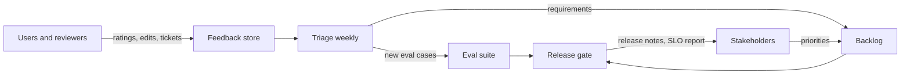
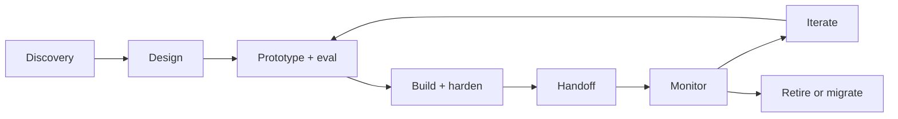

# CCAR-P Domain 6 — Stakeholder Communication & Lifecycle Management (14%)

> **Track:** [CCAR-P](../README.md) · **Weight:** 14% (see [`registry.yaml`](../../registry.yaml)) ·
> **Objectives:** CCAR-P-6.1 to 6.5 · **Time:** ~4 hours including labs

A technically correct design that the business does not understand, fund or trust will not reach
production. This domain tests how you run discovery, explain trade-offs, set and manage expectations
(including SLAs), document decisions and carry a solution through its lifecycle. Expect items such as "the
sponsor wants X by Friday; what do you do first?" where the best answer is the one that reduces risk and
keeps decisions explicit.

## Objectives

| ID | Objective | Where to study |
|---|---|---|
| CCAR-P-6.1 | Run structured discovery and requirements gathering | [Solution design process](../../../13-enterprise-ai-architecture/01-solution-design-process.md), [Stakeholder communication](../../../13-enterprise-ai-architecture/06-stakeholder-communication.md) |
| CCAR-P-6.2 | Communicate architectural decisions and trade-offs | [Architecture decision records](../../../13-enterprise-ai-architecture/07-architecture-decision-records.md) |
| CCAR-P-6.3 | Manage stakeholder feedback loops and expectations, including SLAs | [Stakeholder communication](../../../13-enterprise-ai-architecture/06-stakeholder-communication.md), [Production readiness](../../../15-production-operations/01-production-readiness.md) |
| CCAR-P-6.4 | Document architectures and give implementation guidance | [ADRs](../../../13-enterprise-ai-architecture/07-architecture-decision-records.md), [Reference architectures](../../../13-enterprise-ai-architecture/03-reference-architectures.md) |
| CCAR-P-6.5 | Support lifecycle phases (discovery, design, handoff, monitoring, iteration) | [Lifecycle management](../../../13-enterprise-ai-architecture/09-lifecycle-management.md), [Model upgrades and change management](../../../15-production-operations/08-model-upgrades-and-change-management.md) |

## Key concepts

- **Discovery.** Structured investigation of the problem, users, data, constraints, risks and success
  criteria before committing to a design.
- **Architecture decision record (ADR).** A short document that records one decision: context, options,
  decision, consequences and status.
- **SLA, SLO, SLI.** An SLA is a commitment to a customer (often with consequences); an SLO is an internal
  target; an SLI is the measured indicator. For LLM systems, quality SLIs sit next to availability and latency.
- **RACI.** Who is Responsible, Accountable, Consulted and Informed for each decision and operational task.
- **Handoff.** The transfer from the build team to the operating team, with runbooks, dashboards, eval suites
  and ownership.

## Detailed technical notes

### 6.1 Structured discovery

Discovery workstreams and the questions that matter for Claude solutions:

| Workstream | Questions | Artefact |
|---|---|---|
| Problem and value | What outcome, for whom, measured how? What happens today and what does it cost? | Value hypothesis, baseline metrics |
| Users and workflow | Who uses it, in which tool, at what step? Who reviews outputs? | Journey map, current-state process |
| Data | What inputs exist, where, how sensitive, how fresh, who owns them, what permissions apply? | Data inventory and classification |
| Integration | Which systems must be read or written? APIs, MCP servers, identity provider? | Context diagram |
| Risk and compliance | Regulated data? Consequential decisions? Required approvals? | Risk tier, DPIA trigger |
| Quality | What does "good" look like? Can SMEs label 100 examples? | Success criteria, seed eval set |
| Non-functionals | Latency, volume, peak, availability, cost ceiling, residency | NFR list |
| Organisation | Sponsor, budget, change impact, training needs | Stakeholder map, RACI |

Techniques: interview users *and* reviewers, shadow the current process, collect real (de-identified)
examples early, run a time-boxed feasibility spike against a small eval set, and confirm a single accountable
business owner.

### 6.2 Communicating decisions and trade-offs

Tailor the message to the audience:

| Audience | Cares about | Lead with |
|---|---|---|
| Executive sponsor | Value, risk, cost, timeline | Outcome, options with cost and risk, recommendation, decision needed |
| Risk, legal, compliance | Data use, controls, accountability | Data flows, controls mapped to obligations, residual risk |
| Engineering | Interfaces, operability, effort | Architecture, contracts, eval and release process |
| End users | What changes for them, how to trust it | Workflow, limits, how to give feedback and escalate |
| Security | Trust boundaries, identities, attack surface | Threat model, privilege model, logging |

Present trade-offs as **options with consequences**, not as a single answer: for example, "Option A meets the
latency SLO at higher cost; Option B halves cost but needs a 2-second relaxation of the p95 target; Option C
meets both but delays launch by six weeks for retrieval work". Be explicit about uncertainty: LLM quality is
statistical, so communicate rates and confidence ("94% field accuracy on a 600-item test set") rather than
promises ("it will be accurate").

ADR template:

```markdown
# ADR-012: Use a router workflow with a bounded agent for delay escalations
Status: Accepted (2026-10-24)
Context: volumes, SLA, risk tier, constraints, eval results
Options considered: A single agent; B router + bounded agent; C rules only
Decision: B
Consequences: positive, negative, follow-up actions, review date
Evidence: eval run IDs, cost model, threat model reference
```

### 6.3 Feedback loops, expectations and SLAs

- **Set expectations early:** LLM systems are probabilistic; agree acceptable error rates, the human fallback
  and what happens when the model refuses or is unavailable.
- **Define SLOs across four dimensions:** availability, latency (time to first token and total, p95/p99),
  quality (eval score on sampled traffic, escalation rate) and cost (cost per completed task, monthly ceiling).
- **Account for dependencies:** your SLA cannot exceed what upstream services support without fallbacks;
  design queueing, retries with backoff, fallback models or a degraded mode (for example, a templated reply).
- **Feedback channels:** in-product thumbs-up/down with reasons, reviewer edit capture, a regular review with
  the business owner, and a published changelog of prompt and model versions.
- **Change expectations deliberately:** when an eval shows a target is unachievable at the agreed cost, raise
  it early with options, not at launch.



### 6.4 Documentation and implementation guidance

A complete handover pack for a Claude solution:

| Document | Contents |
|---|---|
| Architecture overview | Context diagram, component diagram, data flows with trust boundaries |
| ADR log | Every significant decision with status |
| Prompt and configuration registry | Prompt versions, model IDs, effort levels, tool definitions, owners |
| Eval suite and report | Datasets, graders, thresholds, latest scorecard |
| Threat model and control matrix | Threats, controls, residual risk, owners |
| Runbooks | Incident response for refusal spikes, latency, cost overrun, injection incident, model deprecation |
| Implementation guide | Coding standards (structured outputs, `stop_reason` handling, retries, no secrets in prompts), reference code, environment setup |
| Operating model | RACI, on-call, review cadences, change process |

Implementation guidance should be **prescriptive where it protects safety and consistency** (identity,
logging, output validation, release gates) and **flexible elsewhere**.

### 6.5 Lifecycle phases



| Phase | Architect's exit criteria |
|---|---|
| Discovery | Value hypothesis, risk tier, data inventory, seed eval set, go/no-go |
| Design | Architecture, ADRs, threat model, cost model, NFRs agreed |
| Prototype | Eval results against bar on dev/validation sets; feasibility confirmed |
| Build and harden | Security review, load test, observability, runbooks, test-set results |
| Handoff | Operating team trained; ownership and on-call accepted; dashboards live |
| Monitor | SLO reports, drift detection, cost tracking, feedback triage |
| Iterate | Every change goes through the eval gate; ADRs updated |
| Model change | Migration plan: read migration notes, re-baseline tokens, re-run evals, shadow, canary, rollback plan |
| Retire | Data deletion, index removal, credential revocation, user communication |

Model lifecycle matters specifically: models are deprecated and retired on published schedules, new
models change behaviour and request rules (for example, current models reject sampling parameters and
prefill), so pin model IDs, track deprecation notices and budget for migration work.

## Worked design scenario

*Tailspin Manufacturing's* COO asks for an assistant that "decides all warranty claims automatically" within
four weeks. Discovery finds that claims above a cost threshold need engineering sign-off, 30% of claims are
written in Spanish, claim photos matter, and no labelled data exists.

Your response:

1. Reframe the outcome: "reduce median claim decision time by 60% while keeping decision agreement with
   senior assessors at 97%+".
2. Present options: (A) full automation in four weeks, high risk, no eval baseline; (B) assistive assessment
   with auto-approval under a low cost threshold after a four-week pilot; (C) rules-only automation of the
   simplest 20%. Recommend B, with A's scope reconsidered after pilot data.
3. Agree SLOs: p95 assessment time under 30 s, agreement rate 97%, escalation path within one business day.
4. Plan labelling of 300 historical claims (both languages, with photos) with senior assessors.
5. Record ADR-001 and share a one-page summary with the COO, engineering, finance and compliance.

## Anti-patterns

- Committing to a deadline or accuracy figure before an eval exists.
- One slide deck for every audience.
- Decisions made in meetings and never recorded.
- Handoff without runbooks, eval suites or a named owner.
- Treating launch as the end; no budget for monitoring, iteration or model migration.
- Promising 100% accuracy or "no hallucinations".

## Labs and further practice

- [Lab 20: Secure enterprise architecture](../../../19-hands-on-labs/lab-20-secure-enterprise-architecture/README.md)
- [Lab 18: Reliability engineering](../../../19-hands-on-labs/lab-18-reliability-engineering/README.md)
- [Lab 19: Observability](../../../19-hands-on-labs/lab-19-observability/README.md)
- [Stakeholder and behavioural interview questions](../../../21-interview-preparation/stakeholder-and-behavioural.md)
- [Practical exercise 1: ADR](../practical-exercises.md)

## Self-check

1. What five sections does an ADR need?
2. Which four dimensions should SLOs for a Claude solution cover?
3. A sponsor asks for "no hallucinations". How do you respond?
4. What must exist before handoff to an operating team?
5. What steps belong in a model-upgrade plan?

<details>
<summary>Answers</summary>

1. Context, options considered, decision, consequences and status (plus evidence links and a date).
2. Availability, latency, quality and cost.
3. Reframe as a measurable target (for example, unsupported-claim rate below a threshold on a defined test
   set), explain the controls (grounding, citations, review) and agree what happens when errors occur.
4. Runbooks, dashboards and alerts, the eval suite with thresholds, a configuration registry, a threat model,
   named owners and on-call, and trained operators.
5. Read the migration notes, update request parameters, re-baseline token counts, re-run the full eval, adjust
   prompts and effort, shadow and canary, monitor, and keep a rollback path until the old model's retirement.

</details>
