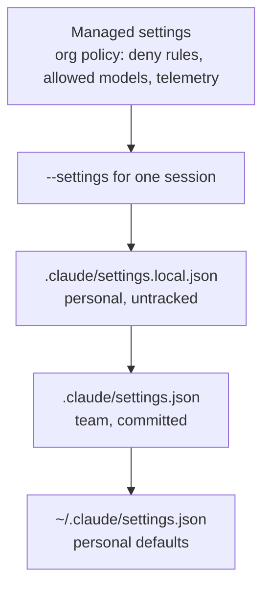

# CCAR-P Domain 7 — Developer Productivity & Operational Enablement (7%)

> **Track:** [CCAR-P](../README.md) · **Weight:** 7% (see [`registry.yaml`](../../registry.yaml)) ·
> **Objectives:** CCAR-P-7.1 to 7.3 · **Time:** ~3 hours including labs

The smallest domain, but its content overlaps with security (Domain 3 and 5) and operations (Domain 4). The
architect's angle is **enablement at team scale**: a paved road that makes Claude Code productive and safe
for many developers, plus using AI-assisted tooling for debugging and operations. Claude Code facts on this
page were checked against [code.claude.com/docs](https://code.claude.com/docs) on 2026-10-24; the product
changes quickly, so re-check before relying on a detail.

## Objectives

| ID | Objective | Where to study |
|---|---|---|
| CCAR-P-7.1 | Configure Claude tools and environments for teams (e.g. Claude Code) | [Team rollout](../../../09-claude-code/08-team-rollout.md), [Permissions and settings](../../../09-claude-code/04-permissions-and-settings.md), [CLAUDE.md and memory](../../../09-claude-code/03-claude-md-and-memory.md) |
| CCAR-P-7.2 | Improve developer workflows with AI-assisted tooling | [Commands, skills, subagents](../../../09-claude-code/05-commands-skills-subagents.md), [Hooks](../../../09-claude-code/06-hooks.md), [Headless, CI and Agent SDK](../../../09-claude-code/09-headless-ci-and-agent-sdk.md) |
| CCAR-P-7.3 | Support debugging and operational issue resolution | [Incident response](../../../15-production-operations/07-incident-response.md), [Headless, CI and Agent SDK](../../../09-claude-code/09-headless-ci-and-agent-sdk.md) |

## Key concepts

- **Settings scopes.** Managed (organisation policy), user (`~/.claude/settings.json`), shared project
  (`.claude/settings.json`, committed) and project local (`.claude/settings.local.json`, personal, kept out of
  git).
- **Permission rules.** `allow`, `ask` and `deny` rules naming a tool and a pattern, for example
  `Bash(npm run test *)` or `Read(./.env)`.
- **CLAUDE.md.** Standing instructions and project knowledge loaded into context (organisation, user, project
  and directory levels).
- **Hooks.** Shell commands (or other handlers) that run deterministically on lifecycle events such as before
  or after a tool call, which makes them the right place for enforcement.
- **Subagents, Skills, slash commands and plugins.** Reusable specialisations: subagents run in their own
  context with their own tools; Skills load on demand; plugins bundle commands, agents, skills, hooks and MCP
  servers for distribution.
- **Headless mode.** `claude -p "<prompt>"` for non-interactive runs in scripts and CI; the Claude Agent SDK
  exposes the same harness as a library.

## Detailed technical notes

### 7.1 Team configuration

Settings precedence (highest first): **managed settings → command-line `--settings` → project local →
shared project → user**. Managed settings cannot be overridden by any user or project file. List-valued keys
such as `permissions.allow` merge across files rather than replacing each other.



What goes where:

| Layer | Put here | Do not put here |
|---|---|---|
| Managed | Organisation-wide deny rules (secrets, production credentials), allowed models, telemetry, MCP server allow-lists | Team-specific workflow preferences |
| Shared project (`.claude/settings.json`) | Team permission rules for build/test/lint, hooks, enabled plugins, project env vars that are not secret | Secrets, personal preferences |
| Project `.mcp.json` | Project-scoped MCP servers the team shares | Credentials (use env var expansion or a secrets helper) |
| `CLAUDE.md` (committed) | Build and test commands, architecture notes, conventions, "do and don't" rules | Secrets; enforcement that must never be skipped (use hooks or permissions) |
| Project local | Personal overrides and experiments | Anything the team depends on |

Important behaviours to know (as of 2026-10-24):

- Shared-project `allow` rules and some other keys take effect only after a developer **trusts the
  folder**; `deny` and `ask` rules apply immediately.
- Permission modes `auto` and `bypassPermissions` set as `defaultMode` do not take effect from project or local
  settings; they must come from user or managed settings or a command-line flag. Treat bypass as unsuitable for
  shared or production-adjacent environments.
- `/status` shows which settings sources loaded; `claude doctor` reports rejected entries.

Example shared project settings (synthetic):

```json
{
  "$schema": "https://json.schemastore.org/claude-code-settings.json",
  "permissions": {
    "allow": ["Bash(make test)", "Bash(make lint)", "Bash(git diff *)"],
    "ask": ["Bash(git push *)"],
    "deny": ["Read(./.env)", "Read(./.env.*)", "Read(./secrets/**)", "Bash(curl *)"]
  },
  "hooks": {
    "PreToolUse": [
      {
        "matcher": "Bash",
        "hooks": [{ "type": "command", "command": "./.claude/hooks/block-prod-commands.sh" }]
      }
    ]
  }
}
```

Rollout pattern: pilot with a volunteer team, publish a starter `CLAUDE.md` and settings template, set managed
deny rules centrally, choose the API path (Claude subscription plans, Claude API, or a cloud platform such as
Bedrock or Vertex AI) to match procurement and data-residency needs, enable usage and cost monitoring
(OpenTelemetry export is supported), train developers on review discipline, then scale.

### 7.2 Improving developer workflows

| Mechanism | Use it for | Example |
|---|---|---|
| `CLAUDE.md` | Shared project knowledge | "Run `make test` before proposing a commit; services live in `svc/`" |
| Slash commands / Skills | Repeatable procedures | `/release-notes`, a "write-migration" skill with scripts and templates |
| Subagents | Focused tasks with isolated context and limited tools | A read-only code reviewer; a test-writer |
| Hooks | Deterministic enforcement and automation | Block edits to `infra/prod/`; run formatter after edits; log tool calls |
| MCP servers | Access to issue trackers, docs, observability, databases | Read-only connection to the incident tracker |
| Headless `claude -p` and CI integration | Automation in pipelines | PR review comments, changelog drafts, test triage |
| Claude Agent SDK | Building internal agents on the Claude Code harness | An internal "upgrade dependencies" bot |

Guidance: prefer **hooks and permissions for anything that must always happen**, and CLAUDE.md or Skills for
guidance the model should follow. Keep CLAUDE.md concise; very long memory files waste context and dilute the
important rules. Review AI-authored changes with the same rigour as human ones; require tests.

### 7.3 Debugging and operational issue resolution

Patterns for using Claude in operations:

- **Incident investigation:** a read-only agent with MCP access to logs, metrics and recent deploys summarises
  the timeline and candidate causes; a human decides on mitigation.
- **Log and stack-trace analysis:** pipe logs into headless Claude Code with a structured-output request for
  suspected component, evidence lines and next diagnostic step.
- **Runbook automation:** Skills that encode runbooks; hooks that require approval before any state-changing
  command.
- **Post-incident:** draft the timeline and post-incident review from chat and ticket history.

Debugging a Claude-powered application itself:

| Symptom | Check |
|---|---|
| 400 errors after a model change | Removed parameters (`temperature`, `top_p`, `top_k`, prefill, forced `tool_choice`, `budget_tokens`) |
| 429 errors | Rate limits per model; honour `retry-after`; backoff and queueing; capacity planning |
| 529 / overloaded or 5xx | Retries with jittered backoff; fallback route; degrade gracefully |
| Truncated output | `stop_reason == "max_tokens"`; raise `max_tokens` or stream |
| Empty or odd response | `stop_reason == "refusal"` or `pause_turn` not handled |
| Costs spiking | Cache hit ratio dropped (silent invalidator), loop runaway, larger context |

For Claude Code itself: `/status`, `claude doctor`, `--debug` output, checking which settings and MCP servers
loaded, and the troubleshooting guide in [24-troubleshooting](../../../24-troubleshooting/claude-code.md).

## Decision framework: guidance or enforcement?

| Requirement | Mechanism |
|---|---|
| "Should usually" (style, conventions) | `CLAUDE.md`, Skills |
| "Must never" (read secrets, touch production) | Managed or project `deny` rules, hooks, sandboxing, credentials not present |
| "Must always" (format, tests, audit log) | Hooks, CI checks |
| "Needs a human" (push, deploy, migrations) | `ask` rules, protected branches, CI approvals |

## Worked design scenario

*Wide World Importers* is rolling out Claude Code to 120 engineers across 15 repositories. Requirements: no
access to production secrets, consistent build and test behaviour, audit of tool use, and the ability to
query the internal incident tracker.

- Managed settings: deny reads of `.env*`, `**/secrets/**` and cloud credential files; restrict allowed models;
  enable OpenTelemetry export to the company's observability platform.
- A template repository with `.claude/settings.json` (allow build/test/lint commands, `ask` on `git push`), a
  `PreToolUse` hook that blocks commands targeting production contexts, a `PostToolUse` formatter hook, and a
  concise `CLAUDE.md`.
- A project `.mcp.json` entry for a **read-only** incident-tracker MCP server authenticated per user.
- A plugin packaging the team's review subagent and release-notes skill, distributed through an internal
  marketplace.
- Success metrics: PR cycle time, escaped defects, developer satisfaction and spend per engineer.

## Anti-patterns

- Putting "never read .env" in `CLAUDE.md` instead of a deny rule.
- Committing API keys or tokens in `.mcp.json` or settings files.
- Enabling bypass permissions on shared or CI machines with production credentials.
- A 2,000-line `CLAUDE.md` that nobody maintains.
- Unpinned, unreviewed third-party MCP servers or plugins.
- Measuring success by lines of code generated.

## Labs and further practice

- [Lab 10: Claude Code workflows](../../../19-hands-on-labs/lab-10-claude-code-workflows/README.md)
- [Lab 18: Reliability engineering](../../../19-hands-on-labs/lab-18-reliability-engineering/README.md)
- [Claude Code cheat sheet](../../../22-cheat-sheets/claude-code.md)
- [Practical exercise 5: team configuration](../practical-exercises.md)

## Self-check

1. In what order are Claude Code settings applied, from highest to lowest precedence?
2. Why is a hook better than a CLAUDE.md instruction for blocking production commands?
3. Where should a team-shared, read-only MCP server be configured, and how are its credentials handled?
4. Which `defaultMode` values cannot be set from project settings?
5. Name three checks when a Claude-powered service starts returning 400 errors after a model upgrade.

<details>
<summary>Answers</summary>

1. Managed, command-line `--settings`, project local, shared project, user.
2. A hook runs deterministically on every matching tool call and can block it; a CLAUDE.md instruction is
   guidance the model may not follow.
3. In the project's `.mcp.json` (committed), with credentials supplied from environment variables or per-user
   authentication, never written into the file.
4. `auto` and `bypassPermissions`.
5. Removed sampling parameters (`temperature`, `top_p`, `top_k`), assistant prefill, forced `tool_choice` of
   `any`/`tool`, and `budget_tokens` thinking configuration.

</details>
