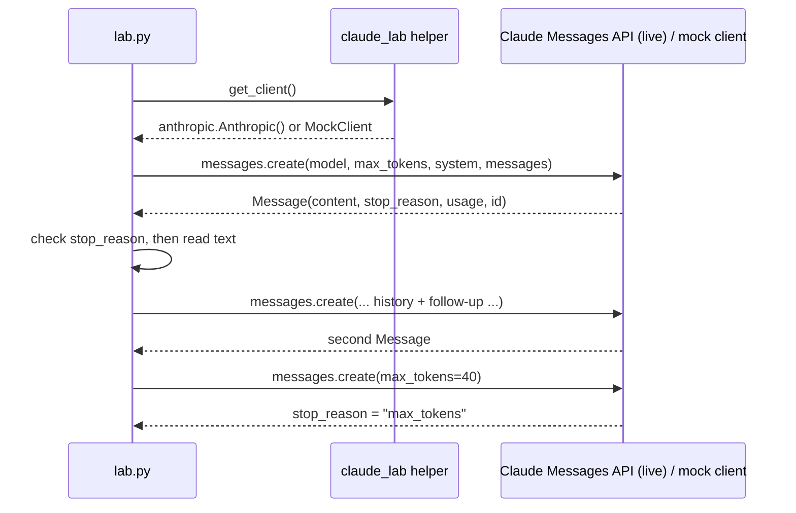

# Lab 01: Your first Claude interaction

## Objective

Send your first request to the Claude Messages API and learn to read everything that comes
back. By the end of this lab you can:

- write a request with a `system` prompt and a `user` message;
- name the fields of a response (`content`, `stop_reason`, `usage`, `id`, `model`);
- continue a conversation by resending the history, because the API keeps no state between calls;
- detect a cut-off answer by checking `stop_reason` before you use the text.

The scenario: *Northwind Lending*, a fictional consumer lender, wants a help-centre assistant that
explains loan terms in plain English without giving personal financial advice.

## Level / Time / Cost

| | |
|---|---|
| Level | Beginner |
| Time | About 30 minutes |
| Mock mode | Free. Runs offline with canned responses. |
| Live mode | Makes 3 small requests to `claude-opus-5-5`. At the published rate of US$4 per million input tokens and US$20 per million output tokens (as of 2026-10-24, see the [pricing page](https://platform.claude.com/docs/en/about-claude/pricing)), the whole run costs well under US$0.05. |

> **Cost:** requires API credits (live mode).

## Prerequisites

- Python 3.10 or later.
- The lab environment from the [labs README](../README.md) (a virtual environment with
  [`requirements.txt`](../requirements.txt) installed is only needed for live mode).
- Helpful background: [How Claude works](../../02-claude-fundamentals/01-how-claude-works.md) and
  [Your first conversation](../../02-claude-fundamentals/02-first-conversation.md).

## Architecture



The shared helper [`common/claude_lab.py`](../common/claude_lab.py) decides which client you get.
In mock mode it also rejects request mistakes that the real API rejects for current models, such as
sending `temperature` or ending the message list with an assistant turn (prefill).

## Setup

From the repository root:

```bash
cd 19-hands-on-labs
python -m venv .venv && source .venv/bin/activate      # optional for mock mode
pip install -r requirements.txt                         # needed for live mode only
```

For live mode, export your key in the shell (never commit it):

```bash
export ANTHROPIC_API_KEY="your key from the Claude Console"
```

If you have used `ant auth login`, the SDK finds that profile and you do not need the variable.

## Walkthrough of the sample code

Open [`lab.py`](lab.py) alongside this section.

1. **Imports.** The lab adds `../common` to `sys.path` and imports `get_client`, `MODEL`,
   `register_mock`, `text_of` and `banner`. `MODEL` defaults to `claude-opus-5-5`; override it with
   the `CLAUDE_LAB_MODEL` environment variable.
2. **System prompt.** [`data/system_prompt.txt`](data/system_prompt.txt) sets the role (help-centre
   assistant), the audience (non-experts), the boundaries (concepts only, no personal advice, no
   personal data) and a required closing sentence. Keeping it in a file makes it easy to review and
   version.
3. **The request.** `client.messages.create(...)` takes four things you will use in every lab:
   - `model`: the model ID, with no date suffix.
   - `max_tokens`: a hard ceiling on the tokens Claude may generate, including thinking. It is not a
     target length.
   - `system`: instructions that apply to the whole conversation.
   - `messages`: the conversation so far, starting with a `user` turn.

   The lab also sets `output_config={"effort": "low"}`. On `claude-opus-5-5` thinking is adaptive and
   always on, and `effort` is how you tune depth. The default for this model is `medium`; a short
   definition does not need more than `low`. The lab sends no `temperature`, because current models
   reject sampling parameters.
4. **`describe()`** prints the response fields. `content` is a list of blocks. You may see a
   `thinking` block before the `text` block in live mode; [`text_of()`](../common/claude_lab.py) joins
   only the text blocks. `usage` counts input and output tokens, which is what you are billed for.
   `_request_id` (live only) is the ID to quote if you contact support.
5. **`safe_answer()`** checks `stop_reason` before trusting the text:
   - `end_turn`: Claude finished normally.
   - `max_tokens`: the answer was cut off. Raise `max_tokens` or ask for less.
   - `refusal`: a safety classifier declined the request; `stop_details` explains the category.
   - `tool_use` and `pause_turn` belong to later labs and are treated as unexpected here.
6. **Multi-turn.** The second call appends Claude's first reply (`first.content`) and a follow-up
   question to `messages`. If you skip the history, Claude has no idea what "an example" refers to.
   The mock responder asserts that three messages arrived, so a missing history fails loudly.
7. **Truncation.** The third call sets `max_tokens=40`. The response comes back with
   `stop_reason="max_tokens"`, and `safe_answer()` raises a clear error instead of passing a half
   sentence to the user.
8. **Self-checks.** The lab ends with pass/fail checks. Structural checks always apply. The wording
   check (the closing disclaimer) is strict in mock mode and advisory in live mode, because a real
   model may phrase things differently.

## Synthetic test data

| File | Purpose |
|---|---|
| [`data/system_prompt.txt`](data/system_prompt.txt) | The help-centre system prompt for the fictional Northwind Lending |

The questions are hard-coded in `lab.py`. No personal data is used anywhere in the lab.

## Execution steps

**1. Mock mode (offline, free).** From the repository root:

```bash
CLAUDE_LAB_MODE=mock python 19-hands-on-labs/lab-01-first-claude-interaction/lab.py
```

**2. Live mode (uses API credits).**

> **Cost:** requires API credits (live mode).

```bash
export ANTHROPIC_API_KEY="..."
CLAUDE_LAB_MODE=live python 19-hands-on-labs/lab-01-first-claude-interaction/lab.py
```

**3. Experiments to try in live mode.**

- Change `effort` to `"high"` and compare `usage.output_tokens`. Thinking tokens are billed as output.
- Ask an off-topic question ("What's a good pasta recipe?") and see whether the system prompt holds.
- Remove the line that appends `first.content` and watch the follow-up lose its context.

## Expected results

Mock-mode output from a real run (message IDs are random and will differ):

```text
=== Lab 01 - First Claude interaction ===  [MOCK — offline, no credits used; model=claude-opus-5-5]

Step 1: single request with a system prompt
  id            : msg_mock_69cf89967415
  model         : claude-opus-5-5
  role          : assistant
  stop_reason   : end_turn
  content blocks: ['text']
  usage         : input_tokens=193, output_tokens=104

  Claude says:
  An annual percentage rate (APR) is the yearly cost of a loan expressed as a percentage. Unlike the plain interest rate, it also includes most fees you pay to take out the loan, such as an origination fee. That makes APR the better number for comparing two loan offers side by side.

This is general information, not financial advice. A Northwind Lending loan specialist can explain the figures on your own offer.

Step 2: a follow-up turn (the full history is sent again)
  id            : msg_mock_c5ce99176b72
  model         : claude-opus-5-5
  role          : assistant
  stop_reason   : end_turn
  content blocks: ['text']
  usage         : input_tokens=337, output_tokens=96

  Claude says:
  Here is a simple illustration with made-up numbers. Offer A has a 9.0% interest rate and no fees. Offer B has an 8.5% interest rate but adds a 3% origination fee. Once the fee is spread across the loan term, Offer B's APR can end up higher than Offer A's, so Offer A may cost less overall even though its headline rate is higher.

This is general information, not financial advice.

Step 3: a deliberately tiny max_tokens to trigger truncation
  id            : msg_mock_99b6adc30664
  model         : claude-opus-5-5
  role          : assistant
  stop_reason   : max_tokens
  content blocks: ['text']
  usage         : input_tokens=212, output_tokens=40
  Handled: The answer was cut off at max_tokens. Raise max_tokens or ask for less.

Self-checks
  [PASS] stop_reason is a documented value
  [PASS] first answer finished normally (end_turn)
  [PASS] usage reports input and output tokens
  [PASS] history alternates user/assistant/user
  [PASS] answer stays inside the system prompt's scope
  [PASS] truncation detected via stop_reason

All checks passed.
```

Notice that `input_tokens` grows from 193 to 337 on the second turn: you pay again for the history you
resend. Mock token counts are estimates (characters divided by four); live counts come from the API.

In live mode you will usually see a `thinking` block listed before `text` in `content blocks`, with
empty thinking text, because `claude-opus-5-5` omits thinking summaries unless you ask for them.

## Troubleshooting

| Symptom | Cause and fix |
|---|---|
| `Live mode needs the SDK` | Run `pip install -r 19-hands-on-labs/requirements.txt` in your virtual environment. |
| `AuthenticationError` (401) | `ANTHROPIC_API_KEY` is missing or wrong. Run `ant auth status` or re-export the key. Do not set both `ANTHROPIC_API_KEY` and `ANTHROPIC_AUTH_TOKEN`. |
| `NotFoundError` (404) for the model | The model ID is mistyped or not enabled for your organisation. Check `CLAUDE_LAB_MODEL`. |
| `ValueError: 'temperature' is not supported` | You added a sampling parameter. Current models reject it; tune the prompt or `effort` instead. |
| `assistant prefill is not supported` | Your `messages` list ends with an assistant turn. Always end with a `user` turn. |
| Step 1 fails with `max_tokens` in live mode | Thinking consumed the budget. Raise `max_tokens` or keep `effort` at `low`. |
| Self-check shows `[WARN]` in live mode | The model did not add the exact disclaimer. Tighten the system prompt and rerun; this is a prompt-quality signal, not a code bug. |

More fixes: [labs and repository troubleshooting](../../24-troubleshooting/labs-and-repository.md) and
[API errors](../../24-troubleshooting/api-errors.md).

## Security considerations

- **Credentials.** The key comes only from the environment or an `ant auth login` profile. Never paste
  it into `lab.py`, a notebook or a committed `.env`.
- **System prompts are not access control.** The "no personal data" rule shapes Claude's behaviour,
  but your application must still avoid sending personal data it does not need (data minimisation).
- **Treat output as untrusted.** Before you show model text in a web page, escape it. Before you act on
  it, validate it. Later labs build on this.
- **Log carefully.** `describe()` prints IDs and token counts, not prompts. Prompts and responses can
  contain customer data, so decide deliberately what your logs keep.

## Cleanup

Nothing to clean up: the lab writes no files. Unset the key when you finish a live session
(`unset ANTHROPIC_API_KEY`) if you exported it in a shared terminal.

## Exam relevance

Objective IDs from [`registry.yaml`](../../16-certification-tracks/registry.yaml):

| Objective | How this lab covers it |
|---|---|
| CCAO-F-1.1 | Writing an effective first prompt for a business task |
| CCAO-F-5.3 | Writing system-level instructions with clear scope and boundaries |
| CCAO-F-2.1 | Checking that an output is complete (`stop_reason`) before using it |
| CCAR-P-2.2 | Designing a system prompt with guardrails |
| CCAR-P-2.4 | Seeing how resent history drives token usage |

## Next lab

[Lab 02: Prompt improvement](../lab-02-prompt-improvement/README.md) takes a weak prompt and improves it
step by step, measuring each change with a rubric.
