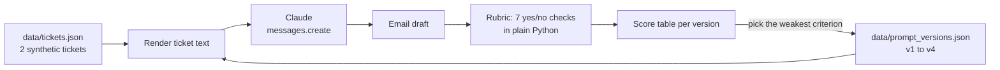

# Lab 02: Prompt improvement

## Objective

Turn a vague prompt into a reliable one through small, deliberate changes, and prove each change
helped with a measurable rubric instead of a gut feeling. By the end of this lab you can:

- name what is missing from a weak prompt (role, audience, goal, constraints, format, examples);
- separate instructions from data with XML tags;
- write a code-graded rubric of yes/no criteria and score outputs with it;
- read a score table and decide which criterion the next change should target.

The scenario: *Acme Logistics*, a fictional parcel carrier, wants Claude to turn internal
delivery-exception notes into short customer emails. The internal notes contain reference codes and
staff names that customers must never see.

## Level / Time / Cost

| | |
|---|---|
| Level | Beginner |
| Time | About 45 minutes |
| Mock mode | Free. Offline, deterministic outputs. |
| Live mode | 8 requests (4 prompt versions x 2 tickets) to `claude-opus-5-5` at `effort: low`. Each request is a few hundred tokens each way, so a full run costs a few US cents at the rates on the [pricing page](https://platform.claude.com/docs/en/about-claude/pricing) (US$4 / US$20 per million input / output tokens as of 2026-10-24). |

> **Cost:** requires API credits (live mode).

## Prerequisites

- [Lab 01](../lab-01-first-claude-interaction/README.md) completed.
- Reading: [Clear, direct instructions](../../03-prompt-engineering/01-clear-direct-instructions.md),
  [Structure with XML tags](../../03-prompt-engineering/02-structure-with-xml-tags.md),
  [Examples (few-shot)](../../03-prompt-engineering/03-examples-few-shot.md) and
  [Iterating on prompts](../../03-prompt-engineering/08-iterating-on-prompts.md).

## Architecture



The loop on the right is the point of the lab: score, find the weakest criterion, change one thing,
score again.

## Setup

```bash
cd 19-hands-on-labs
pip install -r requirements.txt     # live mode only
export ANTHROPIC_API_KEY="..."      # live mode only
```

## Walkthrough of the sample code

Open [`lab.py`](lab.py) and [`data/prompt_versions.json`](data/prompt_versions.json).

**The four prompt versions.** Each version changes one thing, so you can attribute the score change:

| Version | What changed | Why it helps |
|---|---|---|
| `v1-baseline` | "Write an update about this delivery problem." plus the raw ticket | Nothing tells Claude who the reader is, so it has to guess the tone and level of detail. |
| `v2-role-and-audience` | A system prompt naming the company, the reader and what the reader needs; the request names three must-haves | Claude now writes *to the customer* rather than *about the incident*. |
| `v3-structure-and-constraints` | The ticket goes inside `<ticket>` tags; explicit rules (no internal codes or staff names, 120-word limit, one plain-English cause) | Tags stop Claude confusing data with instructions. Explicit rules close the gaps the rubric found. |
| `v4-example-and-format` | One worked example in `<example>` tags and an exact output format (a fixed subject line) | Every email now has the same shape, which downstream systems and reviewers can rely on. |

Templates use `string.Template` with a `$ticket_text` placeholder, so curly braces in ticket data can
never break formatting.

**The rubric.** `score()` returns seven booleans. Each criterion is cheap, deterministic and tied to a
requirement:

| Criterion | Check |
|---|---|
| greets customer by name | first name appears |
| apologises | "sorry" or "apolog" appears |
| states the new date | the exact `new_date` string appears |
| gives a way to get help | the support address appears |
| no internal codes or staff names | regex for `EXC-1234`, `ABC-1`, `Van 17` patterns, plus the ticket's `internal_names` list |
| at most 120 words | word count |
| uses the subject-line format | output starts with `Subject: Update on your order <id>` |

Code-graded checks like these are ideal for format and safety rules. They cannot judge tone or
helpfulness well; [Lab 16](../lab-16-evaluation-framework/README.md) adds model-graded and human
review for that.

**The request.** `run_version()` sends the version's system prompt (if any) and the rendered user
message, with `effort: low` because this is short drafting. It checks `stop_reason` before scoring.
There is no prefill and no `temperature`: on current models you shape output with instructions,
examples and, when you need machine-readable output, structured outputs (Lab 03).

**Mock behaviour.** The mock responder looks for the techniques present in the prompt (an `Audience:`
line, `<ticket>` tags, an `<example>`) and returns a draft of matching quality. The drafts are
illustrative, written for this lab; they are not recorded model outputs.

**Self-checks.** The rubric itself is tested (deterministic, catches a leaked code, catches a leaked
name) and so is the improvement trend. In live mode the trend checks become warnings, because a real
model may already do well on `v2`, or slip on one ticket.

## Synthetic test data

| File | Contents |
|---|---|
| [`data/tickets.json`](data/tickets.json) | Two fictional delivery exceptions with customer name, order ID, dates, a support address on the reserved `.example` domain, an internal note full of codes, and the staff names that must not leak |
| [`data/prompt_versions.json`](data/prompt_versions.json) | The four prompt versions with a one-line description of each change |

Add a third ticket (for example a parcel damaged in transit) to see whether `v4` generalises.

## Execution steps

**1. Mock mode:**

```bash
CLAUDE_LAB_MODE=mock python 19-hands-on-labs/lab-02-prompt-improvement/lab.py
```

**2. Live mode:**

> **Cost:** requires API credits (live mode).

```bash
CLAUDE_LAB_MODE=live python 19-hands-on-labs/lab-02-prompt-improvement/lab.py
```

**3. Iterate yourself.** Add a `v5` entry to `prompt_versions.json` that targets whatever live mode
missed (often the word limit or a leaked staff name), rerun, and compare totals. Change one thing at a
time.

## Expected results

Mock-mode output from a real run:

```text
=== Lab 02 - Prompt improvement with a rubric ===  [MOCK — offline, no credits used; model=claude-opus-5-5]

--- v1-baseline: The first draft someone wrote in a hurry.
  T-1001: 1/7  missed: greets customer by name, apologises, states the new date, gives a way to get help, no internal codes or staff names, uses the subject-line format
    preview: Delivery update for order AL-58213.  Exception EXC-4471 was raised. EXC-4471 raised at depot BRS-2. Van 17 failed MOT check, driver Tomas reassigned. ...
  T-1002: 1/7  missed: greets customer by name, apologises, states the new date, gives a way to get help, no internal codes or staff names, uses the subject-line format

--- v2-role-and-audience: Say who Claude is writing as, who reads it, and what the reader needs.
  T-1001: 5/7  missed: no internal codes or staff names, uses the subject-line format
    preview: Hi Priya,  We're sorry your parcel is late. Because of an issue logged as EXC-4471 at our depot, your order AL-58213 will now arrive on 2026-11-05. If...
  T-1002: 5/7  missed: no internal codes or staff names, uses the subject-line format

--- v3-structure-and-constraints: Separate the data from the instructions with XML tags and state hard constraints.
  T-1001: 6/7  missed: uses the subject-line format
    preview: Dear Priya,  We apologise for the delay to order AL-58213. A problem on the original route means your parcel will now arrive on 2026-11-05. You don't ...
  T-1002: 6/7  missed: uses the subject-line format

--- v4-example-and-format: Add one worked example and an exact output format so every email looks the same.
  T-1001: 7/7
    preview: Subject: Update on your order AL-58213  Hi Priya,  We're sorry: your parcel will now arrive on 2026-11-05 instead of 2026-11-03 because of a problem o...
  T-1002: 7/7

Score by version
  version                          score  bar
  v1-baseline                      2/14   ##
  v2-role-and-audience            10/14   ##########
  v3-structure-and-constraints    12/14   ############
  v4-example-and-format           14/14   ##############

Self-checks
  [PASS] rubric is deterministic (same email, same score)
  [PASS] rubric catches a leaked internal code
  [PASS] rubric catches a leaked staff name
  [PASS] every version was scored on every ticket
  [PASS] final version beats the baseline
  [PASS] no version scored lower than the one before
  [PASS] final version meets every criterion

All checks passed.
```

Read the table the way you would in a real project: `v2` fixed tone and content but still leaked an
internal code, so `v3` added an explicit "never include internal codes" rule; `v3` met every content
rule but the format drifted, so `v4` added an example and an exact format.

## Troubleshooting

| Symptom | Cause and fix |
|---|---|
| `KeyError` or `ValueError` from `Template.substitute` | A prompt in `prompt_versions.json` uses `$` for something other than `$ticket_text`. Write a literal dollar sign as `$$`. |
| Live `v4` misses "uses the subject-line format" | The model added a greeting line before the subject. Restate "Output only the email" or move the format rule to the end of the prompt. |
| Live scores go *down* between versions | Usually a new rule conflicts with an old one. Compare the two prompts line by line and check the `missed:` list. |
| Every live score is low, including `v4` | Check the rubric before the prompt: print an email and confirm each criterion by hand. A wrong regex is a common cause. |
| `unexpected stop_reason max_tokens` | Raise `max_tokens`; thinking counts against it. |

See also [Prompts and outputs troubleshooting](../../24-troubleshooting/prompts-and-outputs.md).

## Security considerations

- **Data leakage through generated text.** Internal notes often contain codes, staff names and
  operational detail. The "no internal codes or staff names" criterion is a guardrail you can enforce
  in code on every email before it is sent, not just a test.
- **Minimise what you send.** If the email never needs the internal note, do not send it. Here the
  note is needed to explain the cause, so the prompt tells Claude how to summarise it instead.
- **Untrusted ticket text.** Ticket notes are written by people and systems you do not fully control.
  Wrapping them in `<ticket>` tags and telling Claude what the tags contain reduces, but does not
  remove, the risk of instructions hidden in the data. [Lab 14](../lab-14-prompt-injection-testing/README.md)
  tests this directly.
- **Human review.** Customer-facing messages that fail any rubric check should go to a person, not out
  of the door.

## Cleanup

No files are written. Delete any extra prompt versions you added if you want to reset the lab.

## Exam relevance

Objective IDs from [`registry.yaml`](../../16-certification-tracks/registry.yaml):

| Objective | How this lab covers it |
|---|---|
| CCAO-F-1.1 | Writing an effective prompt for a business task |
| CCAO-F-1.3 | Iterating on a prompt to improve output quality |
| CCAO-F-2.1 | Evaluating outputs for accuracy and completeness |
| CCAO-F-7.1 | Diagnosing and fixing an underperforming prompt |
| CCAR-P-2.3 | Applying few-shot examples |
| CCAR-P-4.3 | Iterative improvement measured against a fixed test set |
| CCAR-P-4.4 | Diagnosing prompt failures criterion by criterion |

## Next lab

[Lab 03: Structured outputs](../lab-03-structured-outputs/README.md) replaces "please output this
format" with a JSON Schema the API enforces.
