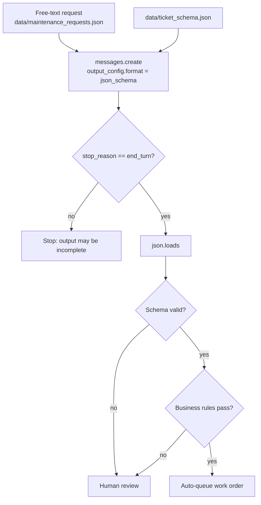

# Lab 03: Structured outputs

## Objective

Get machine-readable JSON from Claude that your code can trust, and learn the difference between
*shape* and *correctness*. By the end of this lab you can:

- send a JSON Schema in `output_config.format` so the API constrains the response to that shape;
- parse the response safely, checking `stop_reason` first;
- validate the result against the schema yourself as defence in depth;
- enforce business rules that a schema cannot express, and route failures to a person;
- use the SDK's `client.messages.parse()` helper with a Pydantic model (live mode).

The scenario: *Contoso Health*, a fictional healthcare provider, receives free-text facilities
maintenance requests from staff and wants them turned into consistent tickets for its work-order
system.

## Level / Time / Cost

| | |
|---|---|
| Level | Beginner |
| Time | About 45 minutes |
| Mock mode | Free and offline. |
| Live mode | 4 short requests to `claude-opus-5-5` at `effort: low` (3 extractions plus one `messages.parse()` demo). Roughly one or two US cents at the rates on the [pricing page](https://platform.claude.com/docs/en/about-claude/pricing) as of 2026-10-24. |

> **Cost:** requires API credits (live mode).

## Prerequisites

- [Lab 01](../lab-01-first-claude-interaction/README.md) and [Lab 02](../lab-02-prompt-improvement/README.md).
- Reading: [Structured output](../../03-prompt-engineering/06-structured-output.md) and
  [The Messages API](../../06-claude-api/02-messages-api.md).
- Basic familiarity with JSON. You do not need to know JSON Schema in depth; the lab explains the
  keywords it uses.

## Architecture



## Setup

```bash
cd 19-hands-on-labs
pip install -r requirements.txt     # live mode only; installs anthropic and pydantic
export ANTHROPIC_API_KEY="..."      # live mode only
```

## Walkthrough of the sample code

**1. The schema** ([`data/ticket_schema.json`](data/ticket_schema.json)). It uses only a few keywords:

| Keyword | Meaning here |
|---|---|
| `type` | `object`, `string`, `boolean`, `array` |
| `enum` | `category` and `priority` must be one of a fixed list, so downstream code can switch on them |
| `required` | every field must be present, even if its value is `"unknown"` |
| `additionalProperties: false` | no surprise fields |
| `items` | each affected item is a string |

Structured outputs support a subset of JSON Schema. Keep schemas simple (types, enums, required,
nested objects and arrays) and put numeric ranges, lengths and cross-field rules in code. Check the
[structured outputs documentation](https://platform.claude.com/docs/en/build-with-claude/structured-outputs)
for the current list of supported keywords.

**2. The request** (`extract_ticket()`):

```python
response = client.messages.create(
    model=MODEL,
    max_tokens=4096,
    system=SYSTEM,
    output_config={
        "effort": "low",
        "format": {"type": "json_schema", "schema": SCHEMA},
    },
    messages=[{"role": "user", "content": "<request id=\"MR-301\">...</request>"}],
)
```

`effort` and `format` live side by side inside `output_config`. The older top-level `output_format`
parameter on `messages.create()` is deprecated. You do not need, and on current models cannot use,
an assistant prefill such as `{` to coax JSON out: the schema does that job.

**3. Check `stop_reason`, then parse.** With a schema the API returns the JSON as a single text block.
If the response stopped for `max_tokens` or `refusal`, the JSON may be incomplete, so the lab stops
before `json.loads()`.

**4. Validate against the schema anyway.** `validate()` is a small standard-library validator for the
keywords above. The API's constrained decoding should make it redundant, but validating at your trust
boundary costs microseconds and protects you from configuration mistakes (for example, someone
removes `format` from the request) and from future code paths that skip structured outputs.

**5. Business rules.** `business_rules()` checks what a schema cannot: "a safety risk must be high or
critical priority", "summary at most 25 words", "at least one affected item". In mock mode, request
`MR-303` (a burning smell) comes back schema-valid but marked `medium` priority, and the rule sends it
to human review. That is the key lesson: **structured outputs guarantee shape, not truth.**

**6. `messages.parse()` (live only).** The SDK can build the schema from a Pydantic model and return a
validated object:

```python
response = client.messages.parse(
    model=MODEL,
    max_tokens=4096,
    system=SYSTEM,
    output_config={"effort": "low"},
    output_format=MaintenanceTicket,        # a Pydantic BaseModel class
    messages=[...],
)
ticket = response.parsed_output            # a MaintenanceTicket instance
```

The SDK merges the generated schema into `output_config.format` for you. `output_format` on
`parse()` takes a type; pass a raw schema dict through `output_config` instead. This was checked
against `anthropic` 2.3.0, the version range pinned in [`requirements.txt`](../requirements.txt).

## Synthetic test data

| File | Contents |
|---|---|
| [`data/maintenance_requests.json`](data/maintenance_requests.json) | Three fictional staff requests: a leaking tap, flickering lights, and a burning smell near an electrical cupboard |
| [`data/ticket_schema.json`](data/ticket_schema.json) | The ticket schema sent to the API and used by the local validator |

The requests contain no patient or personal data. Facilities tickets were chosen on purpose so the
lab never touches protected health information.

## Execution steps

**1. Mock mode:**

```bash
CLAUDE_LAB_MODE=mock python 19-hands-on-labs/lab-03-structured-outputs/lab.py
```

**2. Live mode:**

> **Cost:** requires API credits (live mode).

```bash
CLAUDE_LAB_MODE=live python 19-hands-on-labs/lab-03-structured-outputs/lab.py
```

**3. Experiments.**

- Add a fourth request that mentions no building at all and confirm the location fields come back as
  `"unknown"` rather than invented.
- Add `"urgency_reason": {"type": "string"}` to the schema without adding it to `required`, and see
  what the model does with an optional field.
- Remove the safety sentence from `SYSTEM` and see whether live mode still marks `MR-303` as high or
  critical.

## Expected results

Mock-mode output from a real run:

```text
=== Lab 03 - Structured outputs ===  [MOCK — offline, no credits used; model=claude-opus-5-5]

MR-301: {"category": "plumbing", "priority": "high", "location": {"building": "Riverside", "floor": "2", "area": "staff kitchen"}, "summary": "Hot water tap in the floor 2 staff kitchen is leaking onto the floor and getting worse.", "safety_risk": true, "affected_items": ["hot water tap", "kitchen floor"]}
  schema: valid
  business rules: ok
  route: auto-queue

MR-302: {"category": "lighting", "priority": "low", "location": {"building": "Harbour", "floor": "ground", "area": "meeting room B"}, "summary": "Two ceiling lights in meeting room B flicker constantly.", "safety_risk": false, "affected_items": ["ceiling light", "ceiling light"]}
  schema: valid
  business rules: ok
  route: auto-queue

MR-303: {"category": "electrical", "priority": "medium", "location": {"building": "Riverside", "floor": "4", "area": "electrical cupboard by the lifts"}, "summary": "Burning smell near the floor 4 electrical cupboard; area cleared, alarm not triggered.", "safety_risk": true, "affected_items": ["electrical cupboard"]}
  schema: valid
  business rules: ['safety risk flagged but priority is below high']
  route: human review

Live extra skipped in mock mode: client.messages.parse() needs the real SDK and pydantic.

Self-checks
  [PASS] every response parsed as JSON
  [PASS] every response matches the schema
  [PASS] validator rejects a missing required field
  [PASS] validator rejects an out-of-enum value
  [PASS] validator rejects an unexpected property
  [PASS] validator rejects a wrong nested type
  [PASS] safety rule routes the burning-smell ticket correctly
  [PASS] mock MR-303 is caught by the business rule

All checks passed.
```

In live mode you will usually see `MR-303` come back as `critical` and go to the auto-queue, because
the system prompt states the safety rule. Either outcome passes the "routes correctly" check: what
matters is that a safety risk never lands in the queue at low or medium priority.

## Troubleshooting

| Symptom | Cause and fix |
|---|---|
| `400 invalid_request_error` mentioning the schema | The schema uses a keyword structured outputs do not support. Simplify it and move the rule into `business_rules()`. |
| `400` mentioning `output_format` | You passed the deprecated top-level `output_format` to `messages.create()`. Use `output_config={"format": ...}`. |
| `TypeError: output_format must be a type` | On `messages.parse()`, `output_format` takes a Pydantic class. For a dict schema use `output_config`. |
| `json.decoder.JSONDecodeError` | Almost always a truncated response. Check `stop_reason` (the lab does) and raise `max_tokens`. |
| A 400 when combining with citations | Citations and `output_config.format` cannot be used in the same request. Use one or the other. |
| Live values look invented (a building that was never mentioned) | Tell the model what to do when a value is missing (`"unknown"`), as `SYSTEM` does, and test with a request that omits it. |

See also [Prompts and outputs troubleshooting](../../24-troubleshooting/prompts-and-outputs.md).

## Security considerations

- **Model output is untrusted input.** Even schema-valid JSON is data written by a model. Validate it,
  never `eval()` it, and escape string fields before rendering them in a web page or using them in SQL
  or shell commands.
- **Enums are an allow-list.** Constraining `category` and `priority` to fixed values means a crafted
  request cannot invent a new category that downstream code mishandles.
- **Fail safe.** Anything that fails schema or business checks goes to a human, not to the auto-queue.
  For safety-related routing, a false alarm is cheaper than a missed hazard.
- **No sensitive data in free text.** The requests here contain no personal or patient data. In a real
  deployment, tell staff not to include patient details in facilities tickets, and check for it.

## Cleanup

Nothing to clean up. The lab writes no files.

## Exam relevance

Objective IDs from [`registry.yaml`](../../16-certification-tracks/registry.yaml):

| Objective | How this lab covers it |
|---|---|
| CCAO-F-2.3 | Applying validation techniques to outputs |
| CCAO-F-2.4 | Deciding when an output needs human review |
| CCAO-F-2.6 | Choosing a structured data output format |
| CCAR-P-2.2 | Guardrails through schemas and enums |
| CCAR-P-5.1 | Implementing a safety control (safety risk routing) |
| CCAR-P-5.3 | Human-in-the-loop validation for failed checks |

## Next lab

[Lab 04: Document-grounded Q&A](../lab-04-document-grounded-qa/README.md) makes Claude answer only
from a supplied document, quote its evidence, and say so when the answer is not there.
