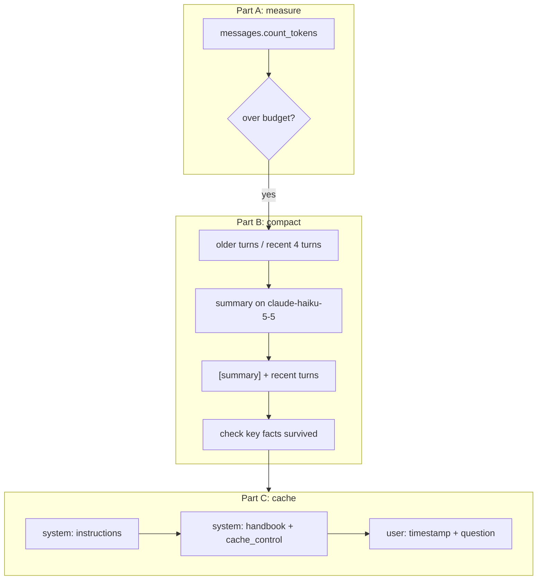

# Lab 05: Context management

## Objective

Control what goes into Claude's context window, what it costs, and what you can reuse. By the end of
this lab you can:

- count tokens with the API's token counting endpoint before you send a request;
- apply a compaction strategy: summarise older turns, keep recent turns verbatim, and check that key
  facts survive;
- lay out a prompt so prompt caching works (stable prefix first, volatile data after the breakpoint);
- read `cache_creation_input_tokens` and `cache_read_input_tokens` and turn them into cost.

The scenario: *Northwind Lending*'s support assistant sends a 600-word handbook with every request and
handles long conversations with applicants. Both make requests larger and slower than they need to be.

## Level / Time / Cost

| | |
|---|---|
| Level | Intermediate |
| Time | About 60 minutes |
| Mock mode | Free and offline. Includes a small cache simulator so you can see cache fields without the API. |
| Live mode | 8 short requests (6 to `claude-opus-5-5`, 1 summary on `claude-haiku-5-5`, 1 follow-up) plus 3 token-count calls. Under US$0.05 at the rates on the [pricing page](https://platform.claude.com/docs/en/about-claude/pricing) as of 2026-10-24. The token counting endpoint is free to use but rate limited; see the [token counting docs](https://platform.claude.com/docs/en/build-with-claude/token-counting). |

> **Cost:** requires API credits (live mode).

## Prerequisites

- [Lab 01](../lab-01-first-claude-interaction/README.md) to [Lab 04](../lab-04-document-grounded-qa/README.md).
- Reading: [Context windows](../../01-ai-and-llm-fundamentals/05-context-windows.md),
  [Managing long context](../../04-context-engineering/02-managing-long-context.md),
  [Prompt caching](../../04-context-engineering/03-prompt-caching.md) and
  [Compaction and context editing](../../04-context-engineering/05-compaction-and-context-editing.md).

## Architecture



In Part C everything left of the `cache_control` marker is the cacheable prefix. The order the API
renders a request in is `tools`, then `system`, then `messages`, and the cache is a prefix match: change
one byte early on and nothing after it can be reused.

## Setup

```bash
cd 19-hands-on-labs
pip install -r requirements.txt     # live mode only
export ANTHROPIC_API_KEY="..."      # live mode only
```

`CLAUDE_LAB_FAST_MODEL` (default `claude-haiku-5-5`) sets the model used for the summary.

## Walkthrough of the sample code

### Part A: count before you send

`count()` calls `client.messages.count_tokens(model=..., system=..., messages=...)`. Token counts are
model-specific, so pass the same model you will use for the real request. Do not estimate Claude tokens
with another vendor's tokenizer; it undercounts. The lab compares the conversation's size with
`HISTORY_BUDGET_TOKENS`. The budget is set artificially low (450 tokens) so a 14-message demo triggers
compaction; in production you would derive it from the model's context window, your `max_tokens` and
a safety margin.

### Part B: compaction you control

`compact()` splits the history into older turns and the most recent four, summarises the older turns
with the smaller model, and rebuilds the history as one summary turn followed by the recent turns. Three
design choices matter:

1. **Instruct the summariser about what must survive.** The prompt says to keep identifiers, amounts,
   dates, document status, open requests and preferences exactly. The self-check verifies four of them
   (`NL-APP-7731`, payslips, the 48-month request, email contact). Losing one means the agent asks the
   customer to repeat themselves.
2. **Keep recent turns verbatim.** The latest exchange carries the immediate context and tone;
   summarising it loses detail for little saving.
3. **Use the cheaper model for the summary.** Summarising a transcript is a well-bounded task.

The API also offers managed alternatives you should know about:

| Option | What it does | Notes (as of 2026-10-24) |
|---|---|---|
| Server-side compaction | The API summarises earlier context automatically near a threshold | Beta header `compact-2026-01-12`; you must append the full `response.content` (including compaction blocks) back to `messages` |
| Context editing | Clears old tool results or thinking blocks instead of summarising | Beta header `context-management-2025-06-27` with `clear_tool_uses_20250919` |
| Your own compaction (this lab) | You decide what to keep and can test it | Works on every model and platform |

### Part C: cache-friendly layout

The system prompt is a list of two text blocks. The handbook block carries
`"cache_control": {"type": "ephemeral"}`, which marks the end of the cacheable prefix.

- **Bad layout:** `Current time: ...` is the first line of the system prompt. Every request has a new
  timestamp, so the prefix is new every time: each request pays the cache *write* premium and never
  reads.
- **Good layout:** the system prompt is byte-for-byte identical across requests, and the timestamp moves
  into the user message after the breakpoint. Request 1 writes the cache; requests 2 and 3 read it.

`cost()` prices each request from its `usage` fields. `input_tokens` is only the *uncached* remainder;
the full prompt size is `input_tokens + cache_creation_input_tokens + cache_read_input_tokens`. For
`claude-opus-5-5` (from the claude-api skill pricing, cached 2026-10-06, checked 2026-10-24): base
input US$4/MTok, 5-minute cache writes 1.25x (US$5/MTok), cache reads US$0.20/MTok, output US$20/MTok.

**Minimum prefix size.** Prefixes below a model-specific minimum silently do not cache (no error, just
zero cache fields). The claude-api skill lists 512 tokens for `claude-opus-5-5`; check the
[prompt caching docs](https://platform.claude.com/docs/en/build-with-claude/prompt-caching) for your
model. The handbook is comfortably above that.

**The mock cache simulator.** In mock mode, `fake_cached_answer()` hashes everything up to the last
`cache_control` marker and remembers which prefixes it has seen, so cache fields behave like the real
API's for this exercise. Its token counts are estimates (characters divided by four).

## Synthetic test data

| File | Contents |
|---|---|
| [`data/support_handbook.md`](data/support_handbook.md) | A fictional 11-section support handbook, the stable content worth caching |
| [`data/long_conversation.json`](data/long_conversation.json) | A synthetic 14-message support conversation containing the facts compaction must preserve |

## Execution steps

**1. Mock mode:**

```bash
CLAUDE_LAB_MODE=mock python 19-hands-on-labs/lab-05-context-management/lab.py
```

**2. Live mode:**

> **Cost:** requires API credits (live mode).

```bash
CLAUDE_LAB_MODE=live python 19-hands-on-labs/lab-05-context-management/lab.py
```

Run Part C requests close together: the default cache lifetime is five minutes, refreshed on each hit.

**3. Experiments.**

- Move `cache_control` from the handbook block to the instructions block. The prefix is now tiny and
  falls under the minimum, so nothing caches.
- Change one word in `INSTRUCTIONS` between two live runs and watch the first good-layout request write
  a new cache entry.
- Lower `KEEP_RECENT_MESSAGES` to 2 and check whether the follow-up answer still knows the upload status.

## Expected results

Mock-mode output from a real run:

```text
=== Lab 05 - Context management ===  [MOCK — offline, no credits used; model=claude-opus-5-5]

Part A: count tokens before you send
  system prompt + handbook     : 1074 tokens
  14-message conversation      : 569 tokens (budget 450)
  over budget?                 : True

Part B: compact older turns, keep recent turns verbatim
  messages: 14 -> 5; tokens: 569 -> 280
  summary : Customer applied for 12,000 EUR (application NL-APP-7731), stage documents pending. Passport and an August utility bill uploaded. Payslip uploads failed because...
  follow-up answer using the compacted history: Your term change request to 48 months is noted on NL-APP-7731 for the underwriter, and we'll contact you by email once the payslips have been reviewed.

Part C: prompt caching layouts (3 requests each)
  bad  req 1: input=   28  cache_write= 1076  cache_read=    0  output=  29  cost=$0.00607
  bad  req 2: input=   23  cache_write= 1076  cache_read=    0  output=  20  cost=$0.00587
  bad  req 3: input=   29  cache_write= 1076  cache_read=    0  output=  29  cost=$0.00608
  good req 1: input=   36  cache_write= 1067  cache_read=    0  output=  29  cost=$0.00606
  good req 2: input=   31  cache_write=    0  cache_read= 1067  output=  20  cost=$0.00074
  good req 3: input=   37  cache_write=    0  cache_read= 1067  output=  29  cost=$0.00094
  total cost  bad=$0.01802  good=$0.00774  saving=57%
  (prices: claude-opus-5-5 as of 2026-10-24; mock token counts are estimates)

Self-checks
  [PASS] conversation exceeded the budget and was compacted
  [PASS] compacted history fits the budget
  [PASS] recent turns kept verbatim
  [PASS] summary preserves every key fact
  [PASS] history still starts with a user turn
  [PASS] bad layout never reads from cache
  [PASS] good layout writes once, then reads
  [PASS] good layout is cheaper overall

All checks passed.
```

The bad layout is slightly *worse* than not caching at all: it pays the 1.25x write premium on every
request and never collects a read. With only three requests the good layout saves more than half; over
hundreds of requests the saving approaches the full read discount on the cached part. In live mode,
output tokens include thinking, so absolute costs are higher, but the pattern of cache fields is the same.

## Troubleshooting

| Symptom | Cause and fix |
|---|---|
| `cache_read_input_tokens` is 0 on every live request | A silent invalidator: a timestamp, UUID or unsorted JSON in the prefix, a changing tool list, or more than five minutes between requests. Diff two request bodies. |
| `cache_creation_input_tokens` is 0 on the first request | The prefix is below the model's minimum cacheable size, or the `cache_control` marker is on the wrong block. |
| A summary drops a fact | Name the fact types to keep in the summary prompt, and test with the `KEY_FACTS` check. Never compact away an open request. |
| `400` about message roles after compaction | The rebuilt history must start with a `user` turn and must not end with an `assistant` turn before you add the next question. |
| Live token counts differ from mock | Expected. Mock counts are estimates; the API's counts are authoritative and model-specific. |
| Live "compacted history fits the budget" warns | Real token counts are higher than the mock estimate. Raise `HISTORY_BUDGET_TOKENS` or keep fewer recent turns. |

See also [API errors](../../24-troubleshooting/api-errors.md).

## Security considerations

- **Summaries are a new copy of customer data.** A summary can carry identifiers and preferences into
  logs, caches and other systems. Apply the same retention and access rules as to the original transcript.
- **Do not let compaction drop safety context.** Facts such as "customer reported a shared password" or
  "vulnerable customer" must survive. Add them to `KEY_FACTS`-style checks.
- **Never put secrets in cached prefixes.** A cached prefix is reused by every later request in your
  organisation that sends the same bytes, whichever end user it serves; it should hold shared
  instructions and reference material only.
- **Per-user data belongs after the breakpoint.** Keeping user-specific content out of the shared prefix
  also keeps it out of the part that is reused.

## Cleanup

Nothing to clean up. Cache entries expire on their own (five minutes by default).

## Exam relevance

Objective IDs from [`registry.yaml`](../../16-certification-tracks/registry.yaml):

| Objective | How this lab covers it |
|---|---|
| CCAO-F-3.4 | Managing context limits by summarising and restarting with a summary |
| CCAR-P-2.4 | Optimising context windows and token usage |
| CCAR-P-2.5 | Reusing prompts through caching |
| CCAR-P-4.5 | Optimising token usage and cost-performance |

## Next lab

[Lab 06: Model comparison](../lab-06-model-comparison/README.md) runs the same tasks on Opus, Sonnet and
Haiku and compares latency, cost and quality.
