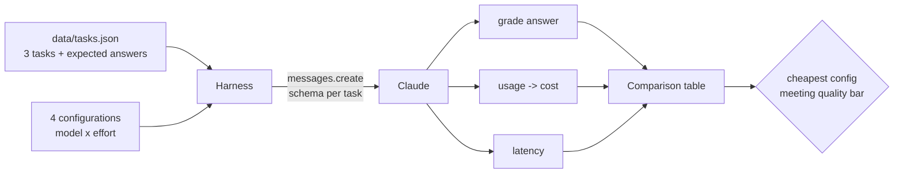

# Lab 06: Model comparison

## Objective

Choose a model with evidence instead of habit. You will run the same graded tasks on Claude Opus,
Sonnet and Haiku (and on Opus at two effort levels), then compare accuracy, latency, tokens and cost
computed from each response's `usage`. By the end of this lab you can:

- build a small, repeatable comparison harness with automatic grading;
- compute cost per request and per thousand requests from `usage` and a dated price table;
- treat `effort` as a cost lever inside a single model, not only model choice;
- pick the cheapest configuration that meets an explicit quality bar, and explain the trade-off.

The scenario: *Acme Logistics* wants to automate three kinds of back-office work (classifying customer
messages, extracting invoice fields, and choosing a shipping option under constraints) and needs to
decide which model to run each on.

## Level / Time / Cost

| | |
|---|---|
| Level | Intermediate |
| Time | About 60 minutes |
| Mock mode | Free and offline. Latency is simulated from token counts and clearly labelled. |
| Live mode | 12 requests (3 tasks x 4 configurations). Short prompts; a full run is a few US cents, almost all of it on the Opus and Sonnet rows. |

> **Cost:** requires API credits (live mode).

Prices used in the lab, in US$ per million tokens, from the claude-api skill's model table (cached
2026-10-06) and checked **as of 2026-10-24**. Always confirm on the
[pricing page](https://platform.claude.com/docs/en/about-claude/pricing) before you rely on them:

| Model | Model ID | Input | Output |
|---|---|---|---|
| Claude Opus 5.5 | `claude-opus-5-5` | 4.00 | 20.00 |
| Claude Sonnet 5.5 | `claude-sonnet-5-5` | 2.00 | 10.00 |
| Claude Haiku 5.5 | `claude-haiku-5-5` | 0.10 | 0.50 (prompts up to 100K tokens; 0.50 / 2.50 above that) |

## Prerequisites

- [Lab 03: Structured outputs](../lab-03-structured-outputs/README.md) (the tasks use schemas so answers
  can be graded by code).
- Reading: [Model families](../../05-claude-products-and-models/02-model-families.md),
  [Model selection](../../05-claude-products-and-models/03-model-selection.md) and
  [Token counting and cost](../../06-claude-api/08-token-counting-and-cost.md).

## Architecture



## Setup

```bash
cd 19-hands-on-labs
pip install -r requirements.txt     # live mode only
export ANTHROPIC_API_KEY="..."      # live mode only
```

Your organisation must have access to all three models for the live run. If one is unavailable you will
get a `404 not_found_error`; remove that row from `CONFIGS`.

## Walkthrough of the sample code

**1. Tasks with known answers** ([`data/tasks.json`](data/tasks.json)). Each task has a prompt, a JSON
Schema and an `expected` answer, covering three difficulty levels:

| Task | Kind | What makes it hard |
|---|---|---|
| `classify` | Simple classification | Nothing much: a good test of whether a small model is enough |
| `extract` | Field extraction | Must pick the total (1,562.50), not the subtotal, and return it as a number |
| `reason` | Multi-constraint reasoning | Option B is cheapest and arrives on time, but loading cannot finish before it departs |

**2. Configurations.** `CONFIGS` pairs a model with an `effort` level. Opus appears twice, at `medium`
and `low`. Effort controls how much the model thinks and how many output tokens it spends; it is often
the first lever to try before switching models. Note that default effort differs by model
(`claude-opus-5-5` and `claude-haiku-5-5` default to `medium`, `claude-sonnet-5-5` to `high`), so the lab
sets it explicitly to compare like with like.

**3. One request per task** (`run_task()`). The request sets `output_config={"effort": ..., "format": ...}`
and nothing else model-specific: no `temperature`, no forced `tool_choice`, no prefill. Latency is timed
with `time.perf_counter()` around the call in live mode. In mock mode the response is instant, so the
lab estimates latency from output tokens and labels the column "simulated".

**4. Grading.** `grade()` compares each expected field. Numbers are compared with a small tolerance and
must be numbers, so `"1562.5"` as a string fails. Automatic grading only works because structured
outputs make the answers machine-readable.

**5. Cost from usage.** `cost_usd()` multiplies `usage.input_tokens` and `usage.output_tokens` by the
dated price table. Output tokens include thinking, which is why effort moves cost.

**6. The decision.** The lab filters to configurations that meet `QUALITY_BAR` (all tasks correct) and
picks the cheapest. It never recommends a configuration that failed the bar, however cheap.

**About the mock numbers.** The mock's token counts, latencies and the single Haiku mistake are
illustrative values written for this lab so the pipeline runs offline. They are **not benchmark results**
and say nothing about how the real models compare. Run live mode for real numbers, and use far more
than three tasks before making a production decision.

## Synthetic test data

| File | Contents |
|---|---|
| [`data/tasks.json`](data/tasks.json) | Three fictional tasks with schemas and expected answers. "Fjord Freight AS" is a fictional supplier. |

## Execution steps

**1. Mock mode:**

```bash
CLAUDE_LAB_MODE=mock python 19-hands-on-labs/lab-06-model-comparison/lab.py
```

**2. Live mode:**

> **Cost:** requires API credits (live mode).

```bash
CLAUDE_LAB_MODE=live python 19-hands-on-labs/lab-06-model-comparison/lab.py
```

**3. Experiments.**

- Run live mode three times. How stable are accuracy and latency? Small samples are noisy; that is why
  real evaluations use dozens to hundreds of cases ([Lab 16](../lab-16-evaluation-framework/README.md)).
- Add `("claude-haiku-5-5", "high")` to `CONFIGS`. Does more effort fix the reasoning task on the
  smallest model, and what does it cost?
- Set `QUALITY_BAR = 2 / 3` and see how the recommendation changes. Who should own that number in a real
  project?

## Expected results

Mock-mode output from a real run:

```text
=== Lab 06 - Model comparison ===  [MOCK — offline, no credits used; model=claude-opus-5-5]

model               effort  accuracy  avg latency (s, simulated)  in tok  out tok  cost/run $  per 1k runs $  misses
claude-opus-5-5     medium      100%                        3.16     393      590     0.01337          13.37  -
claude-opus-5-5     low         100%                        1.75     393      295     0.00747           7.47  -
claude-sonnet-5-5   medium      100%                        2.70     393      670     0.00749           7.49  -
claude-haiku-5-5    medium       67%                        1.05     393      400     0.00024           0.24  reason

Prices: US$/MTok input/output as of 2026-10-24: claude-opus-5-5 4.00/20.00; claude-sonnet-5-5 2.00/10.00; claude-haiku-5-5 0.10/0.50
Cheapest configuration meeting the 100% quality bar: claude-opus-5-5 at effort=low

Self-checks
  [PASS] every configuration ran every task
  [PASS] cost is computed from usage and is positive
  [PASS] grader accepts a correct answer and rejects a wrong one
  [PASS] grader compares numbers with a tolerance
  [PASS] lower effort used fewer output tokens on the same model
  [PASS] a recommendation was made only from configurations that met the bar

All checks passed.
```

How to read it (remember the numbers are illustrative): the smallest model is roughly 30 times cheaper
but misses the constraint in the reasoning task. Lowering effort on the largest model halves its cost
and keeps accuracy, which ties it with the mid-sized model at medium effort. Two practical conclusions
follow. First, a mixed deployment can route simple classification to the smallest model and keep
reasoning on a larger one. Second, try a lower effort level on a capable model before building a
multi-model cascade: one model is simpler to operate and keeps one prompt cache.

## Troubleshooting

| Symptom | Cause and fix |
|---|---|
| `404 not_found_error` for one model | That model is not available to your organisation or the ID is mistyped. Remove the row or fix the ID; never add a date suffix. |
| `429 rate_limit_error` | Each model has its own rate limits. Add a short pause between configurations or reduce the task count. |
| A live row shows `max_tokens` in the notes | Thinking used the whole budget. Raise `max_tokens` or lower `effort`. |
| Accuracy changes between live runs | Expected with three tasks. Increase the task set before drawing conclusions. |
| Live latency much higher than expected | Network distance, queueing and thinking time all add up. Measure from the region you deploy in. |

See also [Model selection](../../05-claude-products-and-models/03-model-selection.md) and
[API errors](../../24-troubleshooting/api-errors.md).

## Security considerations

- **Cheaper is not always safe enough.** A model that is wrong one time in three on constrained decisions
  may be fine for drafting and unacceptable for anything that triggers spend or customer impact. Set the
  quality bar per use case, with the business owner.
- **Same safeguards on every model.** Switching to a smaller model for cost reasons must not remove
  output validation, human review or logging around it.
- **Keep test data synthetic.** Comparison harnesses get shared and rerun often. Use fictional records,
  as here, rather than real invoices or customer messages.

## Cleanup

Nothing to clean up. The lab writes no files.

## Exam relevance

Objective IDs from [`registry.yaml`](../../16-certification-tracks/registry.yaml):

| Objective | How this lab covers it |
|---|---|
| CCAO-F-3.2 | Differentiating the Haiku, Sonnet and Opus families |
| CCAO-F-3.3 | Matching model choice to cost, speed and quality needs |
| CCAR-P-2.1 | Selecting models based on measured trade-offs |
| CCAR-P-3.3 | Evaluating accuracy-latency trade-offs and justifying configuration |
| CCAR-P-4.1 | Defining evaluation metrics (accuracy, latency, cost) |
| CCAR-P-4.5 | Optimising cost-performance with effort and model choice |

## Next lab

[Lab 07: API integration](../lab-07-api-integration/README.md) wraps the client for production: retries,
typed errors, timeouts, request IDs and streaming.
