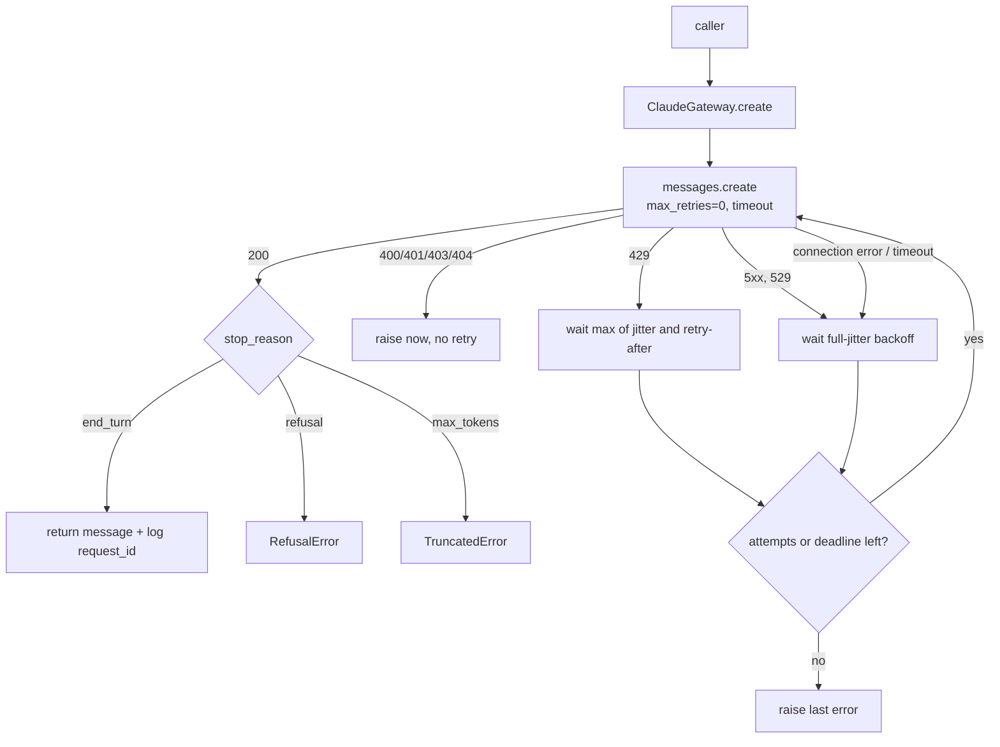

# Lab 07: API integration

## Objective

Wrap the Claude client so it behaves well in a real service: it retries what is safe to retry, fails
fast on what is not, never waits forever, and leaves enough evidence in the logs to debug any request.
By the end of this lab you can:

- write a most-specific-first exception chain that separates retryable from non-retryable errors;
- implement exponential backoff with full jitter that honours the `retry-after` header;
- set per-attempt timeouts and an overall deadline, and avoid multiplying SDK retries with your own;
- log request IDs and a correlation ID for every attempt;
- handle `refusal` and `max_tokens` as outcomes in their own right;
- stream a response in live mode and know when a stream can and cannot be retried.

The scenario: *Acme Logistics* is putting Claude behind its parcel-tracking chat. The service must stay
responsive during rate limiting and brief provider incidents, and the on-call engineer must be able to
trace any failed conversation.

## Level / Time / Cost

| | |
|---|---|
| Level | Intermediate |
| Time | About 60 minutes |
| Mock mode | Free and offline. Replays six scripted scenarios (success, 529 then 500, 429 with `retry-after`, 400, repeated timeouts, refusal) without real waiting. |
| Live mode | 2 short requests (one normal, one streamed) to `claude-opus-5-5`. Under one US cent at the rates on the [pricing page](https://platform.claude.com/docs/en/about-claude/pricing) as of 2026-10-24. Live mode cannot force errors, so only the happy path and streaming run. |

> **Cost:** requires API credits (live mode).

## Prerequisites

- [Lab 01](../lab-01-first-claude-interaction/README.md).
- Reading: [Errors, rate limits and retries](../../06-claude-api/06-errors-rate-limits-retries.md),
  [Streaming](../../06-claude-api/03-streaming.md) and
  [Reliability engineering](../../15-production-operations/05-reliability-engineering.md).

## Architecture



## Setup

```bash
cd 19-hands-on-labs
pip install -r requirements.txt     # live mode only
export ANTHROPIC_API_KEY="..."      # live mode only
```

## Walkthrough of the sample code

**1. Who owns retries.** The SDK already retries connection errors, 408, 409, 429 and 5xx twice by
default. If you add your own loop on top, four wrapper attempts become up to twelve real requests. The
gateway calls `client.with_options(max_retries=0, timeout=timeout_s)` so it is the only retry layer, and
every attempt is visible in its log. (The alternative, which is fine for simple scripts, is to rely on
the SDK's built-in retries and tune `max_retries`.)

**2. The exception chain.** Python matches `except` clauses top to bottom, so the order matters:

| Order | Exception (SDK class) | Status | Action |
|---|---|---|---|
| 1 | `BadRequestError`, `AuthenticationError`, `PermissionDeniedError`, `NotFoundError` | 400, 401, 403, 404 | Raise immediately. Retrying the same request cannot fix it. |
| 2 | `RateLimitError` | 429 | Retry, waiting at least the `retry-after` header value. |
| 3 | `APIStatusError` (catch-all for other statuses, including `InternalServerError` and `OverloadedError` 529) | >= 500 | Retry with backoff. Anything else below 500 is raised. |
| 4 | `APIConnectionError` (includes `APITimeoutError`) | none | Retry with backoff. |

A single broad `except APIStatusError` would lose the difference between "try again" and "fix your
request". In live mode the lab uses the real classes from `anthropic`; in mock mode `mock_errors()`
builds stand-ins with the same names and inheritance, so the chain is exercised offline. The chain was
checked against `anthropic` 2.3.0 by pointing the real SDK at a local stub server that returned 529, then
429 with `retry-after: 1`, then 200, then 400: the gateway made three attempts, waited one second for the
429, logged three request IDs, and did not retry the 400.

**3. Backoff with full jitter.** `_backoff()` draws a random delay between 0 and
`min(max_delay, base_delay * 2**attempt)`. Randomising the whole interval spreads out clients that failed
at the same moment, so they do not retry in lockstep. For a 429 the delay is raised to at least the
server's `retry-after`.

**4. Timeouts and deadline.** Two limits work together:

- `timeout_s` caps each attempt (the SDK raises `APITimeoutError` when it is exceeded);
- `deadline_s` caps the total time spent waiting between attempts, so a user is never left hanging for
  minutes during an incident.

Long generations should be streamed rather than given a huge timeout; the SDKs expect streaming for very
large `max_tokens` values.

**5. Request IDs and correlation IDs.** Every response from the real SDK has `_request_id` (from the
`request-id` header) and every `APIStatusError` has `.request_id`. The gateway logs one for each attempt,
under a correlation ID you generate per logical call. Support needs the request ID; your own tracing needs
the correlation ID to stitch the attempts together.

**6. Opaque user IDs.** The request passes `metadata={"user_id": opaque_user_id(...)}`: a salted hash, not
an email or account number. It lets you investigate abuse reports without sending personal data.

**7. Outcomes that are not errors.** A `refusal` or `max_tokens` arrives with HTTP 200. The gateway turns
them into `RefusalError` and `TruncatedError` and never retries them: resending the same request will most
likely refuse again. For `claude-opus-5-5` and other current models, the API also offers server-side
refusal fallbacks to another model (a beta `fallbacks` parameter on `client.beta.messages.create`); see the
[refusals and fallback docs](https://platform.claude.com/docs/en/build-with-claude/refusals-and-fallback)
before enabling it in production.

**8. Streaming.** In live mode `stream_answer()` uses:

```python
with client.messages.stream(**params) as stream:
    for text in stream.text_stream:
        print(text, end="", flush=True)
    final = stream.get_final_message()
```

`get_final_message()` gives you the complete `Message`, including `stop_reason` and `usage`, so the same
checks apply. A stream can be retried safely only before the first token reaches the user; after that, a
retry would show a second, different answer. The mock client has no streaming, so mock mode prints
fixed-size chunks of a normal response and says so.

## Synthetic test data

None needed. The scripted scenarios live in `SCRIPTS` in [`lab.py`](lab.py), and the parcel number is
fictional.

## Execution steps

**1. Mock mode:**

```bash
CLAUDE_LAB_MODE=mock python 19-hands-on-labs/lab-07-api-integration/lab.py
```

**2. Live mode:**

> **Cost:** requires API credits (live mode).

```bash
CLAUDE_LAB_MODE=live python 19-hands-on-labs/lab-07-api-integration/lab.py
```

**3. Experiments.**

- Add a scenario `"auth": [ERR.AuthenticationError("invalid x-api-key")]` and confirm it is not retried.
- Set `deadline_s=1.0` and rerun. The rate-limited scenario now gives up, because waiting two seconds
  would break the deadline. Is that the behaviour your users would want?
- In live mode, set `timeout_s=0.5`. Most requests now time out; watch the backoff and the final error.

## Expected results

Mock-mode output from a real run (correlation and request IDs are random):

```text
=== Lab 07 - API integration: retries, errors, timeouts, request IDs, streaming ===  [MOCK — offline, no credits used; model=claude-opus-5-5]

Scenario: happy
    [corr-1310da58] attempt 1: ok request_id=req_mock_af221603a7
  answer: Your shipment AL-58213 is out for delivery and should arrive today between 14:00 and 16:00.
  outcome: ok; attempts=1; delays=[]

Scenario: flaky
    [corr-0af991f0] attempt 1: OverloadedError -> retry in 0.16s
    [corr-0af991f0] attempt 2: InternalServerError -> retry in 0.15s
    [corr-0af991f0] attempt 3: ok request_id=req_mock_bae7af5fc1
  answer: Your shipment AL-58213 is out for delivery and should arrive today between 14:00 and 16:00.
  outcome: ok; attempts=3; delays=[0.16, 0.15]

Scenario: rate-limited
    [corr-bdfdcdf3] attempt 1: RateLimitError -> retry in 2.00s (retry-after=2)
    [corr-bdfdcdf3] attempt 2: ok request_id=req_mock_f62d0642cf
  answer: Your shipment AL-58213 is out for delivery and should arrive today between 14:00 and 16:00.
  outcome: ok; attempts=2; delays=[2.0]

Scenario: bad-request
    [corr-31b7115d] attempt 1: BadRequestError request_id=req_mock_031a75cb36 -> not retryable
  surfaced to caller: BadRequestError: max_tokens: must be greater than 0
  outcome: failed: BadRequestError (not retryable); attempts=1; delays=[]

Scenario: outage
    [corr-946e03ed] attempt 1: APITimeoutError -> retry in 0.04s
    [corr-946e03ed] attempt 2: APITimeoutError -> retry in 0.54s
    [corr-946e03ed] attempt 3: APITimeoutError -> retry in 0.73s
    [corr-946e03ed] attempt 4: APITimeoutError -> giving up
  surfaced to caller: APITimeoutError: Request timed out
  outcome: gave up after 4 attempts: APITimeoutError; attempts=4; delays=[0.04, 0.54, 0.73]

Scenario: refusal
    [corr-3d7ec322] attempt 1: ok request_id=req_mock_358c9bcde6
  handled RefusalError: declined (category=cyber)
  outcome: refusal; attempts=1; delays=[]

Streaming
Your shipment AL-58213 is out for delivery and should arrive today between 14:00 and 16:00.   (mock: simulated chunks)
  streamed 91 characters; request_id=req_mock_a3009be00a

Self-checks
  [PASS] happy path succeeds first time
  [PASS] every attempt that reached the API logged a request ID
  [PASS] streamed text is complete
  [PASS] 529 then 500 are retried, third attempt succeeds
  [PASS] 429 waits at least retry-after
  [PASS] 400 is not retried
  [PASS] timeouts give up after max_attempts
  [PASS] backoff delays never exceed max_delay unless retry-after says so
  [PASS] refusal is surfaced as its own error, not retried
  [PASS] mock never actually slept

All checks passed.
```

The jitter uses a seeded random generator, so the delays are repeatable between runs. In mock mode the
gateway records delays instead of sleeping, so the whole run finishes in well under a second.

## Troubleshooting

| Symptom | Cause and fix |
|---|---|
| Far more requests in your provider logs than your wrapper logged | SDK retries are still on underneath. Use `with_options(max_retries=0)` or remove your own loop. |
| Retries make a 429 worse | You are ignoring `retry-after` or retrying without jitter. Honour the header and randomise. |
| `APITimeoutError` on long answers | Stream the response instead of raising the timeout far above normal. |
| A user sees two different answers | A stream was retried after tokens were already shown. Retry streams only before the first token. |
| `AttributeError: _request_id` | You are reading it from a mock or a dict. Use `getattr(message, "_request_id", None)`. |
| `BadRequestError` mentioning `temperature`, `budget_tokens` or `tool_choice` | These are rejected on current models. Remove them; use `effort`, adaptive thinking and `tool_choice: auto`. |

See also [API errors](../../24-troubleshooting/api-errors.md) and
[Rate limits and capacity](../../15-production-operations/06-rate-limits-and-capacity.md).

## Security considerations

- **No secrets in logs.** The gateway logs IDs, error class names and delays. It never logs the API key,
  request headers or full prompts. Review any extra logging you add for personal data.
- **Opaque identifiers only.** `metadata.user_id` is a salted hash. Never send emails, phone numbers or
  account numbers there.
- **Retries are a load amplifier.** Unbounded retries during an incident make the incident worse. Cap
  attempts, cap total time, add jitter, and consider a circuit breaker in front of the gateway.
- **Refusals are signals.** Log refusal categories (not the prompt) and review trends; a spike can indicate
  misuse of your application.
- **Fail visibly.** When the gateway gives up, show the user a clear "try again later" message and keep the
  correlation ID so support can find the attempts.

## Cleanup

Nothing to clean up. The lab writes no files.

## Exam relevance

Objective IDs from [`registry.yaml`](../../16-certification-tracks/registry.yaml):

| Objective | How this lab covers it |
|---|---|
| CCAR-P-1.2 | End-to-end design including failure paths |
| CCAR-P-3.4 | Observability: request IDs and correlation IDs per attempt |
| CCAR-P-4.6 | Logging that supports monitoring and diagnosis |
| CCAR-P-5.2 | Handling failure modes (rate limits, outages, refusals, truncation) |
| CCAR-P-7.3 | Supporting debugging and operational issue resolution |

## Next lab

[Lab 08: Tool invocation](../lab-08-tool-invocation/README.md) gives Claude tools and runs the tool-use loop
by hand.
