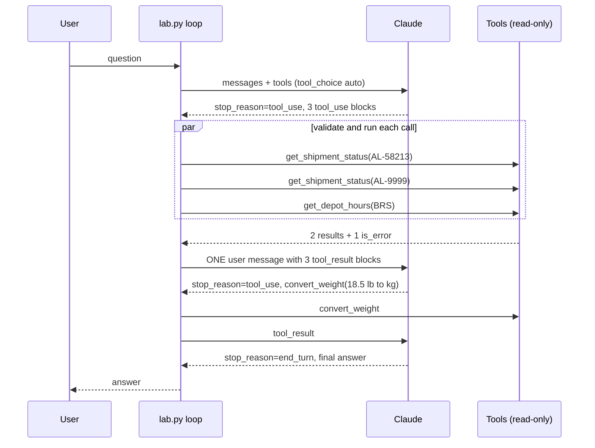

# Lab 08: Tool invocation

## Objective

Give Claude tools and run the tool-use loop yourself, safely. By the end of this lab you can:

- define tools with clear descriptions and strict JSON Schemas;
- run the manual loop: call, execute every `tool_use` block, send `tool_result` blocks, repeat until
  `end_turn`;
- handle **parallel** tool calls by returning all results in **one** user message;
- validate tool inputs in your own code before executing anything;
- report failures with `is_error: true` so Claude can recover instead of the loop crashing;
- cap iterations and refuse to act on truncated or refused responses.

The scenario: *Acme Logistics*' parcel assistant needs live facts (shipment status, depot hours) and a
small calculation (pounds to kilograms). Every tool is read-only, so the worst a bad call can do is
return an error.

## Level / Time / Cost

| | |
|---|---|
| Level | Intermediate |
| Time | About 60 minutes |
| Mock mode | Free and offline. Scripted three-iteration conversation with parallel calls and one tool error. |
| Live mode | Typically 2 to 4 requests to `claude-opus-5-5` at `effort: medium`, each carrying the tool definitions. A few US cents per run at the rates on the [pricing page](https://platform.claude.com/docs/en/about-claude/pricing) as of 2026-10-24. |

> **Cost:** requires API credits (live mode).

## Prerequisites

- [Lab 03: Structured outputs](../lab-03-structured-outputs/README.md) (JSON Schema basics).
- Reading: [Tool use fundamentals](../../07-tool-use-and-function-calling/01-tool-use-fundamentals.md),
  [Defining tools](../../07-tool-use-and-function-calling/02-defining-tools.md),
  [The tool-use loop](../../07-tool-use-and-function-calling/03-the-tool-use-loop.md) and
  [Tool security](../../07-tool-use-and-function-calling/06-tool-security.md).

## Architecture



## Setup

```bash
cd 19-hands-on-labs
pip install -r requirements.txt     # live mode only
export ANTHROPIC_API_KEY="..."      # live mode only
```

## Walkthrough of the sample code

**1. Tool definitions** (`TOOLS`). Each tool has a `name`, a `description` and an `input_schema`:

- Descriptions say what the tool returns, that it is read-only, and when to use it ("call once per
  tracking ID; independent lookups can be made in parallel"). Claude chooses tools from these
  descriptions, so they are part of your prompt.
- `"strict": True` asks the API to guarantee that tool inputs match the schema exactly. Strict schemas
  need `additionalProperties: false` and a `required` list.
- Enums (`kg`/`lb`, depot codes) turn free text into an allow-list.

**2. The request.** `tool_choice={"type": "auto"}` lets Claude decide whether to call a tool. On
`claude-opus-5-5` and other current models, forcing a tool with `{"type": "any"}` or
`{"type": "tool", ...}` returns a 400, so steer with the system prompt and descriptions instead ("Use the
tools for facts; never guess tracking data").

**3. The loop** (`run_conversation()`):

| `stop_reason` | What the loop does |
|---|---|
| `tool_use` | Run every `tool_use` block in the response, then send the results |
| `end_turn` | Return the final text |
| `max_tokens` or `refusal` | Stop. A truncated `tool_use` block may have incomplete input; never execute it |
| anything else | Stop with an error (`pause_turn` only occurs with server-side tools, not used here) |

The assistant turn is appended as `response.content`, the full list of blocks (including any thinking
blocks), not just the text. Thinking blocks must be passed back unchanged while a tool loop is in progress.

**4. Parallel results in one message.** In iteration 1 Claude asks for three independent lookups at once.
The loop executes all three and appends a single user message whose content is the list of three
`tool_result` blocks, each pointing at its `tool_use_id`. Splitting them across several messages is a
common bug; the mock responder asserts against it, and it also teaches the model to stop making parallel
calls.

**5. Sequential dependency.** In iteration 2 Claude calls `convert_weight` with the 18.5 lb it learned from
the first result. Parallel where independent, sequential where one step needs another's output.

**6. Validation and `is_error`** (`run_tool()`):

- Unknown tool name: `is_error` result, nothing executed.
- `validate_input()` checks required fields, unexpected fields, types and enums against the schema
  before execution. With `strict: true` this should never fire, but it costs nothing and protects you if
  someone removes `strict` or adds a tool without it.
- Business validation inside the tool (`ToolInputError`): the tracking ID must match `AL-` plus five digits.
  `AL-9999` fails, and the error message tells Claude what a valid ID looks like and to ask the customer.
- Any other exception becomes a generic message. Stack traces and internal details never go to the model.
- Results are capped at `MAX_RESULT_CHARS` so one large record cannot flood the context.

**7. Iteration cap.** `MAX_ITERATIONS = 6` stops a confused loop from running (and billing) forever.

**Alternative: the SDK Tool Runner.** `client.beta.messages.tool_runner(...)` with `@beta_tool` functions runs
this loop for you. Writing it by hand once, as here, makes it much easier to debug the runner later and to
add approval gates ([Lab 13](../lab-13-human-in-the-loop/README.md)).

## Synthetic test data

| File | Contents |
|---|---|
| [`data/shipments.json`](data/shipments.json) | Three fictional shipments with status, arrival window, weight and destination depot |
| [`data/depots.json`](data/depots.json) | Opening hours for three fictional depots |

## Execution steps

**1. Mock mode:**

```bash
CLAUDE_LAB_MODE=mock python 19-hands-on-labs/lab-08-tool-invocation/lab.py
```

**2. Live mode:**

> **Cost:** requires API credits (live mode).

```bash
CLAUDE_LAB_MODE=live python 19-hands-on-labs/lab-08-tool-invocation/lab.py
```

Live runs may order or batch the calls differently (for example, converting the weight in a third
iteration, or asking you to confirm `AL-9999` without calling the tool). The structural self-checks still
apply; the three mock-only checks are skipped.

**3. Experiments.**

- Make `get_depot_hours` raise `RuntimeError("database down")` and confirm Claude receives the generic
  error and explains the problem instead of inventing hours.
- Remove `"strict": True` from `convert_weight` and ask for a conversion to "stone". What does the
  validator do?
- Set `MAX_ITERATIONS = 1` and see the loop stop safely.

## Expected results

Mock-mode output from a real run:

```text
=== Lab 08 - Tool invocation ===  [MOCK — offline, no credits used; model=claude-opus-5-5]

User: Can you check parcels AL-58213 and AL-9999? Also, what does AL-58213 weigh in kg, and is the Bristol depot open on Saturday?

  iteration 1: stop_reason=tool_use, tool calls=['get_shipment_status', 'get_shipment_status', 'get_depot_hours']
    get_shipment_status({"tracking_id": "AL-58213"}) -> {"tracking_id": "AL-58213", "status": "out_for_delivery", "eta": "2026-11-05 14:00-16:00",
    get_shipment_status({"tracking_id": "AL-9999"}) -> is_error tracking_id must look like AL- followed by 5 digits, e.g. AL-12345. Ask the customer to ch
    get_depot_hours({"depot_code": "BRS"}) -> {"depot_code": "BRS", "name": "Bristol depot", "hours": {"mon-fri": "07:00-19:00", "sat": 
  iteration 2: stop_reason=tool_use, tool calls=['convert_weight']
    convert_weight({"value": 18.5, "from_unit": "lb", "to_unit": "kg"}) -> {"value": 8.39, "unit": "kg"}
  iteration 3: stop_reason=end_turn, tool calls=[]

Claude:
Here's what I found:
- AL-58213 is out for delivery, arriving 2026-11-05 between 14:00 and 16:00. It weighs 18.5 lb, which is about 8.39 kg.
- AL-9999 isn't a valid tracking number (they look like AL- followed by five digits). Could you check it on your receipt?
- The Bristol depot is open on Saturday from 08:00 to 13:00.

Self-checks
  [PASS] loop ended with end_turn within the iteration cap
  [PASS] every tool_use id got exactly one tool_result
  [PASS] each user turn after a tool call holds only tool_result blocks
  [PASS] validator rejects missing, extra, wrong-type and out-of-enum inputs
  [PASS] unknown tools return is_error instead of crashing
  [PASS] weight conversion is correct
  [PASS] three independent calls ran in parallel in one turn
  [PASS] malformed tracking ID came back as is_error
  [PASS] final answer uses the converted weight

All checks passed.
```

## Troubleshooting

| Symptom | Cause and fix |
|---|---|
| `400` "tool_use ids were found without tool_result blocks" | A `tool_use` block was not answered. Every call needs exactly one result with the matching `tool_use_id`, in the very next user message. |
| `400` mentioning `tool_choice` `any` or `tool` | Forced tool use is rejected on Opus 5.5, Sonnet 5.5, Fable 5.1 and Mythos 5.1. Use `auto` plus clear instructions. |
| Claude stops calling tools in parallel | Results were split across several user messages, or the user message mixed text before the results. Send all results together. |
| Claude invents a value after a tool fails | The error result was dropped. Return it with `is_error: true` and a useful message. |
| The loop never ends | The model keeps calling a tool whose error message does not explain how to fix the input. Improve the message and keep the iteration cap. |
| `json.loads` fails on tool input | Parse `block.input` (already a dict in the SDK); never string-match the raw JSON. |

See also [Tools and agents troubleshooting](../../24-troubleshooting/tools-and-agents.md).

## Security considerations

- **Least privilege.** All three tools are read-only and scoped to one carrier's synthetic data. A tool that
  changes state (cancel, refund, delete) needs its own authorisation checks and usually a human approval
  step ([Lab 13](../lab-13-human-in-the-loop/README.md)).
- **Tool inputs are untrusted.** The model writes them, and the model can be influenced by user text or
  by data returned from earlier tools. Validate types, allow-lists and formats in code, every time.
- **Tool outputs are untrusted too.** Data coming back from tools can carry instructions planted by a third
  party (indirect prompt injection). Cap its size, and do not let it silently expand what the agent may do.
- **Safe error messages.** Return actionable but non-sensitive errors. Stack traces, SQL and file paths help
  attackers more than they help the model.
- **Authorisation belongs to the user, not the model.** In production, check that the signed-in customer
  owns the tracking ID before returning its details; never rely on the model to enforce that.

## Cleanup

Nothing to clean up. The lab writes no files.

## Exam relevance

Objective IDs from [`registry.yaml`](../../16-certification-tracks/registry.yaml):

| Objective | How this lab covers it |
|---|---|
| CCAR-P-1.3 | Applying the augmented-LLM pattern (model plus tools) |
| CCAR-P-3.1 | Keeping the tool set small and read-only to avoid capability bloat |
| CCAR-P-3.7 | Integrating capabilities through tool use |
| CCAR-P-5.1 | Guardrails: validation, allow-lists, iteration caps |
| CCAR-P-5.2 | Handling tool failure modes without crashing or guessing |

## Next lab

[Lab 09: MCP fundamentals](../lab-09-mcp-fundamentals/README.md) moves tools out of your application into
a Model Context Protocol server.
