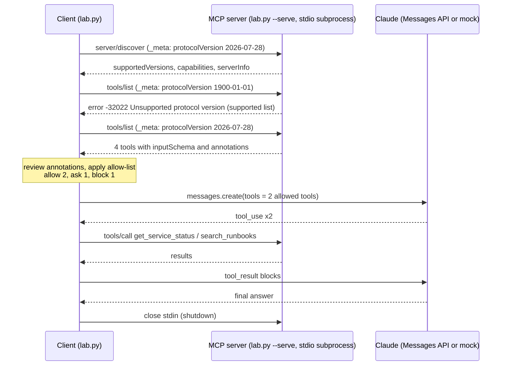

# Lab 09: MCP fundamentals

## Objective

Understand the Model Context Protocol (MCP) at the wire level, then see the same server written with the
official SDK. By the end of this lab you can:

- describe how an MCP client and server talk over the stdio transport (newline-delimited JSON-RPC 2.0);
- run the current protocol flow: `server/discover`, per-request `_meta`, `tools/list`, `tools/call`;
- explain how version negotiation works and what changed from the older `initialize` handshake;
- read tool annotations (`readOnlyHint`, `destructiveHint`, `idempotentHint`, `openWorldHint`), treat them
  as untrusted hints, and enforce an allow-list policy in the client;
- tell a tool execution error (`isError: true`) from a protocol error;
- connect MCP tools to Claude through the Messages API tool loop.

The scenario: *Northwind Lending*'s IT service desk wants Claude to use internal runbooks and service
status. The platform team exposes them through an MCP server, which also offers write and destructive
tools that the help-desk assistant must not use on its own.

**Protocol revision verified for this lab:** `2026-07-28`, the current revision on
[modelcontextprotocol.io](https://modelcontextprotocol.io/specification/latest) as of 2026-10-24. The SDK
part was verified against the MCP Python SDK `mcp` 2.3.0, the latest release on PyPI on that date.

## Level / Time / Cost

| | |
|---|---|
| Level | Intermediate |
| Time | About 75 minutes |
| Mock mode | Free and offline. `lab.py` uses only the standard library: it starts its own MCP server as a subprocess and talks to it over stdio. Step 5 uses the mock Claude. |
| Live mode | Only step 5 calls Claude: 2 requests to `claude-opus-5-5`, about one US cent at the rates on the [pricing page](https://platform.claude.com/docs/en/about-claude/pricing) as of 2026-10-24. |
| Optional SDK extra | `server.py` needs `pip install "mcp>=2.0,<3"` (Python 3.11+). Its `--self-test` makes no API calls and costs nothing. |

> **Cost:** requires API credits (live mode).

## Prerequisites

- [Lab 08: Tool invocation](../lab-08-tool-invocation/README.md). MCP tools end up in the same tool loop.
- Reading: [What is MCP](../../08-model-context-protocol/01-what-is-mcp.md),
  [MCP architecture](../../08-model-context-protocol/02-architecture.md),
  [Building an MCP server](../../08-model-context-protocol/03-building-an-mcp-server.md) and
  [MCP security](../../08-model-context-protocol/05-mcp-security.md).

## Architecture



Every client request carries its own `_meta` with the protocol version and client capabilities. The server
keeps no session state, so the same process can serve unrelated requests in any order.

## Setup

Mock mode needs nothing beyond Python 3.10+.

For live mode:

```bash
cd 19-hands-on-labs
pip install -r requirements.txt
export ANTHROPIC_API_KEY="..."
```

For the optional SDK server (Python 3.11+):

```bash
pip install "mcp>=2.0,<3"        # already included if you installed requirements.txt
```

## Walkthrough of the sample code

### The transport

`serve()` reads one JSON-RPC message per line from stdin and writes one per line to stdout. Messages must
not contain embedded newlines (the client asserts this), and nothing except protocol messages may go to
stdout; diagnostics go to stderr. The client shuts the server down by closing its stdin, which is the
portable graceful-shutdown signal for stdio.

### Steps 1 and 2: discovery and version negotiation

In revision `2026-07-28` there is **no negotiation handshake**. Instead:

- every request includes `params._meta` with `io.modelcontextprotocol/protocolVersion` and
  `io.modelcontextprotocol/clientCapabilities` (both required) and, optionally, `clientInfo`;
- a request missing them is rejected with `-32602` (invalid params);
- a request with a version the server does not implement gets `-32022 Unsupported protocol version`, with
  a `data.supported` list; the client picks a mutually supported version and retries;
- `server/discover` (which servers must implement) returns `supportedVersions`, `capabilities`,
  `instructions` and `serverInfo` in one call. Clients may call it first, and should on stdio when they
  also support older servers.

Results in this revision carry `resultType` (`"complete"` here) and the server identifies itself in the
result's `_meta`.

### Step 3: `tools/list`

Each tool has a `name`, a `title`, a `description`, an `inputSchema` (JSON Schema) and optional
`annotations`. The server returns tools in a fixed order, which lets clients cache the list and helps
prompt caching when the tools are passed to a model.

### Step 4: annotations are hints; policy is yours

`review_annotations()` checks shape (booleans only, known keys) and applies the spec's defaults when a hint
is missing: a tool is assumed **not** read-only, **potentially destructive**, **not** idempotent and
**open world** unless it says otherwise. A tool with no annotations at all is therefore treated as risky.

The MCP specification says clients must treat annotations as untrusted unless they come from a trusted
server. So `decide()` does not let annotations grant anything. It uses an explicit allow-list:

| Tool | Annotations | Policy |
|---|---|---|
| `search_runbooks` | read-only, idempotent, closed world | allow |
| `get_service_status` | read-only, idempotent, closed world | allow |
| `create_incident_ticket` | writes, not destructive, not idempotent | ask a human |
| `restart_service` | destructive | block |

Annotations are still useful as a tripwire: if an allow-listed tool starts claiming to be destructive (for
example after a server update), `decide()` blocks it and a person reviews the change.

### Step 5: MCP tools in the Claude tool loop

`to_claude_tool()` maps an MCP tool to a Messages API tool (`inputSchema` becomes `input_schema`). Only the
allowed tools are offered. `ask_claude()` runs the same loop as Lab 08; for each `tool_use` block it checks
the allow-list again (never assume the model only asks for what it was offered), sends `tools/call` to the
MCP server, and turns the MCP result into a `tool_result`, carrying `isError` across as `is_error`.

Claude Code and the Messages API's MCP connector can do this wiring for you; doing it by hand once shows
exactly where the trust boundaries are.

### Step 6: two kinds of error

| Kind | Example | How it is reported | Who should see it |
|---|---|---|---|
| Tool execution error | `max_results=50` | A normal result with `isError: true` and an explanation | The model, so it can correct its arguments |
| Protocol error | Unknown tool `format_disk` | A JSON-RPC `error` with code `-32602` | The client and its logs |

Note: the official SDK server (below) reports an unknown tool as an `isError` result rather than a JSON-RPC
error. Write clients that handle both.

### Step 7: history, the `initialize` handshake

Protocol revisions up to and including `2025-11-25` opened every connection with a handshake: the client
sent `initialize` (with `protocolVersion`, `capabilities`, `clientInfo`), the server answered with its own
version and capabilities, and the client sent the `notifications/initialized` notification before any other
request. Version and capabilities were then remembered for the session instead of being sent on every
request. The `2026-07-28` revision calls these older versions "legacy". A server may support both eras: an
`initialize` request selects legacy behaviour for that stdio process. Step 7 starts a second server process
and runs the legacy handshake against it, so you can compare the two styles side by side.

### The SDK version: `server.py`

[`server.py`](server.py) implements the same four tools with the official MCP Python SDK v2:

```python
from mcp.server import MCPServer
from mcp.types import ToolAnnotations

mcp = MCPServer("northwind-it", instructions="...")

@mcp.tool(title="Get service status",
          annotations=ToolAnnotations(read_only_hint=True, idempotent_hint=True, open_world_hint=False))
def get_service_status(service: Literal["vpn", "email", "loan-portal"]) -> dict:
    """Return the current status of an internal service."""
    ...

if __name__ == "__main__":
    mcp.run()   # stdio by default
```

Type hints and docstrings become the `inputSchema` and description; `pydantic.Field` constraints (such as
`ge=1, le=5`) become schema limits and are validated before your function runs; raising `ToolError` returns
an `isError` result. Note that v2 uses `MCPServer` from `mcp.server`; many older examples use the v1
`FastMCP` class, which this lab does not use.

Verified on 2026-10-24 with `mcp` 2.3.0 by running `server.py --self-test` (in-process client) and by sending
raw JSON-RPC lines over stdio: the SDK server answered `server/discover` with
`supportedVersions: ["2026-07-28"]`, rejected a `1900-01-01` request with `-32022`, rejected a request with no
`_meta` with `-32602`, and also accepted a legacy `initialize` at `2025-11-25`.

To use it from Claude Code (command syntax from the [Claude Code MCP docs](https://code.claude.com/docs/en/mcp)):

```bash
claude mcp add --transport stdio northwind-it -- python /absolute/path/to/server.py
```

## Synthetic test data

| File | Contents |
|---|---|
| [`data/runbooks.json`](data/runbooks.json) | Three fictional service desk runbooks |
| [`data/services.json`](data/services.json) | Status for three fictional internal services; `loan-portal` is degraded |

## Execution steps

**1. Mock mode (stdlib only):**

```bash
CLAUDE_LAB_MODE=mock python 19-hands-on-labs/lab-09-mcp-fundamentals/lab.py
```

**2. Talk to the stdlib server by hand.** In one terminal:

```bash
python 19-hands-on-labs/lab-09-mcp-fundamentals/lab.py --serve
```

Then paste this line and press Enter:

```json
{"jsonrpc": "2.0", "id": 1, "method": "server/discover", "params": {"_meta": {"io.modelcontextprotocol/protocolVersion": "2026-07-28", "io.modelcontextprotocol/clientCapabilities": {}}}}
```

Press Ctrl-D to close stdin and stop the server.

**3. Live mode (Claude chooses the tools):**

> **Cost:** requires API credits (live mode).

```bash
CLAUDE_LAB_MODE=live python 19-hands-on-labs/lab-09-mcp-fundamentals/lab.py
```

**4. Optional: the SDK server.**

```bash
pip install "mcp>=2.0,<3"
python 19-hands-on-labs/lab-09-mcp-fundamentals/server.py --self-test
```

## Expected results

Mock-mode output from a real run:

```text
=== Lab 09 - MCP fundamentals (stdlib client and server over stdio) ===  [MOCK — offline, no credits used; model=claude-opus-5-5]

1. server/discover (revision 2026-07-28: stateless, no handshake)
   supportedVersions=['2026-07-28', '2025-11-25'] capabilities=['tools'] server=northwind-it-stdlib
2. A request with a version the server does not support
   error -32022: Unsupported protocol version supported=['2026-07-28', '2025-11-25']
   request without _meta -> error -32602: Missing required _meta fields
3. tools/list
4. Annotation review and client policy
   tool                     policy       notes
   search_runbooks          allow        -
   get_service_status       allow        -
   create_incident_ticket   ask a human  not idempotent: repeated calls repeat the effect
   restart_service          block        destructive, not idempotent: repeated calls repeat the effect
5. Claude uses the allowed MCP tools
   Claude called: ['get_service_status', 'search_runbooks']
   Claude: The loan origination portal is currently degraded (elevated response times since 08:51 UTC), so this is a known issue. Per runbook RB-103, don't restart anything: link the user's ticket to the open P2 incident and record their timestamp and browser.
6. Errors: tool execution error vs protocol error
   bad arguments -> result.isError=True: max_results must be an integer from 1 to 5.
   unknown tool  -> error -32602: Unknown tool: format_disk
7. History: the 2025-11-25 handshake (separate server process)
   initialize -> protocolVersion=2025-11-25; notifications/initialized sent; tools/list -> 4 tools (no _meta needed)

Wire trace (first lines, truncated):
   -> {"jsonrpc": "2.0", "id": 1, "method": "server/discover", "params": {"_meta": {"io.modelcontextprotocol/protocolVersion": "2026-07-28", "io.modelcontex
   <- {"jsonrpc": "2.0", "id": 1, "result": {"resultType": "complete", "supportedVersions": ["2026-07-28", "2025-11-25"], "capabilities": {"tools": {}}, "in
   -> {"jsonrpc": "2.0", "id": 2, "method": "tools/list", "params": {"_meta": {"io.modelcontextprotocol/protocolVersion": "1900-01-01", "io.modelcontextprot
   <- {"jsonrpc": "2.0", "id": 2, "error": {"code": -32022, "message": "Unsupported protocol version", "data": {"supported": ["2026-07-28", "2025-11-25"], "

Self-checks
  [PASS] discover advertises the modern revision
  [PASS] unsupported version returns -32022 with a supported list
  [PASS] missing _meta is rejected with -32602
  [PASS] every tool has well-formed annotations
  [PASS] destructive tool is blocked by policy
  [PASS] write tool needs a human
  [PASS] only allow-listed tools were offered to Claude
  [PASS] Claude only called allow-listed tools
  [PASS] bad arguments give isError (model can self-correct)
  [PASS] unknown tool gives a JSON-RPC protocol error
  [PASS] a tool missing annotations is treated as risky
  [PASS] legacy handshake still works (history)
  [PASS] both server processes shut down cleanly

All checks passed.
```

`server.py --self-test` output with `mcp` 2.3.0 (the two log lines at the top are the SDK's own warnings for
the rejected call and the blocked restart; they go to stderr):

```text
Tool 'search_runbooks' rejected arguments: ['max_results']
Tool 'restart_service' failed: 'Error executing tool restart_service: Restarting vpn must go through the change-management process; nothing was restarted.'
tool search_runbooks          read_only=True destructive=None
tool get_service_status       read_only=True destructive=None
tool create_incident_ticket   read_only=False destructive=False
tool restart_service          read_only=False destructive=True
call search_runbooks -> isError = False | {
  "id": "RB-101",
  "title": "VPN client cannot connect",
  "service": "vpn",

call with max_results=50 -> isError = True
call restart_service -> isError = True | Error executing tool restart_service: Restarting vpn must go through the change-
```

## Troubleshooting

| Symptom | Cause and fix |
|---|---|
| Client hangs waiting for a reply | The server wrote nothing, or wrote to stdout something that is not a single-line JSON message (a `print()` debug line, pretty-printed JSON). Log to stderr only. |
| `-32602` on every request | Your client omits `_meta` or one of its required keys. Every modern request must carry them. |
| `-32022 Unsupported protocol version` | Pick a version from `error.data.supported` and retry. Do not fall back to `initialize` on this error: it proves the server is modern. |
| An older client fails against a modern-only server | Legacy clients cannot negotiate forward. Upgrade the client or run a dual-era server. |
| `ModuleNotFoundError: mcp` or `ImportError: MCPServer` | Install `mcp>=2.0,<3` on Python 3.11+. `MCPServer` does not exist in 1.x SDKs. |
| Claude Code does not show the server | Check `claude mcp list`, use an absolute path to `server.py`, and approve project-scoped servers when prompted. |

See also [MCP troubleshooting](../../24-troubleshooting/mcp.md).

## Security considerations

- **Annotations are claims, not controls.** A malicious or buggy server can label a destructive tool
  read-only. Decide with an allow-list you own; use annotations only to warn and to catch changes.
- **Least privilege per client.** The help-desk assistant gets two read-only tools. Writes need a human;
  destructive operations are blocked entirely. Review this whenever the server's tool list changes.
- **Re-check at call time.** The client re-checks the allow-list when Claude asks for a tool, because a model
  can be manipulated into requesting tools it was not offered.
- **Validate on both sides.** The server validates arguments (`max_results` 1 to 5); the client validates
  what it sends and treats results as untrusted text that may contain injected instructions.
- **Supply chain.** An MCP server is code you run (stdio) or a service you trust (HTTP). Pin versions, review
  updates, and prefer servers from sources you trust. Credentials for stdio servers come from the
  environment, never from tool arguments.
- **Audit.** Log every `tools/call` with the tool name, a hash or summary of the arguments, the result status
  and who approved it.

## Cleanup

Both server processes exit when the lab closes their stdin. If you started `lab.py --serve` by hand, press
Ctrl-D. If you registered `server.py` with Claude Code, remove it with `claude mcp remove northwind-it`.

## Exam relevance

Objective IDs from [`registry.yaml`](../../16-certification-tracks/registry.yaml):

| Objective | How this lab covers it |
|---|---|
| CCAR-P-3.1 | Evaluating tool configuration for capability bloat (allow 2 of 4 tools) |
| CCAR-P-3.2 | Finding authorisation gaps: annotations are not authorisation |
| CCAR-P-3.7 | Choosing MCP as an integration mechanism and wiring it to the API |
| CCAR-P-5.1 | Guardrails: allow-list, approval, block |
| CCAR-P-5.3 | Human approval for write tools |

## Next lab

[Lab 10: Claude Code workflows](../lab-10-claude-code-workflows/README.md) configures Claude Code for a team
project: memory, permissions, hooks and a Skill.
