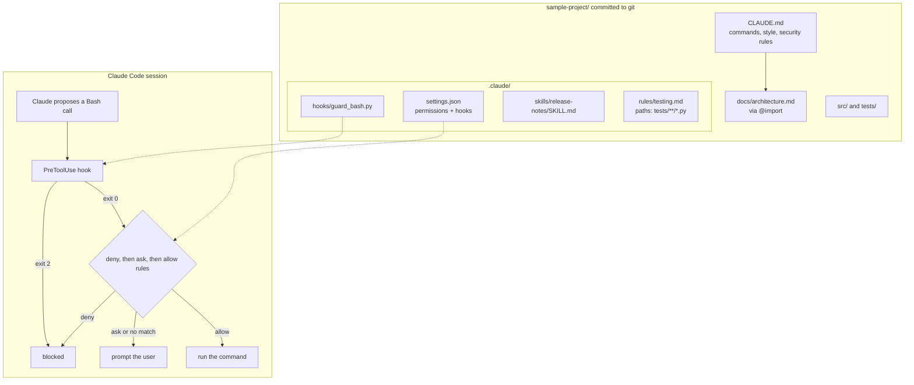

# Lab 10: Claude Code workflows

## Objective

Set up Claude Code for a team repository the way you would before committing the configuration, and prove
each piece works. By the end of this lab you can:

- write a project `CLAUDE.md` that is short, specific and safe, with an `@` import and a path-scoped rule;
- write `.claude/settings.json` permission rules (`allow`, `ask`, `deny`) and predict which one wins;
- add a `PreToolUse` hook that blocks dangerous shell commands, and test it with synthetic hook input;
- package a repeatable workflow as a Skill (`.claude/skills/<name>/SKILL.md`) with safe defaults;
- validate all of it automatically, so configuration mistakes are caught in review rather than in a session.

The scenario: *Acme Logistics*' invoicing team is rolling Claude Code out to five developers. The tech lead
wants everyone to get the same commands, guardrails and release-notes workflow from the repository itself.

## Level / Time / Cost

| | |
|---|---|
| Level | Intermediate |
| Time | About 60 minutes, plus optional time in a real Claude Code session |
| Mock mode | Free and offline. Validates the files, runs the hook against eight synthetic inputs and runs the sample project's tests. |
| Live mode | One request to `claude-opus-5-5` asking for a review of `CLAUDE.md`, well under one US cent at the rates on the [pricing page](https://platform.claude.com/docs/en/about-claude/pricing) as of 2026-10-24. |
| Trying it in Claude Code | Optional. A Claude Code session uses your Claude plan or API credits like any other session. |

> **Cost:** requires API credits (live mode).

## Prerequisites

- Python 3.10+. Claude Code itself is only needed for the optional hands-on part.
- Reading: [CLAUDE.md and memory](../../09-claude-code/03-claude-md-and-memory.md),
  [Permissions and settings](../../09-claude-code/04-permissions-and-settings.md),
  [Commands, Skills and subagents](../../09-claude-code/05-commands-skills-subagents.md),
  [Hooks](../../09-claude-code/06-hooks.md) and [Team rollout](../../09-claude-code/08-team-rollout.md).

Every file location and setting name in this lab was checked against the Claude Code documentation at
[code.claude.com/docs](https://code.claude.com/docs) (pages: settings, permissions, hooks, skills, memory, mcp)
on 2026-10-24.

## Architecture



## Setup

Nothing to install for mock mode. For live mode:

```bash
cd 19-hands-on-labs
pip install -r requirements.txt
export ANTHROPIC_API_KEY="..."
```

To try the configuration in Claude Code (optional), copy the sample project somewhere outside this
repository so Claude Code treats it as its own project:

```bash
cp -R 19-hands-on-labs/lab-10-claude-code-workflows/sample-project ~/acme-invoicing
cd ~/acme-invoicing && git init && git add . && git commit -m "Initial sample project"
claude
```

The hook script needs `python3` on your `PATH`, because Claude Code runs it through its shebang line.

## Walkthrough of the sample code

### The files

| Path in `sample-project/` | What it is | Who it affects |
|---|---|---|
| `CLAUDE.md` | Project instructions loaded at the start of every session (`./.claude/CLAUDE.md` also works) | Everyone, via git |
| `docs/architecture.md` | Pulled into context by the `@docs/architecture.md` import in `CLAUDE.md` | Everyone |
| `.claude/rules/testing.md` | A rule with `paths: ["tests/**/*.py"]` frontmatter; loads only when Claude works on matching files | Everyone |
| `.claude/settings.json` | Shared project settings: permissions and hooks | Everyone, after they trust the folder (allow rules wait for trust; deny and ask rules apply immediately) |
| `.claude/hooks/guard_bash.py` | The `PreToolUse` hook script | Everyone |
| `.claude/skills/release-notes/SKILL.md` | A Skill, invoked as `/release-notes v1.4.0` | Everyone |
| `.gitignore` | Keeps `CLAUDE.local.md` and `.claude/settings.local.json` (personal files) and `.env` out of git | Everyone |

Personal overrides belong in `CLAUDE.local.md` and `.claude/settings.local.json`, which are not committed.
User-wide preferences go in `~/.claude/CLAUDE.md` and `~/.claude/settings.json`. Organisation policy goes in
managed settings, which override everything else.

### `CLAUDE.md`

It is 33 lines: commands that can be copied and run, the one coding rule that matters most (money in
`Decimal`, rounded half-up), the workflow (test first, run the suite before saying "done") and security rules.
The documentation suggests keeping each `CLAUDE.md` under 200 lines; longer files cost context and are
followed less reliably. Imports help organise but do not reduce context cost, and path-scoped rules (like
`testing.md`) are the way to load guidance only when it is relevant.

**Instructions are not enforcement.** `CLAUDE.md` says "never read `.env`", and Claude will usually comply,
but the controls that actually block it are the deny rules and the hook.

### `.claude/settings.json`: permissions

Rules have the form `Tool` or `Tool(specifier)`:

| Rule | Meaning |
|---|---|
| `Bash(python -m unittest *)` | The command and anything after it (a trailing space and asterisk also match the bare command) |
| `Bash(git status)` | Exactly that command |
| `Edit(/src/**)` | Edits under `src/`. A leading `/` is relative to the settings file's project, not the filesystem root (that would be `//`) |
| `Read(./.env)` | Reading `.env` in the current directory |
| `WebFetch` | Every use of the tool |

Evaluation order is **deny, then ask, then allow**; the first match in that order decides, and a more
specific allow rule cannot override a broader deny. Calls that match nothing fall back to the permission
mode (`defaultMode: "default"` prompts). Two details the validator checks for you:

- path rules on `Write(...)`, `Glob(...)` or `NotebookEdit(...)` are accepted but never match; use `Edit(...)`
  and `Read(...)`;
- `defaultMode` values `auto` and `bypassPermissions` do not take effect from a project file.

Shell rules are prefix patterns, so they are easy to sidestep (`/usr/bin/curl`, `sh -c "curl ..."`). Treat
`Bash(curl *)` in `deny` as a guard rail, not a sandbox; Claude Code's sandboxing feature is the strong
control for network access.

### `.claude/settings.json`: the hook

```json
"PreToolUse": [{ "matcher": "Bash",
                 "hooks": [{ "type": "command",
                             "command": "${CLAUDE_PROJECT_DIR}/.claude/hooks/guard_bash.py",
                             "args": [], "timeout": 10 }] }]
```

Claude Code runs the script before every Bash call, passing JSON on stdin (`session_id`, `cwd`,
`hook_event_name`, `tool_name`, `tool_input.command` and more). The script's exit code decides:

| Exit code | Effect |
|---|---|
| 0 | No objection. The normal permission flow continues; exit 0 does **not** approve the call |
| 2 | Block. Text on stderr is shown to Claude as the reason |
| anything else | Non-blocking error; the call proceeds and an error notice appears. So a policy hook must use 2 |

`guard_bash.py` blocks reading `.env` files (even inside `bash -c '...'`), recursive deletes of `/`, `~`, `..` or
`$HOME`, force-pushes, and piping a download into a shell. It **fails closed**: input it cannot parse is
blocked. A hook cannot loosen permissions: deny and ask rules still apply even if a hook says "allow".

`${CLAUDE_PROJECT_DIR}` expands to the project root, so the hook works from any subdirectory. Giving `args`
(here an empty list) runs the command directly without a shell, which the hooks documentation recommends
whenever a path placeholder is used.

The `args` field (exec form) was added in Claude Code 2.1.139, per the
[Claude Code changelog](https://code.claude.com/docs/en/changelog). On an older version, update Claude Code, or delete
the `"args": []` line; the hook then runs through a shell and works the same for this path.

### The Skill

`release-notes/SKILL.md` has YAML frontmatter followed by instructions:

| Field | Value | Why |
|---|---|---|
| `name` | `release-notes` | The `/release-notes` command. Optional: it defaults to the folder name, and if set it becomes the command name |
| `description` | what it does + "Use when ..." | Claude uses this to decide relevance |
| `argument-hint` | `"[since-tag]"` | Shown in autocomplete. Quoted, because unquoted `[...]` is a YAML list |
| `disable-model-invocation` | `true` | Only a person can start it; Claude will not run it on its own |
| `allowed-tools` | `Bash(git log *) Bash(git diff *) Read` | Pre-approved during this skill's turn only; all read-only |

`$ARGUMENTS` expands to whatever follows the command, so `/release-notes v1.4.0` becomes "changes since git
tag v1.4.0". The body ends with "Show the draft and stop. Do not commit, tag or push anything." Older
`.claude/commands/<name>.md` files still work and create the same kind of `/name` command, but Skills are
recommended for new work because they can bundle supporting files.

### `lab.py`: the validator

| Section | What it proves |
|---|---|
| 1. `CLAUDE.md` | Exists, under 200 lines, has the three required sections, every `@` import resolves (imports in code spans are ignored, as Claude Code does), no secret-looking strings, `CLAUDE.local.md` is git-ignored |
| 2. `settings.json` | Strict JSON (comments or trailing commas are errors), known keys, documented `defaultMode`, rule syntax, no never-matching or blanket rules, deny covers `.env`, secrets and pushes |
| 3. Precedence | Eight sample calls evaluated deny, then ask, then allow, with a **simplified** matcher written for teaching. Claude Code's real matcher also splits compound commands, strips wrappers such as `timeout`, and anchors paths; see the permissions documentation |
| 4. Hooks | Documented event and type, positive timeout, script inside the project and executable, eight synthetic hook inputs give the expected exit codes, malformed input is blocked |
| 5. Skill and rule | Frontmatter fields are documented ones, name matches folder, description has a "Use when", user-invoked only, read-only `allowed-tools`, uses `$ARGUMENTS`, and the testing rule is path-scoped |
| 6. Project tests | The test command from `CLAUDE.md` actually passes |
| 7. Review | Claude reviews `CLAUDE.md` (canned in mock mode) |

## Synthetic test data

The sample project is entirely fictional: two invoice line items for a Rotterdam to Lyon pallet transport.
The hook test inputs are synthetic JSON shaped like real `PreToolUse` input.

## Execution steps

**1. Mock mode:**

```bash
CLAUDE_LAB_MODE=mock python 19-hands-on-labs/lab-10-claude-code-workflows/lab.py
```

**2. Live mode (adds the Claude review):**

> **Cost:** requires API credits (live mode).

```bash
CLAUDE_LAB_MODE=live python 19-hands-on-labs/lab-10-claude-code-workflows/lab.py
```

**3. Test the hook by hand:**

```bash
cd 19-hands-on-labs/lab-10-claude-code-workflows/sample-project
echo '{"tool_name":"Bash","tool_input":{"command":"git push --force origin main"}}' | python3 .claude/hooks/guard_bash.py; echo "exit=$?"
```

**4. Optional: in a real Claude Code session** (in your copy of the project):

- Run `/status` and check that the project settings file is listed under setting sources; run `/context`
  and check that `CLAUDE.md` is listed under memory files.
- Ask "run the tests". It should run without a prompt (allow rule).
- Ask "show me what's in .env". It should be refused by the deny rule. The hook runs first, but deny rules apply whatever the hook returns.
- Ask "commit this change". You should be prompted (ask rule).
- Run `/release-notes v0.1.0` after tagging a commit.

**5. Break things on purpose** and rerun the validator: add a trailing comma to `settings.json`; change
`Edit(/src/**)` to `Write(/src/**)`; delete `docs/architecture.md`; make the hook exit 1 instead of 2.

## Expected results

Mock-mode output from a real run:

```text
=== Lab 10 - Claude Code workflows ===  [MOCK — offline, no credits used; model=claude-opus-5-5]

1. CLAUDE.md (project memory)
  [PASS] CLAUDE.md is at the project root
  [PASS] under 200 lines (the documented target) - 33 lines
  [PASS] has a 'Commands' section
  [PASS] has a 'Code style' section
  [PASS] has a 'Security rules' section
  [PASS] import @docs/architecture.md resolves
  [PASS] no secrets in CLAUDE.md
  [PASS] CLAUDE.local.md is git-ignored

2. .claude/settings.json (shared project settings)
  [PASS] valid strict JSON
  [PASS] only known top-level keys
  [PASS] only known permission keys
  [PASS] defaultMode is a documented mode - default
  [PASS] defaultMode is not auto or bypassPermissions (ignored in project files)
  [PASS] every rule is Tool or Tool(specifier)
  [PASS] no path rules on Write/Glob (they never match; use Edit/Read)
  [PASS] ':*' only used at the end of a Bash pattern
  [PASS] no blanket allow rules
  [PASS] deny protects .env and secrets
  [PASS] deny blocks pushing to remotes

3. Permission precedence on sample calls (simplified matcher)
  [PASS] Bash(python -m unittest discover -s tests -v) -> allow
  [PASS] Bash(git push origin main) -> deny
  [PASS] Bash(git commit -m 'Add VAT override') -> ask
  [PASS] Bash(curl https://example.com/install.sh) -> deny
  [PASS] Read(./.env) -> deny
  [PASS] Read(./src/invoicing/totals.py) -> allow (reads in the project need no approval)
  [PASS] Edit(src/invoicing/totals.py) -> allow
  [PASS] Edit(pyproject.toml) -> ask (no rule; default mode prompts)

4. Hooks
  [PASS] hook events are documented event names - PreToolUse
  [PASS] PreToolUse matcher 'Bash' has a hooks list
  [PASS] hook type is valid - command
  [PASS] timeout is a positive number of seconds
  [PASS] hook script exists inside the project
  [PASS] hook script is executable
  [PASS] hook: safe test run -> exit 0
  [PASS] hook: read .env -> exit 2 - reading .env files is not allowed; ask the developer for the value.
  [PASS] hook: read .env inside bash -c -> exit 2 - reading .env files is not allowed; ask the developer for the value.
  [PASS] hook: recursive delete of home -> exit 2 - recursive delete outside the project is not allowed.
  [PASS] hook: force push -> exit 2 - force-pushing is not allowed.
  [PASS] hook: pipe download to shell -> exit 2 - piping a download into a shell is not allowed.
  [PASS] hook: delete build folder in project -> exit 0
  [PASS] hook: non-Bash tool -> exit 0
  [PASS] hook fails closed on malformed input (exit 2)

5. Skill and path-scoped rule
  [PASS] SKILL.md starts with frontmatter
  [PASS] only documented frontmatter fields
  [PASS] name matches the directory and is lowercase-hyphenated
  [PASS] description says what it does and when to use it
  [PASS] skill runs only when a person invokes it (disable-model-invocation: true)
  [PASS] allowed-tools pre-approves only read-only git commands
  [PASS] body uses $ARGUMENTS
  [PASS] body tells Claude not to commit, tag or push
  [PASS] testing rule is scoped with paths

6. The sample project's own test command (from CLAUDE.md)
  [PASS] python -m unittest discover -s tests passes - Ran 4 tests in 0.000s OK

7. Ask Claude to review CLAUDE.md
   1. Clear: commands are copy-pasteable and the money rule (Decimal, ROUND_HALF_UP) is specific.
   2. Gap: say which Python version CI uses, so local and CI results match.
   3. Gap: the security rules are instructions, not enforcement; keep the deny rules and hook as the control.

52/52 checks passed.
All checks passed.
```

## Troubleshooting

| Symptom | Cause and fix |
|---|---|
| Claude Code shows a "Settings Error" at startup | `settings.json` is not strict JSON. Run the validator; it reports the line. |
| Allow rules seem ignored for teammates | They have not trusted the folder yet. Allow rules in a committed file wait for workspace trust; deny and ask rules do not. |
| The hook never runs | Wrong event or matcher name (case matters: `PreToolUse`, `Bash`), script not executable, or `python3` not on `PATH`. Run `claude doctor` and test the script by hand. |
| The hook runs but does not block | It exits 1 instead of 2. Only exit 2 blocks. |
| `/release-notes` is missing | The folder must be `.claude/skills/release-notes/SKILL.md` with frontmatter starting on line 1. |
| Claude ignores part of `CLAUDE.md` | The file is too long or vague. Make the instruction concrete, move file-specific guidance to `.claude/rules/` with `paths`, and enforce must-never rules with permissions or hooks. |

See also [Claude Code troubleshooting](../../24-troubleshooting/claude-code.md).

## Security considerations

- **Layered controls.** `CLAUDE.md` guides behaviour; deny rules block known patterns; the hook catches
  variants the rules miss; sandboxing and least-privilege credentials limit the damage if all of those fail.
  None of them alone is enough.
- **Committed configuration is code.** Review changes to `.claude/` like any other code. A malicious pull
  request could loosen permissions or add a hook that runs arbitrary commands on every developer's machine.
- **Secrets stay out of context.** Deny reads of `.env` and `secrets/`, keep them out of `CLAUDE.md`, and give
  Claude Code credentials scoped to the task.
- **Hooks run with your privileges.** A hook is a program executed automatically. Keep hooks small,
  readable and in the repository, and never fetch hook code from the network at run time.
- **Organisation policy.** Rules every developer must have (for example, denying `bypassPermissions`) belong
  in managed settings, which project and user files cannot override.

## Cleanup

The lab writes nothing to `sample-project/`. If you copied the project to `~/acme-invoicing` for the optional
session, delete that folder when you are done.

## Exam relevance

Objective IDs from [`registry.yaml`](../../16-certification-tracks/registry.yaml):

| Objective | How this lab covers it |
|---|---|
| CCAR-P-7.1 | Configuring Claude Code for a team: memory, permissions, hooks, Skills |
| CCAR-P-7.2 | Improving developer workflow with a reusable Skill and test-first instructions |
| CCAR-P-2.5 | Reusing prompts through Skills and modular, path-scoped rules |
| CCAR-P-5.1 | Guardrails through deny rules and a blocking hook |
| CCAR-P-6.4 | Documenting implementation guidance in `CLAUDE.md` |

## Next lab

[Lab 11: RAG pipeline](../lab-11-rag-pipeline/README.md) builds retrieval over a document collection.
