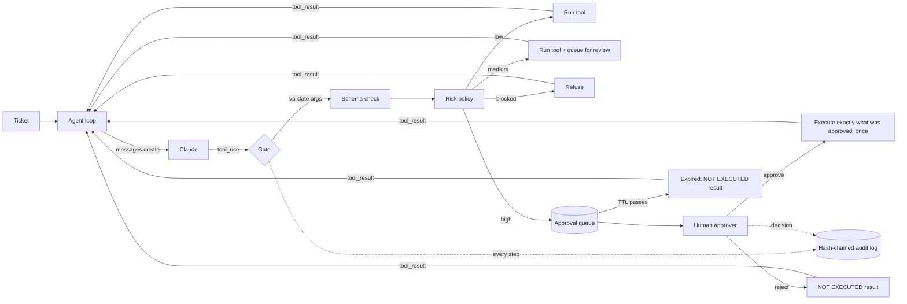

# Lab 13: Human-in-the-Loop Approvals

> **Level:** Advanced · **Time:** ~45 min · **Cost:** free in mock mode; live mode uses API credits · **Exam relevance:** CCAR-P 5.3, CCAR-P 5.1, CCAR-P 3.1, CCAR-P 5.2, CCAO-F 2.4

## Objective

Build an approval gate that sits between Claude and the tools it can call. By the end of this lab you will be able to:

- assign each proposed tool call a risk tier (low, medium, high or blocked) from a policy file, including tiers that depend on the arguments (a small credit is routine, a large one is not);
- let low-risk calls run, let medium-risk calls run but queue them for review afterwards, and pause high-risk calls until a person approves, rejects or ignores them;
- bind an approval to the exact arguments that were approved, so the action cannot be swapped or replayed;
- enforce separation of duties, so the requester can never approve its own action;
- write a tamper-evident, hash-chained audit trail that answers "who allowed this, when, and why?";
- return honest tool results to Claude when an action is rejected or expires, so the model tells the requester what really happened instead of improvising a workaround.

The key idea: **the model proposes, the platform decides.** Claude never sees a "please approve" tool and cannot talk its way past the gate, because the gate is ordinary code that runs outside the model.

## Level, time and cost

| Item | Value |
|---|---|
| Level | Advanced |
| Time | About 45 minutes (15 to run and read the output, 30 for the exercises) |
| Mock mode | Free, offline, standard library only, finishes in well under a second |
| Live mode | Three tickets, about 3 model calls each with tool definitions in every request |

> **Cost:** requires API credits (live mode).

A live run sends roughly 9 to 12 requests to `claude-opus-5-5` (as of 2026-10-24). Each request carries the system prompt, five tool definitions and the growing conversation, so expect around 15,000 to 25,000 input tokens and 2,000 to 4,000 output tokens in total, which is a few cents to a few tens of cents at the published rates. Check the [pricing page](https://platform.claude.com/docs/en/about-claude/pricing) for current numbers. The approver is simulated in both modes, so nobody has to sit at a keyboard.

## Prerequisites

- Python 3.10 or newer.
- [Lab 08: Tool invocation](../lab-08-tool-invocation/README.md), because this lab uses a manual tool-use loop (`stop_reason == "tool_use"`, `tool_result` blocks, parallel tool calls).
- [Lab 12: Agentic task execution](../lab-12-agentic-task-execution/README.md) for step budgets and stopping conditions.
- Helpful background: [Human-in-the-loop](../../10-agentic-ai/05-human-in-the-loop.md), [Human oversight](../../12-ai-security/13-human-oversight.md) and [Logging and auditability](../../12-ai-security/11-logging-and-auditability.md).

## Architecture



Everything inside the gate is deterministic Python. Claude only ever sees tool results.

## Setup

Mock mode needs nothing beyond Python 3.10+. For live mode:

```bash
pip install -r 19-hands-on-labs/requirements.txt
export ANTHROPIC_API_KEY=...   # see 19-hands-on-labs/.env.example; never commit a real key
```

See [`../requirements.txt`](../requirements.txt), [`../.env.example`](../.env.example) and the shared helper [`../common/claude_lab.py`](../common/claude_lab.py), which picks the mock or live client from `CLAUDE_LAB_MODE`.

Output files go to `$LAB_OUTPUT_DIR/claude-labs/lab-13`. If `LAB_OUTPUT_DIR` is unset, the system temp directory is used. Nothing is written inside the repository.

## Walkthrough of the sample code

All the code is in [`lab.py`](lab.py). Read it top to bottom; the sections below follow its order.

**Tools.** Five tools for a fictional freight company, Acme Logistics. Each is declared with `strict: true`, every property is required, and `additionalProperties` is `false`, so the shape of the arguments is predictable. The request uses `tool_choice={"type": "auto"}`; forcing a specific tool (`any` or `tool`) is rejected on Opus 5.5, Sonnet 5.5, Fable 5.1 and Mythos 5.1, and you do not need it.

**FakeClock.** Approval waits are measured in simulated minutes. The lab advances the clock instead of sleeping, so a 15-minute expiry takes microseconds and the output is identical on every run. Production systems use the same trick in tests.

**AuditLog and verify_chain.** Every record includes the SHA-256 hash of the previous record, and its own hash covers its whole content. If someone edits, deletes or reorders a record, the recomputed chain breaks at that point. This is *tamper-evident*, not tamper-proof: an attacker who can rewrite the whole file can rebuild the chain. Real deployments ship the log to write-once storage or anchor the latest hash somewhere the agent host cannot write.

**ShipmentSystem.** A fake back end with an in-memory copy of `data/shipments.json`. It returns strings that start with `EXECUTED:` or `ERROR:` so the model gets clear, structured feedback.

**validate_args and classify.** The gate first validates arguments against the tool schema (even with `strict: true`, you should not trust input you did not check yourself). Then `classify` reads `data/risk_policy.json`:

- tools that are not in the policy are `blocked` (an allow-list, not a deny-list);
- `hard_limits` block an action outright, whoever approves it (credits above 2,000 USD belong in the finance system);
- `escalate` raises the tier based on arguments (credits above 100 USD become high risk).

**ApprovalQueue, SimulatedApprover, await_decision.** A high-risk call becomes an `ApprovalRequest` with an ID, the SHA-256 of the canonical arguments, a reason and an expiry time. `decide()` enforces two rules: the approver must not be the requester, and the approver must be authorised for that tool. The simulated approver reads `data/approver_script.json`, waits a scripted "thinking time", then approves, rejects or never answers. `await_decision` polls until a decision arrives or the time-to-live (TTL) passes.

In a real system you would not block a thread for 15 minutes. You would persist the conversation and the pending request, return control, and resume the loop when a webhook or queue message delivers the decision. The lab keeps the loop in memory to stay small; the state you would persist is exactly the `ApprovalRequest` plus the message list.

**execute_approved.** This is the second half of the binding. It runs the action only if the request is `approved`, the tool and argument hash match what was approved, and the approval has not already been used. Then it marks the request `consumed`. Without this check, a compromised or confused agent could get approval for "credit 45 USD" and then execute "credit 4,500 USD".

**gate.** Ties it together and writes `tool_proposed`, `tier_assigned`, `approval_requested`, `approval_decided`, `tool_executed` and `tool_blocked` events. Notice what goes back to Claude when an action does not run: a `tool_result` with `is_error: true` that starts with `NOT EXECUTED`, gives the reason, and says not to retry. The system prompt tells the model what that prefix means.

**run_ticket.** A bounded manual loop (six steps). It checks `stop_reason` before touching `content`: `refusal` and `max_tokens` route the ticket to a human, `tool_use` goes through the gate, and anything else ends the loop. All `tool_result` blocks from one assistant turn go back in a single user message, which is how parallel tool calls are answered.

**Mock model.** `mock_ops_agent` is registered with `register_mock`. It only answers requests whose system prompt contains `ACME-OPS-ASSISTANT`, follows a two-step plan per ticket, and writes a final summary from the tool results it receives. It emits real `ToolUseBlock` objects, so the gate code is the same in both modes.

**Self-checks.** Nine checks test the controls directly (chain verification, tamper detection, allow-list, hard limit, schema validation, separation of duties, argument binding, single use, and "every approval-backed execution has an approved decision"). Five more check the scripted scenario and only run in mock mode, because a live model may choose different tool calls.

## Synthetic test data

All data is fictional. Organisations, addresses and reference numbers do not exist.

| File | Contents |
|---|---|
| `data/tickets.json` | Three tickets: a damage credit (T-1001), an address change from an unverified email (T-1002), and a customs release plus a small goodwill credit (T-1003). |
| `data/shipments.json` | The fake shipment records the tools read and update. |
| `data/risk_policy.json` | Tool allow-list, base tiers, escalation rules, hard limits, the approval TTL (900 seconds) and poll interval. |
| `data/approver_script.json` | Which approver may approve which tools, and the scripted decision per tool: approve the credit, reject the reroute, never answer the customs release. |

The scenario covers each path through the gate at least once: low (status lookups), medium (60 USD credit), high-approved (450 USD credit), high-rejected (reroute), high-expired (customs release), and blocked (tested directly in the self-checks).

## Execution steps

### Mock mode

From the repository root:

```bash
CLAUDE_LAB_MODE=mock python 19-hands-on-labs/lab-13-human-in-the-loop/lab.py
echo $?   # 0 means every self-check passed
```

Then inspect the audit log:

```bash
python -m json.tool --json-lines "${LAB_OUTPUT_DIR:-$(python -c 'import tempfile;print(tempfile.gettempdir())')}/claude-labs/lab-13/audit.jsonl" | head -40
```

### Live mode

> **Cost:** requires API credits (live mode).

```bash
pip install -r 19-hands-on-labs/requirements.txt
export ANTHROPIC_API_KEY=...
CLAUDE_LAB_MODE=live python 19-hands-on-labs/lab-13-human-in-the-loop/lab.py
```

The approver is still the scripted one, so decisions are the same. What changes is Claude: it may phrase things differently, look up status more than once, or decide not to request an action at all (for example, it may refuse to reroute on an unverified email without asking). The control self-checks still run; the scenario checks are skipped and the lab says so.

## Expected results

Real output from a mock run. The output directory path differs per machine.

```text
=== Lab 13: human-in-the-loop approvals ===  [MOCK — offline, no credits used; model=claude-opus-5-5]

--- T-1001 (Tailspin Toys) ---
  get_shipment_status    tier=low     (read-only lookup)
  issue_carrier_credit   tier=high    (credit above 100 USD moves real money)
                         APR-0001 -> approved after 4 min by ops.lead@acme-logistics.example
  final: T-1001 summary: Done: credit CR-0001 of 450.00 USD applied for SHP-7781.

--- T-1002 (Fabrikam) ---
  get_shipment_status    tier=low     (read-only lookup)
  reroute_shipment       tier=high    (address changes are a common fraud pattern and hard to reverse)
                         APR-0002 -> rejected after 5 min by ops.lead@acme-logistics.example
  final: T-1002 summary: An approver rejected the request, so nothing changed; we will confirm the request with the customer.

--- T-1003 (Contoso Health) ---
  get_shipment_status    tier=low     (read-only lookup)
  release_customs_hold   tier=high    (regulatory exposure if paperwork is wrong)
                         APR-0003 -> expired after 15 min
  issue_carrier_credit   tier=medium  (small goodwill credits are routine)
  final: T-1003 summary: The request is waiting for a human decision and stays open for follow-up. Done: credit CR-0002 of 60.00 USD applied for SHP-7802.

Medium-risk actions queued for after-the-fact review:
  - T-1003: issue_carrier_credit ran without pre-approval and is queued for review -> EXECUTED: credit CR-0002 of 60.00 USD applied for SHP-7802

Audit events: tool_proposed=7, tier_assigned=7, tool_executed=5, approval_requested=3, approval_decided=3, post_review_queued=1
Files written to <temp dir>/claude-labs/lab-13: audit.jsonl, approvals.json

Self-checks (control logic, always enforced):
  [PASS] audit hash chain verifies
  [PASS] editing record 3 breaks the chain (first bad seq = 3)
  [PASS] tool not on the allow-list is blocked
  [PASS] credit above the hard limit is blocked outright
  [PASS] schema validation rejects missing and extra fields
  [PASS] requester cannot approve its own request
  [PASS] changed arguments after approval are refused
  [PASS] an approval can be used only once
  [PASS] every approval-backed execution has an approved decision

Self-checks (scripted mock scenario):
  [PASS] T-1001: 450 USD credit paused, approved, then applied
  [PASS] T-1002: rejected reroute left the address unchanged
  [PASS] T-1003: unanswered customs release expired and did not run
  [PASS] T-1003: 60 USD credit ran as medium risk and was queued for review
  [PASS] model was told about the rejection and the expiry

14/14 checks passed.
```

Things to notice:

- The same tool, `issue_carrier_credit`, lands in two different tiers because the policy looks at the amount.
- T-1003 has two parallel tool calls. One waits 15 minutes and expires; the other runs. A pause on one action does not have to block unrelated low-risk work, but you should decide that deliberately per workflow.
- The audit log has more records than the summary shows, including the self-check probe that was blocked.

### Exercises

1. Change the approver script so the customs release is approved after 20 minutes. Why does it still expire? Raise `approval_ttl_seconds` and rerun.
2. Add an escalation rule so `reschedule_delivery` becomes high risk when the new date is more than 14 days away.
3. Edit a line in `audit.jsonl` by hand and write a tiny script that calls `verify_chain` on the file.
4. Add a second approver who may approve credits but not reroutes, and route the reroute to them. Watch `decide()` refuse.

## Troubleshooting

| Symptom | Likely cause | Fix |
|---|---|---|
| `ValueError: forced tool_choice is not supported` | You changed `tool_choice` to `any` or `tool`. | Keep `{"type": "auto"}` and steer with the system prompt. |
| `PermissionError: separation of duties` | The approver identity equals `requester_identity`. | Use a different approver in `approver_script.json`. |
| `PermissionError: arguments differ from the approved request` | Something changed the arguments between approval and execution. | This is the control working. Re-request approval for the new arguments. |
| Live run: Claude retries a rejected action | The tool result was not clear enough, or the system prompt was edited. | Keep the `NOT EXECUTED ... Do not retry` wording and the matching system-prompt rule. |
| Live run: a high-risk tool never appears | Claude chose not to request it (often reasonable for T-1002). | Not a bug. Read the final summary. The scenario checks are skipped in live mode. |
| `AuthenticationError` in live mode | `ANTHROPIC_API_KEY` missing or wrong. | Export the key or run `ant auth login`; see `../.env.example`. |
| Nothing in the output directory | `LAB_OUTPUT_DIR` points somewhere unexpected. | Print the path shown at the end of the run. |

## Security considerations

- **Put the gate outside the model.** A system prompt that says "ask before refunds" is guidance, not a control. The tier decision, the approval check and the argument binding are all plain code that the model cannot override, even under prompt injection (see [Lab 14](../lab-14-prompt-injection-testing/README.md)).
- **Default deny.** Unknown tools are blocked. New tools must be added to the policy on purpose, with a tier.
- **Bind approvals to arguments and use them once.** Store a hash of the canonical arguments and compare at execution time. Expire unanswered requests rather than leaving them open forever, and never treat silence as consent.
- **Separation of duties.** The agent identity must never appear in an approver list. In production, approvers authenticate through your identity provider, and the approval UI shows the full arguments, not the model's summary of them, because a summary can be wrong or manipulated.
- **Approval fatigue is a real risk.** If everything is high risk, people click "approve" without reading. Use argument-based escalation and medium-tier after-the-fact review to keep the approval queue short and meaningful.
- **Audit for accountability.** Record who proposed, which tier, who decided, when and why. Ship the log to storage the agent host cannot modify; the hash chain only makes tampering detectable.
- **Data minimisation.** The audit log stores the full arguments here for teaching. In a regulated system, store what you need to reconstruct the decision and redact personal data (see [Lab 15](../lab-15-sensitive-data-protection/README.md)).
- **Treat tool results and ticket text as untrusted.** T-1002 arrived by unverified email; content like that is a classic route for social engineering and injection.

## Cleanup

The lab only writes to its output directory. Remove it with:

```bash
rm -rf "${LAB_OUTPUT_DIR:-$(python -c 'import tempfile;print(tempfile.gettempdir())')}/claude-labs/lab-13"
```

If you exported `ANTHROPIC_API_KEY` for live mode, unset it when you are done (`unset ANTHROPIC_API_KEY`).

## Exam relevance

Objective IDs come from [`16-certification-tracks/registry.yaml`](../../16-certification-tracks/registry.yaml).

| Objective | Text | How this lab covers it |
|---|---|---|
| CCAR-P 5.3 | Apply human-in-the-loop validation | Risk-tiered approval gate, expiry, separation of duties |
| CCAR-P 5.1 | Implement guardrails and safety controls | Allow-list, hard limits, argument binding |
| CCAR-P 3.1 | Evaluate tool and agent configuration for capability bloat | Every tool has an explicit tier; unknown tools are blocked |
| CCAR-P 5.2 | Identify risks, limitations and failure modes of LLM systems | Approval fatigue, unverified requests, tampering |
| CCAR-P 1.3 | Select architectural patterns (workflow, agentic, augmented LLM) | Agent proposes, deterministic workflow decides |
| CCAO-F 2.4 | Decide when human review or extra verification is needed | Which actions need a person, and which can be reviewed afterwards |

## Next lab

Continue with [Lab 14: Prompt injection testing](../lab-14-prompt-injection-testing/README.md), where you attack a toy application of your own and measure how layered defences, including tool-call policies like the gate in this lab, reduce the damage.
