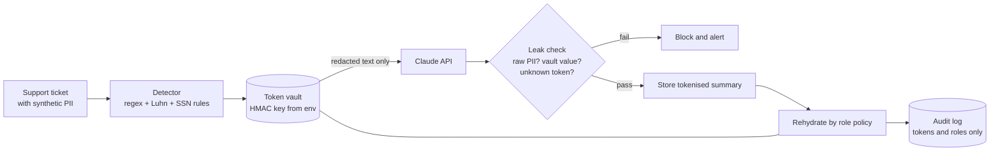

# Lab 15: Sensitive Data Protection

> **Level:** Advanced · **Time:** ~45 min · **Cost:** free in mock mode; live mode uses API credits · **Exam relevance:** CCAR-P 5.1, CCAR-P 5.2, CCAR-P 5.4, CCAO-F 6.2, CCAO-F 6.3

## Objective

Build a small privacy layer that sits between your application and the Claude API. By the end of the lab you will have:

1. A pattern-based detector for four kinds of synthetic personal data: e-mail addresses, phone numbers, payment-card-like numbers (checked with the Luhn algorithm so ordinary order numbers are not flagged) and Social Security number (SSN)-like identifiers (with exclusions for shapes that are never issued).
2. A measurement of that detector's precision and recall against a labelled synthetic set, including the cases it misses.
3. A reversible tokenisation vault. Values are swapped for keyed tokens such as `[EMAIL_BBADD1E0]` before the request leaves your process, and only a role that is allowed to see a value can turn the token back into it.
4. Leak checks on the model's output that catch raw personal data, values echoed from the vault and tokens the model invented.
5. An audit trail of every rehydration that records tokens, roles and purposes but never the raw values.

The pattern is simple: **minimise what you send, check what comes back, and control who can reverse it.**

## Level, time and cost

| Item | Value |
|---|---|
| Level | Advanced (you should be comfortable with regular expressions and basic API calls) |
| Time | About 45 minutes, including the exercises |
| Mock mode | Free, offline, standard library only |
| Live mode | Four short `messages.create` calls to `claude-opus-5-5` at `effort: "low"` |

> **Cost:** requires API credits (live mode).

A live run sends about 1,200 input tokens and receives a few hundred output tokens, including thinking. At the Claude Opus 5.5 list price as of 2026-10-24 ($4 per million input tokens and $20 per million output tokens; check the [pricing page](https://platform.claude.com/docs/en/about-claude/pricing) for current rates), that is a few US cents per run.

## Prerequisites

- Python 3.10 or later.
- Earlier labs: [Lab 01](../lab-01-first-claude-interaction/README.md) for the client set-up and [Lab 14](../lab-14-prompt-injection-testing/README.md) for treating model output as untrusted.
- Basic familiarity with regular expressions and hash-based message authentication codes (HMAC). You do not need any privacy-engineering background.

## Architecture



The trust boundary is the arrow into the Claude API. Everything to the left of it can see raw values; nothing crossing it should.

## Setup

Mock mode needs nothing beyond Python 3.10+. From the repository root:

```bash
CLAUDE_LAB_MODE=mock python 19-hands-on-labs/lab-15-sensitive-data-protection/lab.py
```

For live mode, install the SDK and export your key. See [`../.env.example`](../.env.example) for the variable names and [`../requirements.txt`](../requirements.txt) for the packages.

```bash
pip install -r 19-hands-on-labs/requirements.txt
export ANTHROPIC_API_KEY="..."        # never commit this value
export LAB15_VAULT_KEY="$(python -c 'import secrets; print(secrets.token_hex(32))')"   # optional
```

`LAB15_VAULT_KEY` is optional. Without it, the lab generates a random key for each run, so the eight hex characters in each token change between runs. Set it when you want stable tokens across runs, for example to join tokenised records from two batches.

## Walkthrough of the sample code

All the logic is in [`lab.py`](lab.py). The shared helper [`../common/claude_lab.py`](../common/claude_lab.py) supplies the client, the model ID and the mock machinery.

### 1. Detection (`detect`)

Each detector is a regular expression followed by a validation rule:

| Type | Pattern | Validation | Why the validation matters |
|---|---|---|---|
| `EMAIL` | `local@domain.tld` | none | E-mail syntax is distinctive enough on its own. |
| `CARD` | 13–19 digits, either unbroken or in 4-4-4-x or 4-6-5 groups | Luhn checksum | Order numbers, invoices and tracking IDs are also long digit runs. The Luhn check removes about 90% of random runs. |
| `SSN` | `AAA-GG-SSSS` | area not `000` or `666`, group not `00`, serial not `0000` | Those shapes are never issued, and placeholder values such as `000-12-3456` appear in forms and test data. |
| `PHONE` | optional `+1`, area code with or without brackets, then 3-3-4 digits | none | Lookarounds stop it matching inside longer digit runs. |

Detectors run in a fixed order (e-mail, card, SSN, phone), and a span claimed by one cannot be claimed by another. That ordering is a design decision: a card number must not be half-redacted as a phone number.

The SSN rule keeps the 900–999 area range. Those numbers are not issued as SSNs, but they are the range used for Individual Taxpayer Identification Numbers (ITINs), which are just as sensitive. That is also why the synthetic data can safely use values such as `912-34-5678`: they belong to no one's Social Security record.

### 2. Measuring the detector (`evaluate_detector`)

A detector you have not measured is a guess. The lab compares detected `(type, normalised value)` pairs with the labels in `data/labelled_samples.jsonl` and reports true positives (TP), false positives (FP) and false negatives (FN) per type. Precision is `TP / (TP + FP)`, how often a flag is right. Recall is `TP / (TP + FN)`, how much of the real data you caught.

The labelled set deliberately contains two cases the detector misses: a spelled-out e-mail address (`sam dot lee at example dot com`) and a seven-digit phone number without an area code. Recall comes out at 0.87, and the self-check threshold is 0.85. In a real system you would decide whether to accept those gaps, add detectors, or add a named-entity recognition (NER) model. Notice also that the customer's **name** is never detected. Names, addresses and free-text health details need NER or a dedicated data loss prevention (DLP) service. Regular expressions alone are not enough.

### 3. The token vault (`TokenVault`)

`token_for` computes `HMAC-SHA256(key, "TYPE:normalised value")` and keeps the first eight hex characters. Three properties follow:

- **Deterministic.** `DANA.OKAFOR@example.com` and `dana.okafor@example.com` normalise to the same value and so get the same token, which keeps references consistent across tickets.
- **Keyed.** Without the key, an attacker cannot confirm a guess by hashing candidate values. That attack is called a dictionary attack, and it is trivial against an unkeyed hash of a phone number.
- **Reversible only through the vault.** The token-to-value mapping lives in the vault, never in the token. In production the vault is an encrypted store with its own access control and retention policy, separate from the logs and from the model provider.

Eight hex characters give about four billion values, which is fine for a lab. Use longer suffixes, and detect collisions, at scale.

`redact` replaces every finding with its token. The redacted text is the only thing passed to `summarise`.

### 4. Calling Claude (`summarise`)

The request follows the current API rules: `model=MODEL` (`claude-opus-5-5`), `output_config={"effort": "low"}` because summarising is a simple task, no sampling parameters and no prefill. The system prompt tells Claude to copy tokens exactly and never guess or invent personal data. The code checks `stop_reason` before reading the content. If it is anything other than `end_turn`, such as `max_tokens` or `refusal`, the lab raises an error instead of storing a partial or empty summary.

In mock mode, the responder also appends each request to `SENT_PAYLOADS`. That acts as an egress log, and a self-check scans it for every raw value found in the tickets. This is the most important test in the lab, because it proves that nothing sensitive crossed the boundary.

### 5. Leak checks (`leak_check`)

Model output is untrusted input. Three checks run before a summary is stored:

1. Run the detector over the output. Any raw pattern is a leak.
2. Look for any exact vault value, including digit-only forms after removing spaces and punctuation. This catches values the detector would miss in a different format.
3. Every token in the output must exist in the vault. An unknown token means the model invented one or something tampered with the text, and a later rehydration would fail or, worse, resolve to the wrong record.

The lab builds a deliberately bad output and confirms all three checks fire.

### 6. Rehydration by role (`rehydrate`)

`ROLE_POLICY` maps roles to the entity types they may see in clear text:

| Role | Sees in clear | Sees masked |
|---|---|---|
| `case_handler` | e-mail, phone, card, SSN | nothing |
| `support_agent` | e-mail, phone | card, SSN |
| `analytics` | nothing | everything |

Masked values keep just enough to be useful (`**** **** **** 1111`, `d***@example.com`). Every replacement adds an audit row with the role, the purpose, the token, the type and whether it was revealed. The raw value is never logged.

## Synthetic test data

| File | Contents |
|---|---|
| `data/support_tickets.jsonl` | Four support tickets for the fictional *Northwind Lending*, mixing personal data with lookalike values: a non-Luhn reference number, a non-Luhn order number and a "card ending 4444" fragment. |
| `data/labelled_samples.jsonl` | Twenty labelled sentences: 13 contain personal data, and 7 are hard negatives (invoice and tracking numbers, version strings, dates, placeholder SSN shapes). Two positives are known misses. |

Every value is synthetic:

- E-mail domains are `example.com`, `example.org`, `.example` or `.invalid`, which are reserved for documentation and testing.
- Phone numbers use the `555-01xx` range, which is reserved for fictional use in North America.
- Card numbers are the publicly documented test numbers that payment processors publish for sandbox testing, such as `4111 1111 1111 1111`.
- SSN-like values sit in the 900 range or other never-issued shapes.

Never replace these with real data, even "just to test".

## Execution steps

### Mock mode

```bash
CLAUDE_LAB_MODE=mock python 19-hands-on-labs/lab-15-sensitive-data-protection/lab.py
echo "exit code: $?"
```

The run takes well under a second and exits 0 when all self-checks pass. To get stable tokens, prefix the command with `LAB15_VAULT_KEY=any-local-secret`.

### Live mode

> **Cost:** requires API credits (live mode).

```bash
pip install -r 19-hands-on-labs/requirements.txt
export ANTHROPIC_API_KEY="..."
CLAUDE_LAB_MODE=live python 19-hands-on-labs/lab-15-sensitive-data-protection/lab.py
```

Live mode sends the same redacted tickets to Claude. The summaries will be worded differently from the mock, but the leak checks and role-based rehydration run unchanged. The egress-log self-check runs only in mock mode, where the lab can intercept the request. In live mode, use your own HTTP proxy or the SDK's debug logging to inspect the outgoing payloads.

## Expected results

Output from a real mock run without `LAB15_VAULT_KEY` set. The eight hex characters in each token and the temporary-directory path will differ on your machine.

```text
=== Lab 15: Sensitive data protection ===  [MOCK — offline, no credits used; model=claude-opus-5-5]

Step 1: detector precision and recall on data/labelled_samples.jsonl
  type    TP  FP  FN  precision  recall
  EMAIL    3   0   1       1.00    0.75
  PHONE    3   0   1       1.00    0.75
  CARD     5   0   0       1.00    1.00
  SSN      2   0   0       1.00    1.00
  ALL     13   0   2       1.00    0.87
  Misses and false positives: [('L15', 'EMAIL'), ('L16', 'PHONE')]
  [PASS] no false positives on order numbers, IDs and invalid SSN shapes
  [PASS] overall precision >= 0.95
  [PASS] overall recall >= 0.85 (known gaps: spelled-out e-mail, 7-digit phone)
  [PASS] non-Luhn 16-digit runs are not flagged as cards
  [PASS] Luhn-valid test card is flagged
  [PASS] area 000 / 666 and group 00 are rejected

Step 2: redact tickets before sending (vault key source: random per-run key)
  NWL-4471: 3 finding(s) [CARD, PHONE, EMAIL]
    redacted: Hi, this is Dana Okafor. I was charged twice for my March loan payment on card [CARD_0568C9CD]. Please call me back on [PHONE_3DCC66DC] or reply to [EMAIL_BBADD1E0]. My reference number is 2026102400017734.
  NWL-4472: 3 finding(s) [SSN, PHONE, EMAIL]
    redacted: Updating my tax details for the hardship application. My taxpayer ID is [SSN_E1E3972E] and my new phone is [PHONE_60FB714C]. Account email: [EMAIL_B81CD66B]. Thanks, Marco.
  NWL-4473: 2 finding(s) [CARD, PHONE]
    redacted: Autopay failed again on the Mastercard ending 4444 (full number [CARD_F17C091B]). Order 9876 5432 1098 7654 from the partner store was also declined. Text me at [PHONE_A3180B94].
  NWL-4474: 1 finding(s) [EMAIL]
    redacted: Please close my account. I no longer need the line of credit. You can reach me at [EMAIL_20840FD8]. No other changes needed.
  [PASS] every ticket after redaction has no detectable PII
  [PASS] tokens are deterministic for the same normalised value

Step 3: summarise redacted tickets with Claude
  NWL-4471 ->
    Issue: Duplicate charge on the March loan payment.
    Contact: [PHONE_3DCC66DC], [EMAIL_BBADD1E0]
    Next step: Refund the duplicate payment after billing confirms it.
  NWL-4472 ->
    Issue: Hardship application needs updated tax and contact details.
    Contact: [PHONE_60FB714C], [EMAIL_B81CD66B]
    Next step: Route to the hardship team to update the file.
  NWL-4473 ->
    Issue: Autopay failed and a partner-store order was declined.
    Contact: [PHONE_A3180B94]
    Next step: Check the autopay mandate and the card status.
  NWL-4474 ->
    Issue: Customer asks to close the line of credit.
    Contact: [EMAIL_20840FD8]
    Next step: Send the account closure confirmation form.
  [PASS] no raw PII value left the process (egress log scan)

Step 4: leak checks on model output
  NWL-4471: clean
  NWL-4472: clean
  NWL-4473: clean
  NWL-4474: clean
  [PASS] all real summaries pass the leak check
  simulated bad output -> ['raw CARD pattern in output', 'exact vault value echoed in output', 'unknown token [CARD_DEADBEEF] (invented or tampered)']
  [PASS] leak check blocks a raw card number
  [PASS] leak check blocks an invented token

Step 5: rehydrate the redacted NWL-4471 ticket for different roles
  case_handler:
    Hi, this is Dana Okafor. I was charged twice for my March loan payment on card 4111 1111 1111 1111. Please call me back on (202) 555-0143 or reply to dana.okafor@example.com. My reference number is 2026102400017734.
  support_agent:
    Hi, this is Dana Okafor. I was charged twice for my March loan payment on card **** **** **** 1111. Please call me back on (202) 555-0143 or reply to dana.okafor@example.com. My reference number is 2026102400017734.
  analytics:
    Hi, this is Dana Okafor. I was charged twice for my March loan payment on card **** **** **** 1111. Please call me back on ***-***-0143 or reply to d***@example.com. My reference number is 2026102400017734.
  [PASS] case_handler sees the full card number
  [PASS] support_agent sees contact details but only a masked card
  [PASS] analytics sees only masked values
  [PASS] every rehydration is audited

Audit log (9 rows, tokens only, no raw values) written to /var/folders/.../T/claude-labs/lab-15/rehydration_audit.jsonl
  [PASS] audit log contains no raw PII

Self-checks: 17/17 passed
```

Things to notice:

- The reference number `2026102400017734` and the order number `9876 5432 1098 7654` stay in the text because they fail the Luhn check. "Mastercard ending 4444" also stays, because four digits identify nothing on their own.
- The customer names "Dana Okafor" and "Marco" are **not** redacted. That gap is real, and the exercises ask you to address it.
- In the simulated bad output, the raw card number trips two independent checks. Defence in depth means one missed pattern is not enough to leak.

### Exercises

1. Add a detector for a fictional *Northwind Lending* loan ID format (`NWL-LN-` followed by eight digits) and add three labelled samples for it, including one hard negative.
2. Add a simple name redactor that uses a list of first names from the ticket metadata, and measure how precision changes.
3. Add a `purpose` allow-list so that `support_agent` can see a card number only when `purpose == "chargeback dispute"`.

## Troubleshooting

| Symptom | Likely cause | Fix |
|---|---|---|
| `[FAIL] no false positives ...` after you edit a regex | The new pattern matches a hard negative, often a long ID or a date | Print `detect(text)` for the failing sample, then tighten lookarounds or add a validation rule. |
| Tokens change every run | `LAB15_VAULT_KEY` is not set, so a random key is used | Export a key if you need stable tokens. Keep it out of the repository. |
| Live summaries contain `[UNKNOWN_TOKEN]` after rehydration | Claude altered a token (changed its case or dropped a bracket) | Keep the "copy tokens exactly" instruction, and treat any unknown token as a leak-check failure, which the lab already does. |
| `RuntimeError: unexpected stop_reason 'max_tokens'` | `max_tokens` is too low for the reply plus thinking | Raise `max_tokens`. Do not store truncated output. |
| `RuntimeError: unexpected stop_reason 'refusal'` | A safety classifier declined the request | Inspect `response.stop_details`, and review the ticket text before retrying. |
| `SystemExit: Live mode needs the SDK` | The `anthropic` package is not installed | `pip install -r 19-hands-on-labs/requirements.txt` |

## Security considerations

- **Data minimisation comes first.** Tokenisation reduces exposure, but sending nothing sensitive at all is better. Ask whether the model needs the field before you decide how to protect it.
- **Regular expressions are a floor, not a ceiling.** They miss names, addresses, free-text medical details, international formats and obfuscated values. Treat measured recall as a known residual risk and record it in your risk register.
- **Protect the key and the vault separately from the data.** If the HMAC key and the token mapping leak together, tokenisation offers no protection. Store the key in a secrets manager, rotate it on a schedule, and remember that rotation changes every token.
- **Logs are a common leak path.** Request and response logging, exception traces and analytics events often capture prompts. Log the tokenised text only, as the audit log here does.
- **Rehydration is an authorisation decision.** Check the role and a stated purpose on every call, and audit it. Do not cache rehydrated text in places with weaker access control.
- **Regulatory context.** Rules such as the EU General Data Protection Regulation (GDPR) and the US Health Insurance Portability and Accountability Act (HIPAA) treat pseudonymised data as still personal while the re-identification key exists. Tokenisation reduces risk, but it does not take data out of scope. Confirm your obligations, retention settings and any data processing agreement with your privacy and legal teams.
- **Payment card data.** Real primary account numbers fall under the Payment Card Industry Data Security Standard (PCI DSS). The usual answer is not to let them reach a language-model pipeline at all. Tokenise at the payment provider.

## Cleanup

The lab writes one file, `claude-labs/lab-15/rehydration_audit.jsonl`, under your system temporary directory, or under `LAB_OUTPUT_DIR` if you set it. Remove it with:

```bash
rm -rf "${LAB_OUTPUT_DIR:-${TMPDIR:-/tmp}}/claude-labs/lab-15"
```

Unset `LAB15_VAULT_KEY` and `ANTHROPIC_API_KEY` if you exported them in a shared shell.

## Exam relevance

| Objective | Text (from [registry.yaml](../../16-certification-tracks/registry.yaml)) | Where this lab covers it |
|---|---|---|
| CCAR-P 5.1 | Implement guardrails and safety controls | Pre-call redaction, output leak checks |
| CCAR-P 5.2 | Identify risks, limitations and failure modes of LLM systems | Measured detector recall, invented tokens |
| CCAR-P 5.4 | Ensure regulatory compliance (e.g. GDPR, HIPAA, FedRAMP) | Pseudonymisation, audit trail, data minimisation |
| CCAO-F 6.2 | Apply data-sensitivity, regulatory and privacy considerations | Choosing what may leave the trust boundary |
| CCAO-F 6.3 | Follow organisational AI policy and governance standards | Role policy for rehydration |

## Next lab

[Lab 16: Evaluation Framework](../lab-16-evaluation-framework/README.md). You will build a golden dataset, code-based graders and an LLM-as-judge rubric to measure prompt changes before you ship them.
