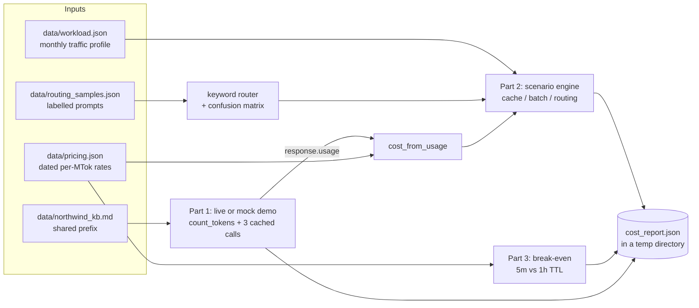

# Lab 17: Cost Optimisation

> **Level:** Intermediate · **Time:** ~45 min · **Cost:** free in mock mode; live mode uses API credits · **Exam relevance:** CCAR-P 4.5, CCAR-P 2.5, CCAR-P 2.1, CCAR-P 1.6, CCAO-F 3.3

## Objective

By the end of this lab you can:

1. Turn the `usage` object on a Claude response into dollars, pricing each of the four token meters (regular input, cache writes, cache reads, output) separately.
2. Model a month of traffic for a fictional organisation and compare the effect of prompt caching, the Message Batches API and model routing, alone and combined.
3. Work out the break-even point for prompt caching with the 5-minute and the 1-hour time-to-live (TTL), and recognise when caching cannot help at all.
4. Explain why the right unit is **cost per completed task**, not cost per request, using a router that sometimes sends work to a model that is too small.

The lab is a calculator with a short live demonstration attached. Nothing in it is a forecast of your bill: every price is dated, and every workload number is an assumption you should replace with your own measurements.

## Level, time and cost

| | |
|---|---|
| Level | Intermediate. You should be comfortable reading Python and JSON. |
| Time | About 45 minutes, including the exercises at the end of the walkthrough. |
| Mock mode | Free and offline. A fake client returns realistic `usage` numbers. |
| Live mode | Three small `messages.create` calls and one `messages.count_tokens` call on `claude-opus-5-5`. |

> **Cost:** requires API credits (live mode).

A live run sends a handbook of roughly 1,000 tokens three times (written to the cache once, then read twice) plus three short questions, at low effort. Using the prices in `data/pricing.json` (as of 2026-10-24) that is about one US cent, a little more if the model writes longer answers or thinks for longer. Token counting is free but has its own rate limit.

## Prerequisites

- Python 3.10 or later.
- [Lab 05: Context management](../lab-05-context-management/README.md) and [Lab 06: Model comparison](../lab-06-model-comparison/README.md) are helpful background: they introduce context windows and the differences between the Haiku, Sonnet and Opus families.
- For live mode: an Anthropic API key with credits.
- Basic arithmetic. The whole lab is multiplication and addition, which is exactly why it is worth doing by hand once.

## Architecture



Everything flows through one function, `cost_from_usage`. The live demo feeds it real `usage` objects; the scenario engine feeds it *expected* usage built from the workload assumptions. Using the same function for both keeps the forecast honest: if the function is wrong, the live numbers will disagree with your invoice and you will notice.

## Setup

Mock mode needs nothing beyond Python 3.10+. From the repository root:

```bash
python --version   # 3.10 or later
```

Live mode needs the SDK and a key. See [`../requirements.txt`](../requirements.txt) and [`../.env.example`](../.env.example):

```bash
pip install -r 19-hands-on-labs/requirements.txt
export ANTHROPIC_API_KEY="..."        # never commit this; .env is git-ignored
```

The shared helper [`../common/claude_lab.py`](../common/claude_lab.py) decides the mode from `CLAUDE_LAB_MODE` and supplies the mock client.

## Walkthrough of the sample code

### 1. The cost model (`cost_from_usage`)

Every Claude response carries a `usage` object. The four fields that matter for cost are:

| Field | What it counts | Price |
|---|---|---|
| `input_tokens` | Prompt tokens after the last cache breakpoint (or all of them if you do not cache) | Base input rate |
| `cache_creation_input_tokens` | Prompt tokens written to the cache on this request | 1.25x input for the 5-minute TTL, 2x for the 1-hour TTL |
| `cache_read_input_tokens` | Prompt tokens served from the cache | The model's cache-read rate (0.20 USD per million tokens on Opus 5.5 and Sonnet 5.5, as of 2026-10-24) |
| `output_tokens` | Everything the model generated, including thinking | Output rate |

`cost_from_usage` reads those fields from either an SDK object or a plain dict, picks the right rates, applies the cache-write multiplier for the chosen TTL, and halves everything when `batch=True`. The Batches API discount applies to every token in the request, including cache reads and writes, so the discounts stack. The function returns the split as well as the total, because "where does the money go" is usually a more useful question than "how much".

`rates_for` handles one wrinkle: in `data/pricing.json`, `claude-haiku-5-5` has a higher rate for prompts above 100,000 tokens. The lab counts input, cache writes and cache reads together when testing that threshold.

> **Unverified:** whether the Haiku 5.5 long-prompt threshold counts cached tokens, and the Haiku 5.5 cache-read rate itself, are not stated in the source this lab used. The file assumes 0.1x the input rate and marks it with `cache_read_unverified`. Check the [pricing page](https://platform.claude.com/docs/en/about-claude/pricing) before relying on Haiku cache figures.

### 2. The live demo (`run_demo`)

The demo builds a system prompt from two blocks: a short instruction, then the synthetic Northwind handbook marked with `cache_control: {"type": "ephemeral"}`. Stable content goes first and the breakpoint goes at the end of the stable part, because prompt caching is a prefix match: change one byte before the breakpoint and everything after it misses.

It then:

1. Calls `client.messages.count_tokens(...)` to estimate the prompt size before spending anything. This is how you budget a request in advance.
2. Sends three different questions with the same system prompt and `output_config={"effort": "low"}`. Effort is a cost lever in its own right: lower effort means less thinking and fewer output tokens, and a short lookup does not need more.
3. Checks `stop_reason` before reading the text. A `max_tokens` or `refusal` response is reported and skipped rather than treated as an answer.
4. Prices each response twice: as billed (with cache meters) and as it would have been without caching.

The mock responder plays the role of the API: the first request reports a cache write, later ones report cache reads, and token counts are derived from the text length so the numbers move when you edit the handbook.

### 3. The scenario engine (`monthly_cost`)

`data/workload.json` describes six request types for the fictional Northwind Lending policy assistant: FAQ lookups, document classification, email drafts, case summaries, policy analysis and a monthly portfolio review. Each has a daily volume, a per-request suffix size, an output size, a "true tier" (the cheapest model tier expected to do the job well) and a flag saying whether a person is waiting for the answer.

`expected_usage` converts one request type into an *average* usage dict. With caching on and a hit rate `h`, a shared prefix of `P` tokens becomes `P*(1-h)` cache-write tokens plus `P*h` cache-read tokens. Prefixes shorter than the cacheable minimum (512 tokens on the current models according to the claude-api skill, as of 2026-10-24) are priced as plain input, because the API silently ignores the marker.

Six scenarios are compared:

| Scenario | What changes |
|---|---|
| A | Everything on Opus 5.5, no caching, no batching. The baseline. |
| B | A plus prompt caching of the 6,000-token shared prefix. |
| C | A plus the Batches API for request types where nobody is waiting. |
| D | Caching and batching together. Batch traffic uses a lower assumed hit rate, because batch requests are not guaranteed to run close together. |
| E | D plus a keyword router that sends each request to Haiku, Sonnet or Opus. When the router picks a model below the request's true tier, the lab charges for the failed attempt **and** the escalation to the right model. |
| F | D plus a perfect router. This is an upper bound you cannot reach, shown so you can see what misrouting costs. |

### 4. The router and cost per completed task

`route()` is deliberately naive: keywords such as "compare" or "assess" mean complex, "draft" or "summarise" mean medium, anything else is simple. `routing_matrix()` runs it over 24 labelled prompts and turns the results into a confusion matrix. Two complex prompts are routed to Haiku (they contain no trigger words), and one medium prompt is routed to Opus (it contains the word "review").

Those errors cost different amounts. Over-routing (medium to Opus) costs more per request but succeeds. Under-routing (complex to Haiku) produces an answer that misses the quality bar, so you pay for the cheap attempt *and* the expensive one. That is why the lab reports cost per completed task. A request that is cheap but has to be redone is not cheap.

Before you build a router at all, measure the simpler option: the most capable model at a lower effort setting. One model also means one cache, because caches are scoped to the model. A router splits your traffic across three caches, each of which has to be written separately.

### 5. Caching break-even (`break_even`)

For `N` requests that share a `P`-token prefix:

- Without caching you pay `N * P * input_rate`.
- With caching you pay one write (`P * input_rate * write_multiplier`) and `N-1` reads (`P * cache_read_rate`).

With Opus 5.5's prices as of 2026-10-24 (input 4.00, cache read 0.20 USD per million tokens), the 5-minute TTL wins from the second request onward and the 1-hour TTL from the third. The third row shows a 400-token prefix, which is below the cacheable minimum and never breaks even, however many requests share it. Choose the TTL from the gap between requests that share the prefix: if they arrive less than five minutes apart, the 5-minute TTL stays warm on its own and the 1-hour TTL only adds a more expensive write.

### Exercises

1. Change `interactive_cache_hit_rate` in `data/workload.json` to `0.5` and rerun. How much of scenario B's saving survives?
2. Add `"plan"` to `COMPLEX_WORDS` and rerun. Does accuracy go up, and does scenario E get cheaper or more expensive?
3. Set `cache_ttl` to `"1h"`. Which scenarios change, and why does the 1-hour TTL make sense only for gaps of more than five minutes?
4. In live mode, compare `count_tokens` with the real `usage` total of the first request. Why might they differ slightly?

## Synthetic test data

All files in `data/` are invented for this lab. Northwind Lending is a fictional organisation and the handbook policies are not real.

| File | Contents |
|---|---|
| `pricing.json` | Per-million-token prices for `claude-opus-5-5`, `claude-sonnet-5-5` and `claude-haiku-5-5`, cache and batch multipliers, the cacheable minimum, an `as_of` date (2026-10-24), the source and the pricing page URL. |
| `workload.json` | Six request types with volumes, token sizes, true tiers and latency flags, plus cache hit-rate assumptions clearly labelled as assumptions. |
| `routing_samples.json` | 24 hand-labelled prompts (8 per tier) used to measure the router. |
| `northwind_kb.md` | A synthetic support handbook of about 1,000 tokens, used as the cached prefix. |

## Execution steps

### Mock mode

From the repository root:

```bash
CLAUDE_LAB_MODE=mock python 19-hands-on-labs/lab-17-cost-optimisation/lab.py
echo $?    # 0 means every self-check passed
```

It finishes in well under a second. Set `LAB_OUTPUT_DIR` if you want the JSON report somewhere other than your system temp directory.

### Live mode

> **Cost:** requires API credits (live mode).

```bash
pip install -r 19-hands-on-labs/requirements.txt
export ANTHROPIC_API_KEY="..."
CLAUDE_LAB_MODE=live python 19-hands-on-labs/lab-17-cost-optimisation/lab.py
```

Parts 2 and 3 are pure arithmetic and identical in both modes. Part 1 now shows real `usage` numbers. Look at `cache_creation_input_tokens` on the first request and `cache_read_input_tokens` on the next two. In live mode the cache-read check is printed as `[INFO]` rather than pass or fail, because a cache miss is something to investigate, not a bug in the lab.

## Expected results

Mock-mode output (the report path depends on your temp directory; everything else is deterministic):

```text

=== Lab 17: Cost optimisation ===  [MOCK — offline, no credits used; model=claude-opus-5-5]

Pricing as of 2026-10-24 (https://platform.claude.com/docs/en/about-claude/pricing)

Part 1: measure real usage with a cached handbook prefix

  count_tokens estimate for request 1: 990 input tokens (about $0.00396 uncached)

  Q1: What time does the support desk close on Friday?
      A: The support desk closes at 18:00 on Fridays (handbook section 1).
      usage: input=20 cache_write=916 cache_read=0 output=16
      cost $0.004980 vs $0.004064 without caching

  Q2: Is the hardship hotline open on a public holiday?
      A: Yes. The hardship hotline opens 10:00 to 14:00 on public holidays (handbook section 1).
      usage: input=20 cache_write=0 cache_read=916 output=21
      cost $0.000683 vs $0.004164 without caching

  Q3: How long do we keep call recordings?
      A: Call recordings are kept for 18 months and then deleted automatically (handbook section 6).
      usage: input=17 cache_write=0 cache_read=916 output=22
      cost $0.000691 vs $0.004172 without caching

Part 2: monthly scenarios for the synthetic Northwind workload

  scenario                                     monthly USD     vs A
  A baseline (Opus, no cache, no batch)          11,511.60    +0.0%
  B + prompt caching                              3,527.23   -69.4%
  C + batch for non-urgent work                   7,897.50   -31.4%
  D caching + batch                               3,454.85   -70.0%
  E D + keyword router (with escalations)           858.19   -92.5%
  F D + perfect router (upper bound)                794.03   -93.1%

  router accuracy on 24 labelled prompts: 87.5%
    true simple   -> routed {'simple': 8, 'medium': 0, 'complex': 0}
    true medium   -> routed {'simple': 0, 'medium': 7, 'complex': 1}
    true complex  -> routed {'simple': 2, 'medium': 0, 'complex': 6}

Part 3: prompt-caching break-even (Opus 5.5, shared prefix)

  6000-token prefix, 5m TTL: N=1 $0.0300 vs $0.0240, N=2 $0.0312 vs $0.0480, N=3 $0.0324 vs $0.0720  -> break-even at N=2
  6000-token prefix, 1h TTL: N=1 $0.0480 vs $0.0240, N=2 $0.0492 vs $0.0480, N=3 $0.0504 vs $0.0720  -> break-even at N=3
  400-token prefix, 5m TTL: N=1 $0.0016 vs $0.0016, N=2 $0.0032 vs $0.0032, N=3 $0.0048 vs $0.0048  -> no break-even: prefix is below the cacheable minimum

  report written to <temp-dir>/claude-labs/lab-17/cost_report.json

Self-checks
  [PASS] 1M Opus input tokens cost 4.00 USD
  [PASS] batch halves the same request
  [PASS] 5-minute cache write is 1.25x input
  [PASS] Haiku switches to long-prompt rates above 100K prompt tokens
  [PASS] 5m TTL breaks even at 2 requests, 1h TTL at 3
  [PASS] a prefix below the minimum never benefits from caching
  [PASS] router accuracy is at least 85%
  [PASS] caching and batch each cut cost; together they cut more
  [PASS] misrouting costs money: perfect router beats keyword router
  [PASS] every demo request ended with stop_reason end_turn
  [PASS] requests 2 and 3 read the handbook from cache
  [PASS] cached requests cost less than uncached ones

12/12 checks passed
```

What to notice:

- **Request 1 costs more with caching** (the 1.25x write premium), requests 2 and 3 cost about a sixth as much. Caching is an investment that only pays back on reuse.
- **Caching beats batching for this workload** because the shared prefix is large and most traffic is interactive. Batching helps only the requests nobody is waiting for.
- **Routing gives the biggest saving here**, but only because most of Northwind's volume is simple work. The gap between E and F is the price of the router's mistakes.

## Troubleshooting

| Symptom | Likely cause | Fix |
|---|---|---|
| `cache_read_input_tokens` stays 0 in live mode | Prefix below the model's cacheable minimum, a byte changed in the prefix between calls, or the requests were more than five minutes apart | Keep the handbook unchanged, run the calls back to back, and check the prefix size with `count_tokens` |
| `cache_creation_input_tokens` is high on every request | Something before the breakpoint changes per request (a timestamp, a request ID, unsorted JSON) | Move volatile content after the last `cache_control` breakpoint |
| `SystemExit: No price for ...` | `CLAUDE_LAB_MODEL` is set to a model not in `pricing.json` | Add its rates to `pricing.json` (with a date) or unset the variable |
| Live costs do not match your invoice | Prices changed, thinking tokens are billed as output, or the Haiku long-prompt rule applies | Re-check the pricing page and update `pricing.json` and its `as_of` date |
| `ModuleNotFoundError: anthropic` | Live mode without the SDK installed | `pip install -r 19-hands-on-labs/requirements.txt` |
| A `400` mentioning `temperature` | Code copied from an older tutorial | Remove sampling parameters; use effort and prompt changes instead |

## Security considerations

- **Cost is a security property.** An attacker who can make your application send long prompts or trigger many retries can run up your bill (sometimes called denial of wallet). Cap `max_tokens`, limit request rates per user, and alert on spend per tenant. [Lab 20](../lab-20-secure-enterprise-architecture/README.md) puts these controls in a gateway.
- **Do not let users choose the model or effort directly.** Routing decisions belong in your code, where they can be audited.
- **Usage logs can leak information.** Token counts and per-tenant spend can reveal business volumes. Treat cost dashboards as internal data.
- **Cache isolation.** Prompt caches are isolated per workspace on the Claude API and never shared across organisations, but within a workspace a shared prefix is shared by design. Do not put one tenant's private data in a prefix another tenant's requests will reuse.
- **No credentials in code.** The lab reads `ANTHROPIC_API_KEY` from the environment through the SDK; nothing is written to the repository.

## Cleanup

The lab writes one file, `claude-labs/lab-17/cost_report.json`, under your system temp directory (or `LAB_OUTPUT_DIR`). Delete it when you are done:

```bash
python -c "import tempfile, shutil, pathlib; shutil.rmtree(pathlib.Path(tempfile.gettempdir()) / 'claude-labs' / 'lab-17', ignore_errors=True)"
```

Cached prompt entries expire on their own after the TTL; there is nothing to delete on the API side.

## Exam relevance

Objective text is quoted from [`16-certification-tracks/registry.yaml`](../../16-certification-tracks/registry.yaml).

| Objective | Text | Where this lab covers it |
|---|---|---|
| CCAR-P-4.5 | Optimise token usage, latency and cost-performance | The whole lab: cost from usage, scenarios, break-even |
| CCAR-P-2.5 | Reuse prompts via caching, modular prompts and Skills | Cached handbook prefix, TTL choice, cacheable minimum |
| CCAR-P-2.1 | Select Claude models based on trade-offs | Routing scenario and escalation costs |
| CCAR-P-1.6 | Align solutions to business value (efficiency, transformation, productivity, cost, SLAs) | Batch only where no one is waiting; cost per completed task |
| CCAR-P-2.4 | Optimise context windows and token usage | `count_tokens` before sending; effort as a lever |
| CCAO-F-3.3 | Match model choice to cost, speed and quality needs | Tier-to-model mapping and the confusion matrix |
| CCAO-F-7.3 | Optimise workflows for efficiency and effectiveness | Batching non-urgent work |

## Next lab

[Lab 18: Reliability engineering](../lab-18-reliability-engineering/README.md) makes the same calls survive rate limits, outages, timeouts and refusals.
