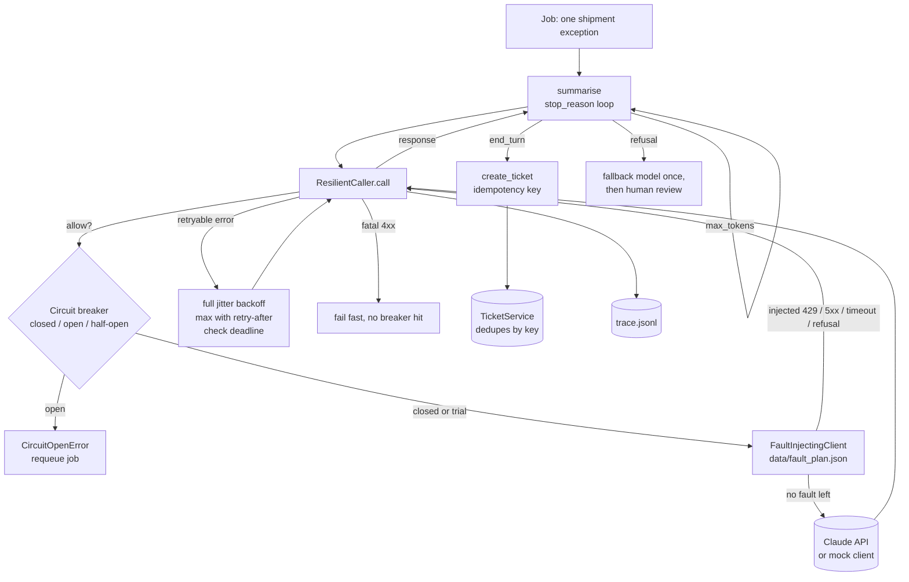

# Lab 18: Reliability Engineering

> **Level:** Advanced · **Time:** ~60 min · **Cost:** free in mock mode; live mode uses API credits · **Exam relevance:** CCAR-P 5.2, CCAR-P 3.3, CCAR-P 1.6, CCAR-P 7.3, CCAR-P 4.6

## Objective

By the end of this lab you can build a Claude integration that keeps working when things go wrong. You will:

1. Classify API failures into **retryable** (408, 409, 429, 5xx including 529 overloaded, connection errors, timeouts) and **fatal** (400, 401, 403, 404, 413), and retry only the first kind.
2. Retry with **exponential backoff and full jitter**, honour the server's `retry-after` header, and stop at an **overall deadline** as well as a per-call timeout.
3. Protect a struggling dependency with a **circuit breaker** that moves between closed, open and half-open.
4. Handle every `stop_reason` deliberately: `end_turn`, `max_tokens`, `refusal` (reading `stop_details`), and `pause_turn`.
5. Make downstream side effects safe to retry with **idempotency keys**, so a lost acknowledgement does not create a duplicate ticket.
6. Prove all of this with **fault injection**: a plan file that replays rate limits, overloads, timeouts, a bad request, a refusal and an outage on demand.

## Level, time and cost

| | |
|---|---|
| Level | Advanced. You should be comfortable with exceptions, closures and reading JSON traces. |
| Time | About 60 minutes, including the exercises. |
| Mock mode | Free and offline. A simulated clock means backoff waits take no real time; the run finishes in well under a second. |
| Live mode | Around 12 real `messages.create` calls (most on `claude-opus-5-5`, one on the fallback model `claude-sonnet-5-5`) at low effort, plus roughly 15 seconds of real backoff waiting. |

> **Cost:** requires API credits (live mode).

Each live call sends a short system prompt and a single JSON record (a few hundred tokens) and asks for a paragraph under 60 words. At the prices recorded in [Lab 17](../lab-17-cost-optimisation/README.md) (as of 2026-10-24) a full live run costs a few US cents at most. Injected faults are raised locally before a request leaves your machine, so they cost nothing.

## Prerequisites

- Python 3.10 or later.
- [Lab 07: API integration](../lab-07-api-integration/README.md) (calling the Messages API and reading responses) and [Lab 17: Cost optimisation](../lab-17-cost-optimisation/README.md) (why retries cost money).
- For live mode: an Anthropic API key with credits.

## Architecture



The layers are deliberately separate. `ResilientCaller` knows about transport failures and nothing about content. `summarise` knows about `stop_reason` and nothing about HTTP. `create_ticket` knows about idempotency and nothing about Claude. Keeping them apart means each one can be tested on its own, and the fault injector can sit between your code and the API without either side noticing.

## Setup

Mock mode needs nothing beyond Python 3.10+. Live mode needs the SDK and a key; see [`../requirements.txt`](../requirements.txt) and [`../.env.example`](../.env.example):

```bash
pip install -r 19-hands-on-labs/requirements.txt
export ANTHROPIC_API_KEY="..."        # never commit this; .env is git-ignored
```

Optional environment variables:

| Variable | Default | Purpose |
|---|---|---|
| `CLAUDE_LAB_MODE` | `mock` | `live` calls the real API |
| `CLAUDE_LAB18_FALLBACK_MODEL` | `claude-sonnet-5-5` | Model tried once after a refusal |
| `LAB_OUTPUT_DIR` | system temp directory | Where `trace.jsonl` and `outcomes.json` are written |

## Walkthrough of the sample code

### 1. Classifying failures (`classify`, `retry_after_seconds`)

Retrying the wrong error is worse than not retrying. A `400 invalid_request_error` will fail identically every time, and a `401` means the key is wrong, so retrying either just burns quota and delays the alert. `classify` returns `retryable` for:

- HTTP 408, 409, 429, 500, 502, 503, 504 and 529 (`overloaded_error`), and any other 5xx;
- connection errors and timeouts, recognised by class name (`APIConnectionError`, `APITimeoutError`) or by the standard library's `ConnectionError` and `TimeoutError`.

Everything else is `fatal`. The function never imports `anthropic`: it reads `status_code` and the class hierarchy, so it works on the SDK's exceptions in live mode and the lab's injected ones in mock mode.

`retry_after_seconds` reads the `retry-after` header from `exc.response.headers`. When the server tells you how long to wait, that number wins over your own backoff calculation.

### 2. Backoff with full jitter and a deadline (`ResilientCaller.call`)

For attempt `n`, the delay is a random value between 0 and `min(cap, base * 2^(n-1))`. This is "full jitter". Without jitter, every client that failed at the same moment retries at the same moment and causes the next overload. The random generator is seeded from the fault plan so mock runs are repeatable.

Two time limits apply:

- **Per-call timeout.** Each request is sent with `timeout=min(per_call_timeout, remaining)`. The SDK accepts `timeout` per request; in the mock it is passed through to the fault injector, which "hangs" the simulated clock for that long before raising.
- **Overall deadline.** Before sleeping, the caller checks whether the retry would land after the deadline. If it would, it raises `DeadlineExceeded` immediately instead of waiting for a request that cannot finish in time. A user-facing request with a 10-second service-level objective should not spend 40 seconds retrying.

The official SDK already retries 408, 409, 429 and 5xx responses and connection errors (`max_retries`, default 2) and has a default `timeout` of 10 minutes. This lab turns the SDK's retries off with `client.with_options(max_retries=0)` so that you can see every attempt and so that two retry layers do not multiply each other. In your own code, choose one layer: the SDK's built-in retries are fine for scripts; your own policy is worth it when you need deadlines, breakers and metrics.

### 3. The circuit breaker (`CircuitBreaker`)

| State | Behaviour | Moves to |
|---|---|---|
| closed | Requests flow. Consecutive retryable failures are counted. | open after 3 consecutive failures |
| open | Requests are refused locally with `CircuitOpenError`; nothing is sent. | half-open after `reset_timeout` |
| half-open | One trial request is allowed through. | closed on success, open on failure |

Fatal 4xx errors do not count as failures: a malformed request from one caller says nothing about the health of the API. When the breaker opens mid-retry, the caller stops retrying and the job is requeued rather than sleeping and trying again. The breaker takes an injectable clock, which is why the mock run can jump 21 seconds forward without waiting.

### 4. Handling `stop_reason` (`summarise`)

A response arriving is not the same as a job succeeding. `summarise` loops on the stop reason (bounded at six follow-ups):

- **`end_turn`**: done; use the text.
- **`max_tokens`**: the answer was cut off. The lab raises the budget (60, then 240, capped at 1,024) and asks again. An alternative for long outputs is a continuation: send the partial text back inside a new *user* message ("your previous answer stopped at ...; continue from there"). Never use an assistant prefill: current models reject it.
- **`refusal`**: the model declined. The lab reads `resp.stop_details.category` and `explanation`, records them, tries the configured fallback model once, and if that also refuses marks the job `needs_human_review`. It never retries the same request on the same model, because a refusal is not a transient error.
- **`pause_turn`**: only happens with server-side tools (such as web search) when the server's internal loop pauses. `resume_after_pause` sends the conversation back with the paused assistant turn appended unchanged and **no** extra "continue" message. The fault plan does not trigger it, because the shared mock client rejects a trailing assistant message; a self-check tests the helper directly instead.

**Server-side fallback.** For `claude-opus-5-5`, the API can do the refusal fallback for you: call `client.beta.messages.create(...)` with `betas=["server-side-fallback-2026-07-01"]` and `fallbacks="default"`, and the API re-runs a refused request on a suitable model within the same call, routing by refusal category. The lab implements the fallback in application code because the offline mock client has no `beta` namespace, and because the application-level version makes the logic visible. In production, prefer the server-side parameter where it is available, and still check `stop_reason` on the final response, since the fallback model can refuse too.

> **Unverified:** the server-side fallback details (beta header value, `"default"` form, model support) come from the claude-api skill as of 2026-10-24. Check the refusals documentation on platform.claude.com before relying on them.

### 5. Idempotent side effects (`TicketService`, `create_ticket`)

The Messages API has no idempotency-key parameter, and calling Claude twice is usually harmless apart from cost. The danger is in what you *do* with the answer. Here, each completed note creates a ticket in a (fake) ticketing system. For SHP-1002 the fault plan makes the ticketing service commit the write and then lose the response. The client cannot tell that from a failure, so it retries.

- With an idempotency key derived from the business identity (`acme|create_ticket|<shipment>|<exception code>`, hashed), the retry sends the same key, the service returns the existing ticket marked `replayed`, and there is still exactly one ticket.
- The `naive` service ignores keys, and the same retry produces a duplicate.

Derive the key from what the action *is*, not from a random value generated per attempt. A random UUID is fine only if you store it before the first attempt and reuse it on every retry.

### 6. Fault injection (`FaultInjectingClient`)

The injector wraps the client. On each call it finds the job ID in the prompt, pops the next step from that job's list in `data/fault_plan.json`, and either raises (`http`, `timeout`, `connection`), returns a synthetic refusal, or passes the request through when the list is empty. Because it sits outside the mock, the same fault plan runs in live mode: injected failures are simulated locally and successful calls go to the real API.

### Exercises

1. Change SHP-1003's plan to five 529 errors. Which limit stops it first, `max_attempts` or the breaker?
2. Give SHP-1005 a `401` instead of a `400`. Confirm it still fails fast and does not move the breaker.
3. Set `failure_threshold=2`. Which phase-1 job now trips the breaker, and what happens to the jobs after it?
4. Remove the `retry_after` from SHP-1002's step. How long does the backoff become with seed 18?
5. Add a `{"kind": "connection"}` step to SHP-1001 and check the trace.

## Synthetic test data

All data is invented. Acme Logistics, its carriers (Bluefin Freight, Kestrel Parcel, Orchid Air Cargo, Polar Line Reefers) and its depots are fictional.

| File | Contents |
|---|---|
| `data/shipment_exceptions.json` | Ten shipment exception records with codes, locations, reasons, delays and recommended actions. |
| `data/fault_plan.json` | The seed (18), the ordered fault steps per job, per-job settings (SHP-1006's 60-token budget) and the list of jobs whose ticket acknowledgement is lost. |

Fault plan summary:

| Job | Injected behaviour | What it exercises |
|---|---|---|
| SHP-1001 | none | happy path |
| SHP-1002 | 429 with `retry-after: 2`; ticket ack lost | retry-after, idempotency |
| SHP-1003 | 529 then 500 | backoff with jitter |
| SHP-1004 | timeout | per-call timeout |
| SHP-1005 | 400 | fail fast |
| SHP-1006 | 60-token budget | `max_tokens` handling |
| SHP-1007 | refusal (category `cyber`) | `stop_details`, fallback |
| SHP-2001 | three 503s | breaker opens |
| SHP-2002 | none, but arrives while the breaker is open | short-circuit, half-open recovery |
| SHP-3001 | 529s with `retry-after: 2`, 3-second deadline | deadline |

## Execution steps

### Mock mode

From the repository root:

```bash
CLAUDE_LAB_MODE=mock python 19-hands-on-labs/lab-18-reliability-engineering/lab.py
echo $?    # 0 means every self-check passed
```

### Live mode

> **Cost:** requires API credits (live mode).

```bash
pip install -r 19-hands-on-labs/requirements.txt
export ANTHROPIC_API_KEY="..."
CLAUDE_LAB_MODE=live python 19-hands-on-labs/lab-18-reliability-engineering/lab.py
```

Live mode uses the real clock (backoff waits really happen, the breaker resets after 5 seconds instead of 20) and real responses. Elapsed times are printed as "varies". SHP-1006 may or may not hit `max_tokens` on a 60-token budget, so that check runs in mock mode only. Any real 429 or 529 you receive is handled by the same code as the injected ones.

## Expected results

Mock-mode output (only the output directory differs between machines):

```text
=== Lab 18: Reliability engineering ===  [MOCK — offline, no credits used; model=claude-opus-5-5]

Phase 1: transient errors, a fatal error and stop_reason handling

  SHP-1001  completed              attempts=1  elapsed   0.0s
  SHP-1002  completed              attempts=2  elapsed   2.0s
  SHP-1003  completed              attempts=3  elapsed  0.67s
  SHP-1004  completed              attempts=2  elapsed  20.1s
  SHP-1005  failed                 attempts=1  elapsed   0.0s
  SHP-1006  completed              attempts=2  elapsed   0.0s  max_tokens at 60; raised budget
  SHP-1007  completed              attempts=2  elapsed   0.0s  refusal on claude-opus-5-5 (category=cyber); trying claude-sonnet-5-5

Phase 2: a sustained outage trips the circuit breaker

  SHP-2001  deferred_circuit_open  attempts=3  elapsed  0.74s
  SHP-2002  deferred_circuit_open  attempts=0  elapsed   0.0s
  breaker state: open; requeueing ['SHP-2001', 'SHP-2002'] after 21s
  SHP-2001  completed              attempts=1  elapsed   0.0s
  SHP-2002  completed              attempts=1  elapsed   0.0s
  breaker transitions: ['closed->open', 'open->half_open', 'half_open->closed']

Phase 3: an overall deadline stops a retry storm

  SHP-3001  deadline_exceeded      attempts=2  elapsed   2.0s

Phase 4: idempotent side effects (create one ticket per completed note)

  SHP-1001 -> TCK-0001 after 1 attempt(s)
  SHP-1002 -> TCK-0002 after 2 attempt(s) (ack lost, retried with the same key, replayed)
  SHP-1003 -> TCK-0003 after 1 attempt(s)
  SHP-1004 -> TCK-0004 after 1 attempt(s)
  SHP-1006 -> TCK-0005 after 1 attempt(s)
  SHP-1007 -> TCK-0006 after 1 attempt(s)
  SHP-2001 -> TCK-0007 after 1 attempt(s)
  SHP-2002 -> TCK-0008 after 1 attempt(s)
  tickets with idempotency keys: 8; without keys: 9

  trace (30 events) and outcomes written to <temp-dir>/claude-labs/lab-18

Self-checks
  [PASS] classifier: 400/401/403/404 are fatal
  [PASS] classifier: 408/409/429/500/529 and timeouts are retryable
  [PASS] full jitter stays within [0, cap]
  [PASS] SHP-1001 completed first time
  [PASS] SHP-1002 honoured retry-after (waited >= 2s) then completed
  [PASS] SHP-1003 survived 529 + 500 in 3 attempts
  [PASS] SHP-1004 recovered from a timeout
  [PASS] SHP-1005 failed fast on 400 with one attempt
  [PASS] SHP-1006 completed despite a small max_tokens budget
  [PASS] SHP-1006 hit max_tokens and raised its budget
  [PASS] SHP-1007 refusal recorded its category and fell back
  [PASS] outage opened the breaker and SHP-2002 was short-circuited without an API call
  [PASS] breaker went closed -> open -> half_open -> closed
  [PASS] both deferred jobs completed after requeue
  [PASS] SHP-3001 stopped at the deadline after 2 calls
  [PASS] one ticket per completed job despite a lost ack
  [PASS] without idempotency keys the lost ack creates a duplicate
  [PASS] pause_turn resume appends the assistant turn and no extra user message
  [PASS] mock run finished in under 20 s of real time

19/19 checks passed
```

How to read it:

- **SHP-1004 shows 20.1 s elapsed** because the injected timeout "hangs" for the full 20-second per-call timeout on the simulated clock. In production, that is time a user spends waiting, which is why per-call timeouts should be set from your latency budget, not left at the SDK default.
- **SHP-2001 sends three requests, SHP-2002 sends none.** Once the breaker opens, requests are refused locally until the reset timeout passes.
- **Nine tickets without keys, eight with.** The difference is the lost acknowledgement on SHP-1002.
- The trace file, `trace.jsonl`, has one JSON object per event (`error`, `backoff`, `circuit_opened`, `short_circuit`, `deadline_exceeded`, `response`) with simulated timestamps. [Lab 19](../lab-19-observability/README.md) turns this kind of trace into structured logs, metrics and spans.

## Troubleshooting

| Symptom | Likely cause | Fix |
|---|---|---|
| Live run retries far more than the plan says | SDK retries still enabled in your own copy of the code | Keep `client.with_options(max_retries=0)` when you own the retry policy |
| Every live call fails with 401 | Missing or wrong `ANTHROPIC_API_KEY` | Export a valid key; 401 is fatal by design, so the lab does not retry it |
| Breaker never closes in live mode | The trial request in half-open also failed (a real outage, or a wrong model ID) | Check the trace; fix the model ID or wait and rerun |
| SHP-1007 ends as `needs_human_review` in live mode | The fallback model also refused, or the fallback model ID is wrong | Check `CLAUDE_LAB18_FALLBACK_MODEL` |
| `ValueError: assistant prefill is not supported` | You tried a `max_tokens` continuation by ending `messages` with the partial assistant turn | Put the continuation request in a new user message instead |
| `400` mentioning `tool_choice` or `temperature` | Code copied from an older example | Use `tool_choice` `auto` and remove sampling parameters |
| Check "SHP-1003 survived ... in 3 attempts" fails after editing the plan | The plan and the self-checks are tied together | Revert `data/fault_plan.json` or update the check |

## Security considerations

- **Retries amplify load and cost.** Unbounded retries turn a provider incident into a self-inflicted denial of service and a large bill. Always cap attempts, add jitter, set a deadline and use a breaker.
- **Never retry authentication or permission errors automatically.** A 401 or 403 can mean a revoked key; retrying hides the signal. Alert instead.
- **Refusals are not errors to route around.** The fallback in this lab exists for false positives on legitimate business content. Do not build a loop that keeps rephrasing or switching models until something complies; record the category, use at most one fallback, and send the rest to a person.
- **Idempotency keys must not leak data.** The lab hashes the business identity instead of using raw shipment IDs as keys. Do not put personal data in keys, logs or traces.
- **Fault injection belongs in tests and game days, not in production paths.** Keep the injector behind an explicit switch.
- **Traces can contain sensitive content.** The lab logs status codes and stop reasons only, never prompt or response text. [Lab 19](../lab-19-observability/README.md) covers redaction in logs.

## Cleanup

The lab writes `trace.jsonl` and `outcomes.json` to `claude-labs/lab-18/` under your system temp directory (or `LAB_OUTPUT_DIR`). Remove them with:

```bash
python -c "import tempfile, shutil, pathlib; shutil.rmtree(pathlib.Path(tempfile.gettempdir()) / 'claude-labs' / 'lab-18', ignore_errors=True)"
```

Nothing is created on the API side.

## Exam relevance

Objective text is quoted from [`16-certification-tracks/registry.yaml`](../../16-certification-tracks/registry.yaml).

| Objective | Text | Where this lab covers it |
|---|---|---|
| CCAR-P-5.2 | Identify risks, limitations and failure modes of LLM systems | Error classes, refusals, truncation, outages |
| CCAR-P-3.3 | Evaluate accuracy–latency trade-offs and justify configuration | Per-call timeouts, deadlines, effort setting, fallback model |
| CCAR-P-1.6 | Align solutions to business value (efficiency, transformation, productivity, cost, SLAs) | Deadlines that respect a service-level objective |
| CCAR-P-7.3 | Support debugging and operational issue resolution | Trace file, fault plan, breaker transitions |
| CCAR-P-4.6 | Monitor performance with logging and observability tooling | Structured trace events per attempt |
| CCAR-P-5.3 | Apply human-in-the-loop validation | Refusals that persist go to human review |

## Next lab

[Lab 19: Observability](../lab-19-observability/README.md) adds structured logs, request IDs, token and cost metrics, latency percentiles and spans to calls like these.
