# Lab 19: Observability for Claude Applications

> **Level:** Advanced · **Time:** ~60 min · **Cost:** free in mock mode; live mode uses API credits · **Exam relevance:** CCAR-P 3.4, CCAR-P 4.6, CCAR-P 4.1, CCAR-P 4.5, CCAR-P 5.2

## Objective

A Claude feature that works on your laptop is not the same as one you can run for thousands of users. Once it is live, you need to answer questions such as "which tenant is driving our token bill?", "why was this request slow?", "did that prompt contain a customer's email, and did we just write it to a log?" and "is our error rate above what we promised?". Answering them takes telemetry: logs, metrics and traces.

In this lab you instrument a small multi-tenant workload of 20 Claude calls so that every request produces:

1. **Structured JSON logs**, one object per line, with a **redaction filter** that removes emails, API-key-like strings, SSN-like numbers and card numbers (checked with the Luhn algorithm) before anything reaches disk.
2. **Correlation IDs**: your own `request_id` and a `trace_id` on every log line and span, plus the API's own `request-id` header value in live mode, so you can hand a failing request to support.
3. **Token and cost metrics** per model, using published per-token prices.
4. **Latency percentiles** (p50, p95, p99) using the nearest-rank method.
5. **OpenTelemetry-style spans** (trace ID, span ID, parent, timing, status, attributes) written to a local JSONL file, without installing OpenTelemetry.
6. **Alert rules** for error rate, a p95 latency service-level objective (SLO) and cost per request.

By the end you will be able to explain what to measure for a large language model (LLM) feature, why the shape of the data matters, and how to move from this teaching tracer to the Claude SDK's own OpenTelemetry support.

## Level, time and cost

| Item | Value |
|---|---|
| Level | Advanced |
| Time | About 60 minutes, including the exercises |
| Mock mode | Free, offline, deterministic, under one second |
| Live mode | 20 small requests: 10 to Claude Haiku 5.5, 6 to Claude Sonnet 5.5, 4 to Claude Opus 5.5 |

> **Cost:** requires API credits (live mode).

A live run sends roughly 2,000 input tokens and, with adaptive thinking at `low` or `medium` effort, a few thousand output tokens in total. At the prices below that is typically well under USD 0.10 per run. Thinking tokens are billed as output, so the real figure depends on how much the model chooses to think.

Prices used by the lab, as of 2026-10-24 (from the `claude-api` skill; confirm on the [pricing page](https://platform.claude.com/docs/en/about-claude/pricing) before relying on them):

| Model | Input, USD per million tokens | Output, USD per million tokens |
|---|---|---|
| `claude-opus-5-5` | 4.00 | 20.00 |
| `claude-sonnet-5-5` | 2.00 | 10.00 |
| `claude-haiku-5-5` | 0.10 (prompts up to 100K tokens) | 0.50 (prompts up to 100K tokens) |

The lab also prices prompt-cache writes at 1.25 times the input rate (5-minute time to live) and cache reads at USD 0.20 per million for Opus 5.5 and Sonnet 5.5.

> **Unverified:** the Haiku 5.5 cache-read rate is not listed in the sources used for this lab. The code assumes 0.1 times the input price. Check the pricing page before you use the figure.

## Prerequisites

- Python 3.10 or later.
- Comfort with the Messages API request and response shape (labs 01 and 07), and with `stop_reason` handling.
- Helpful: [Lab 15: Sensitive data protection](../lab-15-sensitive-data-protection/README.md) for redaction ideas, [Lab 17: Cost optimisation](../lab-17-cost-optimisation/README.md) for pricing arithmetic and [Lab 18: Reliability engineering](../lab-18-reliability-engineering/README.md) for retries. This lab records failures; lab 18 shows how to recover from them.
- Basic familiarity with the terms *log*, *metric* and *trace*. The walkthrough explains each one.

## Architecture

```mermaid
flowchart LR
    subgraph App["Lab application (lab.py)"]
        R[requests.jsonl<br/>20 synthetic calls] --> H[handle&#40;&#41;<br/>root span: lab19.handle_request]
        H --> P[redact_preview span]
        H --> C["chat &lt;model&gt; span<br/>client.messages.create"]
        C -->|usage, stop_reason,<br/>request-id| M[Record]
    end
    C <-->|HTTPS| API[(Claude API<br/>or mock client)]
    H -->|log.info / log.error| F{{RedactingFilter}}
    F --> L[(app.log.jsonl)]
    H --> T[(spans.jsonl)]
    M --> AGG[Metrics: tokens, cost,<br/>error rate, p50/p95/p99]
    AGG --> AL[Alert rules]
```



Three signals come out of one request:

- **Logs** answer "what happened, in words?". Each line is a JSON object with an `event` name, a level and the IDs needed to join it to other data.
- **Metrics** answer "how much and how often?". Here they are computed in memory at the end of the run. In production they would be counters and histograms in a metrics backend.
- **Traces** answer "where did the time go?". A trace is a tree of spans that share one `trace_id`. The root span covers the whole request and its children cover each step.

## Setup

Mock mode needs nothing beyond Python 3.10+. Run every command from the repository root.

For live mode:

```bash
python -m venv .venv && source .venv/bin/activate
pip install -r 19-hands-on-labs/requirements.txt
export ANTHROPIC_API_KEY="sk-ant-..."     # or copy ../.env.example to .env and load it
```

See [`../requirements.txt`](../requirements.txt), [`../.env.example`](../.env.example) and the shared helper [`../common/claude_lab.py`](../common/claude_lab.py). Never commit a real key.

Optional: set `LAB_OUTPUT_DIR` to choose where the log and span files are written. By default they go to `<system temp>/claude-labs/lab-19/`, outside the repository.

## Walkthrough of the sample code

All the code is in [`lab.py`](lab.py). The main pieces, in the order a request meets them:

**1. Clocks.** `FakeClock` starts at 2026-10-24 09:00 UTC and only moves when the code calls `advance_ms()`. In mock mode the lab advances it by a simulated latency (a base time per model, a per-output-token cost, random jitter from a seeded generator and an occasional 3x slow tail). That makes every timestamp, latency and percentile identical on every run, which is what you want in a test. `RealClock` uses `time.time_ns()` in live mode.

**2. Redaction.** `redact()` applies four patterns in a fixed order: API-key-like strings (`sk-ant-…`), email addresses, SSN-like `123-45-6789` numbers, and 13 to 19 digit card-like numbers. A card-like match is only redacted if it passes the Luhn checksum, so a 16-digit order number such as `1234 5678 9012 3456` survives. Each hit becomes a typed marker such as `[REDACTED:EMAIL]`, which keeps logs readable and lets you count how often each kind of data shows up.

**3. Logging.** `build_logger()` attaches a `JsonFormatter` and a `RedactingFilter` to a standard-library `logging` file handler. The filter runs on **every** record, including the deliberately careless `llm.request.debug` line that logs the raw prompt. That line shows the point of defence in depth: even if a developer logs something they should not, the handler still scrubs it. The lab also logs only an 80-character redacted preview in the normal completion event.

**4. Tracing.** `FileTracer.span()` is a context manager that creates a `Span` with a 32-hex-character `trace_id`, a 16-hex-character `span_id`, a `parent_span_id`, a `kind` (`SERVER`, `CLIENT` or `INTERNAL`), start and end times in Unix nanoseconds, attributes, a status and events. When the block exits, the span is appended to `spans.jsonl`. This mirrors the OpenTelemetry data model closely enough that you could convert the file to OTLP JSON with a short script.

**5. The instrumented call.** `handle()` opens three spans per request:

| Span | Kind | What it records |
|---|---|---|
| `lab19.handle_request` | SERVER | `app.request_id`, `app.tenant`, `app.route`; marked ERROR if the call fails |
| `lab19.redact_preview` | INTERNAL | how many values were redacted from the preview |
| `chat <model>` | CLIENT | `gen_ai.operation.name`, `gen_ai.provider.name`, `gen_ai.request.model`, `gen_ai.request.max_tokens`, `gen_ai.response.model`, `gen_ai.response.finish_reasons`, `gen_ai.usage.*`, `anthropic.request.id` (live), `app.cost_usd` |

The API call itself follows current rules: `model`, `max_tokens`, a `system` prompt, one user message, and `output_config={"effort": ...}` set per route (`low` for classification and summaries, `medium` for analysis). It sends no `temperature` and no assistant prefill, and leaves thinking at its adaptive default.

After the call, the code checks `stop_reason` before trusting the content. `max_tokens` is logged as a WARNING (`llm.request.truncated`) and `refusal` as `llm.request.refused`. Truncation is a silent quality problem, so it should show up on a dashboard, not only in a user complaint.

On failure, the code records `error.type`, a short message and an `exception` event on the span, logs `llm.request.failed` with the HTTP status code if there is one, and returns an error record. It does not retry. That is lab 18's job, and keeping it out of this lab keeps the telemetry easy to read.

**6. Request IDs.** Your own `request_id` (for example `req-943f196f8d86`) is created before the call, so even a request that never reaches the API has one. In live mode the SDK exposes the API's `request-id` header as `response._request_id`. Despite the underscore it is public, per the SDK documentation. The lab stores it as `api_request_id` in the log and as `anthropic.request.id` on the span. Quote it when you contact support.

**7. Cost.** `cost_usd()` multiplies each usage field by its rate: input, cache writes (1.25 times input), cache reads and output. It switches to the long-prompt Haiku 5.5 rates when a Haiku prompt exceeds 100K tokens.

**8. Percentiles.** `percentile()` uses the nearest-rank method: sort the samples and take the value at rank `ceil(p/100 × n)`. With 20 samples, p95 is the 19th-smallest value and p99 is the largest. Small samples make high percentiles jumpy, which is why production SLOs are judged over windows with many requests.

**9. Alerts.** Three rules are evaluated at the end: error rate above 5%, p95 latency above a 4,000 ms SLO, and any single request costing more than USD 0.01. In production these would be alerting rules in your monitoring system, evaluated over a sliding window, with a minimum request count so one failure at 3 a.m. does not page someone.

### Attribute names and the production path

The `gen_ai.*` attribute names follow the OpenTelemetry GenAI semantic conventions, which are still marked as in development. Note one subtlety the lab handles: in those conventions `gen_ai.usage.input_tokens` **includes** cache reads and writes, whereas the Messages API's `usage.input_tokens` **excludes** them. The lab adds them back and also records `gen_ai.usage.cache_read.input_tokens` and `gen_ai.usage.cache_write.input_tokens`.

> **Unverified:** the GenAI semantic conventions are still changing. Check the current OpenTelemetry specification before you rely on an attribute name in a dashboard.

In production you would not write your own tracer. As of 2026-10-24 the Claude SDKs can emit OpenTelemetry spans themselves (beta). You register a tracer provider and the SDK creates an `anthropic.messages.create` span per request, with `gen_ai.*` usage attributes and `anthropic.request.id`. In Python that is a standard `TracerProvider` plus, optionally, `Anthropic(open_telemetry={...})` to choose a provider or content mode. The default content mode is metadata only (no prompts or responses), which is the privacy-preserving choice. Separately, an organisation admin can configure server-side API tracing to an OTLP endpoint. Read the [OpenTelemetry pages in the Claude docs](https://platform.claude.com/docs) for the current option names, because beta APIs change.

> **Unverified:** exact OpenTelemetry option names and span names in the SDK may change during the beta. Treat the names above as illustrative and confirm them in the docs.

## Synthetic test data

[`data/requests.jsonl`](data/requests.jsonl) holds 20 requests from three fictional tenants: **Contoso Health** (a clinic group), **Northwind Lending** (a consumer lender) and **Acme Logistics** (a parcel carrier). Each row has a `tenant`, a `route` (`classify`, `summarise` or `analyse`), a `model` and a `prompt`. A few rows carry extras:

| Row | Extra | Purpose |
|---|---|---|
| 4 | a fake email address and the well-known `4111 1111 1111 1111` test card number | proves the log filter redacts personal data |
| 9 | `"fault": "overloaded"` | mock mode raises a simulated HTTP 529 `overloaded_error` |
| 11 | a fake `sk-ant-…not-a-real-key…` string | proves API-key-like strings are redacted |
| 15 | `"fault": "timeout"` | mock mode simulates an 8-second client timeout |
| 17 | `"max_tokens": 60` | forces `stop_reason: "max_tokens"` so truncation is logged |

All names, addresses and numbers are invented. Fault injection only happens in mock mode. In live mode rows 9 and 15 run as normal requests.

## Execution steps

### Mock mode

```bash
CLAUDE_LAB_MODE=mock python 19-hands-on-labs/lab-19-observability/lab.py
echo "exit code: $?"
```

Then look at the files it wrote (the path is printed on the second line):

```bash
OUT="${LAB_OUTPUT_DIR:-$(python -c 'import tempfile;print(tempfile.gettempdir())')}/claude-labs/lab-19"
head -n 3 "$OUT/app.log.jsonl"
grep '"ERROR"' "$OUT/app.log.jsonl"
python -c "import json,sys; [print(s['name'], s['status']['code']) for s in map(json.loads, open(sys.argv[1]))]" "$OUT/spans.jsonl" | sort | uniq -c
```

### Live mode

> **Cost:** requires API credits (live mode).

```bash
export ANTHROPIC_API_KEY="sk-ant-..."
CLAUDE_LAB_MODE=live python 19-hands-on-labs/lab-19-observability/lab.py
```

In live mode, latencies are real wall-clock times, IDs come from `secrets`, `api_request_id` is filled in, token counts include thinking tokens, and the two fault rows succeed, so the error-rate alert normally stays `ok`. The mock-only self-checks are skipped.

## Expected results

Real output from a mock run. Only the output directory on line 3 differs between machines. Everything else, including IDs, timestamps and latencies, is deterministic.

```text
=== Lab 19: Observability ===  [MOCK — offline, no credits used; model=claude-opus-5-5]

Writing logs and spans to: /var/folders/.../T/claude-labs/lab-19

1) Per-request results
   # tenant             model              route     status stop         lat_ms    in   out   cost_usd
   1 contoso-health     claude-haiku-5-5   classify  ok     end_turn      340.8    87     2   0.000010
   2 contoso-health     claude-haiku-5-5   classify  ok     end_turn      347.3    84     2   0.000009
   3 northwind-lending  claude-sonnet-5-5  summarise ok     end_turn      966.9   104    21   0.000418
   4 northwind-lending  claude-sonnet-5-5  summarise ok     end_turn      982.5    99    18   0.000378
   5 acme-logistics     claude-opus-5-5    analyse   ok     end_turn     2429.1    97    76   0.001908
   6 acme-logistics     claude-haiku-5-5   classify  ok     end_turn      289.9    88     2   0.000010
   7 contoso-health     claude-sonnet-5-5  summarise ok     end_turn      739.8    94    22   0.000408
   8 northwind-lending  claude-haiku-5-5   classify  ok     end_turn      474.6    87     2   0.000010
   9 acme-logistics     claude-opus-5-5    analyse   error  overloaded    120.0     0     0   0.000000
  10 contoso-health     claude-haiku-5-5   classify  ok     end_turn     1009.3    82     2   0.000009
  11 northwind-lending  claude-sonnet-5-5  summarise ok     end_turn     2793.6    98    21   0.000406
  12 acme-logistics     claude-haiku-5-5   classify  ok     end_turn      532.7    85     2   0.000010
  13 contoso-health     claude-opus-5-5    analyse   ok     end_turn     2508.1    94    76   0.001896
  14 northwind-lending  claude-haiku-5-5   classify  ok     end_turn      334.4    87     3   0.000010
  15 acme-logistics     claude-sonnet-5-5  summarise error  timeout      8000.0     0     0   0.000000
  16 contoso-health     claude-haiku-5-5   classify  ok     end_turn      533.0    83     2   0.000009
  17 northwind-lending  claude-opus-5-5    analyse   ok     max_tokens   2253.6    41    60   0.001364
  18 acme-logistics     claude-haiku-5-5   classify  ok     end_turn      362.6    87     2   0.000010
  19 contoso-health     claude-sonnet-5-5  summarise ok     end_turn      879.6    87    27   0.000444
  20 northwind-lending  claude-haiku-5-5   classify  ok     end_turn     1296.8    82     3   0.000010

2) Metrics by model
  model              requests errors  in_tok out_tok   cost_usd
  claude-opus-5-5           4      1     232     212   0.005168
  claude-sonnet-5-5         6      1     482     109   0.002054
  claude-haiku-5-5         10      0     852      22   0.000096
  total cost: $0.007318   error rate: 10.0% (2/20)

3) Latency percentiles (nearest-rank, all requests incl. errors)
  p50=739.8 ms   p95=2793.6 ms   p99=8000.0 ms   (SLO: p95 <= 4000 ms)

4) Alert rules
  FIRING  error_rate > 5%              observed 10.0%
  ok      p95_latency > 4000 ms        observed 2793.6 ms
  ok      max cost/request > $0.01     observed $0.001908

5) Sample redacted log line (request 4, DEBUG raw-prompt log)
  {"ts": "2026-10-24T09:00:02.406Z", "level": "DEBUG", "event": "llm.request.debug", "request_id": "req-943f196f8d86", "prompt": "Summarise for the case file: customer [REDACTED:EMAIL] called about autopay failing on card [REDACTED:CARD] and asked for a callback."}

6) Span tree for request 1
    lab19.handle_request [SERVER] 341.2 ms status=OK 
      └─ lab19.redact_preview [INTERNAL] 0.4 ms status=OK 
      └─ chat claude-haiku-5-5 [CLIENT] 340.8 ms status=OK {"gen_ai.request.model": "claude-haiku-5-5", "gen_ai.usage.input_tokens": 87, "gen_ai.usage.cache_read.input_tokens": 0, "gen_ai.usage.cache_write.input_tokens": 0, "gen_ai.usage.output_tokens": 2}

7) Self-checks
  [PASS] redact() masks email, API key, SSN-like and Luhn-valid card
  [PASS] redact() leaves a non-Luhn 16-digit order number alone
  [PASS] percentile() nearest-rank on 1..100 gives 50/95/99
  [PASS] log file has one valid JSON object per line
  [PASS] no raw email, card number or API key reached the log file
  [PASS] redaction markers are present in the log file
  [PASS] three spans per request
  [PASS] trace_id is 32 hex chars and span_id 16 hex chars
  [PASS] every child span's parent exists in the same trace
  [PASS] request IDs are unique
  [PASS] total cost equals the sum of per-model costs
  [PASS] failed calls are ERROR spans with error.type
  [PASS] mock: two injected faults recorded and error-rate alert fires
  [PASS] mock: truncated response logged at WARNING

14/14 self-checks passed.
```

What to notice:

- **The p99 is the timeout.** One 8-second failure out of 20 dominates p99 but not p95. This is why you include failed requests in latency metrics: users waited for them too.
- **Opus 5.5 is 4 of 20 requests but about 70% of the cost.** Per-model and per-tenant cost breakdowns are often the first dashboard a finance partner asks for. Lab 17 explores routing to change this mix.
- **Row 17 succeeded but was truncated.** A dashboard that only counts HTTP errors would call it healthy. Counting `finish_reasons` catches it.
- **The DEBUG line held raw PII in code, but not on disk.** The filter is a safety net, not a licence to log prompts.

Mock token counts come from the helper's rough length-based estimate, not a real tokenizer, so output token counts are much smaller than a live run's.

## Troubleshooting

| Symptom | Likely cause | Fix |
|---|---|---|
| `Live mode needs the SDK` | `anthropic` not installed in the active environment | `pip install -r 19-hands-on-labs/requirements.txt` |
| `authentication_error` (401) in live mode | Key missing, revoked or exported in a different shell | Re-export `ANTHROPIC_API_KEY`, or run `ant auth status` if you use a CLI profile |
| `PermissionError` writing logs | Temp directory not writable | Set `LAB_OUTPUT_DIR` to a writable folder outside the repository |
| Mock output differs from this page | You edited `data/requests.jsonl` or the seed | Revert the data, or accept that the IDs and latencies will change |
| p95 alert never fires in live mode | Real latencies are usually under the 4 s SLO for short prompts | Lower `SLO_P95_MS` to see the rule fire, or add a long `analyse` prompt |
| `api_request_id` is `null` | Expected in mock mode | Only live responses carry the `request-id` header |
| Log contains `[REDACTED:CARD]` for a non-card number | The number happens to pass Luhn (about 1 in 10 random numbers does) | Add context rules, for example require a nearby keyword, or accept the false positive in logs |
| Duplicate spans when you add the SDK's OpenTelemetry support | A third-party Anthropic instrumentation is also installed | Use one source of Claude spans, as the SDK docs advise |

## Security considerations

- **Telemetry is a data store.** Logs and traces are often kept longer and seen by more people than the primary database. Treat them as sensitive: redact at the source, restrict access, and set retention to match your data policy.
- **Redaction is best-effort.** Regular expressions miss names, addresses, free-text medical details and new key formats. Combine source-side minimisation (log previews, not full prompts), the filter shown here, and content-free tracing by default. The SDK's metadata-only content mode is the equivalent in its OpenTelemetry support. [Lab 15](../lab-15-sensitive-data-protection/README.md) goes deeper on detection and tokenisation.
- **Never log credentials.** The lab redacts `sk-ant-` strings because users paste keys into chat. Your own code should never log request headers.
- **Correlation IDs must not carry personal data.** A request or conversation ID is exported in every content mode. Use random values, never an email address or account number.
- **Cardinality is a security and cost issue.** Putting user-controlled strings (such as prompt text) into metric labels can blow up a metrics backend. Keep labels to bounded sets such as model, route and tenant.
- **Alerting on abuse.** Sudden spikes in tokens per tenant or in refusals can indicate prompt-injection attempts or a compromised key. [Lab 20](../lab-20-secure-enterprise-architecture/README.md) adds per-tenant budgets and rate limits at a gateway.
- **Integrity.** If logs are used as audit evidence, write them to append-only storage. Lab 20 shows a hash-chained audit log.

## Cleanup

The lab writes only two files, outside the repository:

```bash
rm -rf "${LAB_OUTPUT_DIR:-$(python -c 'import tempfile;print(tempfile.gettempdir())')}/claude-labs/lab-19"
```

If you exported an API key for live mode, `unset ANTHROPIC_API_KEY` when you finish.

## Exam relevance

Objective IDs come from [`registry.yaml`](../../16-certification-tracks/registry.yaml).

| Objective | Text | How this lab covers it |
|---|---|---|
| CCAR-P 3.4 | Analyse observability challenges and choose monitoring at scale | Logs, metrics and traces; cardinality; sampling windows; SDK OpenTelemetry as the production path |
| CCAR-P 4.6 | Monitor performance with logging and observability tooling | Structured logs, spans, percentiles and alert rules |
| CCAR-P 4.1 | Define evaluation metrics (accuracy, latency, cost, safety, security) | Latency SLO, cost per request, error rate, truncation rate |
| CCAR-P 4.5 | Optimise token usage, latency and cost-performance | Per-model cost attribution shows where optimisation pays |
| CCAR-P 5.2 | Identify risks, limitations and failure modes of LLM systems | Overload, timeout and truncation made visible; PII leakage through logs |

## Next lab

Continue to [Lab 20: Secure enterprise AI architecture](../lab-20-secure-enterprise-architecture/README.md), which puts redaction, rate limits, injection screening, approvals and audit logging into one AI gateway.
