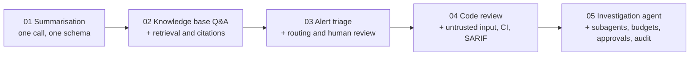

# 20 Real-World Projects

> **Level:** Beginner to Advanced · **Time:** ~25–35 hours for all five · **Exam relevance:** CCAO-F D1, D2, D4, D6 · CCAR-P D1–D7 · CCAR-F D1–D5 · CCDV-F D1, D2, D4, D7, D8

The hands-on labs in [`19-hands-on-labs`](../19-hands-on-labs/README.md) each teach one technique.
These five projects combine many techniques into something you could defend in a design review: a
business problem, requirements, an architecture, a threat model, tests, measurable evaluation criteria,
a dated cost estimate and an honest list of limitations.

Every project runs **offline and free in mock mode** by default, using the shared helper
[`19-hands-on-labs/common/claude_lab.py`](../19-hands-on-labs/common/claude_lab.py). Set
`CLAUDE_LAB_MODE=live` to call the real API.

> **Cost:** requires API credits (live mode). Each project's README estimates the cost per run, dated.

## The projects

| # | Project | Level | What you build | Pattern |
|---|---|---|---|---|
| 01 | [Document summarisation assistant](01-document-summarisation-assistant/README.md) | Beginner | Summaries of long business documents in a fixed structure, checked before use | Single call with structured output |
| 02 | [Knowledge base Q&A assistant](02-knowledge-base-qa-assistant/README.md) | Intermediate | Answers grounded in an internal knowledge base, with citations and "I don't know" behaviour | Retrieval-augmented generation |
| 03 | [Security alert triage assistant](03-security-alert-triage-assistant/README.md) | Intermediate | Classification and prioritisation of security alerts, with human review for risky cases | Workflow with validation and routing |
| 04 | [DevSecOps code review assistant](04-devsecops-code-review-assistant/README.md) | Advanced | Security review of a pull-request diff: deterministic pre-checks plus Claude, de-duplicated, exported as SARIF for CI | Augmented LLM inside a CI pipeline |
| 05 | [Agentic investigation assistant](05-agentic-investigation-assistant/README.md) | Advanced (capstone) | An orchestrator with read-only specialist subagents, an evidence chain, budgets, human approval and an audit trace | Multi-agent, self-hosted loop |

## Difficulty progression



Each project adds one layer of responsibility on top of the previous ones:

1. **Get reliable output from one call.** Prompt structure, structured output, checking `stop_reason`,
   validating before use.
2. **Ground answers in your own data.** Retrieval, citations, refusing to answer outside the sources.
3. **Make decisions that route work.** Classification with confidence, thresholds, human review queues.
4. **Process attacker-controlled input safely in an automated pipeline.** Prompt-injection defences,
   redaction before the API call, rejecting hallucinated output, never auto-applying changes.
5. **Let the model choose its own steps, within limits.** Least-privilege tools per role, budgets,
   policy in code, human approval, evidence and audit you can verify.

If you are new to the API, do labs 01–08 before project 01. Before project 04, do the security labs
(14 and 15). Before project 05, do labs 12, 13 and 19.

## Skills each project builds

| Skill | 01 | 02 | 03 | 04 | 05 |
|---|:-:|:-:|:-:|:-:|:-:|
| Prompt and system-prompt design | ● | ● | ● | ● | ● |
| Structured output and schema validation | ● | ● | ● | ● | ● |
| Retrieval, grounding and citations | | ● | | | ● |
| Classification, confidence and routing | | | ● | ● | ● |
| Human-in-the-loop review | | | ● | ● | ● |
| Prompt-injection defence for untrusted content | | ● | ● | ● | ● |
| Deterministic checks combined with model output | | | ● | ● | ● |
| CI/CD integration (SARIF, exit codes) | | | | ● | |
| Tool use and agent loops | | | | | ● |
| Multi-agent orchestration | | | | | ● |
| Budgets, audit trails and least privilege | | | | ● | ● |
| Evaluation metrics and cost modelling | ● | ● | ● | ● | ● |

## What every project contains

| Part | Purpose |
|---|---|
| `README.md` | Business problem; functional and non-functional requirements; Mermaid architecture; components; data flow; security architecture with a threat model table; example implementation; test strategy; measurable evaluation criteria; deployment and cost considerations; operational limitations; exam relevance. |
| `src/` | The implementation, runnable non-interactively in mock mode. |
| `tests/` | `pytest` tests that run offline, with a `conftest.py` that sets up paths. |
| `data/` | Synthetic data only. Organisations, people, IP addresses and credentials are fictional. |

Run any project's tests from inside its folder:

```bash
cd 20-real-world-projects/04-devsecops-code-review-assistant
CLAUDE_LAB_MODE=mock ../../.venv/bin/python -m pytest tests -q
```

## How to use the projects

- **Read the README before the code.** The requirements and threat model explain why the code is shaped
  the way it is. In a design interview or an architecture exam scenario, that reasoning is what you are
  assessed on.
- **Break things on purpose.** Remove a validation check and see which test fails. Lower a budget and
  see how the system degrades.
- **Run live once you understand mock mode.** Compare the live output with the mock script, then extend
  the synthetic data set and measure against the evaluation criteria.
- **Write your own decision record.** For each project, write a short architecture decision record on
  one trade-off (for example manual loop versus Managed Agents in project 05) using
  [architecture decision records](../13-enterprise-ai-architecture/07-architecture-decision-records.md).

## Exam relevance

The projects are practice for scenario-style reasoning, not copies of exam content. They map most
directly to these objectives (full objective text in
[`16-certification-tracks/registry.yaml`](../16-certification-tracks/registry.yaml)):

| Objective area | Projects |
|---|---|
| CCAO-F-1.1, CCAO-F-2.1, CCAO-F-2.4 (prompting, evaluating outputs, deciding when humans review) | 01, 02, 03 |
| CCAR-P-1.2, CCAR-P-1.3 (end-to-end design, choosing workflow versus agent) | all |
| CCAR-P-1.4 (multi-agent orchestration) | 05 |
| CCAR-P-3.5, CCAR-P-3.6 (RAG design and retrieval strategy) | 02 |
| CCAR-P-4.1, CCAR-P-4.2 (metrics and evaluation datasets) | all |
| CCAR-P-5.1, CCAR-P-5.2, CCAR-P-5.3 (guardrails, failure modes, human in the loop) | 03, 04, 05 |
| CCAR-P-7.2 (AI-assisted developer workflows) | 04 |

## Next steps

- [21 Interview preparation](../21-interview-preparation/README.md): the system design questions build on
  these projects.
- [13 Enterprise AI architecture](../13-enterprise-ai-architecture/README.md) and
  [15 Production operations](../15-production-operations/README.md) for taking a project to production.
- [12 AI security](../12-ai-security/README.md) for the threat-model background used throughout.
